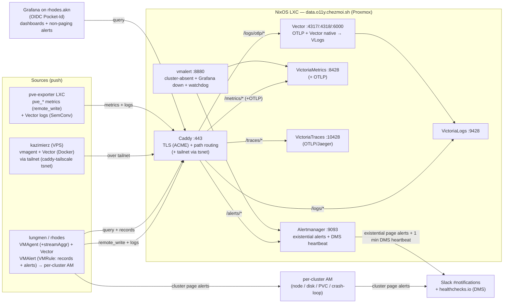

# ADR-013 Observabilité centralisée VictoriaMetrics sur LXC

Migré le 2026-10-11 ; l'état des serveurs n'a pas été revérifié.

Titre d'origine : « Centralized observability stack on a NixOS LXC (VictoriaMetrics) ».

> [!NOTE]\
> **État au 2026-10-11 : décision adoptée et partiellement appliquée.** Le backend central existe dans le dépôt :
> l'appliance NixOS `projects/chezmoi.sh/src/infrastructure/proxmox/lxc/observability/` (`flake.nix`,
> `configuration.nix`, modules `victoriametrics`, `victorialogs`, `victoriatraces`, `vmalert`, `alertmanager`, `caddy`
> et `vector`, règles sous `alerts/`), les jetons Caddy DNS-01 et le client OAuth Tailscale provisionnés par
> `projects/chezmoi.sh/src/infrastructure/pulumi/stack/observability.ts`, un `vmagent` sur le LXC `oci-registry`
> (`.../lxc/oci-registry/modules/vmagent.nix`), le LXC `pve-exporter` et le module partagé
> `catalog/nix/modules/lxc-o11y-agent/`. Grafana tourne sur `rhodes.akn`
> (`projects/rhodes.akn/src/infrastructure/kubernetes/o11y/`, sources de données vers `data.o11y.chezmoi.sh`), et
> `lungmen.akn` pointe vers cette instance (`grafana.external-instance.yaml`). Les agents par cluster, eux, sont absents
> : aucun `VMAgent`, `VMAlert`, `VMRule` ni Vector sous `projects/lungmen.akn/` ou `projects/rhodes.akn/`, et rien de
> tel sous `projects/kazimierz.akn/`. Le statut `implemented` est donc écarté. Le texte ci-dessous est conservé tel que
> décidé : il cite `amiya.akn` et Longhorn, qui n'existent plus dans `projects/`, et une règle Crossplane remplacée
> depuis par Pulumi (voir [ADR-015](./ADR-015-Migrer-Crossplane-vers-Pulumi.md)).

## Contexte et problème

Le homelab Arcane exécute plusieurs clusters Kubernetes (`amiya.akn`, `lungmen.akn`), une passerelle VPS
(`kazimierz.akn`) et un ensemble croissant de LXC Proxmox autonomes (par exemple le registre `oci.chezmoi.sh`). **Aucune
pile d'observabilité n'existe sur aucun d'entre eux.** Il n'y a ni métriques centralisées, ni agrégation de journaux, ni
alertes. La détection des pannes repose entièrement sur une personne qui constate qu'un service est indisponible.

Ce manque n'est pas théorique. Tous les post-mortems récents convergent vers la même cause racine, l'absence de signal :

- **[#1013][]** : le volume de WAL du cluster CloudNative-PG `apps-secured` a atteint 100 % et le cluster est resté hors
  service pendant **quatre jours** avant que quelqu'un s'en aperçoive. Immich et Paperless sont restés indisponibles
  tout ce temps. L'archivage des WAL échouait en silence depuis la création du cluster, 25 jours plus tôt. Une seule
  alerte « disque > 85 % », ou « ContinuousArchiving = false », l'aurait détecté en quelques minutes.
- D'autres incidents (régression du validateur de commits, instabilité de synchronisation d'ArgoCD) reproduisent le même
  schéma : la panne n'était diagnosticable qu'après coup, faute de métriques ou de journaux conservés.

La solution naïve, déployer Prometheus et Grafana dans `lungmen.akn`, comporte un défaut structurel propre à
l'observabilité : **un système de supervision hébergé dans ce qu'il supervise devient aveugle précisément quand il est
le plus nécessaire.** Si la pile avait été dans `lungmen` lors d'un incident de nœud ou d'etcd, elle serait tombée avec
les charges qu'elle devait observer. Le scénario de [#1013][] en est le cas canonique : le cluster lui-même était le
patient.

Le déploiement doit aussi être **multi-cluster dès le premier jour**. `amiya.akn`, `kazimierz.akn` et tout futur cluster
(`shodan.akn`) ont besoin de la même couverture, et leur ajout ne doit pas imposer de repenser l'architecture. Il doit
s'intégrer à l'infrastructure existante (OpenBao pour les identifiants, Pocket-Id pour l'OIDC de Grafana, Longhorn, les
NetworkPolicies Cilium) et respecter les deux règles GitOps non négociables du projet : **déclaratif et versionné**.

La question stratégique à laquelle cet ADR répond est la suivante : **comment déployer une observabilité couvrant tout
le homelab, qui survit à la panne des clusters mêmes qu'elle supervise, reste entièrement déclarative et versionnée,
prend en charge chaque cluster dès le premier jour et demeure assez légère à exploiter pour un seul mainteneur ?**

## Facteurs de décision

### Exigences fonctionnelles

- **Métriques, journaux et alertes** sur chaque cluster et chaque hôte autonome.
- **Découverte des `ServiceMonitor` / `PodMonitor`** : les applications (ArgoCD, CNPG, Longhorn, etc.) fournissent déjà
  ces CRD ; la pile doit les consommer sans configuration de scrape sur mesure.
- **Alertes de bout en bout** pour des conditions réelles : nœud hors service, disque > 85 % (la classe de [#1013][]),
  `CrashLoopBackOff` > 5 min.
- **Tableaux de bord Grafana** pour la visualisation et les alertes sans paging (SLO, avertissements).
- **Vector comme pipeline de transfert et de conversion des journaux** : objectif affiché, les journaux des Pods
  transitent par Vector jusqu'au backend de stockage.

### Exigences non fonctionnelles

- **Indépendance du domaine de panne** : la pile doit continuer à collecter et à alerter quand un cluster supervisé (ou
  son nœud) est hors service.
- **Multi-cluster sans refonte** : ajouter un cluster revient à déployer un agent de collecte, pas à changer
  d'architecture.
- **Corrélation inter-clusters** : comparer et croiser les signaux entre clusters.
- **Déclaratif et versionné** : les règles GitOps n° 1 et n° 2 sont non négociables.
- **Légèreté d'exploitation** : un seul mainteneur ; composants stables, mises à jour peu fréquentes, un minimum
  d'éléments mobiles.
- **Contrôle d'accès proportionné** : tenir les hôtes non autorisés à l'écart de la surface d'ingestion et de requête,
  sans imposer une gestion d'identifiants dont le coût dépasse le bénéfice pour un homelab à propriétaire unique.

### Contraintes

- **Les compétences existantes sont orientées Prometheus** : aucune expérience préalable de ClickHouse (d'après
  [#1018][]).
- **Proxmox est le substrat** : les clusters tournent en VM ; les services autonomes tournent déjà en LXC NixOS
  (précédent `oci.chezmoi.sh`, voir le raisonnement voisin de l'ADR-008).
- **`kazimierz.akn` n'est pas Kubernetes** : c'est un VPS autonome (ADR-008 ; NixOS depuis l'ADR-016, Ansible et Docker
  Compose à la rédaction de cet ADR), joignable uniquement par Tailscale. Tout modèle « un agent par cluster » doit
  s'accommoder d'une cible distante hors Kubernetes.
- **Budget de ressources d'un seul mainteneur** : aucune envie d'exploiter un cluster de stockage multi-nœuds pour un
  homelab.

## Options envisagées

La décision se décompose selon deux axes indépendants : le **backend de stockage** et la **topologie de déploiement**.

### Option A : pile VictoriaMetrics (backend de stockage)

> **Statut : ACCEPTÉE**

Une suite de binaires Go à usage unique : VictoriaMetrics (TSDB de métriques), VictoriaLogs (stockage de journaux),
vmagent (scraper compatible Prometheus et agent de remote-write), vmalert (évaluation des règles) et vmauth (proxy
d'authentification et de routage). L'opérateur VictoriaMetrics lit nativement les CRD du Prometheus Operator
(`ServiceMonitor`, `PodMonitor`, `PrometheusRule`) et les traduit : l'écosystème existant, orienté Prometheus,
fonctionne tel quel, **sans exploiter Prometheus lui-même**. Chaque binaire est petit, adossé à des fichiers et sobre en
mémoire.

- `+` Compatible Prometheus : pas de nouveau langage de requête pour les métriques, écart de compétences minimal.
- `+` Prise en charge native des `ServiceMonitor` / `PodMonitor` via l'opérateur.
- `+` Léger en ressources : le binaire mono-nœud couvre l'échelle d'un homelab en bien moins de 1,5 Go.
- `+` Mature, bien documenté, packagé dans nixpkgs.
- `+` Journaux et métriques utilisent des stockages distincts, conçus pour leur usage : un chemin lent ne peut pas
  bloquer l'autre.
- `-` Trois à cinq composants à raccorder (atténué : ce sont des binaires uniques à la configuration triviale).

### Option B : pile ClickHouse (backend de stockage)

> **Statut : REJETÉE**

Une base OLAP en colonnes qui reçoit journaux, métriques et traces via OpenTelemetry ou Vector, interrogée par Grafana.
L'attrait est un stockage _unique_ qui unifie tous les types de signaux avec des requêtes analytiques rapides.

- `+` Stockage unifié des journaux, des métriques et des traces.
- `+` Excellentes performances de requêtes analytiques sur de très gros volumes.
- `-` **Aucune expérience préalable** : un changement de paradigme SQL/OLAP pour la supervision opérationnelle, en
  contradiction directe avec la contrainte d'un seul mainteneur.
- `-` Pas de prise en charge native des `ServiceMonitor` : Prometheus ou un adaptateur sur mesure resterait nécessaire,
  ce qui _ajoute_ un composant pour résoudre un problème que l'option A règle nativement.
- `-` Lourd : ClickHouse seul réclame 2 à 4 Go, soit plusieurs fois l'empreinte de l'option A.
- `-` Outillage Kubernetes et autonome immature comparé à l'opérateur VictoriaMetrics.
- `-` Le stockage unifié couple les modes de panne : un ClickHouse dégradé emporte les journaux _et_ les métriques en
  même temps.

### Option 1 : dans chaque cluster (topologie de déploiement)

> **Statut : REJETÉE**

Déployer la pile complète dans chaque cluster (par exemple dans `lungmen.akn`), avec les données sur des PVC Longhorn.

- `+` Intégration GitOps la plus simple : quelques applications ArgoCD de plus.
- `+` Découverte de services native dans le cluster.
- `-` **Défaut fatal : le superviseur partage le domaine de panne du supervisé.** Un incident de nœud, d'etcd ou de
  Longhorn rend l'observabilité aveugle précisément quand elle est nécessaire, le scénario de [#1013][].
- `-` Aucune vue unique ; la corrélation entre clusters est manuelle.
- `-` `kazimierz` (hors Kubernetes) ne peut pas l'héberger ainsi du tout.

### Option 2 : collecte par cluster, lecture fédérée (topologie de déploiement)

> **Statut : REJETÉE**

Chaque cluster garde un stockage local ; un Grafana central fédère les lectures sur l'ensemble.

- `+` Aucune dépendance inter-clusters pour la collecte ; chaque cluster est autonome.
- `-` Place toujours le stockage dans chaque domaine de panne observé (exposition partielle au scénario de [#1013][]).
- `-` La corrélation inter-clusters est difficile : les requêtes fédérées se dispersent sur N stockages sans index
  partagé.
- `-` N stockages à exploiter, sauvegarder et régler, l'inverse de la légèreté d'exploitation.

### Option 3 : LXC NixOS centralisé sur Proxmox (topologie de déploiement)

> **Statut : ACCEPTÉE**

Un seul LXC NixOS non privilégié sur l'hôte Proxmox exécute tout le backend de stockage et d'alerte (VictoriaMetrics,
VictoriaLogs, vmalert, Alertmanager), derrière Caddy (TLS et routage par chemin). Chaque cluster n'exécute que des
_agents de collecte_ légers (vmagent pour les métriques, Vector pour les journaux) qui poussent vers le LXC. L'image est
construite de façon déclarative à partir d'un flake Nix, avec la même rigueur as-code qu'un manifeste Kubernetes, en
réutilisant le schéma éprouvé du LXC `oci.chezmoi.sh`.

- `+` **Domaine de panne indépendant** : survit à la panne d'un cluster quel qu'il soit et continue d'alerter. Permet
  aussi de superviser l'hôte Proxmox et les autres LXC.
- `+` **Multi-cluster dès le premier jour** : ajouter un cluster revient à déployer des agents pointés vers le LXC, sans
  refonte.
- `+` **Corrélation centralisée** : un stockage plat unique, des jointures inter-clusters triviales.
- `+` **Déclaratif et versionné** via un flake Nix ; signé GPG, relu.
- `+` **Léger à exploiter** : une seule appliance à sauvegarder et à mettre à jour.
- `-` Point de défaillance unique pour le _backend_ (atténué : les agents tamponnent sur disque et rattrapent à la
  reconnexion ; un Dead-Man's-Switch externe détecte la mort de l'appliance).
- `-` À état, contrairement au LXC du registre sans état : exige un vrai volume de données et des sauvegardes.
- `-` Les ports d'ingestion doivent être exposés (contre une écoute limitée au loopback pour le registre), ce qui fait
  passer l'authentification d'optionnelle à obligatoire.

## Décision retenue

**Option retenue : « la pile VictoriaMetrics (option A) sur un LXC NixOS centralisé (option 3) »**, parce que les deux
choix se renforcent mutuellement : les composants mono-binaire et adossés à des fichiers de VictoriaMetrics sont
exactement ce qui rend viable une appliance à LXC unique, et la topologie centralisée est exactement là où le
remote-write compatible Prometheus excelle. Les quatre arguments qui suivent détaillent cette justification.

### 1. Indépendance du domaine de panne observé

C'est le facteur décisif. Le constat récurrent des post-mortems n'est pas « il manquait un tableau de bord », c'est «
aucun signal pendant l'incident ». Une pile dans les clusters (options 1 et 2) reproduit la panne d'origine : elle peut
tomber avec ce qu'elle surveille. Le LXC centralisé se trouve dans un domaine de panne distinct sur le substrat Proxmox
: la panne d'un nœud `lungmen` n'arrête ni la collecte ni l'alerte des autres clusters, et l'appliance peut observer
l'hôte et les LXC voisins, ce qu'aucune pile dans un cluster ne pourrait faire. Le risque résiduel, la mort de
l'appliance elle-même, est couvert par un Dead-Man's-Switch externe (voir
[Décisions de conception associées](#décisions-de-conception-associées)), qui transforme un angle mort silencieux en
page active.

### 2. Prise en charge des ServiceMonitor sans exploiter Prometheus

Le parc émet déjà des CRD `ServiceMonitor` / `PodMonitor`. L'opérateur VictoriaMetrics les consomme nativement et
configure un `VMAgent` par cluster qui fait du remote-write vers l'appliance. ClickHouse aurait exigé de monter
Prometheus _de toute façon_ pour relayer ces CRD, ajoutant le composant même que son argument de « stockage unifié »
prétend supprimer. L'option A retire un composant ; l'option B en ajoute un.

### 3. Multi-cluster dès le premier jour, corrélation offerte

Un critère d'acceptation de [#1018][] est que l'ajout d'`amiya` et de `kazimierz` ne demande « aucune refonte, seulement
des agents de collecte ». Le modèle centralisé le satisfait à la lettre : un nouveau cluster déploie un `VMAgent`, un
`VMAlert` et Vector (ou, pour `kazimierz`, les équivalents Docker via Tailscale) pointés vers `o11y.chezmoi.sh`, avec
ses règles sous forme de CRD `VMRule` dans son propre dépôt. Comme le backend est un stockage mono-nœud indexé par une
étiquette externe `cluster` (plutôt que par une multi-location stricte), la corrélation inter-clusters est une requête
sans étiquette à joindre, pas une dispersion sur des stockages fédérés. Une multi-location stricte aurait exigé le
`vmcluster`, plus lourd, et rendu la corrélation _plus difficile_ : le mauvais compromis pour un homelab.

### 4. Du déclaratif as-code sans Kubernetes

L'objection initiale à un déploiement hors Kubernetes était « cela viole GitOps ». Ce n'est pas le cas : un flake NixOS
est déclaratif et versionné, donc conforme aux règles GitOps n° 1 et n° 2, et le LXC `oci.chezmoi.sh` prouve déjà le
schéma (images signées GPG, relues, reproductibles). L'exigence n'est pas Kubernetes, c'est _déclaratif et versionné_.
Héberger le backend hors de Kubernetes est ce qui procure le facteur n° 1 (indépendance du domaine de panne) sans coût
pour les principes GitOps. Ce raisonnement reprend celui de l'ADR-008, où quitter Kubernetes était le bon choix pour une
charge que Kubernetes servait mal.

## Conséquences

### Positives

- (+) **Signal résilient** : l'observabilité survit à la panne de n'importe quel cluster supervisé.
- (+) **Couverture de tout le parc** : clusters, hôte Proxmox et LXC autonomes au même endroit.
- (+) **Classe [#1013][] détectée** : les règles disque > 85 %, projection `predict_linear` sur 24 h et PVC < 15 % se
  déclenchent en quelques minutes au lieu de quelques jours.
- (+) **Friction d'ingestion faible** : les `ServiceMonitor` existants sont scrapés automatiquement.
- (+) **Croissance multi-cluster peu coûteuse** : intégrer un cluster revient à déployer des agents.
- (+) **Léger à exploiter** : une appliance ; composants mono-binaire ; mises à jour suivies par nixpkgs.

### Négatives

- (-) **SPOF du backend** : une panne de l'hôte Proxmox ou du LXC arrête la collecte centrale (atténué par le tampon
  disque côté agent et le Dead-Man's-Switch externe ; pas de haute disponibilité, par conception).
- (-) **Appliance à état** : contrairement au LXC du registre, le volume de données doit être sauvegardé (snapshot
  Proxmox quotidien du jeu de données `mp0`).
- (-) **Ingestion exposée, sans authentification** : le port 443 accepte le trafic du sous-réseau autorisé sans
  vérification d'identifiants, si bien que tout hôte de ce sous-réseau peut lire et écrire toutes les données. La règle
  de pare-feu Proxmox par CIDR source est la seule frontière et doit rester stricte ; toute exposition au-delà du réseau
  de confiance exige de réintroduire d'abord `vmauth`.
- (-) **L'évaluation des règles par cluster dépend du stockage central** : le vmalert d'un cluster interroge le VM
  central, donc une partition cluster↔LXC suspend l'évaluation des règles applicatives de ce cluster (atténué : les
  règles existentielles du LXC et les deux heartbeats couvrent encore les cas qui comptent ; la notification reste
  centrale et indépendante).
- (-) **Alertmanager doit être exposé** : `/alerts` est joignable via Caddy (restreint par CIDR, sans authentification)
  pour que les vmalert des clusters puissent le notifier ; une surface de plus à garder derrière le pare-feu.
- (-) **Outillage scindé** : le backend d'observabilité vit hors du flux Kubernetes / ArgoCD (cohérent avec les
  précédents `oci.chezmoi.sh` et `kazimierz`).

### Neutres

- (\~) **Tailscale via caddy-tailscale (tsnet, sans TUN noyau)** : Tailscale est embarqué dans le processus Caddy en
  réseau utilisateur ; aucun passage de `/dev/net/tun` ni de démon `tailscaled` n'est nécessaire. L'état tsnet persiste
  sur le volume de données `mp0` (`/persistent/caddy`), si bien que les reconstructions d'image ne ré-enregistrent pas
  le nœud du tailnet.
- (\~) **Étiquette `cluster` plutôt que multi-location** : isolation suffisante pour un homelab à propriétaire unique ;
  la séparation des données n'était pas un objectif avec un seul opérateur.
- (\~) **Grafana hors de l'appliance** : la visualisation et les alertes riches vivent là où l'itération est peu
  coûteuse (as-code, sans reconstruction du LXC) ; le chemin d'alerte existentiel reste découplé dans le LXC.
- (\~) **`kazimierz` utilise des agents Docker via Tailscale** : un cas particulier documenté, pas une seconde
  architecture.

## Détails de mise en œuvre et état

### Architecture

### Décisions de conception associées

Ces choix découlent directement des deux décisions principales ; ils sont consignés ici parce qu'ils façonnent la
posture de sécurité et de fiabilité :

- **VM mono-nœud et étiquette externe `cluster`, pas de multi-location.** VictoriaMetrics mono-nœud n'a pas de tenants ;
  une multi-location stricte imposerait `vmcluster` (3 composants ou plus), excessif pour un homelab et _pire_ pour la
  corrélation. Chaque série porte une étiquette `cluster` posée par l'émetteur ; un seul Alertmanager route dessus.
- **Pas d'authentification d'ingestion ni de requête : pare-feu de l'hôte Proxmox par CIDR source.** La frontière
  d'accès est le pare-feu PVE (CIDR du homelab et de Tailscale) ; tous les backends écoutent en loopback derrière Caddy.
  Pour un homelab à propriétaire unique, la frontière de sous-réseau suffit, et elle supprime un composant entier
  (vmauth) ainsi que la chaîne de génération, distribution et rotation des identifiants via OpenBao. Le compromis
  accepté est que tout hôte du sous-réseau autorisé peut lire _et_ écrire ; réintroduire une authentification par
  identifiant revient à placer `vmauth` devant les backends si l'appliance est un jour exposée au-delà du réseau de
  confiance.
- **Chemins propres, versionnés et typés par signal.** Caddy gère l'ACME DNS-01 et route un schéma `/<signal>/*` :
  `/metrics/*` vers VictoriaMetrics, `/logs/*` vers VictoriaLogs, `/traces/*` vers VictoriaTraces, `/alerts/*` vers
  Alertmanager. Dans `/logs/*`, la sous-route plus précise `/logs/otlp/*` est interceptée par le Vector côté appliance
  (ingestion OTLP HTTP sur `:4318`) avant que le chemin générique `/logs/*` n'atteigne VictoriaLogs. Les préfixes de VM,
  VLogs et VTraces sont retirés (ils servent à la racine) ; Alertmanager garde le sien via `--web.route-prefix`. Même
  module Caddy que le LXC `oci.chezmoi.sh`.
- **Trois signaux dès le premier jour (métriques, journaux, traces).** VictoriaTraces est déployé avec VM et VLogs
  maintenant plutôt que différé : le coût marginal sur l'appliance est un service mono-binaire de plus, et livrer les
  trois évite de retoucher plus tard le schéma de chemins, le pare-feu et les sources de données Grafana.
- **Métriques de l'hôte et des invités Proxmox via le LXC `pve-exporter`.** Un LXC `pve-exporter` dédié exécute
  prometheus-pve-exporter, qui scrape l'API Proxmox pour les métriques `pve_*` (disque, CPU, disponibilité de l'hôte et
  des invités) et les envoie en remote-write à l'appliance avec `cluster=pve`. Le même LXC gère l'ingestion syslog (voir
  le point sur Vector). L'envoi OTEL de Proxmox n'est pas encore actif ; s'il l'est plus tard, il enverrait de l'OTLP
  vers `…/metrics/opentelemetry/v1/metrics` sans autre changement.
- **Règle de routage : page vers Alertmanager (deux niveaux) ; sinon vers Grafana.** Chaque cluster exécute **son
  propre** Alertmanager, qui reçoit les alertes de niveau page de son vmalert (nœud, disque, PVC, crash-loop, etc.).
  L'**Alertmanager du LXC** est réservé à ce que seul le point de vue central peut détecter : **cluster absent, Grafana
  hors service, et le watchdog / DMS**, de sorte que le paging survit à une panne de cluster. Tout ce qui ne déclenche
  pas de page (avertissements, informations, SLO par application) est évalué et routé par **Grafana**, dont les points
  de contact et politiques de notification sont bien plus simples à exploiter que les récepteurs d'Alertmanager.
- **Règles d'enregistrement et alertes de page des clusters : vmalert et Alertmanager par cluster.** Chaque cluster
  exécute un vmalert (opérateur VictoriaMetrics, lecture des `VMRule` / `PrometheusRule`) qui évalue les **règles
  d'enregistrement** du cluster (Grafana ne peut pas les persister) et ses alertes **dignes d'une page** contre le VM
  central, réécrit les enregistrements et notifie son **propre Alertmanager** (pas celui du LXC central). Les règles
  vivent dans le dépôt ArgoCD du cluster : un changement est un commit GitOps ordinaire, sans reconstruction du LXC. La
  réduction de cardinalité en périphérie est l'agrégation de flux de `vmagent`, par cluster. Le vmalert du LXC reste
  _minimal_ : seulement ce qui exige le point de vue central et doit alerter même quand l'objet observé a disparu :
  **cluster absent, Grafana hors service, et le watchdog / DMS**. Les gardes nœud, disque, PVC et crash-loop (dont la
  garde disque de [#1013][]) sont des `VMRule` par cluster, évaluées côté cluster et notifiées via l'Alertmanager du
  cluster. _Compromis résiduel : le vmalert d'un cluster interroge le VM central, donc une partition cluster↔LXC suspend
  l'évaluation des règles de ce cluster, mais la règle « cluster absent » du LXC alerte quand même._
- **Appartenance à Tailscale via caddy-tailscale (OAuth, `tag:o11y`).** Le LXC rejoint le tailnet pour que les sources
  hors LAN, notamment le VPS `kazimierz.akn`, envoient métriques et journaux et notifient Alertmanager par le tailnet
  chiffré plutôt que par un point d'accès public. Tailscale est embarqué directement dans Caddy avec **caddy-tailscale**
  (tsnet, réseau utilisateur) : ni démon `tailscaled` séparé, ni passage de `/dev/net/tun`. L'écouteur tsnet tourne dans
  le processus Caddy ; les backends en loopback restent inaccessibles depuis le tailnet. L'état tsnet est stocké dans
  `/persistent/caddy` (le volume de données `mp0`) et survit aux reconstructions d'image : le nœud ne se ré-enregistre
  pas. Le secret du client OAuth est un secret intégré à l'image, sur le modèle du jeton Cloudflare.
- **Deux niveaux d'Alertmanager : un par cluster et un sur le LXC.** Chaque cluster exécute son propre Alertmanager pour
  les alertes de page propres au cluster (routées par le vmalert du cluster). L'Alertmanager du LXC ne traite que ce qui
  survit à une panne de cluster : cluster absent, Grafana hors service et le DMS du watchdog. Il est exposé via Caddy
  sous `/alerts` (restreint par CIDR, sans authentification) ; le vmalert du LXC l'atteint par le loopback.
  L'authentification de Grafana reste l'OIDC Pocket-Id (ADR-005), avec un administrateur local de secours.
- **Vector pour les journaux, vmagent pour les métriques.** Vector opère à deux niveaux : (1) un **agent de périphérie**
  (DaemonSet sur les clusters Kubernetes, Docker sur kazimierz) envoie les journaux à l'appliance par le protocole natif
  de Vector (`:6000`) ; (2) un **Vector côté appliance** reçoit les événements structurés (OTLP HTTP/gRPC et Vector
  natif depuis les agents des clusters et le LXC `pve-exporter`), valide la SemConv, convertit au format proche de Loki
  et pousse vers VictoriaLogs. L'appliance n'exécute pas d'écouteur syslog : ce rôle revient au LXC `pve-exporter`
  dédié, qui analyse la RFC 5424 en champs SemConv et les transmet ici par le protocole natif de Vector. Les métriques
  restent volontairement sur vmagent (sans passer par Vector) pour préserver la découverte native des `ServiceMonitor`.
- **Dead-Man's-Switch : Alertmanager du LXC vers healthchecks.io.** L'alerte Watchdog se déclenche toujours ;
  l'Alertmanager du LXC la route vers le récepteur `deadman`, qui ping healthchecks.io chaque minute. Si l'appliance,
  vmalert ou Alertmanager meurt, le heartbeat s'arrête et healthchecks.io alerte l'opérateur. C'est le seul chemin DMS :
  Grafana n'y participe pas. L'URL du heartbeat est `ALERTMANAGER_DEADMAN_URL` (intégrée à la construction depuis
  `observability.sops.env`).

Une liste de contrôle normative concise (le _pourquoi_ figure dans les décisions de conception associées ci-dessus) :

- **Étiquette `cluster`** : chaque source DOIT poser `cluster=<nom>` (étiquette externe des métriques, champ de flux des
  journaux). L'auto-scrape utilise la valeur réservée `cluster=o11y-appliance`.
- **Chemins d'entrée** : `/metrics/*`, `/logs/*`, `/traces/*`, `/alerts/*`. Un seul schéma, versionné, typé par signal.
- **Routage des alertes** : _alertes de page des clusters vers l'Alertmanager du cluster (via le vmalert du cluster /
  `VMRule`) ; alertes existentielles (cluster absent, Grafana hors service, watchdog) vers l'Alertmanager du LXC puis
  healthchecks.io et Slack ; sans page vers Grafana._ Les règles d'enregistrement sont toujours des `VMRule`, jamais
  Grafana. Grafana ne joue aucun rôle dans le chemin du DMS.
- **Étiquettes Tailscale** : le nœud Tailscale porte `tag:o11y`.

### État

- **Terminé et déployé :** le LXC (`data.o11y.chezmoi.sh`, anciennement `o11y.chezmoi.sh`, renommé pour libérer ce nom
  pour Grafana, voir plus bas) est en service sur Proxmox : flake NixOS, modules de services (VictoriaMetrics et OTLP,
  VictoriaLogs, VictoriaTraces, vmalert existentiel, Alertmanager exposé sous `/alerts`, Caddy avec routage par chemin
  `/<signal>` et caddy-tailscale tsnet, pipeline Vector côté appliance, durcissement), règles d'alerte existentielles
  (watchdog, auto-surveillance, disponibilité des clusters dont Grafana hors service, disque via pve-exporter, hôte et
  invités PVE, registre OCI), tâches mise de construction, d'envoi et de mise à jour, et le jeton Cloudflare DNS-01 et
  le client OAuth Tailscale (provisionnés par Pulumi, voir `stack/observability.ts`). **Grafana, clos par [#1159][] :**
  Grafana Operator sur chaque cluster, instance unique sur `rhodes.akn` (`o11y.chezmoi.sh`), sources de données de
  métriques, journaux et traces vers cette appliance, tableaux de bord, routage des alertes sans page et deadman côté
  Grafana.
- **En attente :** déployer côté cluster `VMAgent` (avec streamAggr facultatif), `VMAlert` et `VMRule`, Vector et
  l'export des traces (ainsi que les équivalents Docker de `kazimierz`) ; configurer l'envoi OTEL de Proxmox ; produire
  `architecture.svg`. Suivi dans les phases restantes de [#1018][].

> [!NOTE]\
> **Constat au 2026-10-11 sur les règles de disponibilité.**
> `projects/chezmoi.sh/src/infrastructure/proxmox/lxc/observability/alerts/cluster-availability.rules.yaml` contient
> encore une règle `ClusterAbsent` pour `cluster="amiya"` (avec `GrafanaDown`, dont la description dit que Grafana vit
> sur amiya), alors qu'`amiya.akn` n'existe plus dans `projects/` et que Grafana tourne sur `rhodes.akn`. Il n'existe
> aucune règle pour `rhodes`. Aucune correction n'est faite dans cet ADR : le code n'est pas modifié ici.

## Évolution de la décision

- **2026-06-04** : Décision initiale : pile VictoriaMetrics sur un LXC NixOS centralisé (voir l'historique des
  modifications pour le détail).
- **2026-06-15** : Alignement sur l'implémentation d'amorçage, sans changement d'option : Tailscale via caddy-tailscale
  tsnet, Vector côté appliance, syslog déplacé vers le LXC `pve-exporter`, Alertmanager par cluster et Alertmanager du
  LXC limité aux alertes existentielles et au DMS.

## Historique des modifications

- _2026-10-11_ : **CHORE** : Migration vers le gabarit d'ADR 2.0.0 (version française) : traduction, sections renommées,
  sommaire manuel supprimé, titre aligné sur le nom de fichier, sous-niveaux `####` aplatis en `###`, section
  `Pour aller plus loin`, émojis des conséquences remplacés par les marqueurs du gabarit (les deux points à marqueur
  d'engrenage deviennent `(-)` pour l'exposition d'Alertmanager et `(~)` pour tsnet, déplacé en Neutres),
  `template-version` ajouté, section `Évolution de la décision` extraite de l'historique existant. Décision, options,
  chronologie et dates d'origine inchangées.
- _2026-10-11_ : **CLARIFICATION** : `status` maintenu à `accepted`, sans `implementation-completed`, d'après le dépôt.
  Le backend central existe (appliance `lxc/observability/`, stack Pulumi `stack/observability.ts`, `vmagent` du LXC
  `oci-registry`, LXC `pve-exporter`, module `catalog/nix/modules/lxc-o11y-agent/`, Grafana sur `rhodes.akn`), mais les
  agents par cluster (`VMAgent`, `VMAlert`, `VMRule`, Vector) sont absents de `projects/lungmen.akn/`,
  `projects/rhodes.akn/` et `projects/kazimierz.akn/`. Ajout de la note `> [!NOTE]` en tête, constat sur la règle
  `ClusterAbsent` d'`amiya` dans `cluster-availability.rules.yaml`, et mise à jour de `date`. Les sections du corps
  n'ont pas été réécrites.
- _2026-06-15_ : **CLARIFICATION** : Alignement sur l'implémentation d'amorçage et correction de l'architecture :
  Tailscale via **caddy-tailscale tsnet** (pas de `/dev/net/tun`, pas de `tailscaled`, état persisté dans
  `/persistent/caddy`) ; pipeline Vector côté appliance (ingestion OTLP et Vector natif, validation SemConv) ; écouteur
  syslog déplacé vers le LXC `pve-exporter` ; sous-route `/logs/otlp/*` interceptée par Vector ; canal de page fixé sur
  Slack (#notifications) ; **Alertmanager par cluster** pour les alertes propres aux clusters (vmalert du cluster vers
  son propre AM, pas le central) ; **AM du LXC** limité aux alertes existentielles (cluster absent, Grafana hors
  service, watchdog) et au heartbeat DMS ; **DMS : AM du LXC vers healthchecks.io uniquement** (Grafana hors du chemin
  DMS) ; métriques PVE via le LXC `pve-exporter` (envoi OTEL non actif) ; mermaid mis à jour partout.
- _2026-06-04_ : **FEATURE** : **ACCEPTÉE** : pile VictoriaMetrics (métriques, journaux et traces) sur un LXC NixOS
  centralisé ; mono-nœud et étiquette `cluster` ; pas d'authentification d'ingestion (pare-feu Proxmox par CIDR source
  et tailnet) ; routage Caddy `/<signal>` ; ingestion OTEL/OTLP de Proxmox ; appartenance à Tailscale (`tag:o11y`) pour
  les sources hors LAN, le jeton APIToken Cloudflare et le client OAuth Tailscale étant provisionnés via Crossplane ;
  `VMRule` par cluster pour les enregistrements et alertes de page avec « page vers Alertmanager, sinon vers Grafana » ;
  vmalert du LXC limité aux règles existentielles (cluster ou Grafana hors service, watchdog) ; deux Dead-Man's-Switch
  (service externe à définir).

## Pour aller plus loin

- [ADR-001 Gestion centralisée des secrets](./ADR-001-Gestion-Centralisee-des-Secrets.md) : OpenBao porte les secrets de
  l'appliance (jeton Cloudflare, clé OAuth Tailscale, URL d'Alertmanager).
- [ADR-002 Topologie des secrets OpenBao](./ADR-002-Topologie-des-Secrets-OpenBao.md) : l'emplacement des secrets
  d'observabilité.
- [ADR-005 Authentification OIDC par Envoy Gateway](./ADR-005-Authentification-OIDC-par-Envoy-Gateway.md) : le modèle
  OIDC Pocket-Id de Grafana.
- [ADR-008 Ansible plutôt que Kubernetes pour Kazimierz](./ADR-008-Ansible-plutot-que-Kubernetes-pour-Kazimierz.md) :
  précédent pour quitter Kubernetes quand il ne sert pas la charge ; le modèle d'agent de `kazimierz` en découle.
- [ADR-015 Migrer Crossplane vers Pulumi](./ADR-015-Migrer-Crossplane-vers-Pulumi.md) : le remplacement de Crossplane
  cité dans la décision initiale.
- [README du LXC d'observabilité](../../projects/chezmoi.sh/src/infrastructure/proxmox/lxc/observability/README.md) et
  [README du LXC `oci-registry`](../../projects/chezmoi.sh/src/infrastructure/proxmox/lxc/oci-registry/README.md), sur
  lequel il est modelé : l'implémentation.
- [Mettre à jour un LXC par échange du rootfs](../procedures/infrastructure/INF-20260605-00-Mettre-a-Jour-un-LXC-par-Echange-du-Rootfs.md)
  : la mise à jour de l'appliance.
- [#1013 : volume de WAL `apps-secured` plein, cluster hors service plus de 4 jours][#1013] : l'incident déclencheur.
- [#1018 : déployer la pile d'observabilité pour métriques, journaux et alertes][#1018] : l'issue de suivi.
- [Opérateur VictoriaMetrics, intégration Prometheus](https://docs.victoriametrics.com/operator/integrations/prometheus/)
  : la lecture des CRD Prometheus.
- [VictoriaLogs](https://docs.victoriametrics.com/victorialogs/) : le stockage des journaux.
- [vmalert](https://docs.victoriametrics.com/vmalert/) : l'évaluation des règles.
- [Agrégation de flux de vmagent](https://docs.victoriametrics.com/stream-aggregation/) : la réduction de cardinalité en
  périphérie.
- [Clients OAuth Tailscale](https://tailscale.com/kb/1215/oauth-clients) : l'authentification du LXC sur le tailnet.
- [Vector](https://vector.dev/docs/) : le pipeline de journaux.
- [Alertmanager, motif Watchdog / Dead-Man's-Switch](https://prometheus.io/docs/alerting/latest/configuration/) : le
  heartbeat de l'appliance.

<!-- Issue reference links -->

[#1013]: https://github.com/chezmoidotsh/arcane/issues/1013
[#1018]: https://github.com/chezmoidotsh/arcane/issues/1018
[#1159]: https://github.com/chezmoidotsh/arcane/issues/1159
