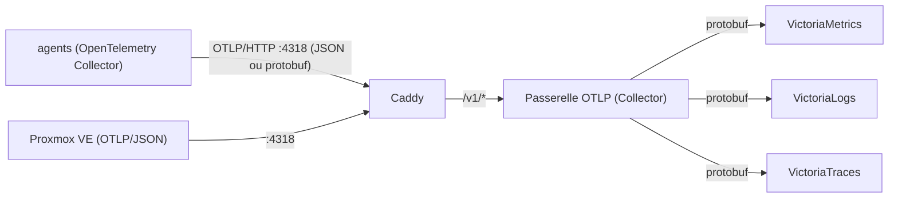

# ADR-018 OTLP comme protocole d'ingestion unique pour l'appliance d'observabilité

## Contexte et problème

L'appliance d'observabilité centrale ([ADR-013](./ADR-013-Observabilite-Centralisee-VictoriaMetrics-sur-LXC.md)) reçoit
les signaux des LXC et, à terme, des clusters. Telle que décidée par l'ADR-013, elle acceptait trois protocoles d'entrée
: le protocole natif de Vector (`:6000`) pour les journaux, `remote_write` Prometheus pour les métriques, et OTLP pour
les traces. Un Vector central, placé devant VictoriaLogs, validait les événements (conformité SemConv), les
convertissait au format attendu par VictoriaLogs et alimentait un second `vmalert` chargé d'alerter sur les rejets de
validation. Côté LXC, le module partagé `catalog.lxcAgent` (devenu `catalog.o11yAgent`) embarquait lui aussi Vector,
avec des analyseurs par service (Zap pour Omni, zot, Caddy, syslog) écrits en VRL.

Ce montage pose trois problèmes :

- **Un format intermédiaire maison.** Les événements circulaient dans un format interne de Vector, proche d'OTLP mais
  propre à ce dépôt. L'agent et le Vector central devaient rester d'accord sur ce format ; une dérive d'un côté se
  traduisait par des rejets de validation, d'où le `vmalert` dédié.
- **Trois protocoles pour trois signaux.** Les métriques passaient par `remote_write`, les journaux par Vector, les
  traces par OTLP. Chaque source devait choisir et configurer trois chemins différents.
- **Un composant de plus à exploiter.** Le Vector central, ses tests, ses tâches `mise` et sa validation SemConv étaient
  de la maintenance pour un gain faible : VictoriaMetrics, VictoriaLogs et VictoriaTraces ingèrent désormais OTLP
  nativement.

La question stratégique à laquelle cet ADR répond est la suivante : **quel protocole d'ingestion l'appliance
d'observabilité expose-t-elle, avec quel agent côté LXC, et que devient le Vector central ?**

## Hors périmètre

- **Les alertes** : le modèle à deux niveaux (Alertmanager par cluster, Alertmanager du LXC pour l'existentiel) de
  l'ADR-013 est inchangé. Seul le `vmalert` du LXC change : il n'évalue plus que la règle Watchdog.
- **Les agents par cluster** : ils ne sont pas déployés ; cet ADR fixe seulement le contrat d'ingestion qu'ils devront
  respecter.
- **Le contrôle d'accès** : toujours le pare-feu Proxmox par CIDR source et le tailnet, sans authentification.

## Facteurs de décision

- **Exigences fonctionnelles** : recevoir métriques, journaux et traces des LXC aujourd'hui, des clusters demain ;
  conserver l'identité de l'hôte (`host.name`) et du service (`service.name`) sur tous les signaux pour la corrélation.
- **Exigences non fonctionnelles** : un seul protocole standard ; peu de composants à exploiter sur l'appliance ;
  tolérance aux indisponibilités de l'appliance sans perte de télémétrie ; surface d'écriture réduite.
- **Contraintes** : les agents tournent dans des LXC NixOS sans privilèges (empreinte mémoire faible) ; la lecture du
  journal systemd est indispensable (aucun agent de fichiers de journaux ne s'applique) ; VictoriaMetrics, VictoriaLogs
  et VictoriaTraces n'ingèrent que l'OTLP/HTTP en protobuf, alors que le serveur de métriques OpenTelemetry de Proxmox
  VE émet de l'OTLP/JSON.

## Options envisagées

### Option 1 : conserver Vector (central et agents) et ses protocoles

> **Statut : REJETÉE**

Statu quo : agents Vector, protocole natif de Vector pour les journaux, `remote_write` pour les métriques, Vector
central pour la validation et la conversion.

- `+` Aucun changement ni coupure.
- `+` Analyseurs VRL par service déjà écrits.
- `-` Format intermédiaire maison à maintenir des deux côtés.
- `-` Gestion OTLP des métriques et des traces faible dans Vector : les trois signaux ne peuvent pas partager le même
  chemin.
- `-` Un composant central de plus (Vector, tests, validation SemConv, second `vmalert`).

### Option 2 : OTLP seul, avec un OpenTelemetry Collector central qui transforme

> **Statut : REJETÉE**

Les agents poussent en OTLP vers un Collector central qui enrichit, filtre ou valide avant de router vers les trois
stockages.

- `+` Un seul protocole côté sources.
- `+` Un point central pour transformer ou filtrer.
- `-` Un composant central avec de la logique à maintenir (le rôle du Vector central), alors que les stockages ingèrent
  déjà OTLP nativement.
- `-` Un point de défaillance supplémentaire dans le chemin d'écriture.

### Option 3 : OTLP seul, Caddy puis une passerelle OTLP minimale vers les stockages, agent OpenTelemetry Collector

> **Statut : ACCEPTÉE**

Caddy écoute sur `:4318` et envoie `/v1/*` à une passerelle OTLP, un OpenTelemetry Collector local : elle accepte l'OTLP
en JSON et en protobuf et réexporte en protobuf vers les points d'entrée natifs de chaque stockage. Elle n'existe que
parce que les stockages refusent l'OTLP/JSON, que Proxmox VE émet ; ses files d'envoi sont persistées sur disque. Sa
seule logique, identique pour tous les émetteurs, normalise la sévérité des journaux et complète les attributs et les
étiquettes des métriques (voir « Décision retenue »). Sur chaque LXC, l'agent est un OpenTelemetry Collector
(distribution contrib) qui lit le journal systemd, collecte les métriques de l'hôte (`hostmetrics`), reçoit du syslog
(facultatif), pousse sa propre télémétrie et exporte le tout en OTLP/HTTP. Les scrutations Prometheus ne restent que
pour les applications qui ne savent pas pousser de l'OTLP.

- `+` Un seul protocole standard pour les trois signaux, du producteur jusqu'au stockage, JSON ou protobuf.
- `+` Logique centrale bornée : la passerelle ne porte que la normalisation de la sévérité et les attributs de ressource
  et étiquettes des métriques, sans configuration par source.
- `+` L'agent lit nativement le journal systemd et gère OTLP pour les trois signaux ; il est le même pour un futur
  cluster.
- `-` Perte de la validation SemConv.
- `-` Un composant central de plus que Caddy seul (la passerelle), mais sans configuration par source.

### Option 4 : vmagent comme agent

> **Statut : REJETÉE**

`vmagent` pour les métriques, avec une autre brique pour les journaux.

- `+` Natif de la pile VictoriaMetrics, léger.
- `-` Ne lit pas le journal systemd.
- `-` N'émet pas d'OTLP.

## Décision retenue

**Option retenue : « OTLP seul, Caddy puis une passerelle OTLP minimale, agent OpenTelemetry Collector »**, parce
qu'elle supprime la logique du Vector central sans la remplacer : les trois stockages ingèrent déjà l'OTLP protobuf,
donc Caddy route les chemins standard (`/v1/metrics`, `/v1/logs`, `/v1/traces`) vers une passerelle qui convertit
l'OTLP/JSON en protobuf, seul format que les stockages acceptent. Sans elle, l'hôte Proxmox VE ne pourrait pas pousser
ses métriques. Elle porte aussi trois transformations :

- **Sévérité des journaux** (`transform/severity`) : `severity_number` est déduit du texte quand l'émetteur n'a envoyé
  que le texte (`warning`, `Information`, `err`, `crit`, etc.), puis `severity_text` est réécrit en majuscules (`TRACE`,
  `DEBUG`, `INFO`, `WARN`, `ERROR`, `FATAL`) à partir du nombre. C'est un écart volontaire au modèle de données des
  journaux OpenTelemetry, qui garde le texte source dans `SeverityText` : il donne un seul champ filtrable, le niveau
  d'origine restant dans le corps du message.
- **Attributs de ressource manquants** (`transform/resource`, métriques) : `service.name="hostmetrics"` pour le
  récepteur `hostmetrics` de l'agent (détecté par la portée), et `host.name` copié depuis `proxmox.node` pour le serveur
  de métriques de Proxmox VE, ce qui l'aligne sur le `host.name` du syslog de Proxmox VE.
- **Étiquettes `job` et `instance`** (`transform/job`, métriques) : `job` vaut `[service.namespace/]service.name` et
  `instance` vaut `host.name`, avec `service.instance.id` en repli, selon le mappage de compatibilité OpenTelemetry vers
  Prometheus. VictoriaMetrics n'a pas d'option pour le faire, et les tableaux de bord Grafana prêts à l'emploi comme
  l'outil « Explore Prometheus metrics » de vmui en ont besoin. `service.name` est conservé, car c'est la clé commune
  avec les journaux et les traces. Ce sont des copies 1:1 : aucune série supplémentaire.

L'appliance n'expose plus qu'un seul chemin d'écriture, sur un port dédié (`:4318`), et le port `:443` devient une
surface de lecture et d'interface seulement. Côté LXC, l'OpenTelemetry Collector est le seul des candidats qui lit le
journal systemd _et_ exporte les trois signaux en OTLP : Vector a été écarté pour son format intermédiaire maison et sa
gestion OTLP faible des métriques et des traces, `vmagent` parce qu'il ne lit pas le journal et n'émet pas d'OTLP. Les
analyseurs VRL par service sont abandonnés. Ils sont remplacés côté agent par des analyseurs facultatifs (`logs.parsers`
: `caddy`, `dex`, `named`, `omni`, `victoria`, `zot`) qui transforment les journaux d'un service en attributs des
conventions sémantiques OpenTelemetry et gardent toujours le corps d'origine ; sans analyseur, le message reste brut.
L'agent et ses analyseurs ne posent que `severity_number` : la passerelle réécrit `severity_text`. La bascule se fait en
une fois (_big bang_) : l'appliance, avec six LXC et aucun cluster raccordé, ne justifie pas une période de double
ingestion.

---

## Conséquences

### Positives

- (+) **Un seul protocole et un seul port d'écriture** : surface d'écriture réduite, contrat d'ingestion identique pour
  tous les producteurs.
- (+) **Moins de logique sur l'appliance** : plus de Vector central, de validation SemConv ni de second `vmalert` ; le
  `vmalert` restant n'évalue que la règle Watchdog, et la passerelle se limite à la sévérité des journaux et aux
  étiquettes des métriques.
- (+) **Une seule sévérité filtrable** : `severity_text` est en majuscules (`TRACE` à `FATAL`) pour tous les émetteurs,
  agent comme Proxmox VE.
- (+) **Tableaux de bord prêts à l'emploi** : les étiquettes `job` et `instance` rendent utilisables les tableaux de
  bord Grafana standard et « Explore Prometheus metrics » de vmui.
- (+) **Métriques de l'hôte sans node-exporter** : le récepteur `hostmetrics` de l'agent le remplace sur les LXC.
  L'agent pousse aussi sa propre télémétrie en OTLP.
- (+) **Tampon déplacé vers les agents** : la file d'envoi de l'exporteur est persistée sur disque (`file_storage`),
  donc une indisponibilité de l'appliance ne perd pas de télémétrie.

### Négatives

- (-) **Trou de télémétrie pendant la bascule** : en _big bang_, les données ne sont pas doublées ; il y a un intervalle
  sans signal entre l'arrêt des anciens agents et le démarrage des nouveaux.
- (-) **Analyse par service facultative** : seuls les services dont l'analyseur est activé dans `logs.parsers` ont des
  champs structurés ; les autres restent bruts et s'analysent à la requête.
- (-) **Écart au modèle de données OpenTelemetry** : `severity_text` ne garde plus le texte source (`warning`,
  `Information`, etc.). Le niveau d'origine reste dans le corps du message.
- (-) **Plus de validation SemConv** : un événement mal formé n'est plus signalé par une alerte dédiée.
- (-) **Plus de chemin d'écriture sur `:443`** : l'écriture `remote_write` et l'import VictoriaMetrics sont refusés
  (403), donc les règles d'enregistrement par cluster qui réécrivent via `vmalert` n'ont plus de chemin de retour tant
  qu'une solution n'est pas décidée.

### Neutres

- (\~) **Noms de métriques Prometheus, étiquettes avec points** : VictoriaMetrics est lancé avec
  `-opentelemetry.convertMetricNamesToPrometheus` et `-opentelemetry.promoteScopeMetadata=false`. Les noms de métriques
  prennent la forme Prometheus (`system_cpu_load_average_1m`) mais les étiquettes gardent leurs points (`service.name`,
  `host.name`), comme les champs de VictoriaLogs ; MetricsQL les accepte sans guillemets (`{service.name="zot"}`). Les
  étiquettes de portée (scope) ne sont pas conservées côté métriques, et VictoriaLogs ignore `scope.name` et
  `scope.version` (en-tête `VL-Ignore-Fields` de la passerelle), toujours à `unknown` pour les sources de journaux.
- (\~) **Scrutation Prometheus résiduelle** : seules les applications qui ne savent pas pousser de l'OTLP restent
  scrutées par l'agent de leur LXC (composants Victoria, Alertmanager, Caddy, zot, omni, pve-exporter).
- (\~) **Champs de flux VictoriaLogs figés** : la passerelle force l'en-tête `VL-Stream-Fields: service.name,host.name`
  vers VictoriaLogs. Sans lui, chaque attribut de ressource deviendrait un champ de flux.
- (\~) **Étiquettes `job` et `instance`** : elles sont posées par la passerelle à partir de `service.name` (et
  `service.namespace`), `host.name` et `service.instance.id` ; les requêtes qui filtrent sur `job` ou `node` changent.
  Ce mappage reste à vérifier sur l'appliance en service.
- (\~) **Essai de SigNoz** : c'est son essai qui a orienté le choix d'une ingestion OTLP d'abord ; la pile
  VictoriaMetrics, VictoriaLogs et VictoriaTraces reste le stockage.

---

## Détails de mise en œuvre et état

- **Composants terminés** : l'appliance (`lxc/o11y-datastore/`) n'accepte plus que OTLP/HTTP sur `:4318`, via la
  passerelle OTLP ; le module partagé `catalog/nix/modules/o11y-agent/` (`catalog.o11yAgent`) est réécrit sur
  l'OpenTelemetry Collector ; les six LXC consommateurs (appliance comprise) utilisent `o11y.endpoint` et l'hôte Proxmox
  VE pousse ses métriques en OTLP. Le Vector central, le port `:6000`, l'ingestion `remote_write`, la validation
  SemConv, le `vmalert` des journaux et les analyseurs VRL par service sont supprimés. La passerelle normalise la
  sévérité et pose les attributs et étiquettes des métriques (`transform/severity`, `transform/resource`,
  `transform/job`), et l'agent propose six analyseurs de journaux facultatifs. Vérifié dans le code de l'arbre de
  travail ; l'appliance est déployée (image `2026.11.10-5`) ; les cinq autres LXC tournent encore sur l'ancien agent
  Vector en production.
- **Composants restants** : les agents par cluster et ceux de `kazimierz` (non déployés, voir ADR-013) devront émettre
  OTLP ; le chemin de retour des règles d'enregistrement par cluster reste à décider.
- **Architecture** :

- **Spécification des standards** : tout producteur pousse en OTLP/HTTP vers `/v1/{metrics,logs,traces}` sur `:4318` et
  pose `host.name` et `service.name` comme attributs de ressource (la passerelle comble `service.name` pour
  `hostmetrics` et `host.name` pour Proxmox VE). Les journaux gardent leur corps d'origine ; sans analyseur activé dans
  `logs.parsers`, l'analyse se fait à la requête dans VictoriaLogs (`| unpack_json`). La sévérité est toujours `TRACE`,
  `DEBUG`, `INFO`, `WARN`, `ERROR` ou `FATAL` dans `severity_text`.

---

## Évolution de la décision

- **2026-11-11** : La passerelle n'est plus un simple convertisseur JSON vers protobuf : elle normalise la sévérité des
  journaux, comble `service.name` (`hostmetrics`) et `host.name` (Proxmox VE) et ajoute les étiquettes `job` et
  `instance` aux métriques. L'agent reprend une analyse des journaux par service, facultative (`caddy`, `dex`, `named`,
  `omni`, `victoria`, `zot`), en attributs des conventions sémantiques OpenTelemetry, et normalise lui aussi la
  sévérité.
- **2026-11-10** : Décision initiale : OTLP comme protocole unique, agent OpenTelemetry Collector, bascule en une fois.
  Remplace la partie ingestion de l'ADR-013 (Vector pour les journaux, `remote_write` pour les métriques). Une
  passerelle OTLP (Collector sans traitement) convertit l'OTLP/JSON en protobuf. L'essai de SigNoz a orienté ce choix
  OTLP d'abord.

---

## Historique des modifications

- **2026-11-11** : **MISE À JOUR** : Transformations de la passerelle (sévérité, attributs de ressource, étiquettes
  `job` et `instance`) et analyseurs de journaux facultatifs de l'agent ajoutés à la décision ; statut inchangé.
- **2026-11-10** : **FEATURE** : Création de l'ADR avec le statut `accepted`.

---

## Pour aller plus loin

- [ADR-013 Observabilité centralisée VictoriaMetrics sur LXC](./ADR-013-Observabilite-Centralisee-VictoriaMetrics-sur-LXC.md)
  : la décision d'origine, dont cet ADR remplace la partie ingestion.
- [README du LXC d'observabilité](../../projects/chezmoi.sh/src/infrastructure/proxmox/lxc/o11y-datastore/README.md) :
  l'implémentation de l'appliance et la surface en lecture seule.
- [README du module `o11y-agent`](../../catalog/nix/modules/o11y-agent/README.md) : l'agent OpenTelemetry Collector et
  ses options.
- [OpenTelemetry Collector](https://opentelemetry.io/docs/collector/) : la documentation de l'agent.
- [Ingestion OpenTelemetry dans VictoriaMetrics](https://docs.victoriametrics.com/victoriametrics/integrations/opentelemetry/)
  : le point d'entrée OTLP natif et les options `-opentelemetry.convertMetricNamesToPrometheus` et
  `-opentelemetry.promoteScopeMetadata`.
