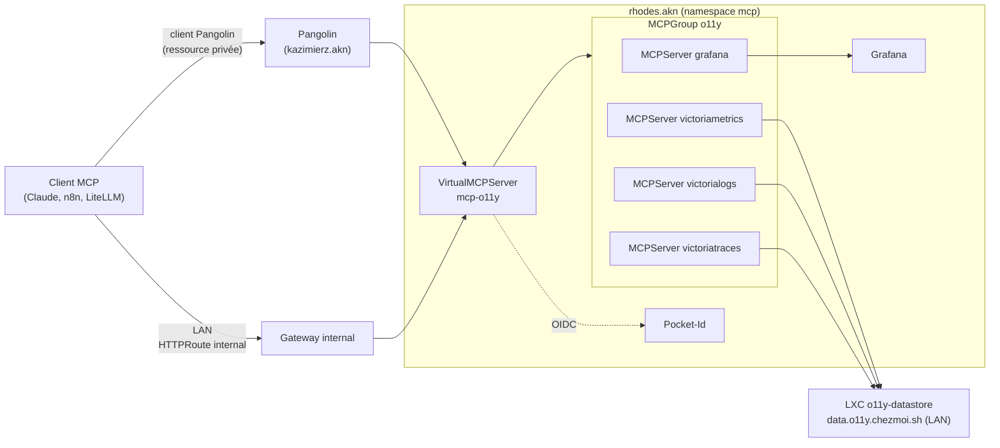

# ADR-019 ToolHive pour gérer les serveurs MCP

## Contexte et problème

Les agents (Claude, n8n, LiteLLM) consomment de plus en plus d'outils via le Model Context Protocol (MCP). Aujourd'hui,
le dépôt n'a aucune gestion des serveurs MCP. Chaque nouveau serveur MCP (Grafana, VictoriaMetrics, VictoriaLogs,
VictoriaTraces…) demanderait aujourd'hui un `Deployment`, un `Service`, une route, une ressource Pangolin et une
authentification écrits à la main, serveur par serveur.

Cette approche bute sur quatre limites :

- **Authentification hétérogène.** Les clients MCP distants (Claude, n8n) attendent le flux OAuth de la spécification
  MCP (métadonnées `/.well-known/oauth-protected-resource`, enregistrement de client dynamique ou CIMD). Peu de serveurs
  MCP l'implémentent ; les autres demandent un jeton statique. Sans couche commune, chaque serveur a sa propre histoire
  d'authentification, ou n'en a pas.
- **Un point d'entrée par serveur.** Brancher Grafana, VictoriaMetrics, VictoriaLogs et VictoriaTraces dans un client
  signifie quatre URL, quatre connexions et quatre authentifications, alors qu'ils servent un même usage (investiguer
  l'observabilité).
- **Pas de contrôle des outils.** Un serveur MCP expose tous ses outils, y compris ceux qui écrivent (créer un tableau
  de bord, supprimer un workflow). Rien ne permet aujourd'hui d'en n'exposer qu'une partie.
- **Pas de déclaratif.** Rien de tout cela ne passe par une ressource Kubernetes versionnée, ce qui contredit les règles
  GitOps du dépôt.

La question stratégique à laquelle cet ADR répond est la suivante : **quel outil utiliser pour déclarer, authentifier,
regrouper et filtrer les serveurs MCP des clusters, et les exposer à l'extérieur par Pangolin ?**

## Hors périmètre

- **La passerelle LLM** : LiteLLM reste la passerelle des modèles. Cet ADR ne traite que les outils MCP.
- **Le choix exhaustif des serveurs MCP** : Grafana, VictoriaMetrics, VictoriaLogs, VictoriaTraces servent
  d'exemples de dimensionnement ; chaque ajout est une PR ordinaire. Le MCP d'instance de n8n n'en fait pas partie (voir
  « Détails de mise en œuvre et état »).
- **Le runtime d'agents** (kagent, agents n8n) : les agents restent des clients du point d'entrée MCP.
- **Le fournisseur d'identité** : Pocket-Id reste le seul IdP ; cet ADR n'en ajoute pas.
- **Le cluster `shodan.akn`** : il n'a pas de manifestes. Le déploiement démarre sur `rhodes.akn` et `lungmen.akn` et
  pourra migrer quand `shodan.akn` existera.

## Facteurs de décision

- **Exigences fonctionnelles** :
  - serveurs MCP déclarés par des CRD, rendus dans `dist/` et synchronisés par ArgoCD
    ([ADR-011](ADR-011-Pre-rendre-les-Manifestes-Kubernetes-dans-Git.md)) ;
  - authentification OAuth côté client conforme à la spécification MCP, adossée à Pocket-Id ;
  - authentification vers les serveurs amont (jeton statique depuis OpenBao, ou OAuth amont) ;
  - regroupement de plusieurs serveurs derrière un seul point d'entrée (Grafana + VictoriaMetrics + VictoriaLogs +
    VictoriaTraces) ;
  - sélection des outils exposés, par serveur.
- **Exigences non fonctionnelles** : un seul composant à exploiter ; configuration entièrement déclarative (pas d'état
  dans une base ou une interface) ; NetworkPolicies Cilium possibles sur chaque pod.
- **Contraintes** : Cilium Gateway API est la seule implémentation de Gateway ; Envoy Gateway a été retiré ; aucune
  base Redis ou autre n'est déployée ; l'exposition publique passe par Pangolin et Newt.

## Options envisagées

### Option 1 : ToolHive Operator (Stacklok)

> **Statut : ACCEPTÉE**

L'opérateur ToolHive fournit des CRD (`toolhive.stacklok.dev/v1beta1`) qui couvrent chaque besoin par une ressource :
`MCPServer` déploie un serveur MCP depuis une image (stdio ou HTTP, avec un proxy devant), `MCPRemoteProxy` place un
proxy devant un serveur MCP HTTP existant, `MCPServerEntry` déclare un serveur distant sans pod,
`MCPGroup` regroupe ces ressources et `VirtualMCPServer` (vMCP) les agrège derrière un seul point d'entrée.
`MCPToolConfig` filtre et renomme les outils (`toolsFilter`, `toolsOverride`), et des politiques Cedar peuvent interdire
un outil selon les claims du jeton. Côté client, le vMCP embarque un serveur d'autorisation (`authServerConfig`) qui
parle le flux OAuth de MCP et délègue l'identité à un fournisseur amont OIDC (Pocket-Id) ; ce même serveur peut
collecter des jetons auprès de fournisseurs OAuth2 amont pendant la connexion. Côté amont, `MCPExternalAuthConfig` gère
le jeton porteur (secret Kubernetes, donc OpenBao via External Secrets) et l'échange de jetons (RFC 8693).

- `+` Toutes les exigences couvertes par un seul projet, en CRD.
- `+` Le serveur d'autorisation embarqué comble l'écart entre le flux OAuth de MCP et Pocket-Id.
- `+` Filtrage des outils à deux niveaux : liste blanche par serveur, interdiction par politique Cedar.
- `+` Les CRD sont rendues dans `dist/` comme toute autre ressource ; ArgoCD les synchronise sans particularité.
- `+` Déjà utilisé en local (ToolHive en poste de travail) : même modèle mental.
- `-` Projet jeune et rapide : les CRD viennent de passer de `v1alpha1` à `v1beta1`, et une partie de la documentation
  décrit encore l'ancienne version. Les montées de version demanderont de lire les notes de version.
- `-` L'opérateur crée lui-même les pods et `Service` : les NetworkPolicies doivent cibler des labels générés.
- `-` Le stockage du serveur d'autorisation est en mémoire par défaut ; sans Redis, un redémarrage du vMCP invalide les
  sessions et oblige les clients à se reconnecter.

### Option 2 : agentgateway

> **Statut : REJETÉE**

agentgateway (Linux Foundation) est un proxy de données dédié à MCP et A2A, piloté sur Kubernetes par son propre plan
de contrôle Gateway API (`GatewayClass` agentgateway, `AgentgatewayPolicy`, backends MCP). Il multiplexe plusieurs
serveurs MCP derrière une route en préfixant les noms d'outils, et autorise les appels par des expressions CEL sur le
JWT et les attributs MCP. C'est l'outil cité dans le README de `shodan.akn`.

- `+` Proxy performant, multiplexage MCP natif, autorisation CEL fine.
- `+` Couvre aussi le trafic LLM et A2A si ces besoins arrivent.
- `-` Ne déploie pas les serveurs MCP : il faut toujours écrire un `Deployment` et un `Service` par serveur, ou ajouter
  kmcp (kagent) pour avoir une CRD `MCPServer`, soit deux projets.
- `-` Ajoute une seconde implémentation Gateway API à côté de Cilium, avec son propre plan de données.
- `-` Une partie des politiques d'autorisation MCP et JWT n'était pas encore exposée dans les ressources Kubernetes en
  août 2026 (retour d'expérience de l'AAIF, à revérifier).
- `-` Pas de serveur d'autorisation embarqué : il valide des jetons, mais Pocket-Id doit alors gérer seul
  l'enregistrement dynamique des clients MCP.

### Option 3 : passerelle applicative (IBM ContextForge, Obot)

> **Statut : REJETÉE**

Ces passerelles sont des applications avec une base de données et une interface web : on y enregistre les serveurs MCP,
on compose des « serveurs virtuels » et on coche les outils à exposer.

- `+` Interface riche, regroupement et sélection d'outils immédiats.
- `-` La configuration vit dans la base de données, pas dans Git : contraire aux règles GitOps du dépôt.
- `-` Une base (PostgreSQL ou Redis) de plus à sauvegarder et à exploiter.

### Alternatives écartées

- **Envoy AI Gateway** : son support MCP repose sur Envoy Gateway, retiré des clusters au profit de Cilium. Le
  réintroduire pour MCP seul n'a pas de sens.
- **Statu quo** (un `Deployment`, une route et une ressource Pangolin par serveur) : ne répond ni au regroupement, ni
  au filtrage, ni à l'OAuth.

## Décision retenue

**Option retenue : « ToolHive Operator »**, parce que c'est la seule option qui couvre les cinq exigences avec un seul
composant et uniquement des CRD. Le point décisif est l'authentification : les clients MCP distants attendent un flux
OAuth complet (métadonnées de ressource protégée, enregistrement dynamique), que ni Pocket-Id ni la plupart des
serveurs MCP ne fournissent seuls. Le serveur d'autorisation embarqué du vMCP prend ce rôle et délègue l'identité à
Pocket-Id, ce qui évite de modifier l'IdP. agentgateway serait le meilleur proxy pur, mais il laisse le déploiement des
serveurs et ce flux OAuth à la charge du dépôt, et ajoute un second plan de données Gateway API. ContextForge et Obot
cochent les cases fonctionnelles en sortant la configuration de Git.

Les compromis acceptés sont la jeunesse de l'API et le stockage en mémoire des sessions OAuth. Le second est assumé :
une reconnexion après redémarrage coûte moins qu'une base Redis à exploiter. Si les reconnexions deviennent gênantes, ou
si le vMCP passe à plusieurs réplicas, Redis entre dans le périmètre.

## Conséquences

### Positives

- (+) Ajouter un serveur MCP revient à ajouter une ressource `MCPServer` ou `MCPRemoteProxy` à un `MCPGroup`.
- (+) Un point d'entrée par usage (par exemple `mcp-o11y`), un seul login pour le client (Pocket-Id pour `mcp-o11y`).
- (+) Les outils d'écriture sont désactivés par défaut et activés au cas par cas, dans une PR.

### Négatives

- (-) Un opérateur de plus à suivre, sur un projet dont l'API bouge encore.
- (-) Les NetworkPolicies doivent suivre les labels posés par l'opérateur ; un changement de labels à une montée de
  version peut casser le trafic.
- (-) Les sessions OAuth sont perdues à chaque redémarrage du vMCP.

### Neutres

- (\~) Les clés de signature et HMAC du serveur d'autorisation doivent être fournies par des secrets (OpenBao via
  External Secrets) ; sans elles, l'opérateur génère des clés éphémères réservées au développement.

## Détails de mise en œuvre et état

Les manifestes sont écrits dans la PR #1508 ; rien n'est encore déployé ni validé sur un cluster. L'opérateur est
installé sur `lungmen.akn` et `rhodes.akn` (`infrastructure/kubernetes/toolhive/`) ; `lungmen.akn` n'héberge pour
l'instant aucune charge MCP, le périmètre déployé se limite au vMCP `mcp-o11y` de `rhodes.akn`. Architecture visée :

- **Placement** : le `VirtualMCPServer` `mcp-o11y` tourne sur `rhodes.akn` (`projects/rhodes.akn/src/apps/mcp/`), là où
  se trouvent Grafana et Pocket-Id ; les serveurs Victoria sont joints en LAN sur `data.o11y.chezmoi.sh`.
- **Exposition** : le point d'entrée `o11y.mcp.chezmoi.sh` est une ressource Pangolin privée (`SiteResource`,
  accessible uniquement depuis un appareil qui exécute le client Pangolin), doublée d'une `HTTPRoute` sur les Gateways
  `external` et `internal`. Elle n'est pas publique.
- **Authentification o11y** : le serveur d'autorisation embarqué du vMCP délègue le login à Pocket-Id (client limité au
  groupe admin, créé par Pulumi ; secret et clé HMAC dans OpenBao `rhodes.akn/mcp/o11y/`). Aucune clé de signature
  n'est configurée : l'opérateur en génère une éphémère, donc les sessions sont perdues à chaque redémarrage
  (compromis déjà accepté).
- **Authentification Grafana** : le serveur MCP Grafana tourne avec `--disable-query --disable-write` et un jeton de
  compte de service Viewer (OpenBao `rhodes.akn/mcp/o11y/grafana-token`) ; les requêtes brutes passent par les serveurs
  Victoria. L'authentification nominative vers Grafana est impossible en auto-hébergé : `mcp-grafana` ne gère que les
  jetons de compte de service (l'OAuth par utilisateur est réservé à Grafana Cloud). Le compte de service est la limite
  acceptée.
- **Groupe `o11y`** : `MCPServer` `grafana`, `victoriametrics`, `victorialogs` et `victoriatraces`.
- **n8n** : le MCP de n8n n'est pas géré par ToolHive. n8n est déjà exposé en privé par Pangolin (`n8n.chezmoi.sh`) et
  son serveur MCP d'instance (`/mcp-server/http`) est joignable directement, avec l'OAuth de n8n (comptes nominatifs).
  Un `MCPRemoteProxy` devant n8n a été écarté : il n'apporte rien de plus, le proxy devait résoudre `n8n.chezmoi.sh`
  depuis le cluster (un nom qui n'existe que dans le DNS du LAN et dans Pangolin), et la CRD n'accepte que `https` pour
  le point d'enregistrement dynamique de clients.
- **À vérifier au premier déploiement** :
  - flux OAuth complet depuis Claude jusqu'à Pocket-Id, à travers le client Pangolin ;
  - passage du streaming HTTP de MCP à travers Pangolin ;
  - noms des `Service` créés par l'opérateur (`vmcp-mcp-o11y:4483`, supposé) et labels
    des pods utilisés par les NetworkPolicies ;

## Historique des modifications

- **2026-11-12** : **DEPRECATION** : Retrait du MCP de n8n du périmètre ToolHive (`MCPRemoteProxy` `n8n-mcp`, ressource
  Pangolin et `HTTPRoute` `n8n.mcp.chezmoi.sh`) : n8n est déjà exposé par Pangolin et son MCP d'instance reste joignable
  directement avec l'OAuth de n8n. Le périmètre ToolHive se limite au vMCP `mcp-o11y`.
- **2026-11-12** : **FEATURE** : Implémentation dans la PR #1508 (manifestes écrits, non déployés). Le vMCP `mcp-o11y`
  passe sur `rhodes.akn` ; n8n passe par un `MCPRemoteProxy` avec OAuth nominatif (au lieu d'un jeton porteur) ;
  exposition par des ressources Pangolin privées et une `HTTPRoute` interne, au lieu de ressources publiques
  `sso: false`.
- **2026-11-12** : **FEATURE** : Création de l'ADR (statut `proposed`).

## Pour aller plus loin

- [ADR-011 Pré-rendre les manifestes Kubernetes dans Git](ADR-011-Pre-rendre-les-Manifestes-Kubernetes-dans-Git.md) :
  les CRD ToolHive suivent le même rendu dans `dist/`.
- [ADR-013 Observabilité centralisée VictoriaMetrics sur LXC](ADR-013-Observabilite-Centralisee-VictoriaMetrics-sur-LXC.md)
  : la cible des serveurs MCP VictoriaMetrics, VictoriaLogs et VictoriaTraces.
- [ADR-002 Topologie des secrets OpenBao](ADR-002-Topologie-des-Secrets-OpenBao.md) : où ranger les jetons amont.
- [Documentation de l'opérateur ToolHive](https://docs.stacklok.com/toolhive/guides-k8s/) : CRD, vMCP et
  authentification.
- [Référence de la CRD VirtualMCPServer](https://docs.stacklok.com/toolhive/reference/crds/virtualmcpserver) : serveur
  d'autorisation embarqué et agrégation.
- [Passage des CRD ToolHive en v1beta1](https://stacklok.com/blog/toolhive-grows-up-what-the-crd-graduation-to-v1beta1-means-for-your-cluster/)
  : état de maturité de l'API.
- [Documentation agentgateway sur Kubernetes](https://agentgateway.dev/docs/kubernetes/latest/) : l'option rejetée.
- [Retour d'expérience AAIF sur agentgateway](https://aaif.io/blog/building-a-governed-mcp-platform-with-agentgateway) :
  limites des ressources Kubernetes d'agentgateway en 2026.
- [Spécification MCP, autorisation](https://modelcontextprotocol.io/specification/draft/basic/authorization) : le flux
  OAuth attendu par les clients.
