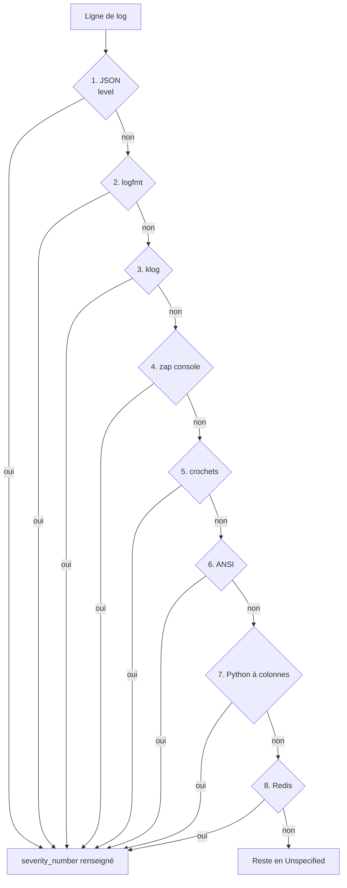
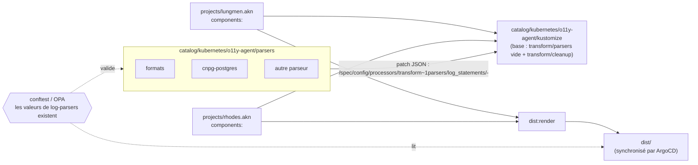
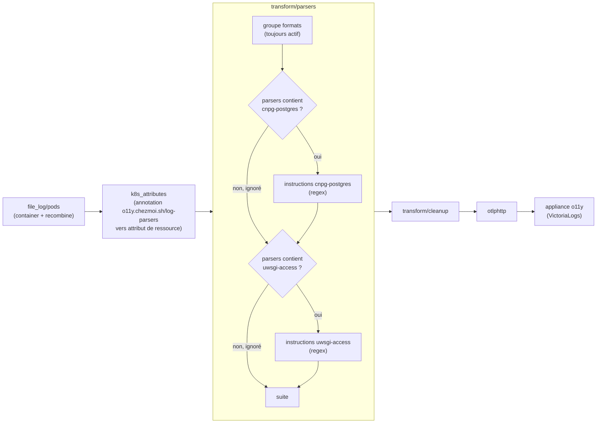

# ADR-020 Parser les logs des pods dans l'agent OpenTelemetry avec une bibliothèque de components Kustomize

## Contexte et problème

Les logs des `Pod` de `lungmen.akn` et `rhodes.akn` sont collectés par le `DaemonSet` `agent`
(`OpenTelemetryCollector`,
[`agent.opentelemetrycollector.yaml`](../../catalog/kubernetes/o11y-agent/kustomize/agent.opentelemetrycollector.yaml)).
Son récepteur `file_log/pods` n'applique que l'opérateur `container` (décodage du format CRI) et aucun traitement de
sévérité. Vérifié sur les deux clusters le 2026-11-14 : chaque log de pod arrive dans VictoriaLogs avec
`severity_text: Unspecified`, soit environ 180 000 enregistrements sur 4 heures (environ 12 logs par seconde au total).
Les niveaux `INFO` ou `WARN` visibles ailleurs viennent de Talos (`tcp_log/talos`), des événements Kubernetes (agent de
cluster) et des LXC.

Conséquence : filtrer les erreurs d'un pod, alerter sur un niveau ou retrouver une exception passe par une recherche
textuelle sur le corps du message. Les champs sémantiques (HTTP, base de données, exception) ne sont jamais extraits.

Le côté LXC dispose déjà d'une bibliothèque de parseurs :
[`catalog/nix/modules/o11y-agent/parsers/`](../../catalog/nix/modules/o11y-agent/parsers/caddy.nix) (`caddy`, `dex`,
`journald`, `named`, `omni`, `syslog`, `victoria`, `zot`). Chaque application a son fichier, activé à la demande par
`logs.parsers`, et chaque parseur est un processeur `transform` en OTTL qui ne renseigne que `severity_number` (la
passerelle OTLP de l'appliance réécrit `severity_text`). Le parseur `caddy` projette les logs d'accès sur les
conventions sémantiques OpenTelemetry (`http.*`, `url.*`, `user_agent.*`, `client.*`, `server.*`, `network.*`, `tls.*`)
et conserve le corps d'origine. Rien d'équivalent n'existe pour les pods.

Un test sur 3 000 lignes de logs de pods tirées au hasard (échantillon de 30 minutes) a mesuré qu'une cascade ordonnée de
8 expressions régulières (la première qui correspond gagne) reconnaît le niveau de 92,4 % des lignes :

| Rang | Format | Sources observées |
| ---- | ------ | ----------------- |
| 1 | JSON | notifications ArgoCD, OpenBao (`@level`), vMCP, CNPG/barman, external-secrets, target-allocator |
| 2 | logfmt | contrôleurs ArgoCD, Cilium, Velero, external-dns, Grafana, mcp |
| 3 | klog | sidecars Proxmox CSI, kube-apiserver, Proxmox CCM |
| 4 | zap console | le collecteur lui-même |
| 5 | crochets | Paperless, Jellyfin |
| 6 | ANSI (zerolog, Nest) | Homebox, Immich |
| 7 | Python à colonnes | Spoolman (uvicorn) |
| 8 | Redis | Redis |

Expressions (RE2), dans l'ordre :

```text
1. JSON: "@?level"\s*:\s*"(?P<lvl>[A-Za-z]+)"
2. logfmt: (?:^|\s)level=(?P<lvl>"?[A-Za-z]+)
3. klog: ^(?P<lvl>[IWEF])\d{4} \d{2}:\d{2}:\d{2}
4. zap console: ^\S+\t(?P<lvl>debug|info|warn|error|dpanic|panic|fatal)\t
5. crochets: \[(?P<lvl>TRC|DBG|INF|WRN|ERR|FTL|CRT|TRACE|DEBUG|INFO|WARNING|WARN|ERROR|CRITICAL|FATAL)\]
6. ANSI (zerolog, Nest): \x1b\[\d+m\s*(?P<lvl>TRC|DBG|INF|WRN|ERR|FTL|LOG|DEBUG|VERBOSE|WARN|ERROR)\x1b
7. Python à colonnes: ^\S+\s+(?P<lvl>DEBUG|INFO|WARNING|ERROR|CRITICAL)\s{2,}
8. Redis: ^\d+:[MCSX] \d{2} \w{3} \d{4} [\d:.]+ (?P<lvl>[.*#-]) 
```



Le reste (7,6 %) se compose des logs d'accès uwsgi de linkding (pas de niveau), des lignes de continuation de traces
Python (Paperless, mcp) et du texte brut de n8n (corrigeable avec `N8N_LOG_FORMAT=json`). Deux limites sont connues :

- Pour PostgreSQL sous CNPG, le `level` du JSON externe est celui de l'enveloppe CNPG. Le vrai niveau est
  `record.error_severity` : il faut un parseur dédié, placé avant la règle JSON générique.
- Go RE2 interdit les noms de groupe en double : il faut une expression par opérateur ou par instruction OTTL.

La question stratégique à laquelle cet ADR répond est la suivante : **comment extraire le niveau, les erreurs et les
champs applicatifs des logs de pods dans l'agent OpenTelemetry, sans configuration obligatoire par charge de travail et
en gardant la configuration visible dans `dist/` ?**

## Hors périmètre

- **Les parseurs des LXC** : la bibliothèque Nix reste telle quelle. Partager une source unique entre Nix et Kubernetes
  (l'OTTL est identique, un JSON importé par Nix suffirait) est reporté tant que moins de deux parseurs sont dupliqués.
- **Le protocole d'ingestion** : OTLP reste le seul chemin d'écriture
  ([ADR-018](ADR-018-OTLP-comme-Protocole-d-Ingestion-Unique-pour-l-Appliance-d-Observabilite.md)).
- **La réécriture de l'horodatage** : l'horodatage CRI posé par l'opérateur `container` est l'heure d'écriture sur la
  sortie standard, à la milliseconde. Reparser une dizaine de formats d'horodatage apporte un gain proche de zéro : il ne
  compterait que pour des rejeux, qui n'existent pas pour les pods (contrairement à `kmsg` de Talos).
- **Les logs de Talos, les événements et les LXC** : ils ont déjà leur chemin et leur sévérité.

## Facteurs de décision

- **Exigences fonctionnelles** :
  - un niveau de sévérité (`severity_number`) sur tous les logs de pods reconnaissables, sans rien déclarer sur la
    charge de travail ;
  - les champs d'erreur sémantiques (`exception.type`, `exception.message`, `exception.stacktrace`, `error.type`) ;
  - des champs applicatifs (HTTP, base de données) activables à la demande, pour les applications qui le méritent ;
  - le cas particulier de CNPG PostgreSQL (niveau dans `record.error_severity`).
- **Exigences non fonctionnelles** : la configuration rendue est lisible dans `dist/`
  ([ADR-011](ADR-011-Pre-rendre-les-Manifestes-Kubernetes-dans-Git.md)) ; un log qui ne concerne pas un parseur ne coûte
  pas d'expression régulière ; ajouter un parseur ne demande de modifier ni les pipelines ni les charges de travail.
- **Contraintes** : le débit est faible (environ 12 logs par seconde) ; l'agent demande 100m de CPU et 256Mi de
  mémoire ; la plupart des pods viennent de charts tiers dont on ne veut pas patcher les annotations ; OpenTelemetry
  Collector, pas un autre agent (ADR-018).

## Options envisagées

### Option 1 : bibliothèque de components Kustomize, en deux couches

> **Statut : PROPOSÉE**

Un seul processeur `transform/parsers` est défini dans la base de l'agent, vide. Chaque parseur est un
`kind: Component` Kustomize sous `catalog/kubernetes/o11y-agent/parsers/<nom>/` qui ajoute son groupe d'instructions
OTTL à ce processeur par un patch JSON (`/spec/config/processors/transform~1parsers/log_statements/-`). Un processeur
`transform/cleanup` vient après lui dans la base. Les components ne touchent jamais aux pipelines. Un projet choisit ses
parseurs avec `components:` dans son `kustomization.yaml`, et le résultat est rendu dans `dist/`.

Les parseurs se rangent en deux couches :

- **Couche format** (toujours active, sans configuration) : la cascade ci-dessus détecte le niveau (`severity_number`
  uniquement) et renseigne les champs d'erreur (`exception.*`, `error.type`). Chaque ligne passe par la cascade ; la
  première expression qui correspond gagne.
- **Couche applicative** (à la demande) : conventions sémantiques HTTP et URL (comme `caddy`) et base de données
  (`db.system.name=postgresql`, `db.namespace`, `db.response.status_code` avec le SQLSTATE, `db.operation.name`). Le
  texte de la requête (`db.query.text`) n'est volontairement pas extrait : il peut contenir des données ou des secrets,
  et la convention sémantique en fait un champ à activer explicitement. La sélection se fait par l'annotation de pod
  `o11y.chezmoi.sh/log-parsers: <liste séparée par des virgules>`, copiée en attribut de ressource par le processeur
  `k8s_attributes`. Chaque groupe d'instructions porte une clause `conditions:` sur cet attribut : un enregistrement non
  concerné coûte une comparaison de chaînes, aucune expression régulière.

Les premiers parseurs du prototype sont `formats` (couche format) et `cnpg-postgres` (couche applicative).

Une règle OPA (conftest, CI uniquement,
[ADR-012](ADR-012-Remplacer-Kyverno-par-OPA.md)) vérifie que chaque valeur de `o11y.chezmoi.sh/log-parsers` existe dans
la bibliothèque. Aucune annotation n'est obligatoire.

Les logs multilignes (traces Python, `Caused by` de Java) passent par un `recombine` générique dans `file_log/pods` :
une ligne est une continuation si elle commence par une espace, `Traceback` ou `Caused by`. Les annotations ne sont pas
connues au moment du récepteur, donc cette heuristique ne peut pas dépendre du parseur choisi.

- `+` Configuration entièrement déclarative, lisible dans `dist/`, sans composant de plus.
- `+` Même modèle mental que la bibliothèque Nix des LXC : un fichier par application, activé à la demande.
- `+` La couche format couvre 92,4 % des lignes de l'échantillon sans toucher à aucune charge de travail.
- `+` Ajouter un parseur ne modifie ni les pipelines ni les autres parseurs.
- `-` Les expressions de la couche format s'exécutent pour chaque ligne : le coût CPU n'est pas encore mesuré.
- `-` Le `recombine` générique peut coller des lignes sans rapport entre elles.
- `-` Les parseurs OTTL sont dupliqués entre Nix et Kubernetes.
- `-` L'annotation s'applique au pod, pas au conteneur : un format par conteneur n'est pas exprimable (CNPG mélange JSON
  et barman, Proxmox CSI mélange klog et JSON). La détection automatique contourne le problème pour le niveau.

### Option 2 : Vector à la place du collecteur OpenTelemetry

> **Statut : REJETÉE**

Vector (Rust, VRL compilé) consomme moins de CPU en théorie qu'OTTL interprété.

- `+` Parsing plus rapide sur le papier.
- `-` À environ 12 logs par seconde, le surcoût de l'OTTL est négligeable devant les requêtes actuelles de l'agent
  (100m de CPU, 256Mi). Ce n'est pas encore mesuré : le suivi se fait avec `otelcol_process_cpu_seconds` avant et après.
- `-` Contredit l'ADR-018 (OTLP seul) et la migration antérieure des LXC de Vector vers OpenTelemetry.

### Option 3 : connecteur `routing` avec un pipeline par format

> **Statut : REJETÉE**

Un connecteur `routing` envoie chaque enregistrement vers un pipeline dédié à son format.

- `+` Isolation nette entre formats.
- `-` Plus de pipelines à maintenir pour un résultat identique à celui des `conditions:` sur un seul processeur.

### Option 4 : fragments de configuration chargés par `${file:...}`

> **Statut : REJETÉE**

Les fragments de parseurs vivent dans une `ConfigMap` que le fournisseur de configuration `${file:...}` du collecteur
assemble au démarrage.

- `+` Fonctionne avec le collecteur tel quel.
- `-` `dist/` ne montre plus la configuration réellement exécutée, ce qui va contre l'ADR-011.

### Option 5 : annotation obligatoire, imposée par OPA sur chaque charge de travail

> **Statut : REJETÉE**

Chaque `Pod` déclare son format ; une règle OPA refuse les manifestes de `dist/` qui n'ont pas l'annotation.

- `+` Aucun parseur implicite : tout est déclaré.
- `-` Oblige à patcher les `podAnnotations` de chaque chart tiers.
- `-` Une annotation par pod ne peut pas exprimer un format par conteneur.

## Décision retenue

**Option retenue : « bibliothèque de components Kustomize, en deux couches »**, parce que c'est la seule qui rend un
niveau de sévérité à tous les logs sans rien demander aux charges de travail, tout en laissant `dist/` montrer la
configuration exécutée. La détection automatique rend l'annotation inutile pour le niveau, donc l'OPA n'a besoin de
valider que les annotations posées (des noms de parseur qui existent), pas d'imposer leur présence. Les `conditions:`
bornent le coût de la couche applicative à une comparaison de chaînes pour les pods non concernés. Vector est écarté
parce que le débit ne justifie pas de remettre en cause l'ADR-018, pas parce qu'il serait moins performant.

Les compromis acceptés sont le coût CPU de la cascade sur chaque ligne (non mesuré, à suivre) et la duplication des
parseurs entre Nix et Kubernetes. Cette décision est à revoir si l'agent dépasse nettement ses requêtes après
déploiement, ou si plus de deux parseurs deviennent communs aux deux côtés.

## Conséquences

### Positives

- (+) Un niveau de sévérité sur environ 92 % des logs de pods, exploitable dans VictoriaLogs et dans les alertes.
- (+) Ajouter un parseur applicatif revient à ajouter un `Component` et une annotation.
- (+) Les champs d'erreur et de base de données suivent les conventions sémantiques OpenTelemetry.

### Négatives

- (-) Une expression régulière par format s'exécute sur chaque ligne ; l'impact sur l'agent reste à mesurer.
- (-) Les attributs ajoutés augmentent légèrement le stockage de VictoriaLogs.
- (-) Deux bibliothèques de parseurs (Nix et Kubernetes) à garder cohérentes.

### Neutres

- (\~) Les logs sans niveau (linkding, continuations de traces) restent en `Unspecified`. n8n se corrige à la source avec
  `N8N_LOG_FORMAT=json`.

## Détails de mise en œuvre et état

Rien n'est implémenté : cet ADR décrit la cible. Le premier prototype couvre `formats` et `cnpg-postgres`.

Composition de la bibliothèque, au rendu :



Chemin d'un log dans l'agent. Un groupe dont la condition est fausse est ignoré : le coût est une comparaison de
chaînes, sans expression régulière.



**À vérifier avant le déploiement :**

- le processeur `transform` accepte un `log_statements` vide dans la base, sur la version 0.162 du collecteur ;
- l'heuristique de `recombine` ne colle pas de lignes sans rapport (test sur un échantillon avant de la généraliser) ;
- une surcharge du format par conteneur demanderait un indexage dynamique OTTL
  (`resource.attributes[Concat([...])]`), non confirmé ; la détection automatique la rend inutile pour l'instant ;
- le coût CPU de l'agent, par `otelcol_process_cpu_seconds` avant et après.

## Historique des modifications

- **2026-11-14** : **FEATURE** : Création de l'ADR (statut `proposed`).

## Pour aller plus loin

- [ADR-011 Pré-rendre les manifestes Kubernetes dans Git](ADR-011-Pre-rendre-les-Manifestes-Kubernetes-dans-Git.md) :
  pourquoi la configuration de l'agent doit rester lisible dans `dist/`.
- [ADR-012 Remplacer Kyverno par OPA](ADR-012-Remplacer-Kyverno-par-OPA.md) : le cadre de la règle conftest qui valide
  les annotations.
- [ADR-013 Observabilité centralisée VictoriaMetrics sur LXC](ADR-013-Observabilite-Centralisee-VictoriaMetrics-sur-LXC.md)
  : la destination des logs.
- [ADR-018 OTLP comme protocole d'ingestion unique](ADR-018-OTLP-comme-Protocole-d-Ingestion-Unique-pour-l-Appliance-d-Observabilite.md)
  : pourquoi l'agent reste un collecteur OpenTelemetry.
- [Collecteur `agent`](../../catalog/kubernetes/o11y-agent/kustomize/agent.opentelemetrycollector.yaml) : la
  configuration actuelle de `file_log/pods`.
- [Parseur `caddy` des LXC](../../catalog/nix/modules/o11y-agent/parsers/caddy.nix) : le modèle de parseur applicatif.
- [Conventions sémantiques HTTP](https://opentelemetry.io/docs/specs/semconv/http/),
  [base de données](https://opentelemetry.io/docs/specs/semconv/database/) et
  [exceptions](https://opentelemetry.io/docs/specs/semconv/exceptions/) : les attributs produits par les parseurs.
