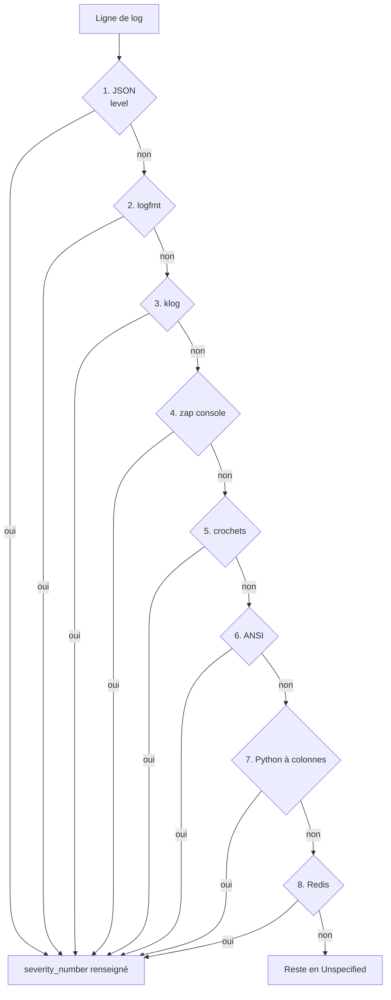
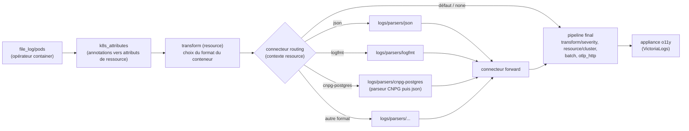
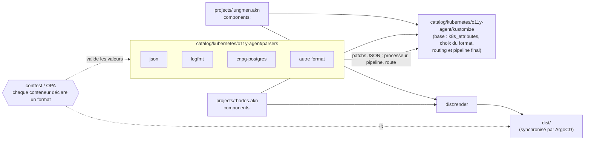

# ADR-020 Parser les logs des pods dans l'agent OpenTelemetry avec une bibliothèque de components Kustomize

## Contexte et problème

Les logs des `Pod` de `lungmen.akn` et `rhodes.akn` sont collectés par le `DaemonSet` `agent` (`OpenTelemetryCollector`,
[`agent.opentelemetrycollector.yaml`](../../catalog/kubernetes/o11y-agent/kustomize/agent.opentelemetrycollector.yaml)).
Son récepteur `file_log/pods` n'applique que l'opérateur `container` (décodage du format CRI) et aucun traitement de
sévérité. Vérifié sur les deux clusters le 2026-11-14 : chaque log de pod arrive dans VictoriaLogs avec
`severity_text: Unspecified`, soit environ 180 000 enregistrements sur 4 heures (environ 12 logs par seconde au total).
Les niveaux `INFO` ou `WARN` visibles ailleurs viennent de Talos (`tcp_log/talos`), des événements Kubernetes (agent de
cluster) et des LXC.

Conséquence : filtrer les erreurs d'un pod, alerter sur un niveau ou retrouver une exception passe par une recherche
textuelle sur le corps du message. Les champs sémantiques (HTTP, base de données, exception) ne sont jamais extraits.

Le côté LXC dispose déjà d'une bibliothèque de parseurs :
[`catalog/nix/modules/o11y-agent/parsers/`](../../catalog/nix/modules/o11y-agent/parsers/caddy.nix) (`caddy`, `dex`,
`journald`, `named`, `omni`, `syslog`, `victoria`, `zot`). Chaque application a son fichier, activé à la demande par
`logs.parsers`, et chaque parseur est un processeur `transform` en OTTL qui ne renseigne que `severity_number` (la
passerelle OTLP de l'appliance réécrit `severity_text`). Le parseur `caddy` projette les logs d'accès sur les
conventions sémantiques OpenTelemetry (`http.*`, `url.*`, `user_agent.*`, `client.*`, `server.*`, `network.*`, `tls.*`)
et conserve le corps d'origine. Rien d'équivalent n'existe pour les pods.

Un test sur 3 000 lignes de logs de pods tirées au hasard (échantillon de 30 minutes) a mesuré qu'une cascade ordonnée
de 8 expressions régulières (la première qui correspond gagne, voir l'option 3) reconnaît le niveau de 92,4 % des
lignes. Les formats rencontrés sont :

| Rang | Format               | Sources observées                                                                               |
| ---- | -------------------- | ----------------------------------------------------------------------------------------------- |
| 1    | JSON                 | notifications ArgoCD, OpenBao (`@level`), vMCP, CNPG/barman, external-secrets, target-allocator |
| 2    | logfmt               | contrôleurs ArgoCD, Cilium, Velero, external-dns, Grafana, mcp                                  |
| 3    | klog                 | sidecars Proxmox CSI, kube-apiserver, Proxmox CCM                                               |
| 4    | zap console          | le collecteur lui-même                                                                          |
| 5    | crochets             | Paperless, Jellyfin                                                                             |
| 6    | ANSI (zerolog, Nest) | Homebox, Immich                                                                                 |
| 7    | Python à colonnes    | Spoolman (uvicorn)                                                                              |
| 8    | Redis                | Redis                                                                                           |

Le reste (7,6 %) se compose des logs d'accès uwsgi de linkding (pas de niveau), des lignes de continuation de traces
Python (Paperless, mcp) et du texte brut de n8n (corrigeable avec `N8N_LOG_FORMAT=json`). Deux constats pèsent sur la
décision :

- Pour PostgreSQL sous CNPG, le `level` du JSON externe est celui de l'enveloppe CNPG (toujours `info`). Le vrai niveau
  est `record.error_severity` : il faut un traitement dédié, qu'une détection générique du JSON ne peut pas deviner.
- Un même pod mélange parfois plusieurs formats selon le conteneur (CNPG : JSON et barman ; Proxmox CSI : klog et JSON).
  Le format est donc une propriété du conteneur, pas du pod.

La question stratégique à laquelle cet ADR répond est la suivante : **comment extraire le niveau, les erreurs et les
champs applicatifs des logs de pods dans l'agent OpenTelemetry, avec un parseur choisi explicitement par conteneur, un
coût qui ne croît pas avec le nombre de formats, et une configuration visible dans `dist/` ?**

## Hors périmètre

- **Les parseurs des LXC** : la bibliothèque Nix reste telle quelle. Partager une source unique entre Nix et Kubernetes
  (l'OTTL est identique, un JSON importé par Nix suffirait) est reporté tant que moins de deux parseurs sont dupliqués.
- **Le protocole d'ingestion** : OTLP reste le seul chemin d'écriture
  ([ADR-018](ADR-018-OTLP-comme-Protocole-d-Ingestion-Unique-pour-l-Appliance-d-Observabilite.md)).
- **La réécriture de l'horodatage** : l'horodatage CRI posé par l'opérateur `container` est l'heure d'écriture sur la
  sortie standard, à la milliseconde. Reparser une dizaine de formats d'horodatage apporte un gain proche de zéro : il
  ne compterait que pour des rejeux, qui n'existent pas pour les pods (contrairement à `kmsg` de Talos).
- **Les logs de Talos, les événements et les LXC** : ils ont déjà leur chemin et leur sévérité.
- **Les logs multilignes** (traces Python, `Caused by` de Java) : le récepteur `file_log/pods` s'exécute avant que
  l'annotation du pod soit connue, donc un `recombine` ne peut pas dépendre du format déclaré. Le sujet est à concevoir
  séparément.

## Facteurs de décision

- **Exigences fonctionnelles** :
  - un niveau de sévérité (`severity_number`) sur les logs de pods dont le format est déclaré ;
  - les champs d'erreur sémantiques (`exception.message`, `exception.stacktrace`, `error.type`) quand le format les
    porte ;
  - des champs applicatifs (HTTP, base de données) pour les applications qui le méritent ;
  - un format par conteneur, avec un défaut pour le pod ;
  - le cas particulier de CNPG PostgreSQL (niveau dans `record.error_severity`).
- **Exigences non fonctionnelles** :
  - déclaration explicite plutôt que détection implicite : aucun parseur n'est appliqué sans que la charge de travail le
    demande, et un conteneur volontairement non parsé est marqué comme tel ;
  - la configuration rendue est lisible dans `dist/`
    ([ADR-011](ADR-011-Pre-rendre-les-Manifestes-Kubernetes-dans-Git.md)) ;
  - le coût par ligne ne croît pas avec le nombre de formats de la bibliothèque, et les formats sont isolés les uns des
    autres ;
  - ajouter un parseur ne touche aucune charge de travail, sauf celles qui l'adoptent.
- **Contraintes** : le débit est faible (environ 12 logs par seconde) ; l'agent demande 100m de CPU et 256Mi de mémoire
  ; la plupart des pods viennent de charts tiers ; OpenTelemetry Collector reste l'agent déployé.

## Options envisagées

### Option 1 : annotation explicite par conteneur et routage par format

> **Statut : RETENUE**

Chaque `Pod` déclare le format de ses logs par une annotation sur le modèle de pod, obligatoire :

- `o11y.chezmoi.sh/log-format: <format>` : le format par défaut de tous les conteneurs du pod ;
- `o11y.chezmoi.sh/log-format.<conteneur>: <format>` : la surcharge pour un conteneur (le nom du conteneur est dans la
  clé de l'annotation, ce qui exprime un format par conteneur sans structure supplémentaire) ;
- la valeur `none` marque un conteneur volontairement non parsé (logs d'accès uwsgi de linkding, texte brut de n8n).

Le processeur `k8s_attributes` copie ces annotations en attributs de ressource (`o11y.log.format`, et
`o11y.log.format.<conteneur>` par un `key_regex` à groupe de capture). Un processeur `transform` en contexte `resource`
choisit la valeur du conteneur de l'enregistrement
(`resource.attributes[Concat(["o11y.log.format.", resource.attributes["k8s.container.name"]], "")]`), à défaut celle du
pod, puis supprime les clés par conteneur. `o11y.log.format` reste sur l'enregistrement : il indique quel parseur l'a
traité.

Un connecteur `routing` (contexte `resource`) envoie ensuite chaque lot vers le pipeline `logs/parsers/<format>`. Ses
routes sont évaluées une fois par ressource (le lot de lignes d'un conteneur), pas une fois par enregistrement : une
ligne ne traverse que les processeurs de son format. La route par défaut n'applique aucun parseur (la sévérité reste non
spécifiée). Chaque pipeline de format exporte vers un connecteur `forward` ; un dernier pipeline, alimenté par le
connecteur `forward` et par la route par défaut, porte `resource/cluster`, `batch` et l'exportateur `otlp_http`.

Les parseurs se rangent par format de log :

| Format        | Reconnaît                                 | Champs renseignés                                        |
| ------------- | ----------------------------------------- | -------------------------------------------------------- |
| `json`        | clés `level`, `@level`, `severity`        | `severity_number`, `exception.message`, `stacktrace`     |
| `logfmt`      | `level=`                                  | `severity_number`, `exception.message` (`error=`/`err=`) |
| `klog`        | préfixe `I`/`W`/`E`/`F`                   | `severity_number`, `exception.message` (`err=`)          |
| `zap-console` | colonnes séparées par des tabulations     | `severity_number`                                        |
| `bracketed`   | `[INFO]`, `[INF]`, …                      | `severity_number`                                        |
| `ansi`        | niveaux colorés (zerolog, console NestJS) | `severity_number`                                        |
| `uvicorn`     | niveau Python à colonnes                  | `severity_number`                                        |
| `redis`       | `.` `-` `*` `#`                           | `severity_number`                                        |

Chaque parseur ne renseigne que `severity_number` pour la sévérité (la passerelle OTLP de l'appliance dérive
`severity_text`), plus les champs d'erreur que son format porte (`exception.message`, `exception.stacktrace`,
`error.type`).

Les formats applicatifs sont des formats à part entière, leur pipeline chaînant leur parseur puis le parseur générique :

- `cnpg-postgres` : JSON plus enregistrement PostgreSQL. Sévérité depuis `record.error_severity`, `db.system.name`,
  `db.namespace`, `db.operation.name`, `db.response.status_code` (SQLSTATE), `error.type`, `exception.message`,
  `client.*`, `process.pid`. Le texte de la requête (`db.query.text`) n'est volontairement pas extrait : il peut
  contenir des données ou des secrets, et la convention sémantique en fait un champ à activer explicitement.
- `hubble-http` : lignes de réponses HTTP Hubble exportées sur la sortie standard de `cilium-agent`, projetées sur
  `http.*`, `url.*`, `server.*`, `user_agent.original`, `client.address`, plus le logfmt des lignes ordinaires de
  l'agent.

La bibliothèque est un ensemble de `Component` Kustomize, un par format, sous
`catalog/kubernetes/o11y-agent/parsers/<format>/`. Chacun ajoute, par des patchs JSON, son processeur
`transform/parse-<format>`, son pipeline `logs/parsers/<format>` et sa route dans la table de routage. Chaque parseur
porte ses tests (`tests/fixtures.yaml`, exécutés par la tâche `mise run o11y:parsers:test` dans le collecteur de la
version déployée). Un projet choisit ses formats avec `components:` dans son `kustomization.yaml`, et le résultat est
rendu dans `dist/`.

Une règle OPA (conftest, CI uniquement, [ADR-012](ADR-012-Remplacer-Kyverno-par-OPA.md)) vérifie que chaque modèle de
pod de `dist/` (`Deployment`, `StatefulSet`, `DaemonSet`, `Job`, `CronJob`, et `Cluster` CNPG par
`spec.inheritedMetadata`) porte l'annotation pour chacun de ses conteneurs, avec une valeur de la bibliothèque ou
`none`. Les charts tiers la reçoivent par leur valeur `podAnnotations` ou par un patch Kustomize explicite.

- `+` Aucun parseur implicite : tout est déclaré, y compris les conteneurs volontairement non parsés.
- `+` Un format par conteneur, avec un défaut pour le pod.
- `+` Le routage est évalué une fois par lot de ressource et non par ligne : le coût ne dépend pas du nombre de formats.
- `+` Chaque format a son pipeline, donc ses propres métriques de collecteur et une isolation des pannes.
- `+` Configuration entièrement déclarative, lisible dans `dist/`, sans composant de plus.
- `+` Même modèle mental que la bibliothèque Nix des LXC : un fichier par format, activé à la demande.
- `+` Ajouter un parseur ne modifie ni les pipelines existants ni les autres parseurs.
- `-` Trois points de patch par composant (route, pipeline, processeur) au lieu d'un.
- `-` Chaque charge de travail doit être annotée (environ 90 sur `lungmen.akn` et `rhodes.akn`), par `podAnnotations` ou
  par un patch Kustomize.
- `-` Les parseurs OTTL sont dupliqués entre Nix et Kubernetes.

### Option 2 : un seul `transform` avec un groupe `conditions:` par format

> **Statut : REJETÉE**

Un seul processeur `transform/parsers` porte un groupe d'instructions OTTL par format, chacun gardé par une clause
`conditions:` sur l'attribut `o11y.log.format`. Un seul point de patch par composant, mais toutes les conditions sont
évaluées sur chaque enregistrement : 30 formats font 30 comparaisons par ligne. C'est de l'ordre de quelques
microsecondes par enregistrement, négligeable à environ 12 logs par seconde, mais cela représente encore environ 3 %
d'un cœur à 10 000 logs par seconde, et le coût croît linéairement avec le nombre de formats. Le routage, lui, est
évalué par lot de ressource et isole les formats (métriques de collecteur par pipeline), au prix de trois points de
patch par composant au lieu d'un.

- `+` Un seul point de patch par composant, un seul pipeline.
- `-` Le coût par ligne croît avec le nombre de formats.
- `-` Aucune isolation : un parseur défaillant pénalise tous les autres, et les métriques ne distinguent pas les
  formats.

### Option 3 : détection automatique du format (cascade de regex, sans annotation)

> **Statut : REJETÉE**

Un processeur `transform` applique une cascade ordonnée de 8 expressions régulières, la première qui correspond gagnant,
sans rien demander aux charges de travail (RE2 interdit les noms de groupe en double : une expression par instruction
OTTL) :

```text
1. JSON: "@?level"\s*:\s*"(?P<lvl>[A-Za-z]+)"
2. logfmt: (?:^|\s)level=(?P<lvl>"?[A-Za-z]+)
3. klog: ^(?P<lvl>[IWEF])\d{4} \d{2}:\d{2}:\d{2}
4. zap console: ^\S+\t(?P<lvl>debug|info|warn|error|dpanic|panic|fatal)\t
5. crochets: \[(?P<lvl>TRC|DBG|INF|WRN|ERR|FTL|CRT|TRACE|DEBUG|INFO|WARNING|WARN|ERROR|CRITICAL|FATAL)\]
6. ANSI (zerolog, Nest): \x1b\[\d+m\s*(?P<lvl>TRC|DBG|INF|WRN|ERR|FTL|LOG|DEBUG|VERBOSE|WARN|ERROR)\x1b
7. Python à colonnes: ^\S+\s+(?P<lvl>DEBUG|INFO|WARNING|ERROR|CRITICAL)\s{2,}
8. Redis: ^\d+:[MCSX] \d{2} \w{3} \d{4} [\d:.]+ (?P<lvl>[.*#-])
```



- `+` Aucune annotation à poser : tous les pods sont couverts d'emblée.
- `-` Parseur implicite : rien n'indique dans le manifeste quel parseur traite un conteneur.
- `-` Les expressions de la couche format s'exécutent pour chaque ligne.
- `-` Risque de mauvaise détection : une clé `level` imbriquée dans un JSON, ou le `level` de l'enveloppe CNPG, toujours
  `info`.
- `-` Ne sait pas exprimer un format par conteneur ni un conteneur volontairement non parsé.

### Option 4 : Vector à la place du collecteur OpenTelemetry

> **Statut : REJETÉE**

Vector (Rust, VRL compilé) consomme moins de CPU en théorie qu'OTTL interprété, et sait émettre de l'OTLP : il ne
contredit pas l'[ADR-018](ADR-018-OTLP-comme-Protocole-d-Ingestion-Unique-pour-l-Appliance-d-Observabilite.md). La seule
raison de l'écarter est l'ajout d'un composant à côté du collecteur OpenTelemetry déjà déployé.

- `+` Parsing plus rapide sur le papier.
- `-` Un second agent à exécuter, configurer et mettre à jour, pour un gain de CPU négligeable à environ 12 logs par
  seconde.

### Option 5 : fragments de configuration chargés par `${file:...}`

> **Statut : REJETÉE**

Les fragments de parseurs vivent dans une `ConfigMap` rendue dans `dist/`, que le fournisseur de configuration
`${file:...}` du collecteur assemble au démarrage.

- `+` Fonctionne avec le collecteur tel quel, et la `ConfigMap` reste visible dans `dist/`.
- `-` Chaque parseur doit quand même modifier la configuration principale (route et pipeline) : les fragments n'y
  économisent rien.
- `-` Le webhook d'admission de l'opérateur valide la configuration du `OpenTelemetryCollector`, pas le contenu des
  fragments : un fragment cassé n'échoue qu'au démarrage du collecteur.
- `-` Configuration répartie sur deux objets.

## Décision retenue

**Option retenue : « annotation explicite par conteneur et routage par format »**, parce qu'elle répond aux deux
exigences que les autres options sacrifient. D'une part, tout est déclaré : aucun parseur implicite, un format par
conteneur (le nom du conteneur dans la clé de l'annotation), et `none` pour ce qui est volontairement non parsé. D'autre
part, le coût ne dépend pas du nombre de formats, puisque le connecteur `routing` évalue ses routes une fois par lot de
ressource et qu'une ligne ne traverse que les processeurs de son format ; chaque format garde en plus son pipeline et
ses métriques. La détection automatique est écartée pour son parseur implicite, son coût par ligne et son risque de
mauvaise détection ; le `transform` unique pour son coût proportionnel au nombre de formats ; Vector pour le seul
composant supplémentaire qu'il impose ; les fragments `${file:...}` parce qu'ils n'économisent aucune modification de la
configuration principale.

Les compromis acceptés sont l'annotation obligatoire de chaque charge de travail (par `podAnnotations` ou par un patch
Kustomize, plus explicite) et les trois points de patch par composant. Cette décision est à revoir si l'agent dépasse
nettement ses requêtes, ou si plus de deux parseurs deviennent communs aux deux côtés.

## Conséquences

### Positives

- (+) Un niveau de sévérité sur tous les logs de pods annotés avec un format, exploitable dans VictoriaLogs et dans les
  alertes.
- (+) Ajouter un format revient à ajouter un `Component`.
- (+) Les champs d'erreur, HTTP et base de données suivent les conventions sémantiques OpenTelemetry.
- (+) La couverture est vérifiable : la règle OPA échoue si un conteneur n'est pas déclaré.

### Négatives

- (-) Environ 90 charges de travail à annoter sur `lungmen.akn` et `rhodes.akn`.
- (-) Les pods créés à l'exécution par des opérateurs (jobs CNPG, jobs de maintenance Velero, serveurs MCP de ToolHive,
  proxys Tailscale, déploiement Grafana du Grafana Operator) ne sont pas dans `dist/` : on les annote par leur ressource
  personnalisée quand elle expose les métadonnées de pod, sinon ils restent non parsés.
- (-) Les attributs ajoutés augmentent légèrement le stockage de VictoriaLogs.
- (-) Deux bibliothèques de parseurs (Nix et Kubernetes) à garder cohérentes : l'OTTL est dupliqué.

### Neutres

- (\~) Les logs sans niveau (linkding, continuations de traces) restent en `Unspecified`. n8n se corrige à la source
  avec `N8N_LOG_FORMAT=json`.

## Détails de mise en œuvre et état

Chemin d'un log dans l'agent :



Composition de la bibliothèque, au rendu :



**Standards introduits :**

- annotations `o11y.chezmoi.sh/log-format` (défaut du pod) et `o11y.chezmoi.sh/log-format.<conteneur>` (surcharge), sur
  le modèle de pod ; valeur `none` pour un conteneur non parsé ;
- attributs `o11y.log.format` sur chaque enregistrement ;
- attribut temporaire `o11y.log.level` : chaque parseur de format y dépose le jeton de niveau trouvé, et un seul
  processeur `transform/severity` du pipeline final le traduit en `severity_number` (la table de correspondance n'est
  pas dupliquée dans chaque parseur) ;
- pipelines `logs/parsers/<format>` et processeurs `transform/parse-<format>`.

**À vérifier sur un cluster :**

- la capture de `key_regex` dans `k8s_attributes` pour les annotations par conteneur ;
- l'indexage dynamique OTTL (`resource.attributes[Concat([...])]`), validé sur la version 0.162.0 du collecteur déployée
  ;
- le coût CPU de l'agent, par `otelcol_process_cpu_seconds` avant et après.

## Historique des modifications

- **2026-11-14** : **FEATURE** : Refonte après revue (routage par format, annotation par conteneur obligatoire).
- **2026-11-14** : **FEATURE** : Création de l'ADR (statut `proposed`).

## Pour aller plus loin

- [ADR-011 Pré-rendre les manifestes Kubernetes dans Git](ADR-011-Pre-rendre-les-Manifestes-Kubernetes-dans-Git.md) :
  pourquoi la configuration de l'agent doit rester lisible dans `dist/`.
- [ADR-012 Remplacer Kyverno par OPA](ADR-012-Remplacer-Kyverno-par-OPA.md) : le cadre de la règle conftest qui valide
  les annotations.
- [ADR-013 Observabilité centralisée VictoriaMetrics sur LXC](ADR-013-Observabilite-Centralisee-VictoriaMetrics-sur-LXC.md)
  : la destination des logs.
- [ADR-018 OTLP comme protocole d'ingestion unique](ADR-018-OTLP-comme-Protocole-d-Ingestion-Unique-pour-l-Appliance-d-Observabilite.md)
  : pourquoi l'agent reste un collecteur OpenTelemetry.
- [Collecteur `agent`](../../catalog/kubernetes/o11y-agent/kustomize/agent.opentelemetrycollector.yaml) : la
  configuration actuelle de `file_log/pods`.
- [Parseur `caddy` des LXC](../../catalog/nix/modules/o11y-agent/parsers/caddy.nix) : le modèle de parseur applicatif.
- [Conventions sémantiques HTTP](https://opentelemetry.io/docs/specs/semconv/http/),
  [base de données](https://opentelemetry.io/docs/specs/semconv/database/) et
  [exceptions](https://opentelemetry.io/docs/specs/semconv/exceptions/) : les attributs produits par les parseurs.
