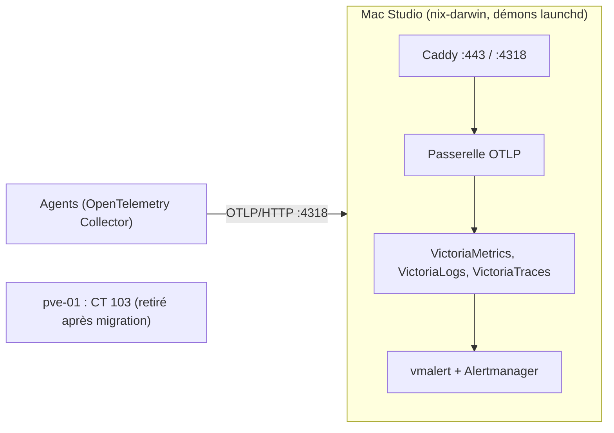

# ADR-022 Héberger l'appliance d'observabilité sur un Mac Studio dédié

## Contexte et problème

L'appliance d'observabilité ([ADR-013](./ADR-013-Observabilite-Centralisee-VictoriaMetrics-sur-LXC.md)) tourne dans le
LXC NixOS `observability` (CT 103) de l'hôte Proxmox `pve-01`. Elle regroupe VictoriaMetrics, VictoriaLogs,
VictoriaTraces, vmalert, Alertmanager, Caddy et la passerelle OTLP (un OpenTelemetry Collector). Le contrat d'ingestion
([ADR-018](./ADR-018-OTLP-comme-Protocole-d-Ingestion-Unique-pour-l-Appliance-d-Observabilite.md)) est simple : un seul
chemin d'écriture, OTLP/HTTP sur `:4318`, et `:443` en lecture seule. Le CT dispose de 4 cœurs, de 8 GiB de mémoire,
sans swap, et d'un volume `/persistent` de 80 Go, dont 13 Go utilisés (17 %) le 2026-11-15 (mesuré sur `pve-01` :
`pct config 103`, puis `df -h` dans le CT 103). Les limites mémoire figurent dans le
[README du LXC](https://github.com/chezmoidotsh/arcane/blob/53c37daf4e1db440c1b1ba53a06167dbf975c380/projects/chezmoi.sh/src/infrastructure/proxmox/lxc/o11y-datastore/README.md).

Deux problèmes se cumulent.

**Le CT n'a pas assez de calcul pour les requêtes lourdes, et `pve-01` n'en a pas à lui prêter.** Mesures du 2026-11-14
(vers 18 h 20, par les API de la pile elle-même), sur 7 jours de journaux (environ 4,5 millions de lignes) :

| Requête                                                                   | Résultat                                                                          |
| ------------------------------------------------------------------------- | --------------------------------------------------------------------------------- |
| `stats by (k8s.namespace.name) count()` (champ indexé)                    | 0,1 s                                                                             |
| Regex sur `_msg` : `(?i)(error\|fail\|timeout).*(conn\|refused\|reset)`   | Délai dépassé à 300 s, sans résultat                                              |
| `stats count_uniq(_msg)`                                                  | Refusée après 5 s : « requires more than 2048MB of memory » (plafond par requête) |
| VictoriaMetrics : `count(quantile_over_time(0.99, {__name__=~".+"}[7d]))` | Délai dépassé à 30 s (`-search.maxQueryDuration`)                                 |

Pendant le test, VictoriaLogs a consommé jusqu'à 3,78 cœurs sur les 4 du CT, pour environ 550 Mo de mémoire résidente
(VictoriaMetrics : environ 580 Mo). Le disque n'est pas en cause : le NVMe de `pve-01` reste occupé à 15 % au plus, pour
environ 6 Mo/s en lecture et une pression d'E/S (PSI) nulle. Le facteur limitant est le CPU. Or `pve-01` porte déjà une
charge d'environ 19 sur 32 threads, avant comme pendant le test, avec les VM Talos de `lungmen.akn` et `rhodes.akn` et
d'autres LXC. Augmenter les cœurs du CT a été refusé : l'observabilité ne doit pas dégrader ces charges. Sur un hôte
partagé, le choix est donc entre des requêtes plafonnées et un voisin bruyant.

**L'appliance est hébergée par l'hôte qu'elle supervise.** L'ADR-013 pose le principe qu'un système de supervision
hébergé dans ce qu'il supervise devient aveugle quand il est le plus utile. Il l'applique aux clusters, mais l'appliance
et son Dead-Man's-Switch tournent aujourd'hui sur `pve-01` : une panne de `pve-01` coupe en même temps les VM Talos, les
LXC et l'observabilité. Les incidents du jour montrent aussi la fragilité du dimensionnement actuel : le CT, alors
limité à 2 GiB, s'est figé quand VictoriaLogs a rempli la mémoire (cache de pages évincé).

La question stratégique à laquelle cet ADR répond est la suivante : **sur quelle machine héberger l'appliance
d'observabilité pour qu'elle dispose du calcul nécessaire aux requêtes lourdes, sans pénaliser les charges de `pve-01`
et en sortant du domaine de panne de l'hôte qu'elle supervise ?**

## Hors périmètre

- **Le contrat d'ingestion** :
  [ADR-018](./ADR-018-OTLP-comme-Protocole-d-Ingestion-Unique-pour-l-Appliance-d-Observabilite.md) reste inchangé
  (OTLP/HTTP seul sur `:4318`, `:443` en lecture seule). Les agents n'ont aucune modification à subir : ils poussent
  vers `data.o11y.chezmoi.sh`, seule la cible DNS change.
- **Le reste de l'ADR-013** : le backend VictoriaMetrics, le modèle à deux niveaux d'alertes et l'indépendance vis-à-vis
  des clusters restent valables. Seule la partie hébergement (LXC sur `pve-01`) est concernée.
- **L'organisation du dépôt** : l'emplacement de la configuration du Mac Studio découle de
  [ADR-021](./ADR-021-Passer-d-une-Vue-Projet-a-une-Vue-Flotte.md) (`fleet/hosts/`). Le déplacement des machines
  existantes y est décidé, pas ici.
- **La haute disponibilité** : l'appliance reste mono-instance, comme décidé par l'ADR-013.
- **Le contenu des charges d'IA** : cet ADR en fixe seulement la contrainte (voir « Décision »), pas le choix des
  modèles ni de l'outillage de l'agent.

## Décision

L'appliance d'observabilité passe du LXC `observability` (CT 103) de `pve-01` à un **Mac Studio dédié, configuré avec
nix-darwin**. Un Mac Studio M1 Max (32 Go de mémoire unifiée, 10 cœurs dont 8 performants et 2 d'efficacité), déjà
acheté et sous-utilisé, héberge la pile : les services tournent directement sur macOS comme démons `launchd`, déclarés
avec nix-darwin dans le dépôt, avec les paquets nixpkgs actuels. Les endpoints et le contrat d'ingestion ne changent pas
; seule la cible DNS de `data.o11y.chezmoi.sh` change.

Le Mac Studio peut aussi héberger des charges d'IA légères (un bac à sable pour un agent, de petits modèles comme un
petit Gemma). La machine est **partagée**, sans priorité d'une charge sur l'autre ; le partage repose sur des budgets :

- chaque charge (observabilité comme IA) a un budget de ressources borné et documenté (CPU, mémoire, mémoire GPU), fixé
  avant son déploiement ;
- le disque est un SSD interne de 1 To, partagé entre les modèles d'IA et les données d'observabilité. À titre de
  comparaison, le volume `/persistent` du LXC actuel fait 80 Go, dont 13 Go utilisés (17 %) le 2026-11-15 (voir le
  contexte) ;
- la mémoire GPU câblée est limitée (`iogpu.wired_limit_mb`), car la mémoire est unifiée et que rien d'autre ne
  l'empêche de s'étendre ;
- aucune de ces charges n'est un prérequis de l'appliance, et son arrêt ne doit rien changer à l'observabilité.

**Emplacement de la configuration : `fleet/hosts/akn.ptilopsis/`.** Le Mac Studio sert deux usages à la fois
(l'observabilité de `chezmoi.sh` et les charges d'IA, la pile envisagée sous le nom `shodan.akn`) : le ranger sous l'un
des deux ferait dépendre l'autre d'un projet qui n'est pas le sien. Selon
[ADR-021](./ADR-021-Passer-d-une-Vue-Projet-a-une-Vue-Flotte.md), c'est un hôte de la flotte, nommé d'après Ptilopsis
(Rhine Lab) : sa configuration nix-darwin vit dans `nix/`, son Pulumi dans `pulumi/`. Le rôle d'appliance
d'observabilité passe du LXC `o11y-datastore` (qui reste sous `projects/chezmoi.sh` jusqu'à cette migration, sans
dossier intermédiaire dans `fleet/`) à `fleet/hosts/akn.ptilopsis/`, avec un seul `pulumi state move` (ADR-021). Retirer
le LXC est un prérequis de la fin de la migration d'ADR-021. Les modules de `o11y-datastore/modules/` deviennent donc
des modules de rôle partagés (`catalog/nix/modules/`) plutôt qu'une configuration propre au LXC.

Les étapes de la migration sont dans
[Migrer l'observabilité vers le Mac Studio](../migrations/MIGR-20261115-00-Migrer-l-Observabilite-vers-le-Mac-Studio.md).

## Pourquoi ce choix

La réponse devait exécuter toute la pile actuelle (VictoriaMetrics, VictoriaLogs, VictoriaTraces, vmalert, Alertmanager,
Caddy, passerelle OTLP) avec les mêmes endpoints, et rendre exécutables les requêtes lourdes mesurées plus haut, sans
dégrader `pve-01` ni les clusters qu'il héberge. Elle devait sortir l'appliance du domaine de panne de `pve-01`
(principe de l'ADR-013), rester déclarative et versionnée (règles GitOps n° 1 et n° 2) et exploitable par un seul
mainteneur. Les contraintes étaient que le matériel existe déjà (aucun achat, consommation de l'ordre de 250 kWh par
an), que l'appliance a un état à sauvegarder et une rétention à tenir sur un SSD interne de taille fixe, que les agents
ne changent pas, et que la machine est partagée avec des charges d'IA au budget borné.

Le Mac Studio règle les deux problèmes à la fois : il donne à l'appliance du calcul que `pve-01` ne peut pas prêter sans
pénaliser ses VM (10 cœurs, partagés seulement avec des charges d'IA au budget borné, donc les pics de VictoriaLogs ne
touchent plus les VM Talos), et il sort l'appliance du domaine de panne de l'hôte qu'elle supervise. Il reste déclaratif
et versionné, dans la continuité de NixOS (mêmes paquets nixpkgs, même langage), sur du matériel déjà acheté.

Les compromis sont acceptés. macOS n'est pas un système serveur (mises à jour, veille, redémarrage après coupure), et il
n'y a pas de cgroups systemd, donc plus de plafonds `MemoryMax`. Les modules NixOS du LXC ne sont pas réutilisables tels
quels et doivent être portés une fois : c'est un coût fini, préféré à une couche à exploiter en continu (voir
l'alternative de la machine virtuelle ci-dessous).

### Alternatives écartées

**Plus de cœurs pour le CT.** Augmenter les cœurs du CT a été refusé : l'observabilité ne doit pas dégrader les charges
de `pve-01`, déjà à environ 19 threads sur 32 avant comme pendant le test. Sur un hôte partagé, le choix est entre des
requêtes plafonnées et un voisin bruyant, et cela ne sort pas l'appliance du domaine de panne de l'hôte.

**Une machine virtuelle Linux sur le Mac (OrbStack ou UTM).** Une VM exécuterait la configuration NixOS actuelle de
`o11y-datastore/`, ce qui réutiliserait les modules existants et retrouverait `MemoryMax` et systemd. Elle ajoute
pourtant une couche de virtualisation à exploiter, à mettre à jour et à superviser, pour une pile de binaires Go qui
tournent nativement sur macOS ; une partie de la mémoire et du CPU lui est réservée, les E/S passent par le disque
virtuel, et son démarrage devient une dépendance de plus après chaque redémarrage du Mac.

**Un cluster Kubernetes (`rhodes.akn` ou `lungmen.akn`).** L'intégration ArgoCD serait native, mais cela contredit le
principe de l'ADR-013 : le superviseur partagerait le domaine de panne des clusters supervisés, et resterait sur
`pve-01`.

---

## Conséquences

### Positives

- (+) **Requêtes lourdes possibles** : l'appliance dispose de 10 cœurs et de 32 Go, partagés avec des charges d'IA au
  budget borné ; les plafonds de requête se règlent sur ce budget, plus sur ce que `pve-01` tolère.
- (+) **`pve-01` protégé** : plus aucun pic de VictoriaLogs sur l'hôte des VM Talos.
- (+) **Domaine de panne distinct** : une panne de `pve-01` n'interrompt plus la collecte, ni l'alerte, ni le heartbeat
  du Dead-Man's-Switch (sous réserve de l'emplacement du heartbeat, à fixer dans le guide de migration).
- (+) **Aucun changement côté agents** : seule la cible DNS de `data.o11y.chezmoi.sh` change.
- (+) **Matériel déjà acheté** : pas d'achat, de l'ordre de 250 kWh par an en fonctionnement 24 h/24.

### Négatives

- (-) **macOS n'est pas un système serveur** : les mises à jour redémarrent la machine. Elles sont donc déclenchées à la
  main, jamais automatiquement ; la veille est désactivée et le redémarrage après coupure de courant activé (`pmset`).
- (-) **Plus de plafonds `MemoryMax`** : sans cgroups systemd, un service qui dérape ne se fait plus tuer seul. Il reste
  `-memory.allowedBytes` et les limites par requête de chaque store. Le partage de la machine repose donc sur les
  budgets de chaque charge (voir « Décision »), pas sur un plafond du système.
- (-) **Pare-feu à remplacer** : le pare-feu Proxmox par CIDR source disparaît. Les mêmes règles (443 et 4318 depuis le
  LAN, Tailscale) doivent être reprises dans `pf` ou le pare-feu applicatif de macOS. Comme l'ADR-013 n'a pas
  d'authentification d'ingestion, cette règle redevient la seule frontière d'accès.
- (-) **Modules à porter** : les modules NixOS de `o11y-datastore/modules/` ne s'appliquent pas à nix-darwin. Il faut
  les réécrire en démons `launchd`, avec un risque de dérive entre les deux implémentations pendant la migration.
- (-) **Rétention limitée par le SSD interne** : le disque de 1 To est partagé avec les modèles d'IA. Les rétentions
  actuelles (18 mois de métriques, 30 jours de journaux, 2 jours de traces) doivent tenir dans la part du disque donnée
  à l'observabilité, part fixée avant la migration (voir la page de migration).
- (-) **Plus de snapshot Proxmox** : la sauvegarde de `/persistent` par snapshot du CT n'existe plus sur le Mac, il faut
  définir l'équivalent.
- (-) **Toujours un point de défaillance unique** : une seule machine physique, mais ce n'est plus `pve-01`.

### Neutres

- (\~) **Le dimensionnement des limites change de nature** : le README du LXC décrit un budget mémoire à plafonds durs ;
  sur le Mac, ce sont des plafonds applicatifs seulement. Le tableau devra être réécrit à la migration.
- (\~) **Migration en quatre étapes** : configuration nix-darwin, portage des modules, bascule DNS (ou mirroring des
  écritures pendant quelques jours), puis retrait du CT 103 après une fenêtre de rétention. Le CT 103 reste pendant la
  période de fonctionnement en parallèle. Le détail est dans le guide de migration.
- (\~) **Deux organisations coexistent** pendant la migration décrite par
  [ADR-021](./ADR-021-Passer-d-une-Vue-Projet-a-une-Vue-Flotte.md) : `fleet/` pour le Mac Studio, `projects/` pour le
  reste. Cet état est temporaire : la migration prend fin quand `projects/` n'existe plus. `AGENTS.md` (structure du
  dépôt) est à mettre à jour.

---

## Historique des modifications

- **2026-11-15** : **CLARIFICATION** : Taille du disque du Mac Studio renseignée (SSD interne de 1 To, partagé entre les
  modèles d'IA et les données d'observabilité) ; la question ouverte « Taille du SSD et rétention » est retirée, la part
  du disque d'observabilité étant à fixer avant la migration.
- **2026-11-15** : **CLARIFICATION** : Restructuration sur le gabarit d'ADR 3.0.0 : décision énoncée en premier, section
  `Pourquoi ce choix` avec les alternatives réellement envisagées (plus de cœurs pour le CT, machine virtuelle, cluster
  Kubernetes), plan de mise en œuvre déplacé dans un guide, questions ouvertes réduites à celle qui bloque la décision.
  Aucun changement de fond.
- **2026-11-14** : **CLARIFICATION** : Renumérotation (ADR-021 devient ADR-022) et alignement sur
  [ADR-021](./ADR-021-Passer-d-une-Vue-Projet-a-une-Vue-Flotte.md) : le Mac est l'hôte `fleet/hosts/akn.ptilopsis/` et
  reprend le rôle du LXC `o11y-datastore`, au lieu du dossier `hosts/` initialement prévu. Le titre de l'ADR-021 et son
  nom de fichier ont changé (vue projet vers vue flotte) ; le Mac Studio n'en est plus le déclencheur mais le
  révélateur.
- **2026-11-14** : **FEATURE** : Création de l'ADR avec le statut `proposed`. Si elle est acceptée, la décision remplace
  la partie hébergement de l'[ADR-013](./ADR-013-Observabilite-Centralisee-VictoriaMetrics-sur-LXC.md).

---

## Pour aller plus loin

- [ADR-013 Observabilité centralisée VictoriaMetrics sur LXC](./ADR-013-Observabilite-Centralisee-VictoriaMetrics-sur-LXC.md)
  : la décision d'origine, dont cet ADR propose de remplacer la partie hébergement.
- [ADR-021 Passer d'une vue projet à une vue flotte](./ADR-021-Passer-d-une-Vue-Projet-a-une-Vue-Flotte.md) : où vit la
  configuration du Mac Studio (`fleet/hosts/akn.ptilopsis/`).
- [ADR-018 OTLP comme protocole d'ingestion unique](./ADR-018-OTLP-comme-Protocole-d-Ingestion-Unique-pour-l-Appliance-d-Observabilite.md)
  : le contrat d'ingestion, inchangé.
- [Migrer l'observabilité vers le Mac Studio](../migrations/MIGR-20261115-00-Migrer-l-Observabilite-vers-le-Mac-Studio.md)
  : les étapes de la migration.
- [README du LXC d'observabilité](https://github.com/chezmoidotsh/arcane/blob/53c37daf4e1db440c1b1ba53a06167dbf975c380/projects/chezmoi.sh/src/infrastructure/proxmox/lxc/o11y-datastore/README.md) :
  l'implémentation actuelle, dont les limites mémoire et les modules à porter.
- [nix-darwin](https://github.com/nix-darwin/nix-darwin) : la configuration déclarative de macOS.
- [VictoriaLogs, limites de requêtes](https://docs.victoriametrics.com/victorialogs/) : `-memory.allowedBytes` et les
  plafonds par requête.
