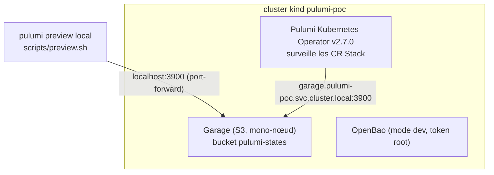

# Expérimentation 2026-07-02 Évaluation Pulumi Contre Crossplane

Migré le 2026-10-11 ; les résultats décrits sont ceux de l'époque et n'ont pas été rejoués.

Cette expérience (EXP-2026-006, issue [#1089](https://github.com/chezmoidotsh/arcane/issues/1089)) évalue si Pulumi et
le Pulumi Kubernetes Operator (v2.7.0) peuvent remplacer Crossplane, XRD personnalisées comprises, avec une fraction de
l'empreinte. Le montage local fonctionne et les questions fonctionnelles et de sécurité sont tranchées ; la mesure
d'empreinte, elle, n'a jamais été faite. L'expérience a alimenté
l'[ADR-015](../decisions/ADR-015-Migrer-Crossplane-vers-Pulumi.md).

Statut de l'époque : `IN_PROGRESS`, créée et dernière mise à jour le 2026-07-02.

## Question

Le modèle par fournisseur de Crossplane pèse trop lourd pour un homelab. Empreinte relevée sur `main` le 2026-07-02, par
`grep` de `kind: Provider`, `Function`, `Token`, `Policy` dans `projects/**/src/infrastructure/crossplane`, recoupée
avec les Compositions pour les ressources produites par démultiplication :

| Élément                   | Quantité                                                                                                                 |
| ------------------------- | ------------------------------------------------------------------------------------------------------------------------ |
| Paquets installés         | 12 : 9 Providers (AWS famille, iam et ses ; Cloudflare famille, account, zone et dns ; Vault ; Terraform) et 3 Functions |
| Jetons d'API Cloudflare   | 8                                                                                                                        |
| Ressources Vault          | environ 19 : 2 claims `ClusterVault` × 5 ressources générées, plus 6 politiques statiques, 2 montages et 1 rôle          |
| Ressources AWS SES et DNS | environ 9, générées par une seule claim `DomainIdentity` (DKIM × 3, MX, SPF, DMARC, mail-from, identité)                 |
| XRD personnalisées        | 2 : `ClusterVault` (3 variantes : Local, Remote, Tailscaled) et `DomainIdentity` (SES et DNS Cloudflare)                 |
| Workspaces Terraform      | 6, exécutés dans Crossplane via `provider-terraform` (Hetzner × 1, Tailscale × 4, Cloudflare × 1)                        |

La migration OCI (#1010, #1076) a été le point de bascule : 7 fournisseurs pour quelques ressources OCI ajoutent environ
500 ressources Kubernetes et une charge CPU et RAM significative. Pulumi propose un autre modèle : un seul Pod
d'opérateur exécute des stacks TypeScript, un paquet npm par fournisseur (aucune CRD installée en permanence), l'état
dans S3, et un flux local `pulumi preview` / `pulumi up` identique à ce que l'opérateur exécute en production.

Exigences posées au POC :

- un backend d'état sans SaaS externe : stockage compatible S3, pas de compte Pulumi Cloud ;
- un flux local `pulumi preview` / `pulumi up` qui utilise le même état que l'opérateur dans le cluster ;
- une cible OpenBao utilisable par le fournisseur `@pulumi/vault`, sans toucher à `vault.chezmoi.sh` ;
- un montage reproductible depuis un checkout propre en une commande, entièrement jetable.

Hors périmètre : la validation Cloudflare et multi-fournisseurs (elle exige l'API Cloudflare réelle, même avec un jeton
restreint), AWS SES et `DomainIdentity`, les Workspaces Terraform Hetzner et Tailscale, OCI, la variante
`TailscaledClusterVault` et toute modification des ressources OpenBao que Crossplane gère sur `amiya.akn` et
`lungmen.akn`.

## Montage

Tout s'exécute dans un cluster kind local jetable (`pulumi-poc`, namespace `pulumi-poc`) : aucun cluster, aucun OpenBao
et aucun compte Cloudflare réels ne sont touchés.



Les exécutions locale et dans le cluster partagent l'état parce qu'elles visent le même bucket et la même clé ; seul le
point d'accès change. C'est le fonctionnement prévu du backend DIY de Pulumi.

| Fichier                                                                                                                                                                                                                                    | Rôle                                                                               |
| ------------------------------------------------------------------------------------------------------------------------------------------------------------------------------------------------------------------------------------------ | ---------------------------------------------------------------------------------- |
| [`package.json`](20260702-pulumi-crossplane-evaluation/package.json)                                                                                                                                                                       | workspaces npm reliant `stack/` et `catalog/cluster-vault/`                        |
| [`catalog/cluster-vault/`](20260702-pulumi-crossplane-evaluation/catalog/cluster-vault)                                                                                                                                                    | `ClusterVaultComponent` testé (partagé, pas propre au bac à sable)                 |
| [`manifests/garage.yaml`](20260702-pulumi-crossplane-evaluation/manifests/garage.yaml)                                                                                                                                                     | Garage mono-nœud (backend d'état S3)                                               |
| [`manifests/openbao-credentials.yaml`](20260702-pulumi-crossplane-evaluation/manifests/openbao-credentials.yaml)                                                                                                                           | adresse et token OpenBao du mode dev, en Secret                                    |
| [`manifests/pulumi-credentials.yaml`](20260702-pulumi-crossplane-evaluation/manifests/pulumi-credentials.yaml)                                                                                                                             | passphrase Pulumi fixe, réservée au dev, en Secret                                 |
| [`stack/index.ts`](20260702-pulumi-crossplane-evaluation/stack/index.ts)                                                                                                                                                                   | programme Pulumi TypeScript (`ClusterVaultComponent`, variante Local)              |
| [`stack/stack.yaml`](20260702-pulumi-crossplane-evaluation/stack/stack.yaml)                                                                                                                                                               | CR Stack facultative, plus `ServiceAccount` et `ClusterRoleBinding` de l'opérateur |
| [`scripts/bootstrap.sh`](20260702-pulumi-crossplane-evaluation/scripts/bootstrap.sh), [`preview.sh`](20260702-pulumi-crossplane-evaluation/scripts/preview.sh), [`teardown.sh`](20260702-pulumi-crossplane-evaluation/scripts/teardown.sh) | cycle de vie du bac à sable, branché sur `mise run poc:*`                          |

`ClusterVaultComponent` est un `ComponentResource` Pulumi qui remplace les Compositions Crossplane de
`catalog/crossplane/clustervault.vault.chezmoi.sh/` : un montage KV v2, un backend d'authentification Kubernetes, une
politique de lecture pour ESO et un rôle d'authentification ESO. `stack/index.ts` en instancie la variante Local pour un
cluster fictif (`poc-cluster`) et ne référence jamais `amiya.akn` ni `lungmen.akn`.

### Amorcer et détruire

```sh
mise run poc:bootstrap
```

La commande est idempotente : elle crée le cluster kind s'il manque, le réutilise sinon. Elle déploie dans l'ordre
Garage, OpenBao en mode dev (chart Helm officiel, `server.dev.enabled=true`), le Pulumi Kubernetes Operator
(`oci://ghcr.io/pulumi/helm-charts/pulumi-kubernetes-operator`, épinglé en v2.7.0) et un Secret avec une passphrase
Pulumi fixe : le `pulumi preview` local et l'opérateur doivent déchiffrer la même configuration de stack stockée sur S3
avec la même passphrase.

`stack/stack.yaml` porte son propre `ServiceAccount` et `ClusterRoleBinding` (`pulumi`, lié à `system:auth-delegator`),
appliqués uniquement avec ce fichier et pas à l'amorçage : les Pods de workspace s'authentifient auprès de l'opérateur
par l'API `TokenReview`.

```sh
mise run poc:teardown   # supprime le cluster kind et tout son contenu
```

### Flux de développement local

```sh
mise run poc:preview
```

Le script redirige Garage (`3900`) et OpenBao (`8200`) vers localhost, installe les dépendances npm depuis la racine de
workspace du dossier, se connecte au backend S3 et lance `pulumi preview` depuis `stack/`. Les identifiants fixes du bac
à sable (`AWS_ACCESS_KEY_ID`, `AWS_SECRET_ACCESS_KEY`, `VAULT_ADDR`, `VAULT_TOKEN`, `PULUMI_CONFIG_PASSPHRASE`) viennent
du bloc `[env]` de `.mise.toml`, donc uniquement sous `mise run`. Le `package.json` déclare `stack/` et
`catalog/cluster-vault/` comme workspaces npm : une seule installation hisse `@pulumi/pulumi` et `@pulumi/vault` dans un
`node_modules` commun, sans installation séparée dans le module du catalogue, ni dans le script ni dans un vrai run de
l'opérateur. Ce `package.json` est propre au POC et ne fait pas partie de la configuration npm de la racine du dépôt.

Pour valider aussi l'opérateur dans le cluster contre le même état, pousser d'abord la branche, puis :

```sh
kubectl apply -f stack/stack.yaml
kubectl -n pulumi-poc get stacks.pulumi.com pulumi-crossplane-poc-sandbox -w
```

`stack.yaml` est livré avec `preview: true`, par parité avec une CR Stack de cluster réel (le bac à sable étant
jetable).

### Pourquoi Garage plutôt que MinIO

Garage (Deuxfleurs) est un stockage compatible S3, plus léger et écrit en Rust, plus cohérent avec le thème de sobriété
de l'évaluation. Son chart Helm amont n'est pas publié dans un registre (clone git seulement, pas de version à épingler)
et demande une étape manuelle de layout. Le bac à sable utilise donc un Deployment simple entièrement épinglé
(`manifests/garage.yaml`) avec les options `--single-node --default-bucket` (Garage 2.3.0 ou plus), qui font au
démarrage l'équivalent du layout, du bucket et de la clé manuels.

### Pod de workspace : image et cache npm

L'image de workspace par défaut de l'opérateur est `pulumi/pulumi:latest-nonroot` (environ 3 Go : CLI Pulumi et
Node.js). `stack/stack.yaml` la remplace via `spec.workspaceTemplate` :

- **Tag épinglé** (`pulumi/pulumi:3.250.0-nonroot`, la version du CLI local fournie par `mise`). `crictl images`
  confirme que les deux tags pointent sur le même digest : l'enjeu n'est pas la taille mais l'`imagePullPolicy`.
  Kubernetes applique `Always` à un tag `latest` et `IfNotPresent` à tout autre tag ; sans politique explicite, l'image
  de 3 Go est retéléchargée à chaque (re)création du Pod, même présente sur le nœud. Après épinglage, un Pod recréé de
  force affiche `pullPolicy=IfNotPresent` et passe `Ready` en moins d'une seconde.
- **Volume éphémère pour le cache npm** : `spec.workspaceTemplate.spec.podTemplate.spec.volumes[].ephemeral` (volume
  éphémère générique Kubernetes), adossé à une vraie StorageClass (`standard`, le provisionneur `rancher.io/local-path`
  de kind). Le PVC est créé pour le Pod du workspace (`ownerReferences: [Pod/<workspace-pod>]`) et collecté avec lui. La
  persistance est sacrifiée volontairement : si un `pulumi up` tirait un paquet npm compromis dans le cache, celui-ci
  disparaît avec le Pod au lieu de resservir le même contenu empoisonné aux runs suivants. `NPM_CONFIG_CACHE=/npm-cache`
  est positionné sur le conteneur `pulumi`. Vérifié : après suppression du Pod, le StatefulSet le recrée et le PVC
  éphémère revient vide (`du -sh /npm-cache` donne `0` immédiatement après, `32M` après la réconciliation suivante).

L'épinglage de l'image ne survit pas à `mise run poc:teardown`, qui supprime le cluster kind et le cache d'images
containerd du nœud. Il ne profite qu'aux redémarrages de Pod dans un cluster vivant (changement de spec de la Stack,
éviction) ; c'est la raison principale pour laquelle une reconstruction complète du bac à sable reste lente. Le volume
de cache npm n'a pas ce défaut puisqu'il est conçu pour se réinitialiser à chaque recréation de Pod.

### Chaîne d'approvisionnement npm

Un lockfile épinglé et Trivy ne suffisent pas à garantir qu'un paquet n'est pas compromis. Les hashes SRI du lockfile
assurent les mêmes octets à chaque installation, pas leur innocuité ; la plupart des incidents npm (version malveillante
publiée sous un nom légitime, exfiltration par `postinstall`) n'ont aucun CVE, donc Trivy (OSV, GHSA, NVD) ne les voit
pas, et il n'inspecte pas les scripts d'installation. Amélioration native retenue : `scripts/preview.sh` exécute
`npm ci` au lieu de `npm install`, ce qui installe strictement depuis `package-lock.json` et échoue bruyamment en cas de
dérive avec `package.json`. `npm audit signatures` (vérification de la signature du registre) reste une option native
non branchée ; un vrai détecteur comportemental de paquets malveillants (type Socket.dev) est hors périmètre.

### Isolation réseau (non validée)

Un artefact OCI construit en CI, scanné par Trivy, dépendances pré-résolues, poussé dans Zot et monté en lecture seule
via la fonctionnalité `ImageVolume` (GA depuis Kubernetes 1.36, containerd 2.1 ou plus, et le CRD Stack modélise déjà
`volumes[].image`), a été évalué à la place de l'installation npm à l'exécution. Il est faisable au niveau Kubernetes et
containerd, mais rejeté pour deux raisons :

- l'étape interne d'installation des dépendances de l'opérateur écrit systématiquement dans `node_modules`, même quand
  il est déjà présent et conforme au lockfile : reproduit en `EROFS` sur un montage en lecture seule, sans champ du CRD
  pour la sauter ;
- Trivy et un lockfile épinglé n'arrêtent pas le pire cas (une version malveillante publiée sous le hash exact que le
  lockfile épingle). Le coût de la CI, de l'artefact et de son cycle de vie ne se justifie pas face à cette réduction de
  risque marginale.

La meilleure parade à la même menace (une dépendance compromise qui exfiltre des secrets ou ouvre un reverse shell) est
une `CiliumNetworkPolicy` de sortie par Stack : limiter le Pod de workspace au DNS, au backend d'état S3, au point
d'accès OpenBao cible, à l'API Cloudflare (si elle gère des jetons), au registre npm et à GitHub (clones `projectRepo`).
Elle complète les mesures précédentes et plafonne les dégâts quelle que soit l'origine de la compromission.

Elle n'a pas été testée : `kubectl get pods -n kube-system` montre `kindnet` et non Cilium, qui n'applique aucune
NetworkPolicy, donc une `CiliumNetworkPolicy` y serait ignorée sans signal. Les vrais clusters (`amiya.akn`,
`lungmen.akn`) exécutent Cilium. Valider demanderait de recréer le cluster kind avec `disableDefaultCNI: true` et
d'installer Cilium par Helm ; reporté.

## Résultats

| ID    | Critère                                                                                  | Statut à l'époque                                 |
| ----- | ---------------------------------------------------------------------------------------- | ------------------------------------------------- |
| V-001 | `mise run poc:bootstrap` monte Garage, OpenBao et l'opérateur                            | Fait : exécuté de façon répétée, idempotent       |
| V-002 | `ClusterVaultComponent` couvre la variante Local                                         | Fait (code)                                       |
| V-003 | `mise run poc:preview` réussit contre l'état du bac à sable                              | En attente : script non exécuté de bout en bout   |
| V-004 | Le run de l'opérateur (`stack/stack.yaml`) lit et écrit le même état S3 que le run local | Fait : réconcilie de façon répétée en `succeeded` |
| V-005 | Empreinte de l'opérateur (CPU et RAM au repos et en réconciliation) mesurée              | En attente                                        |
| V-006 | Tableau comparatif Crossplane contre Pulumi (ressources, CRD, CPU et RAM, DX)            | En attente : dépend de V-005                      |

`mise run poc:bootstrap` et la réconciliation de la Stack dans le cluster ont été exécutés de façon répétée sur le bac à
sable vivant et atteignent systématiquement `succeeded`
(`kubectl get stacks.pulumi.com pulumi-crossplane-poc-sandbox -n pulumi-poc`), y compris après suppression du Pod de
workspace pour éprouver le volume de cache éphémère et la `pullPolicy` de l'image épinglée. `mise run poc:preview` (flux
local par port-forward) n'a pas été exécuté de bout en bout ; seule son étape `npm ci` a été validée isolément.

Les essais de durcissement des dépendances et d'isolation réseau sont allés à leur terme, dont une conception rejetée
(volume d'image OCI et `node_modules` en lecture seule, reproduit en échec `EROFS`). V-005 et V-006 restent à faire :
ils demandent une passe de mesure dédiée, pas seulement des runs de fonctionnement.

## Conclusion

Le verdict complet V-001 à V-006 restait ouvert, mais les questions fonctionnelles et de sécurité sont assez résolues
pour dimensionner la suite. L'expérience est adoptée dans son principe : Pulumi peut plausiblement gérer presque tout ce
que Crossplane gère (`ClusterVault`, `DomainIdentity` et au-delà) pour une fraction de l'empreinte, avec deux
exceptions.

- **Proxmox et Unifi restent hors de Kubernetes et du GitOps.** Les deux sont fondateurs (Proxmox héberge tous les
  clusters, Unifi est le socle réseau). Donner à une charge dans un cluster des identifiants en écriture sur ce qui
  l'héberge crée un cycle de confiance : `Proxmox → héberge K8s → K8s gère Proxmox`. Une compromission dans ce cluster
  (le scénario npm ci-dessus) passerait de « un montage Vault » à « l'hyperviseur physique ». L'intégration Proxmox
  CSI/CCM existante ([expérience](Experimentation-2026-06-17-Proxmox-CSI-et-CCM.md)) accepte une version de ce risque,
  mais avec un token limité à la lecture et à l'attachement ; gérer VM, stockage et SDN en IaC serait un identifiant
  bien plus large sur l'hyperviseur qui héberge l'exécuteur. Tout faire à la main violerait la règle non négociable «
  déclaratif et versionné » ; la piste est d'exécuter cet IaC hors de tout cluster hébergé par Proxmox (par exemple une
  CI hébergée par GitHub appliquant au merge, pas un opérateur auto-hébergé). Question de conception laissée ouverte.
- **Aucun fournisseur Pulumi de première partie n'existait pour Garage, Talos Omni et Pocket-Id.** Des fournisseurs
  Terraform communautaires existent pour Garage et Pocket-Id (un pont aurait coûté moins), mais les trois sont
  développés en fournisseurs **natifs** contre l'API de chaque produit, sans pont Terraform ; Omni n'a de toute façon
  aucun fournisseur Terraform à ponter.

Le risque résiduel de chaîne d'approvisionnement est réel, impossible à fermer entièrement, mais maîtrisable : `npm ci`
et le cache éphémère ferment les failles bon marché (dérive du lockfile, persistance du cache après compromission),
l'artefact OCI audité est rejeté, et la `CiliumNetworkPolicy` de sortie par Stack est la couche suivante recommandée,
non testée ici (CNI différent).

Idée hors résultats : un outil de visualisation de ce que Pulumi gère (par exemple
[mlops-club/pulumi-ui](https://github.com/mlops-club/pulumi-ui)) comblerait le principal manque d'ergonomie,
l'équivalent de `kubectl get composite,claim` pour l'état Pulumi. Non évalué, non priorisé.

Reporté : la validation Cloudflare et multi-fournisseurs (jeton Cloudflare réel exigé, hors « local et jetable »), le
basculement des vrais clusters, la validation de la `CiliumNetworkPolicy` (bac à sable à reconstruire avec Cilium).

Suites ouvertes depuis cette expérience :

| Issue                                                       | Objet                                                                                                                                                                                                          |
| ----------------------------------------------------------- | -------------------------------------------------------------------------------------------------------------------------------------------------------------------------------------------------------------- |
| [#1091](https://github.com/chezmoidotsh/arcane/issues/1091) | Migrer la gestion des ressources Crossplane vers le Pulumi Kubernetes Operator (conception d'abord : `ApplicationSet` ArgoCD pour générer les CR Stack, chemin pour le code Pulumi manuel, ordre de migration) |
| [#1092](https://github.com/chezmoidotsh/arcane/issues/1092) | Fournisseur Pulumi natif pour Garage, contre son API d'administration v2 ; priorité relevée, Garage devenant le S3 principal du homelab                                                                        |
| [#1093](https://github.com/chezmoidotsh/arcane/issues/1093) | Fournisseur Pulumi natif pour Talos Omni                                                                                                                                                                       |
| [#1095](https://github.com/chezmoidotsh/arcane/issues/1095) | Fournisseur Pulumi natif pour Pocket-Id (clients OIDC, utilisateurs, groupes), contre son API REST                                                                                                             |
| [#1094](https://github.com/chezmoidotsh/arcane/issues/1094) | Inventaire de l'infrastructure encore gérée à 100 % à la main, pour documenter l'exclusion Proxmox/Unifi comme un cas parmi d'autres                                                                           |

> [!NOTE]\
> **État au 2026-10-11 : Crossplane a disparu du dépôt, la phase en cluster n'est pas engagée.** `catalog/crossplane/`
> n'existe plus et aucun dossier `projects/*/src/infrastructure/crossplane/` n'existe. Chaque projet à infrastructure
> cloud ou hôte porte une stack Pulumi sous `projects/<projet>/src/infrastructure/pulumi/` ; l'état est dans un backend
> S3 Garage (`backend.url` de `projects/chezmoi.sh/src/infrastructure/pulumi/Pulumi.yaml`), et
> `catalog/pulumi/components/` contient un composant `cluster-vault`. Les stacks s'exécutent en local ; aucune ressource
> `Stack` n'apparaît dans `projects/`, comme le constate
> l'[ADR-015](../decisions/ADR-015-Migrer-Crossplane-vers-Pulumi.md). Le répertoire `catalog/pulumi/sdks/` ne contient
> pas de SDK Garage, Omni ni Pocket-Id ; le statut des issues #1092 à #1095 n'a pas été vérifié. `amiya.akn` n'existe
> plus dans `projects/`.

## Pour aller plus loin

- [ADR-015 Migrer Crossplane Vers Pulumi](../decisions/ADR-015-Migrer-Crossplane-vers-Pulumi.md) : la décision alimentée
  par cette expérience.
- [Expérience Proxmox CSI et CCM](Experimentation-2026-06-17-Proxmox-CSI-et-CCM.md) : le précédent sur le risque d'un
  jeton Proxmox dans un cluster.
- [Issue #1089](https://github.com/chezmoidotsh/arcane/issues/1089) : l'évaluation d'origine ;
  [Pulumi Kubernetes Operator](https://github.com/pulumi/pulumi-kubernetes-operator) et
  [backends DIY](https://www.pulumi.com/docs/iac/operations/stack-management/using-a-diy-backend/) : documentation
  amont.
