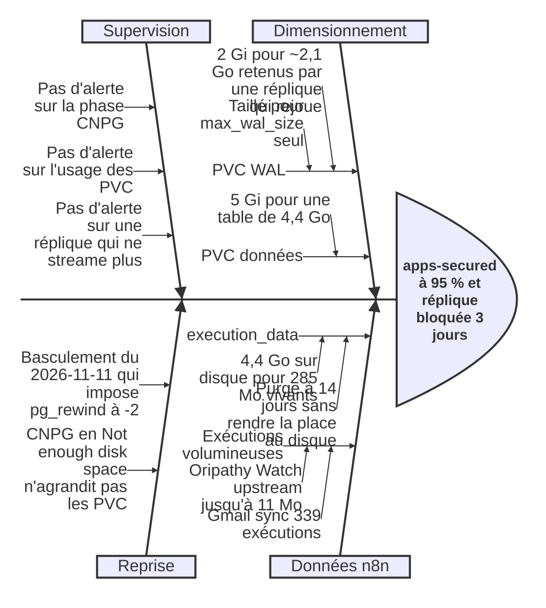

---
title:
  "Disque plein sur le cluster CNPG apps-secured de lungmen.akn : réplique bloquée en boucle pg_rewind pendant 3 jours
  et table n8n gonflée à 4,4 Go"
date: 2026-11-14
author: "[anthropic:claude-opus-5-5]"
participants:
  - "Alexandre"
  - "[anthropic:claude-opus-5-5]"
  - "[system:cloudnative-pg]"
  - "[system:argocd]"
severity: "Medium" # Contenu : la primaire a continué à servir n8n, immich et paperless, mais sans réplique pendant ~3 jours
# et avec la primaire à 95 % de son PVC de données, donc incident structurel contenu, sans perte de données.
status: "Open" # Remédiation terminée le 2026-11-14 ; actions préventives du registre encore à mener.
detection-method: "Manual discovery"
duration: "~3 jours sans réplique (2026-11-11T00:04 → 2026-11-14T01:34 UTC)"
services-affected:
  - "apps-secured-20260530 CNPG cluster (lungmen.akn / namespace: databases)"
  - "n8n, immich, paperless-ngx (bases hébergées, sans haute disponibilité)"
users-affected: "moi seul — aucune indisponibilité observée, haute disponibilité des bases perdue"
root-cause-family:
  - observability-gap
  - storage-undersized
error_signatures:
  - "Not enough disk space"
  - "Insufficient disk space detected in a pod. PostgreSQL cannot proceed until the PVC group is enlarged"
  - "pg_rewind: error: postgres single-user mode in target cluster failed"
  - "Failed to execute pg_rewind"
  - "Readiness probe failed"
procedures:
  - "docs/procedures/databases/DB-20260530-00-Retablir-un-Cluster-CNPG-au-WAL-Plein.md"
related-incidents:
  - path: "docs/incidents/Incident-2026-05-30-WAL-Plein-CNPG-Apps-Secured.md"
    relation: "Même cluster et même phase `Not enough disk space`, mais cause différente (ici l'archivage fonctionne)"
  - path: "docs/incidents/Incident-2026-11-12-WAL-Plein-CNPG-Grafana-Secret-Manquant.md"
    relation: "Même phase `Not enough disk space`, même absence d'alerte sur CNPG et sur les PVC"
related-adrs: []
related-issues:
  - "#1516"
---

# Incident 2026-11-14 Disque plein CNPG Apps Secured Réplique bloquée

Le cluster CloudNative-PG `apps-secured-20260530` de `lungmen.akn` est passé en phase `Not enough disk space` : le PVC
de données (5 Gi) est à 95 % sur les deux instances, et le PVC WAL de la réplique (2 Gi) est plein. La réplique tourne
en boucle sur `pg_rewind` depuis le basculement du 2026-11-11 et ne réplique plus. Rien n'a alerté : l'incident a été
trouvé en cherchant l'origine d'un pic de volume de journaux. Cette page décrit l'événement, ses deux causes (un WAL
sous-dimensionné et une table n8n gonflée) et les contrôles qui manquent.

## Résumé exécutif

La base de données qui héberge n8n, Immich et Paperless tourne sur deux copies, pour qu'une panne de l'une ne coupe pas
les services. Depuis trois jours, la seconde copie était bloquée : son disque de journaux était plein, ce qui
l'empêchait de se remettre à jour après un basculement. Dans le même temps, la copie principale approchait de la
saturation de son disque, à cause d'une table de n8n qui occupait 4,4 Go pour 285 Mo de données utiles. Aucun service
n'a été interrompu, mais plus aucune protection n'existait en cas de panne, et aucune alerte ne l'a signalé. Les disques
ont été agrandis, puis la table sera compactée ; l'incident reviendra tant que ce compactage ne sera pas automatisé.

## Résumé de l'événement

**Résultat attendu :** le cluster `apps-secured-20260530` (2 instances, PostgreSQL 17) est `healthy`, la réplique `-2`
suit la primaire `-1`, et les disques ont de la marge (config dans
`projects/lungmen.akn/src/apps/databases/postgres-apps-secured.helmvalues.yaml`).

**Résultat obtenu :** phase `Not enough disk space`. PVC de données de 5 Gi à 95 % sur les deux instances (~286 Mo
libres). PVC WAL de 2 Gi à 30 % sur la primaire et à 100 % (9,3 Mo libres) sur la réplique `-2`, qui boucle chaque
minute sur `pg_rewind` (ancien primaire du basculement de timeline 13) sans pouvoir terminer la reprise sur incident.
Les bases hébergées sont n8n (4454 Mo), immich (146 Mo) et paperless (22 Mo).

**Impact :** aucune indisponibilité observée, la primaire a servi pendant toute la période. La réplique n'a pas répliqué
pendant ~3 jours : pas de haute disponibilité pour n8n, immich et paperless. La primaire, à 95 % de son disque, était
proche de l'arrêt des écritures. L'archivage WAL fonctionnait (`ContinuousArchiving=True`, `LastBackupSucceeded=True`) :
aucune perte de données.

**Durée :** de 2026-11-11T00:04:34 (basculement, début de la boucle sur `-2`) jusqu'à la découverte, le 2026-11-14.
Remédiation en cours au moment de l'écriture ; le résultat final est à confirmer.

**Premier signal :** les événements Kubernetes `Readiness probe failed` (HTTP 500) sur `apps-secured-20260530-2`,
antérieurs à la découverte et jamais lus.

## Chronologie

<!-- skew: exact pour [system:cloudnative-pg] (`currentPrimaryTimestamp` du Cluster, basculement du 2026-11-11) ;
±? pour toutes les autres lignes, qui viennent de la mémoire d'Alexandre et de la session de diagnostic sans fragment de
journal conservé. La date du déplacement de la base n8n est approximative (PR #1456 et #1457). -->

| Heure (UTC)         | Acteur                       | Événement ou décision                                                                                          |
| ------------------- | ---------------------------- | -------------------------------------------------------------------------------------------------------------- |
| ±? 2026-10-27       | Alexandre                    | La base n8n est déplacée vers `apps-secured` (PR #1456 et #1457)                                               |
| 2026-11-11T00:04:34 | \[system:cloudnative-pg]     | Basculement (timeline 13) : l'ancien primaire `-2` doit passer par `pg_rewind` et commence à boucler           |
| ±? 2026-11-13T23:50 | \[system:argocd]             | Les agents o11y en cluster (PR #1519 et #1521) commencent à collecter les journaux de pods de `lungmen.akn`    |
| 2026-11-13T23:59    | Alexandre                    | Enquête sur un pic de volume de journaux : la boucle de `-2` est la 2e source de journaux du cluster           |
| ±? 2026-11-14T01:00 | \[anthropic:claude-opus-5-5] | Diagnostic : WAL plein sur `-2`, données à 95 %, `execution_data` de n8n à 4,4 Go                              |
| ±? 2026-11-14T01:10 | Alexandre                    | Fusion de la PR #1525 (`storage` 5 Gi → 10 Gi, `walStorage` 2 Gi → 4 Gi) et synchronisation manuelle de l'app  |
| ±? 2026-11-14T01:20 | Alexandre                    | L'opérateur boucle sur `Insufficient disk space` sans agrandir les PVC : patch manuel des 4 PVC (10 Gi / 4 Gi) |
| 2026-11-14T01:26:00 | \[system:cloudnative-pg]     | Les PVC agrandis, `pg_rewind` de `-2` aboutit (`Done!`, 637 Mo copiés) ; `-2` rejoue ~16 Go de WAL depuis S3   |
| 2026-11-14T01:26:59 | \[anthropic:claude-opus-5-5] | `VACUUM (FULL, VERBOSE, ANALYZE) execution_data;` sur `-1` : 16,8 s, 4423 Mo → 298 Mo, PVC données 47 % → 6 %  |
| 2026-11-14T01:27:58 | \[anthropic:claude-opus-5-5] | Rejeu estimé à ~2 h 30 (7 segments/min) : suppression du pod et des 2 PVC de `-2`, CNPG la reclone             |
| 2026-11-14T01:34:38 | \[system:cloudnative-pg]     | `Cluster in healthy state` : `-2` en `streaming`, retard 0, archivage et sauvegarde OK                         |

## Ce qui a bien fonctionné

- **L'archivage WAL et les sauvegardes sont restés sains.** `ContinuousArchiving=True` et `LastBackupSucceeded=True` :
  l'incident n'a mis aucune donnée en danger, contrairement à celui du 2026-05-30.
- **La garde d'espace disque de CNPG.** Elle a placé le cluster en `Not enough disk space` plutôt que de laisser
  PostgreSQL corrompre une base sur un volume plein.
- **Les nouveaux agents o11y ont révélé le problème par effet de bord.** Le volume de journaux (la boucle de `-2` et les
  enregistrements `auditd` de chaque exec `postgres`) a attiré l'attention.
- **Le `StorageClass` `proxmox-lvmthin-ext4` permet l'agrandissement à chaud** (`allowVolumeExpansion`,
  `resizeInUseVolumes`) : aucune recréation de volume n'a été nécessaire.

## Analyse des causes racines

**Technique :** Ishikawa **Pourquoi cette technique :** deux chaînes de causes indépendantes (WAL de la réplique,
gonflement de la table n8n) mènent à la même phase `Not enough disk space`, et une troisième (l'absence de signal) les a
laissées durer ; les 5 Whys ne tiennent pas une seule chaîne.

### Analyse

| Catégorie       | Cause                                                                                                                                                                                                                                                                                                                                                                                 |
| --------------- | ------------------------------------------------------------------------------------------------------------------------------------------------------------------------------------------------------------------------------------------------------------------------------------------------------------------------------------------------------------------------------------- |
| Dimensionnement | Budget WAL d'une réplique qui rejoue ou rattrape : `wal_keep_size` 512 Mo + `max_slot_wal_keep_size` 1500 Mo + `max_wal_size` 100 Mo, soit ~2,1 Go, pour un PVC WAL de 2 Gi. Le volume n'a été dimensionné que pour `max_wal_size`.                                                                                                                                                   |
| Dimensionnement | PVC de données de 5 Gi pour une table `execution_data` qui atteint 4,4 Go sur disque.                                                                                                                                                                                                                                                                                                 |
| Données (n8n)   | La relation TOAST de `execution_data` pèse 4373 Mo (+48 Mo d'index TOAST) pour 285 Mo de données vivantes (`sum(pg_column_size(data))`, 469 exécutions du 2026-10-30 au 2026-11-14) : ~93 % d'espace mort.                                                                                                                                                                            |
| Données (n8n)   | n8n purge les exécutions de plus de 14 jours (défauts du chart : `EXECUTIONS_DATA_PRUNE` à true, âge max 336 h, suppression dure toutes les 15 min). L'autovacuum passe sur la table TOAST (dernier passage 2026-11-14T00:02 UTC) et rend l'espace réutilisable dans la table, mais ne le rend jamais au système de fichiers : le fichier ne fait que grandir jusqu'à son point haut. |
| Données (n8n)   | Plus gros producteurs : « Oripathy - 2. Watch upstream » (15 exécutions, 142 Mo, jusqu'à 11 Mo chacune) et « 1 - Gmail sync to Postgres » (339 exécutions, 61 Mo). Volume vivant de ~14 à 33 Mo par jour.                                                                                                                                                                             |
| Supervision     | Aucune alerte sur la phase du cluster CNPG, l'usage des PVC ou une réplique qui ne streame plus.                                                                                                                                                                                                                                                                                      |
| Reprise         | En phase `Not enough disk space`, l'opérateur CNPG boucle sur `ensure_sufficient_disk_space` et ne propage pas la nouvelle taille aux PVC : il faut les patcher à la main.                                                                                                                                                                                                            |

### Causes racines

- **Le PVC WAL est dimensionné sans le budget de rétention de la réplique.** Une réplique qui rattrape son retard peut
  légitimement retenir ~2,1 Go de WAL dans un volume de 2 Gi : la boucle `pg_rewind` n'a jamais pu finir sa reprise sur
  incident, et la réplique est restée hors ligne.
- **La table `execution_data` de n8n n'est jamais réécrite.** Le motif (gros JSON, purge par suppression, autovacuum
  sans retour d'espace au système de fichiers) fait croître le fichier jusqu'à son point haut ; le PVC de 5 Gi finit par
  être saturé quelle que soit sa taille tant que rien ne compacte la table.
- **L'état du cluster CNPG et de ses PVC ne produit aucun signal.** Trois jours sans réplique et un disque à 95 % sont
  passés inaperçus ; la découverte tient à un hasard.

### Facteurs contributifs

- **La base n8n a été déplacée dans un cluster partagé aux PVC modestes** (PR #1456 et #1457), sans revoir leur taille.
- **Les journaux de la boucle ne remontaient nulle part avant les agents o11y** : la collecte des journaux de pods en
  cluster date du 2026-11-13.
- **L'opérateur ne propage pas l'agrandissement en phase `Not enough disk space`**, ce qui rend la remédiation en deux
  temps (PR, puis patch manuel).

## Signaux d'alerte manqués

| Signal                                                         | Quand il était visible              | Pourquoi on n'a pas agi                                                                |
| -------------------------------------------------------------- | ----------------------------------- | -------------------------------------------------------------------------------------- |
| Événements `Readiness probe failed` (HTTP 500) sur `-2`        | Depuis le basculement du 2026-11-11 | Sans visibilité : aucun contrôle ne lit les événements Kubernetes ni l'état du Cluster |
| Journaux de `pg_rewind` chaque minute sur `-2`                 | Depuis le 2026-11-11                | Sans visibilité : pas de collecte de journaux avant les agents o11y (2026-11-13)       |
| Phase `Not enough disk space` et PVC à 95 %                    | Avant la découverte                 | Sans visibilité : aucune alerte sur la phase CNPG ni sur l'usage des PVC               |
| Alerte promise après l'incident du 2026-05-30 (PVC WAL > 70 %) | Depuis la migration de l'o11y       | Contrôle disparu sans signal ; même constat que dans l'incident du 2026-11-12          |

## Analyse du contrôle

### Sous contrôle (ce que nous aurions pu changer)

- Dimensionner le PVC WAL avec `wal_keep_size` + `max_slot_wal_keep_size` + `max_wal_size` + marge.
- Prévoir une réécriture périodique de `execution_data` en même temps que le déplacement de la base n8n.
- Poser les alertes CNPG et PVC annoncées après les incidents du 2026-05-30 et du 2026-11-12.

### Hors de contrôle (facteurs externes)

| Facteur externe                                                                    | Qu'est-ce qui réduirait l'exposition ?                                                    |
| ---------------------------------------------------------------------------------- | ----------------------------------------------------------------------------------------- |
| PostgreSQL ne rend pas l'espace d'une table au système de fichiers sans réécriture | Compactage planifié (`VACUUM FULL` ou `pg_repack`) avec garde d'espace libre              |
| CNPG ne propage pas l'agrandissement en phase `Not enough disk space`              | Étape manuelle documentée dans la procédure de reprise, alerte avant d'atteindre la phase |
| Le volume d'exécutions n8n dépend des workflows et de leurs sorties                | Réduire la rétention ou ne pas enregistrer les exécutions réussies des workflows bruyants |

## Leçons systémiques

- **Un volume dimensionné sur la valeur de démarrage plutôt que sur la politique de rétention finit toujours plein.** Le
  PVC WAL ignore `wal_keep_size` et les slots ; le PVC de données ignore le point haut d'une table purgée mais jamais
  réécrite. Le même budget vaut pour `apps-20260329` (`max_slot_wal_keep_size` de 900 Mo).
- **Une réplique CNPG qui ne streame plus est invisible.** Deux incidents de la phase `Not enough disk space` en trois
  jours (2026-11-12 et celui-ci) ont été trouvés à la main : la famille `observability-gap` ne se corrige pas par des
  correctifs individuels.
- **La récidive est certaine sans réclamation automatique de l'espace.** Agrandir les PVC repousse l'échéance ; seule la
  réécriture de la table la supprime.

## De la leçon au contrôle

| Leçon                           | Type d'artefact                | Artefact lié (chemin / lien / « À définir »)                                                            |
| ------------------------------- | ------------------------------ | ------------------------------------------------------------------------------------------------------- |
| Volume sans budget de rétention | Commentaire dans le code       | `projects/lungmen.akn/src/apps/databases/postgres-apps-secured.helmvalues.yaml` (PR #1525)              |
| Volume sans budget de rétention | Vérification avant déploiement | À définir : règle `walStorage` ≥ budget WAL sur les autres clusters CNPG (registre des changements)     |
| Table n8n jamais réécrite       | Composant planifié             | À définir : CronJob, `pg_cron` ou `pg_repack` sur la base n8n (registre des changements)                |
| Réplique et PVC invisibles      | Règle d'alerte                 | À définir : règles vmalert sur la phase CNPG, l'usage des PVC et la réplique (registre des changements) |
| Étape de reprise manquante      | Étape de procédure             | À définir : patch manuel des PVC dans `DB-20260530-00-Retablir-un-Cluster-CNPG-au-WAL-Plein.md`         |

## Registre des changements

> Toutes les actions ci-dessous sont des propositions : les dates et les responsables restent à confirmer.

- [ ] [due:: 2026-11-15] [priority:: high] [size:: S] [owner:: Alexandre] Patcher les PVC `apps-secured-20260530-*` à 10
      Gi (et `-wal` à 4 Gi), vérifier que `-2` revient `2/2`, sinon la reconstruire, puis lancer
      `VACUUM (FULL, VERBOSE, ANALYZE) execution_data;` dans la base n8n sur la primaire
  - **Vérification :** phase `Cluster in healthy state`, `-2` en réplication, `pg_total_relation_size('execution_data')`
    proche de la taille vivante (~300 Mo)
  - **Sinon :** le cluster reste en `Not enough disk space` et sans haute disponibilité

- [ ] [due:: 2026-11-28] [priority:: high] [size:: M] [owner:: Alexandre] Automatiser la réclamation d'espace de
      `execution_data` : CronJob Kubernetes (ou `pg_cron`, ou `pg_repack` qui évite le verrou exclusif long mais doit
      être présent dans l'image) lançant `VACUUM FULL execution_data` sur la base n8n, avec une garde sur l'espace libre
  - **Vérification :** après deux exécutions planifiées, la taille de `execution_data` reste sous 500 Mo et le PVC de
    données sous 60 %
  - **Sinon :** le fichier regrossit jusqu'à saturation, comme ici

- [ ] [due:: 2026-11-28] [priority:: high] [size:: M] [owner:: Alexandre] Ajouter des règles vmalert/Alertmanager sur la
      phase du Cluster CNPG différente de healthy, l'usage des PVC au-dessus de 80 % (métriques
      `k8s_volume_available_bytes` et `k8s_volume_capacity_bytes` exportées par les agents o11y) et une réplique qui ne
      streame plus
  - **Vérification :** en remplissant un PVC de test ou en coupant la réplication d'un cluster de test, une alerte
    arrive dans Alertmanager en moins d'une heure
  - **Sinon :** le prochain disque plein ou la prochaine réplique bloquée restent invisibles

- [ ] [due:: 2026-12-12] [priority:: medium] [size:: S] [owner:: Alexandre] Revoir la rétention n8n
      (`EXECUTIONS_DATA_MAX_AGE`, `saveOnSuccess=none` pour les workflows bruyants comme Oripathy, ou données binaires
      déportées)
  - **Vérification :** le volume vivant de `execution_data` baisse sous 14 Mo par jour
  - **Sinon :** le rythme de remplissage reste de 14 à 33 Mo par jour

- [ ] [due:: 2026-12-12] [priority:: medium] [size:: S] [owner:: Alexandre] Appliquer la règle de budget WAL
      (`walStorage` ≥ `wal_keep_size` + `max_slot_wal_keep_size` + `max_wal_size` + marge) aux autres clusters CNPG, en
      commençant par `apps-20260329` (`max_slot_wal_keep_size` de 900 Mo)
  - **Vérification :** chaque cluster CNPG a un `walStorage` supérieur à son budget WAL, vérifié par relecture des
    valeurs Helm
  - **Sinon :** une réplique qui rattrape son retard peut remplir un autre PVC WAL

- [ ] [due:: 2026-12-12] [priority:: medium] [size:: S] [owner:: Alexandre] Documenter dans
      `DB-20260530-00-Retablir-un-Cluster-CNPG-au-WAL-Plein.md` le patch manuel des PVC quand CNPG est en
      `Not enough disk space`
  - **Vérification :** la prochaine reprise d'un disque plein suit la procédure sans improviser le patch des PVC
  - **Sinon :** l'opérateur boucle sur `ensure_sufficient_disk_space` et la PR d'agrandissement ne sert à rien

## Connaissances pour les agents

- [CNPG] : en phase `Not enough disk space`, l'opérateur boucle sur
  `ensure_sufficient_disk_space: Insufficient disk space detected in a pod. PostgreSQL cannot proceed until the PVC group is enlarged`
  et ne propage pas la nouvelle taille du Cluster aux PVC ; les patcher à la main
  (`kubectl patch pvc <nom> --type merge -p '{"spec":{"resources":{"requests":{"storage":"10Gi"}}}}'`, et 4Gi pour le
  PVC `-wal`).
- [CNPG] : budget WAL d'un PVC WAL = `wal_keep_size` + `max_slot_wal_keep_size` + `max_wal_size` + marge ; sur
  `apps-secured-20260530` il vaut ~2,1 Go avant marge.
- [CNPG] : une réplique qui reboucle sur `pg_rewind: error: postgres single-user mode in target cluster failed` a
  souvent un PVC WAL plein ; si elle ne revient pas `2/2` après agrandissement, supprimer le Pod et ses deux PVC pour
  que CNPG la reclone depuis la primaire.
- [PostgreSQL] : l'autovacuum rend l'espace réutilisable dans la table mais ne le rend jamais au système de fichiers ;
  seul `VACUUM FULL` ou `pg_repack` réduit le fichier. `VACUUM FULL` prend un verrou `ACCESS EXCLUSIVE` (~1 min ici) et
  demande un espace libre proche de la taille vivante.
- [n8n] : `execution_data` gonfle avec les exécutions volumineuses (jusqu'à 11 Mo pièce) ; la purge à 14 jours ne réduit
  pas le fichier.
- [CNPG] : une réplique en retard de plusieurs jours rejoue les WAL depuis S3 à ~7 segments/min (16 Mo chacun) ; quand
  la base est petite, la reconstruire (supprimer le pod et ses PVC, CNPG la reclone par `pg_basebackup`) est bien plus
  rapide. Vérifier d'abord une sauvegarde récente `completed` (`kubectl get backups.postgresql.cnpg.io`).

## Suivi de résolution

<!-- trunk-ignore-begin(markdown-link-check): liens vers des PR GitHub -->

### Fait

- [x] Diagnostic : deux causes (WAL de la réplique, gonflement de `execution_data`) —
      [PR #1525](https://github.com/chezmoidotsh/arcane/pull/1525)
- [x] Fusion de la PR #1525 (`storage` 5 Gi → 10 Gi, `walStorage` 2 Gi → 4 Gi) et synchronisation manuelle de l'app
      ArgoCD `lungmen-akn/databases` (synchronisation automatique désactivée)

- [x] Patch manuel des 4 PVC aux tailles du Cluster (10 Gi données, 4 Gi WAL) : l'opérateur, bloqué en
      `Not enough disk space`, ne les agrandit pas lui-même. `pg_rewind` de `-2` aboutit dès l'agrandissement.
- [x] `VACUUM (FULL, VERBOSE, ANALYZE) execution_data;` sur la primaire `-1` (base `n8n`) : 16,8 s de verrou,
      `execution_data` 4423 Mo → 298 Mo, PVC de données 4,6 Go → 530 Mo (6 %)
- [x] Reconstruction de `-2` plutôt que le rejeu de ~16 Go de WAL depuis S3 (~7 segments/min, soit ~2 h 30) :
      `kubectl delete pvc apps-secured-20260530-2 apps-secured-20260530-2-wal` puis
      `kubectl delete pod     apps-secured-20260530-2`, après contrôle des sauvegardes quotidiennes (`completed` le
      2026-11-13). Le job `-2-join` (`pg_basebackup`) clone les 530 Mo en ~6 min, dont ~5 min d'attente du checkpoint.
- [x] Résultat : `Cluster in healthy state` à 01:34:38 UTC, `-2` en `streaming` (retard 0), slot `reserved`,
      `ContinuousArchiving` et `LastBackupSucceeded` à `True`, WAL de la primaire à 15 %

### En attente — contrôles

- [ ] Compactage planifié, alertes CNPG et PVC, rétention n8n, budget WAL des autres clusters, étape de procédure (voir
      le registre des changements)

<!-- trunk-ignore-end(markdown-link-check) -->

## Calendrier de vérification

| Point de contrôle | Date       | Ce que nous vérifierons                                                                                 | Instance      |
| ----------------- | ---------- | ------------------------------------------------------------------------------------------------------- | ------------- |
| 1 semaine         | 2026-11-21 | Cluster `healthy`, `-2` en réplication, `execution_data` compactée ?                                    | Revue en solo |
| 1 mois            | 2026-12-14 | Compactage planifié et alertes CNPG/PVC en place et testés ? Budget WAL appliqué ailleurs ?             | Revue en solo |
| 3 mois            | 2027-02-14 | Le PVC de données a-t-il regrossi vers la saturation ? Une réplique bloquée est-elle passée inaperçue ? | Revue en solo |

## Pour aller plus loin

- [DB-20260530-00](../procedures/databases/DB-20260530-00-Retablir-un-Cluster-CNPG-au-WAL-Plein.md) : la procédure de
  reprise d'un cluster CNPG au disque plein, à compléter avec le patch manuel des PVC.
- [Incident WAL plein CNPG Apps Secured](Incident-2026-05-30-WAL-Plein-CNPG-Apps-Secured.md) : le même cluster et la
  même phase, avec une cause différente (archivage vide).
- [Incident WAL plein CNPG Grafana](Incident-2026-11-12-WAL-Plein-CNPG-Grafana-Secret-Manquant.md) : même absence
  d'alertes sur les clusters CNPG, trois jours plus tôt.
