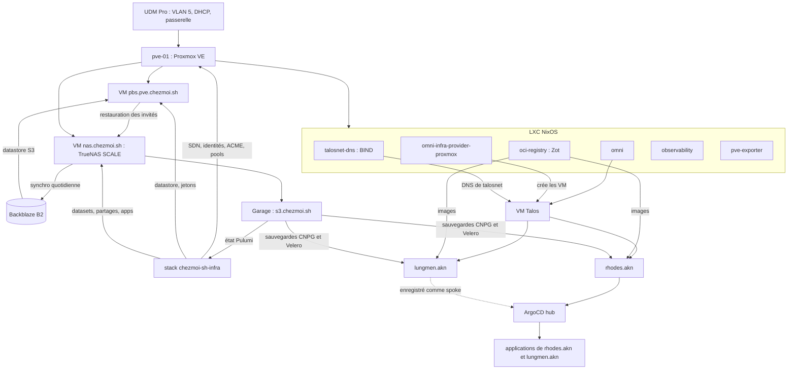
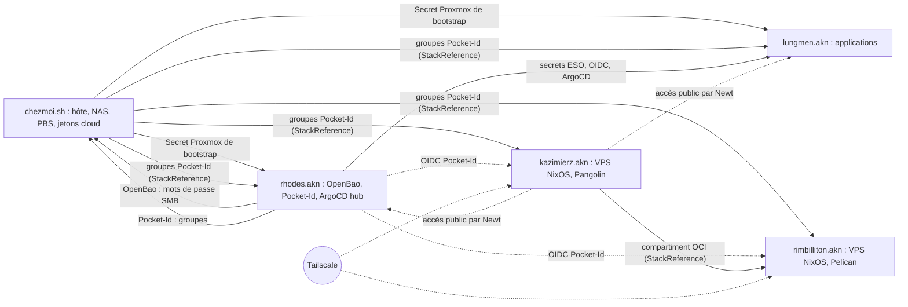

# Plan de reprise après sinistre

Ce plan dit dans quel ordre reconstruire le homelab après la perte d'un service, d'un cluster, du NAS ou de l'hôte
Proxmox entier, et ce que chaque étape exige des précédentes. Il ne répète aucune commande : chaque étape renvoie au
guide ou à la procédure qui la décrit. À la fin de la lecture, l'ordre de reprise, les secrets à réunir avant de
commencer et les cinq circularités de bootstrap encore présentes sont connus.

> [!WARNING]\
> Brouillon traduit, non validé : la refonte du plan de reprise est suivie dans
> [l'issue 1109](https://github.com/chezmoidotsh/arcane/issues/1109). Écrit le 2026-10-11 à partir du dépôt ; aucune
> étape n'a été rejouée sur les serveurs ni les clusters. Ce plan n'a jamais été éprouvé de bout en bout. Seules les
> étapes 1 à 4 de [Restaurer Rhodes](Restaurer-Rhodes.md) ont été rejouées sur un vrai cluster (exercice du 2026-07-28,
> consigné dans son historique). Les étapes marquées « non documenté » n'ont aucune procédure dans le dépôt.

## Par où commencer

| Ce qui est perdu                                     | Commencer à                                                                        |
| ---------------------------------------------------- | ---------------------------------------------------------------------------------- |
| Une base PostgreSQL ou un PVC de `lungmen.akn`       | [Étape 10](#10-restaurer-les-données-de-lungmenakn)                                |
| Le cluster `lungmen.akn`                             | [Étape 9](#9-reconstruire-lungmenakn)                                              |
| Le cluster `rhodes.akn`                              | [Étape 7](#7-reconstruire-rhodesakn), puis l'étape 8                               |
| Un LXC de plateforme (Omni, Zot, DNS, observabilité) | [Étape 6](#6-restaurer-les-lxc-de-plateforme)                                      |
| Le VPS `kazimierz.akn` ou `rimbilliton.akn`          | [Étape 11](#11-reconstruire-les-vps-hors-chaîne)                                   |
| La VM du NAS ou Garage                               | [Étape 4](#4-restaurer-le-nas)                                                     |
| L'hôte `pve-01` entier                               | [Étape 0](#0-réunir-ce-qui-vit-hors-du-dépôt), puis toutes les étapes dans l'ordre |

## Carte des interdépendances

`pve-01` est l'unique hyperviseur : chaque nœud Kubernetes, chaque LXC de plateforme, le NAS et le serveur de sauvegarde
sont ses invités ([`PROXMOX-VE.md`](../../../projects/chezmoi.sh/docs/PROXMOX-VE.md)). Perdre l'hôte, c'est tout perdre
sauf ce qui vit hors site : Backblaze B2, Cloudflare, Tailscale, les deux VPS OCI et le poste de l'opérateur.

### Chaîne de démarrage des services

| Couche                        | Exige des couches au-dessus                                                                                                                   | Source                                                                                                                                                                                                                            |
| ----------------------------- | --------------------------------------------------------------------------------------------------------------------------------------------- | --------------------------------------------------------------------------------------------------------------------------------------------------------------------------------------------------------------------------------- |
| UDM Pro (UniFi)               | Rien : configuration manuelle dans l'interface                                                                                                | [ADR-014](../../decisions/ADR-014-Separer-le-Trafic-des-Noeuds-Talos-du-VLAN-Homelab.md), [IPAM](../../reference/IPAM-Reference.md)                                                                                               |
| `pve-01`                      | Réseau (VLAN 5) ; puis, pour sa configuration, la stack Pulumi `chezmoi-sh-infra`, donc Garage                                                | [`PROXMOX-VE.md`](../../../projects/chezmoi.sh/docs/PROXMOX-VE.md), [`stack/proxmox/`](../../../projects/chezmoi.sh/src/infrastructure/pulumi/stack/proxmox/README.md)                                                            |
| PBS                           | `pve-01` ; clé d'application B2 et datastore créés par Pulumi ; clé de chiffrement côté client conservée dans OpenBao                         | [`PROXMOX_BACKUP_SERVER.md`](../../../projects/chezmoi.sh/docs/PROXMOX_BACKUP_SERVER.md), [`stack/proxmox-backup-server/README.md`](../../../projects/chezmoi.sh/src/infrastructure/pulumi/stack/proxmox-backup-server/README.md) |
| NAS (TrueNAS)                 | `pve-01` (VM, disques en passthrough) ; PBS pour restaurer la VM ; Pulumi pour datasets, partages, utilisateurs et apps                       | [`TRUENAS.md`](../../../projects/chezmoi.sh/docs/TRUENAS.md)                                                                                                                                                                      |
| Garage                        | Le dataset `zp1hs01/applications/truenas/fr.deuxfleurs.garage` ; secrets `garage_*` de la config Pulumi                                       | [`stack/truenas/apps.ts`](../../../projects/chezmoi.sh/src/infrastructure/pulumi/stack/truenas/apps.ts)                                                                                                                           |
| Stack `chezmoi-sh-infra`      | Garage (backend `s3://pulumi-states`) ; passphrase SOPS ; mot de passe `root@pam` ; OpenBao, Pocket-Id et clusters joignables (voir plus bas) | [`Pulumi.yaml`](../../../projects/chezmoi.sh/src/infrastructure/pulumi/Pulumi.yaml), [Procédure INF-20260705-00](../../procedures/infrastructure/INF-20260705-00-Gerer-l-Etat-Pulumi-et-Importer-des-Ressources.md)               |
| LXC de plateforme             | `pve-01` ; secrets chiffrés avec SOPS dans Git (jetons Cloudflare et Tailscale copiés depuis les sorties Pulumi)                              | [`.mise.toml` de `chezmoi.sh`](../../../projects/chezmoi.sh/.mise.toml), [`.sops.yaml`](../../../projects/chezmoi.sh/.sops.yaml)                                                                                                  |
| Omni                          | LXC `omni` et son volume `/persistent` (clé GPG `omni.asc`, CA Talos, `omni.db`)                                                              | [`lxc/omni/README.md`](../../../projects/chezmoi.sh/src/infrastructure/proxmox/lxc/omni/README.md)                                                                                                                                |
| VM Talos                      | Omni, `omni-infra-provider-proxmox`, machine classes, SDN `talosnet` et identité `omni@pve` créés par Pulumi, DNS `talosnet-dns`              | [Procédure OMNI-20260721-00](../../procedures/omni/OMNI-20260721-00-Creer-un-Cluster-Talos-avec-Omni.md), [séparation DNS](../../reference/Passerelles-et-DNS-Reference.md)                                                       |
| Clusters Kubernetes           | Zot (toute image passe par `oci.chezmoi.sh`) ; Secret Proxmox CCM/CSI écrit par `chezmoi-sh-infra` ; Garage pour les sauvegardes              | [`SEC001`](../../../catalog/opa/rules/SEC001-enforce-local-registry.md), [`rhodes-akn-bootstrap.ts`](../../../projects/chezmoi.sh/src/infrastructure/pulumi/stack/proxmox/access/rhodes-akn-bootstrap.ts)                         |
| ArgoCD (hub sur `rhodes.akn`) | Clé age `argocd-sops-age-key` et identifiants GitHub chiffrés avec SOPS ; OpenBao pour son `ExternalSecret` OIDC                              | [`src/argocd/README.md`](../../../projects/rhodes.akn/src/argocd/README.md)                                                                                                                                                       |

### Chaîne des projets

Les flèches pleines sont des dépendances de provisionnement (un `pulumi up` échoue sans elles), les pointillés des
dépendances d'exécution (le service tourne, mais une fonction manque).

| Projet            | Exige des autres projets                                                                                                                                                                                | Source                                                                                                                                                                                                                                                   |
| ----------------- | ------------------------------------------------------------------------------------------------------------------------------------------------------------------------------------------------------- | -------------------------------------------------------------------------------------------------------------------------------------------------------------------------------------------------------------------------------------------------------- |
| `chezmoi.sh`      | Garage pour son état ; et, depuis que la stack écrit dans OpenBao, dans Pocket-Id et dans les clusters : `rhodes.akn` (OpenBao, Pocket-Id) et les contextes Kubernetes de `rhodes.akn` et `lungmen.akn` | [`stack/truenas/users/`](../../../projects/chezmoi.sh/src/infrastructure/pulumi/stack/truenas/users/README.md), [`stack/pocket-id.ts`](../../../projects/chezmoi.sh/src/infrastructure/pulumi/stack/pocket-id.ts), `stack/proxmox/access/*-bootstrap.ts` |
| `rhodes.akn`      | `chezmoi.sh` (Secret `kube-system/rhodes-akn-bootstrap-pve`, groupes Pocket-Id) ; Garage ; Omni ; Zot                                                                                                   | [Restaurer Rhodes](Restaurer-Rhodes.md), étape 3                                                                                                                                                                                                         |
| `lungmen.akn`     | `rhodes.akn` : OpenBao (ESO), Pocket-Id (OIDC), ArgoCD hub ; `chezmoi.sh` (Secret Proxmox, groupes Pocket-Id, mots de passe SMB dans OpenBao) ; Garage                                                  | [Initialiser Lungmen](../../guides/Initialiser-Lungmen.md), [`stack/velero.ts`](../../../projects/lungmen.akn/src/infrastructure/pulumi/stack/velero.ts)                                                                                                 |
| `kazimierz.akn`   | Pocket-Id (fournisseur d'identité de Pangolin) ; groupes de `chezmoi.sh` ; Tailscale. Aucune dépendance à OpenBao dans le code                                                                          | [Initialiser Kazimierz](../../guides/Initialiser-Kazimierz.md), [`stack/pocket-id/`](../../../projects/kazimierz.akn/src/infrastructure/pulumi/stack/pocket-id/index.ts)                                                                                 |
| `rimbilliton.akn` | Stack `kazimierz.akn` (compartiment parent), Pocket-Id, groupes de `chezmoi.sh`, Tailscale, B2. OpenBao seulement comme copie conseillée du mot de passe restic                                         | [Initialiser Rimbilliton](../../guides/Initialiser-Rimbilliton.md), [Procédure BKP-20261005-00](../../procedures/backups/BKP-20261005-00-Restaurer-Minecraft-depuis-Restic.md)                                                                           |

Le projet `hass` lit lui aussi les groupes Pocket-Id de `chezmoi.sh` ; ce plan ne le couvre pas.

### Ce qui vit hors du dépôt

Ces éléments ne sont dans aucun fichier du dépôt, ou seulement chiffrés pour une clé qui n'y est pas. Sans eux, une
partie de la reprise est impossible.

| Élément                                                                     | Où le dépôt dit qu'il vit                                                                                             | Nécessaire pour                                                                   |
| --------------------------------------------------------------------------- | --------------------------------------------------------------------------------------------------------------------- | --------------------------------------------------------------------------------- |
| Clé privée age `age1fj0yj3…` (`SOPS_AGE_KEY_FILE`)                          | `.mise/age/key.txt` sur le poste de l'opérateur (ignoré par Git), et le Secret `argocd-sops-age-key` sur `rhodes.akn` | Tout fichier SOPS : passphrases Pulumi, secrets des LXC, unseal d'OpenBao, ArgoCD |
| Clé d'application Garage sur `pulumi-states`                                | Variables `AWS_ACCESS_KEY_ID` et `AWS_SECRET_ACCESS_KEY` de l'opérateur                                               | Toute commande `pulumi`                                                           |
| Mot de passe `root@pam` de `pve-01`                                         | Keychain macOS de l'opérateur                                                                                         | `pulumi up` de `chezmoi-sh-infra` (ressources ACME)                               |
| Root token et parts Shamir d'OpenBao                                        | Gestionnaire de secrets personnel de l'opérateur                                                                      | Reprise de l'accès administrateur à OpenBao                                       |
| Clé de chiffrement PBS et sa paperkey                                       | OpenBao ; une copie hors ligne de la paperkey est demandée, sans emplacement                                          | Toute restauration depuis PBS                                                     |
| Clé GPG d'Omni (`/persistent/omni/omni.asc`)                                | Volume `mp0` du LXC ; une copie « dans un endroit sûr séparé » est demandée                                           | Relire l'état d'Omni                                                              |
| Identifiants des fournisseurs B2, Cloudflare, Tailscale, TrueNAS, Pocket-Id | Non documenté                                                                                                         | `pulumi up` de `chezmoi-sh-infra`                                                 |

## Ordre de reconstruction

Les étapes suivent la carte de haut en bas. Chacune indique ce qu'elle exige et d'où cela vient, puis renvoie à la page
qui la décrit.

### 0. Réunir ce qui vit hors du dépôt

Avant toute commande, vérifier la présence de chaque élément du tableau
[Ce qui vit hors du dépôt](#ce-qui-vit-hors-du-dépôt) sur le poste de reprise, avec un clone du dépôt et `mise install`.
La clé age vient en premier : elle déchiffre les passphrases Pulumi
(`projects/*/src/infrastructure/pulumi/.mise/env.yaml`) et tous les secrets des étapes suivantes.

### 1. Rétablir le réseau

- **Exige** : rien d'autre que le matériel.
- **Référence** : le plan d'adressage est dans [IPAM](../../reference/IPAM-Reference.md), la topologie dans
  [ADR-014](../../decisions/ADR-014-Separer-le-Trafic-des-Noeuds-Talos-du-VLAN-Homelab.md). La configuration de l'UDM
  Pro est manuelle par décision ; sa reconstruction est non documentée.

### 2. Reconstruire l'hôte `pve-01`

- **Exige** : le réseau ; la paperkey PBS hors ligne pour la suite.
- **Référence** : « Rebuild the host » dans [`PROXMOX-VE.md`](../../../projects/chezmoi.sh/docs/PROXMOX-VE.md) (étapes 1
  et 2 : installer Proxmox VE, recréer l'adresse de gestion et les ponts `vmbr0` et `vmbr1`, restaurer la clé de
  chiffrement PBS). L'installation de Proxmox VE elle-même est non documentée au-delà de cette liste.
- Réinstaller le hook conntrack de l'hôte avec le playbook `pve.yaml`
  ([Procédure INF-20260730-00](../../procedures/infrastructure/INF-20260730-00-Desactiver-le-Suivi-de-Connexion-des-Pools-LB.md)).
- La configuration gérée par Pulumi (SDN, identités, pools, ACME, pare-feu) attend l'étape 5 : son état est sur Garage.

### 3. Remettre PBS en service

- **Exige** : une VM PBS installée depuis l'ISO ; un disque de cache monté sur `/mnt/datastore/cache` ; le datastore
  `Backblaze-B2` et son point d'accès S3, donc une clé d'application B2 sur le bucket `pbs-vm-backup-fcc7acb9` ; la clé
  de chiffrement côté client.
- **D'où cela vient** : la clé B2 et le datastore sont créés par `stack/proxmox-backup-server/datastore.ts` ; la clé B2
  n'existe que dans l'état Pulumi (elle n'est pas exportée en sortie de stack) et dans la configuration de la VM PBS
  perdue ; l'état est sur Garage, que l'étape 4 restaure depuis PBS. C'est une boucle, voir
  [Circularité 1](#1-létat-pulumi-vit-sur-ce-que-pulumi-provisionne).
- **Référence** : « Rebuild the server » dans
  [`PROXMOX_BACKUP_SERVER.md`](../../../projects/chezmoi.sh/docs/PROXMOX_BACKUP_SERVER.md) et « Bootstrapping » dans
  [`stack/proxmox-backup-server/README.md`](../../../projects/chezmoi.sh/src/infrastructure/pulumi/stack/proxmox-backup-server/README.md).
  Configurer le datastore sans Pulumi (clé B2 créée à la main depuis le compte Backblaze, datastore déclaré dans
  l'interface PBS) est non documenté.
- Si l'hôte est intact et que seul un invité est perdu, passer directement à « Restore a guest from backup » dans
  [`PROXMOX-VE.md`](../../../projects/chezmoi.sh/docs/PROXMOX-VE.md).

### 4. Restaurer le NAS

- **Exige** : PBS en service (étape 3) pour restaurer la VM ; les disques des pools ZFS, en passthrough, qui ne font pas
  partie de la sauvegarde de la VM.
- **Référence** : « Rebuild the NAS » dans [`TRUENAS.md`](../../../projects/chezmoi.sh/docs/TRUENAS.md). Deux cas :
  - disques intacts : restaurer la VM, recréer les mappings PCI si l'hôte a changé ; les pools se réimportent et Garage
    revient avec `zp1hs01`, donc l'état Pulumi aussi ;
  - disques perdus : réinstaller la VM, recréer les pools, puis rapatrier les datasets synchronisés depuis B2. Le
    rapatriement exige une clé B2 sur les buckets `nas-backup-*` ; la clé `truenas-replication` n'existe que dans l'état
    Pulumi et dans la configuration du NAS perdu (voir
    [Circularité 2](#2-les-identifiants-b2-nexistent-que-dans-pulumi)). La commande de rapatriement elle-même est non
    documentée.
- Les ACL NFS4 se réappliquent à la main dans l'interface TrueNAS (section « Permissions » de `TRUENAS.md`).

### 5. Relancer Garage et la stack `chezmoi-sh-infra`

- **Exige** : Garage joignable sur `s3.chezmoi.sh` ; une clé d'application Garage sur `pulumi-states` ; la passphrase de
  la stack (SOPS) ; le mot de passe `root@pam` ; les identifiants des fournisseurs.
- **Référence** : l'accès à l'état et la création d'une nouvelle clé Garage sont à l'étape 1 de la
  [Procédure INF-20260705-00](../../procedures/infrastructure/INF-20260705-00-Gerer-l-Etat-Pulumi-et-Importer-des-Ressources.md)
  ; l'application avec `root@pam` est dans « Deploy a change » de
  [`PROXMOX-VE.md`](../../../projects/chezmoi.sh/docs/PROXMOX-VE.md) ; le SDN dans la
  [Procédure INF-20260627-00](../../procedures/infrastructure/INF-20260627-00-Provisionner-le-SDN-Proxmox.md). Relancer
  l'application Garage sans état Pulumi est non documenté (les valeurs sont dans `stack/truenas/apps.ts`).
- Ce premier `pulumi up` intervient avant OpenBao, Pocket-Id et les clusters. Les ressources qui en dépendent
  (`vault.kv.SecretV2` de `stack/truenas/users/`, groupes de `stack/pocket-id.ts`, Secrets Kubernetes de
  `stack/proxmox/access/*-bootstrap.ts`) ne peuvent pas s'appliquer à ce moment. Le comportement exact de `pulumi up`
  dans ce cas (échec partiel ou total, besoin de `--target`) n'est pas vérifié ; une seconde passe a lieu à l'étape 8.
- Les identités Proxmox (`omni@pve`, `pve-exporter`, bootstrap des clusters) de `stack/proxmox/access/` font partie de
  cette passe ; les Secrets `*-bootstrap-pve` ne peuvent être écrits qu'une fois les clusters créés (étapes 7 et 9).

### 6. Restaurer les LXC de plateforme

- **Exige** : `pve-01` ; les secrets de chaque LXC, déjà chiffrés avec SOPS dans
  `projects/chezmoi.sh/src/infrastructure/proxmox/lxc/*/secrets/` (deux destinataires age) ; pour Omni, son volume
  `/persistent` ou la clé `omni.asc`.
- **Ordre** : `talosnet-dns` (DNS de talosnet), `oci-registry` (Zot, source de toutes les images des clusters), `omni`
  puis `omni-infra-provider-proxmox`, et enfin `observability` et `pve-exporter`, qui ne bloquent rien.
- **Référence** : restauration depuis PBS (« Restore a guest from backup » dans
  [`PROXMOX-VE.md`](../../../projects/chezmoi.sh/docs/PROXMOX-VE.md)), ou reconstruction de l'image et remplacement du
  rootfs
  ([Procédure INF-20260605-00](../../procedures/infrastructure/INF-20260605-00-Mettre-a-Jour-un-LXC-par-Echange-du-Rootfs.md),
  [`lxc/omni/README.md`](../../../projects/chezmoi.sh/src/infrastructure/proxmox/lxc/omni/README.md)). Les machine
  classes d'Omni sont perdues si Omni est réinitialisé : les réappliquer avec `mise run omni:machineclass:apply`.

### 7. Reconstruire `rhodes.akn`

- **Exige** : Omni et son fournisseur d'infrastructure ; Zot ; le Secret Proxmox écrit par `chezmoi-sh-infra` ; Garage
  (sauvegardes CNPG d'OpenBao et de Pocket-Id) ; la clé age ; le root token d'OpenBao.
- **Référence** : [Restaurer Rhodes](Restaurer-Rhodes.md) en entier. Il enchaîne la
  [Procédure OMNI-20260721-00](../../procedures/omni/OMNI-20260721-00-Creer-un-Cluster-Talos-avec-Omni.md),
  [Restaurer OpenBao](Restaurer-OpenBao.md), [Restaurer Pocket-Id](Restaurer-Pocket-Id.md) (tous deux avec la
  [Procédure DB-20260723-00](../../procedures/databases/DB-20260723-00-Restaurer-CNPG-depuis-le-Stockage-Objet.md)) et
  l'amorçage d'ArgoCD.

### 8. Repasser la stack `chezmoi-sh-infra`

- **Exige** : OpenBao descellé et Pocket-Id en service (étape 7).
- Relancer `mise run pulumi:apply` dans `projects/chezmoi.sh/src/infrastructure/pulumi` pour écrire les mots de passe
  SMB dans OpenBao et réconcilier les groupes Pocket-Id. Cette seconde passe n'est décrite dans aucun guide ; elle
  découle des dépendances de l'étape 5.

### 9. Reconstruire `lungmen.akn`

- **Exige** : `rhodes.akn` complet (OpenBao, Pocket-Id, ArgoCD) ; le Secret Proxmox écrit par `chezmoi-sh-infra` ; les
  mots de passe SMB dans OpenBao (étape 8).
- **Référence** : [Initialiser Lungmen](../../guides/Initialiser-Lungmen.md). L'enregistrement comme spoke dans ArgoCD
  est manuel (`argocd cluster add`, issue #1282).

### 10. Restaurer les données de `lungmen.akn`

- **Exige** : Garage (buckets CNPG et `velero-lungmen-akn`) ; les identifiants S3 dans OpenBao.
- **Référence** : bases CNPG avec la
  [Procédure DB-20260723-00](../../procedures/databases/DB-20260723-00-Restaurer-CNPG-depuis-le-Stockage-Objet.md),
  volumes avec la
  [Procédure BKP-20260805-00](../../procedures/backups/BKP-20260805-00-Restaurer-un-PVC-Velero-sous-GitOps.md). Les
  données sur le NAS (Immich, Paperless-ngx, médias) reviennent avec l'étape 4.

Les clusters CNPG de `rhodes.akn` (OpenBao, Pocket-Id) sont restaurés à l'étape 7.

### 11. Reconstruire les VPS hors chaîne

Les deux VPS ne dépendent pas de `pve-01` pour tourner ; ils ne se reconstruisent que s'ils sont perdus eux-mêmes.

- **`kazimierz.akn`** : exige Pocket-Id, Tailscale et la stack `chezmoi.sh` (groupes). Voir
  [Initialiser Kazimierz](../../guides/Initialiser-Kazimierz.md), y compris la restauration de l'état de Pangolin.
- **`rimbilliton.akn`** : exige la stack `kazimierz.akn`, Pocket-Id, Tailscale et B2. Voir
  [Initialiser Rimbilliton](../../guides/Initialiser-Rimbilliton.md), puis la
  [Procédure BKP-20261005-00](../../procedures/backups/BKP-20261005-00-Restaurer-Minecraft-depuis-Restic.md) pour les
  mondes.

## Circularités de bootstrap

L'issue #1109 en liste cinq. Chacune a été revérifiée contre le dépôt le 2026-10-11.

| #   | Circularité                                         | Description de l'issue                     | État                                          |
| --- | --------------------------------------------------- | ------------------------------------------ | --------------------------------------------- |
| 1   | L'état Pulumi vit sur ce que Pulumi provisionne     | Exacte ; la procédure INF a été corrigée   | Ouverte                                       |
| 2   | Les identifiants B2 n'existent que dans Pulumi      | Partiellement inexacte (voir ci-dessous)   | Atténuée pour les LXC, ouverte pour B2 et PBS |
| 3   | La copie hors site de Garage ne relance pas Garage  | Exacte                                     | Ouverte                                       |
| 4   | Les sauvegardes d'OpenBao sont sur le Garage du NAS | Exacte ; emplacement de la clé age précisé | Atténuée                                      |
| 5   | La stack `truenas` écrit dans OpenBao               | Exacte, et plus large que décrit           | Ouverte                                       |

### 1. L'état Pulumi vit sur ce que Pulumi provisionne

- **Constat** : les six projets Pulumi déclarent `s3://pulumi-states?endpoint=s3.chezmoi.sh&region=fr-par-1`, et
  `chezmoi-sh-infra` provisionne l'application Garage (`stack/truenas/apps.ts`), le NAS qui la porte, PBS qui sauvegarde
  le NAS et la configuration de `pve-01`.
- **Ce qui a changé** : la
  [Procédure INF-20260705-00](../../procedures/infrastructure/INF-20260705-00-Gerer-l-Etat-Pulumi-et-Importer-des-Ressources.md)
  ne cite plus de projet disparu (historique du 2026-10-11) et documente la création d'une clé Garage (étape 1). L'issue
  #1285 sur cette clé est fermée.
- **État** : ouverte. La seule copie de l'état hors du NAS est la synchronisation quotidienne de
  `/mnt/zp1hs01/applications/truenas` vers B2 (`stack/truenas/cloudsync.ts`), qui exige elle-même une clé B2
  (circularité 2). Le cas PBS aggrave la boucle : restaurer la VM du NAS depuis PBS après la perte de l'hôte exige la
  clé B2 du datastore PBS, qui n'existe que dans cet état.
- **Mitigation documentée** : l'ordre « restaurer le NAS avant tout `pulumi up` » de `PROXMOX-VE.md` et de la procédure
  INF.
- **Mitigation à décider** : une copie de l'état hors du NAS (export périodique chiffré vers B2 ou vers le poste de
  l'opérateur), et une copie hors Pulumi des clés B2 nécessaires au démarrage.

### 2. Les identifiants B2 n'existent que dans Pulumi

- **Constat** : `stack/truenas/cloudsync.ts` crée la clé `truenas-replication` et
  `stack/proxmox-backup-server/datastore.ts` la clé `pbs-vm-backup`.
- **Ce qui a changé** : l'issue dit que la clé `truenas-replication` est exportée en sortie de stack. Ce n'est plus le
  cas : `cloudsync.ts` l'exporte au niveau du module, mais `index.ts` ne la réexporte pas (« Only what is read from
  outside is exported »). Les deux clés B2 ne vivent donc que dans l'état Pulumi et dans la configuration du NAS ou de
  PBS. À l'inverse, les jetons Cloudflare et Tailscale des LXC (`stack/omni.ts`, `stack/observability.ts`,
  `stack/zot-registry.ts`) ont une copie chiffrée avec SOPS dans `lxc/*/secrets/caddy.sops.env`, écrite par les tâches
  `pulumi:*` de [`.mise.toml`](../../../projects/chezmoi.sh/.mise.toml). Le jeton ACME de PBS
  (`proxmox-backup-server/acme.ts`) n'a aucune copie dans le dépôt : il est injecté à la main dans PBS.
- **État** : atténuée pour les LXC (leur reconstruction n'a pas besoin de l'état Pulumi) ; ouverte pour les deux clés B2
  et le jeton ACME de PBS. Une nouvelle clé peut sans doute être créée depuis le compte Backblaze, mais le dépôt ne le
  documente pas.
- **Renvoi** : « Bootstrapping » de
  [`stack/proxmox-backup-server/README.md`](../../../projects/chezmoi.sh/src/infrastructure/pulumi/stack/proxmox-backup-server/README.md),
  « Backups » de [`TRUENAS.md`](../../../projects/chezmoi.sh/docs/TRUENAS.md).

### 3. La copie hors site de Garage ne relance pas Garage

- **Constat** : la synchronisation B2 couvre le dataset de Garage, donc les données et l'état Pulumi. Elle ne fournit ni
  l'application Garage, ni sa configuration (`rpc_secret`, `admin_token`), ni l'accès à B2.
- **Ce qui a changé** : rien. Un élément aide : toutes les valeurs de l'application sont dans `stack/truenas/apps.ts`,
  et ses secrets dans `Pulumi.chezmoi_sh.live.yaml`, chiffrés par la passphrase de la stack, elle-même chiffrée avec
  SOPS. Lire ces secrets sans accès au backend n'est pas vérifié.
- **État** : ouverte. Le dépôt ne décrit pas d'installation manuelle de Garage, ni la cohérence d'une copie à chaud de
  ses métadonnées ; le volume `metadata_snapshots` est un `ix_volume` sous `/mnt/.ix-apps/`, hors du chemin synchronisé.
- **Mitigation à décider** : une procédure de relance manuelle de Garage (application TrueNAS, valeurs de `apps.ts`,
  rapatriement du dataset depuis B2, puis `pulumi import` de l'application).

### 4. Les sauvegardes d'OpenBao sont sur le Garage du NAS

- **Constat** : `projects/rhodes.akn/src/apps/vault/cnpg.objectstore.yaml` envoie les sauvegardes CNPG d'OpenBao vers
  `s3://cnpg-rhodes-akn/openbao` sur `https://s3.chezmoi.sh`, comme celles de Pocket-Id et de Grafana. La copie hors
  site passe par la synchronisation B2 du dataset de Garage (circularités 2 et 3).
- **Ce qui a changé** : l'emplacement de la clé age est établi. `softhsm-tokens.secret.yaml` est chiffré pour un seul
  destinataire, `age1fj0yj3…`, le même que `projects/rhodes.akn/.sops.yaml` utilise partout. La clé privée vit dans
  `.mise/age/key.txt` sur le poste de l'opérateur (`SOPS_AGE_KEY_FILE` du `.mise.toml` racine, chemin ignoré par Git) et
  dans le Secret `argocd-sops-age-key` de `rhodes.akn`, lui-même chiffré pour la même clé
  (`src/argocd/sops/age-key.secret.yaml`). Aucune copie indépendante du poste et du cluster n'est documentée.
- **État** : atténuée. L'unseal ne dépend pas d'OpenBao (le jeton SoftHSM est dans Git) et l'accès administrateur passe
  par le root token hors dépôt ([Restaurer OpenBao](Restaurer-OpenBao.md)). Restent ouverts : les données d'OpenBao
  n'ont pas de copie hors du NAS autre que B2, et la clé age n'a pas de copie de secours documentée.
- **Mitigation à décider** : documenter l'emplacement de secours de la clé age (hors ligne) ; envisager un `ObjectStore`
  CNPG secondaire hors du NAS pour OpenBao.

### 5. La stack `truenas` écrit dans OpenBao

- **Constat** : depuis la PR #1228, `immich.ts`, `jellyfin.ts` et `paperless-ngx.ts` de `stack/truenas/users/` déclarent
  un `vault.kv.SecretV2` vers `lungmen.akn/<app>/storage/smb`. Le README du dossier le reconnaît et interdit ce motif
  pour un compte qui porterait le stockage d'OpenBao.
- **Ce qui a changé** : la dépendance est plus large que l'issue ne le dit. La même stack déclare les groupes Pocket-Id
  (`stack/pocket-id.ts`, qui exige Pocket-Id joignable) et écrit des Secrets dans `rhodes.akn` et `lungmen.akn`
  (`stack/proxmox/access/rhodes-akn-bootstrap.ts`, `lungmen-akn-bootstrap.ts`). L'étape 3 de
  [Restaurer Rhodes](Restaurer-Rhodes.md) demande ce `pulumi up` avant OpenBao et Pocket-Id, sans mentionner ces
  dépendances.
- **État** : ouverte. Le README affirme que le reste de la stack s'applique quand OpenBao est absent ; ce n'est pas
  vérifié par un essai.
- **Mitigation à décider** : sortir les ressources qui écrivent dans OpenBao, Pocket-Id et les clusters dans une stack
  appliquée après `rhodes.akn`, ou documenter un `pulumi up --target` pour la première passe.

## Lacunes

Ce que ce plan ne peut pas affirmer depuis le dépôt :

- Aucune étape n'a été rejouée pour ce plan ; l'ordre est déduit du code et des guides.
- Réinstallation de Proxmox VE, de TrueNAS et de l'UDM Pro : seules des listes d'étapes existent (`PROXMOX-VE.md`,
  `TRUENAS.md`) ; l'UDM Pro n'en a aucune.
- Rapatriement des datasets depuis B2 et relance manuelle de Garage : non documentés.
- Configuration de PBS sans état Pulumi (clé B2 et datastore) : non documentée.
- Emplacement des identifiants des fournisseurs (B2, Cloudflare, Tailscale, TrueNAS, Pocket-Id, administration de
  Garage) utilisés par `pulumi up` : non documenté.
- Existence réelle des copies hors ligne demandées par les README (paperkey PBS, `omni.asc`, clé age) : invérifiable.
- Fréquence des sauvegardes PBS des invités (jobs Proxmox VE manuels par décision) : invérifiable.
- Comportement de `pulumi up` sur `chezmoi-sh-infra` quand OpenBao, Pocket-Id ou un cluster est injoignable : non
  vérifié.
- La stack `rhodes.akn` lit encore une `StackReference` vers la stack du cluster qui a précédé `rhodes.akn`
  (`stack/cloudnative-pg.ts`, ligne 55), et les `cnpg.cluster.yaml` d'OpenBao et de Pocket-Id s'amorcent encore depuis
  l'`ObjectStore` `amiya-akn`. Si cette stack n'existe plus dans le backend, l'étape 3 de Restaurer Rhodes échoue ; ce
  n'est pas vérifié.
- Le projet `hass` et le contenu de l'hôte Home Assistant ne sont pas couverts.

## Suites à donner

Aucune issue n'est ouverte à ce jour pour ces points :

- Copier l'état Pulumi et les clés B2 de démarrage hors du NAS (circularités 1 et 2).
- Documenter la configuration de PBS sans l'état Pulumi (circularités 1 et 2).
- Écrire la procédure de relance manuelle de Garage et de rapatriement depuis B2 (circularité 3).
- Documenter la copie de secours de la clé age et de la paperkey PBS (circularité 4).
- Sortir de `chezmoi-sh-infra` les ressources qui exigent OpenBao, Pocket-Id ou un cluster (circularité 5).
- Corriger les commentaires de `projects/chezmoi.sh/` qui placent encore OpenBao sur `amiya.akn`, et la règle d'alerte
  `ClusterAbsent` sans équivalent pour `rhodes`.

## Historique

- Création initiale de `DISASTER_RECOVERY_PLAN.md` à la racine du dépôt (date non reprise ici), limité à l'instance
  `nex·rpi` et à `projects/nx`, disparus depuis.
- _2026-10-11_ : Réécriture complète à partir du dépôt (issue #1109) et déplacement dans `docs/guides/` (issue #1257) :
  carte des interdépendances, ordre de reconstruction renvoyant aux guides et procédures, revue des cinq circularités de
  bootstrap, lacunes et suites proposées. Aucune étape n'a été rejouée.

## Pour aller plus loin

- [Restaurer Rhodes](Restaurer-Rhodes.md) : la chaîne de reprise du cluster de plateforme, étape 7 de ce plan.
- [Procédure INF-20260705-00](../../procedures/infrastructure/INF-20260705-00-Gerer-l-Etat-Pulumi-et-Importer-des-Ressources.md)
  : l'emplacement de l'état Pulumi et l'accès au backend.
- [Proxmox VE](../../../projects/chezmoi.sh/docs/PROXMOX-VE.md) : l'hôte, ses sauvegardes et sa reconstruction.
- [TrueNAS](../../../projects/chezmoi.sh/docs/TRUENAS.md) : le NAS, Garage et la synchronisation vers B2.
- [ADR-015](../../decisions/ADR-015-Migrer-Crossplane-vers-Pulumi.md) : pourquoi le cycle de vie des VM et des LXC reste
  manuel.
