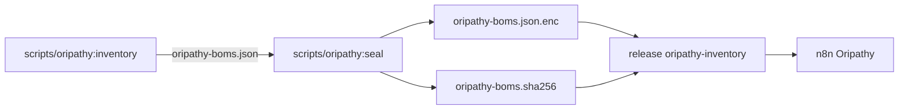

# Oripathy Reference

Inventaire des versions déployées depuis le dépôt, construit par la CI pour Oripathy : format des annotations
`# oripathy:`, règles de placement, ce que la CI produit et publie, et comment lire un échec.

> [!WARNING]\
> Vérifiée contre `scripts/oripathy:inventory`, `scripts/oripathy:seal` et le workflow le 2026-10-21 ; le workflow n8n
> d'Oripathy (hors dépôt) et le secret `ORIPATHY_BOM_KEY` n'ont pas été revérifiés.

## Rôle

Oripathy est un ensemble de workflows n8n, hors de ce dépôt. Chaque matin, il indique au mainteneur quel composant
déployé mettre à jour : une CVE qui touche l'infrastructure, ou une version qui vaut le coup. Son entrée est construite
par la CI à partir de ce dépôt. Les annotations décrivent quoi suivre ; elles remplacent le flux piloté par commentaires
de [Renovate](Renovate-Reference.md).

## Application

Une application est l'une de ces unités :

| Type       | Répertoire                                                                                                      |
| ---------- | --------------------------------------------------------------------------------------------------------------- |
| Kubernetes | `projects/*/src/apps/<app>`, `projects/*/src/infrastructure/kubernetes/<app>`, `projects/rhodes.akn/src/argocd` |
| NixOS      | le répertoire d'un `flake.nix`                                                                                  |
| Catalogue  | `catalog/kubernetes/<name>`                                                                                     |

Chaque application donne un BOM CycloneDX 1.6. `dist/` est généré : les versions sont annotées dans `src/`.

`catalog/kubernetes/` (valeurs de référence et bases kustomize que les projets recopient) est aussi analysé : ses lignes
d'image annotées deviennent des composants `catalog/<name>`, avec un BOM par répertoire. C'est le cas des six images
PostgreSQL (13 à 18, épinglées par digest) de `cloudnative-pg/kustomize/default.image-catalog.yaml`
(`name=postgresql-<majeur>`, `digest=true`) : elles sont les composants `catalog/postgresql-13` à
`catalog/postgresql-18` du BOM `catalog/kubernetes/cloudnative-pg`. Aucune annotation n'est imposée sur les autres
lignes.

## Annotation

```text
# oripathy: type=<helm|oci|nixpkg|release|npm> upstream=github.com/<owner>/<repo> [tagPrefix=v] [name=..] [pkg=..] [digest=true|false]
# oripathy: type=mirror [of=<composant>] [regex=..]
# oripathy: ignore
```

Une valeur peut être entre guillemets (`k="a b"` ou `k='a b'`) quand elle contient des espaces.

| Champ       | Sens                                                                                                                                                                                        |
| ----------- | ------------------------------------------------------------------------------------------------------------------------------------------------------------------------------------------- |
| `type`      | `helm` (chart), `oci` (image), `release` (binaire téléchargé), `npm` (tarball), `nixpkg`, `mirror` (version affichée, voir ci-dessous)                                                      |
| `upstream`  | Dépôt amont : `github.com/<owner>/<repo>` ou `codeberg.org/<owner>/<repo>`                                                                                                                  |
| `tagPrefix` | Préfixe des tags de release amont (`v`)                                                                                                                                                     |
| `name`      | Nom du composant, à fixer quand deux déclarations se ressemblent                                                                                                                            |
| `pkg`       | Paquet nixpkgs (`type=nixpkg`)                                                                                                                                                              |
| `digest`    | `true` ou `false`, obligatoire avec `type=oci` : la ligne de version épingle-t-elle un digest                                                                                               |
| `of`        | `type=mirror` : composant de la même application dont la ligne affiche la version (défaut : le nom du répertoire de l'application)                                                          |
| `regex`     | `type=mirror` : comment lire la version dans la ligne, premier groupe de capture ou groupe nommé `version` (défaut : le scalaire après `key:`) ; entre `'` ou `"` s'il contient des espaces |
| `ignore`    | Décision explicite de ne pas suivre                                                                                                                                                         |

### Placement

L'annotation est **la ligne directement au-dessus de la ligne qui fixe la version**. Le BOM en tire
`evidence.occurrences[].line` (la ligne à modifier) et la ligne de l'annotation.

| Où                            | Ligne annotée                                                                                                                                        |
| ----------------------------- | ---------------------------------------------------------------------------------------------------------------------------------------------------- |
| Chart Helm                    | `version:` d'une entrée `helmCharts:`                                                                                                                |
| Image d'une kustomization     | `newTag:` d'une entrée `images:`                                                                                                                     |
| Valeurs Helm                  | `tag:` sous `repository:`                                                                                                                            |
| Manifeste                     | une ligne `image: registre/depot:tag`                                                                                                                |
| Release distante              | l'URL de release d'un manifeste                                                                                                                      |
| NixOS, image                  | `fooImage = "..."`                                                                                                                                   |
| NixOS, binaire                | `version = "..."` ou `default = "..."`, ou une URL GitHub épinglée                                                                                   |
| NixOS, paquet nixpkgs         | aucune ligne de version : `type=nixpkg pkg=x`, n'importe où dans les fichiers du flake                                                               |
| Chart local (sans `version:`) | `ignore`, au-dessus de `- name:`                                                                                                                     |
| `.application.patch`          | `value:` d'une entrée `- name: ...Version` (la version que l'interface Argo CD affiche), entre le `name:` et le `value:` : `type=mirror` ou `ignore` |

### Exemples

Version d'un chart Helm :

```yaml
helmCharts:
  - repo: https://helm.cilium.io/
    name: cilium
    # oripathy: type=helm upstream=github.com/cilium/cilium tagPrefix=v
    version: 1.20.0
```

`newTag` d'une image de kustomization :

```yaml
images:
  - name: ghcr.io/actualbudget/actual-server
    newName: oci.chezmoi.sh/ghcr.io/actualbudget/actual-server
    # oripathy: type=oci upstream=github.com/actualbudget/actual tagPrefix=v digest=false
    newTag: "26.9.0"
```

`tag` dans des valeurs Helm :

```yaml
image:
  repository: ghcr.io/example/app
  # oripathy: type=oci upstream=github.com/example/app tagPrefix=v digest=false
  tag: 2.0.0
```

Image épinglée dans un module NixOS :

```nix
# oripathy: type=oci upstream=github.com/pelican-dev/panel tagPrefix=v digest=false
panelImage = "ghcr.io/pelican-dev/panel:v1.0.0-beta38";
```

Image épinglée par digest (la référence contient `@sha256:`) :

```nix
# oripathy: type=oci upstream=github.com/example/app tagPrefix=v digest=true
appImage = "ghcr.io/example/app:v1.0.0@sha256:<64 caractères hexadécimaux>";
```

Version affichée par Argo CD (`projects/*/src/**/.application.patch`), à garder alignée sur le composant :

```yaml
info:
  - name: Version
    # oripathy: type=mirror of=cilium regex='value: "([^"]+)"'
    value: "1.20.0"
```

Les valeurs ci-dessus illustrent la forme ; les annotations réelles se trouvent dans les `kustomization.yaml` et les
modules `.nix` du dépôt.

### Attribut `digest`

`digest=true|false` est obligatoire sur chaque annotation `type=oci` (pas sur `ignore`). Il dit si la ligne de version
épingle l'image par digest : `@sha256:` dans la référence, ou un `digest:` kustomize à côté de `newTag:`. Il est
explicite pour qu'une montée de version déplace le digest avec le tag. Le BOM l'expose dans la propriété
`oripathy:digest`, et l'issue rédigée par Oripathy demande alors de déplacer le tag et le digest ensemble. La CI échoue
quand il manque ou ne correspond pas à la ligne.

### Type `mirror`

Une entrée `Version` d'un `.application.patch` affiche une version à la main : c'est un second endroit qui la déclare.
L'annotation `type=mirror` la rattache à un composant de la même application (`of=`, par défaut celui qui porte le nom
du répertoire de l'application). La ligne est ajoutée aux emplacements du composant (occurrence du BOM de rôle `mirror`)
: l'issue rédigée par Oripathy la liste donc parmi les lignes à modifier. La CI échoue quand la ligne affiche une
version qui n'est aucune de celles du composant : sa version, la version ou l'`appVersion` de son chart, un tag d'image
(un `v` initial est ignoré). Une entrée `Version` sans annotation (ou sans `ignore`) fait aussi échouer la CI.

À l'introduction du contrôle, sept versions affichées étaient déjà périmées et ont été corrigées (Cilium de
`rhodes.akn`, CloudNative-PG, Pocket-Id, le chart Vault, Proxmox CCM et CSI de `rhodes.akn`).

### Paquets nixpkgs

`type=nixpkg pkg=x` n'a pas de ligne de version. La version vient de `nix eval` sur le `flake.lock` voisin. Le BOM
ajoute `channelVersion` : la version en tête du canal suivi par le flake, c'est-à-dire ce que `nix flake update`
apporterait. Les paquets de plomberie (`coreutils`, `jq`, `busybox`…) sont ignorés.

Les entrées `github:` de chaque `flake.lock` (nixpkgs, disko…) sont listées dans le BOM sans être suivies : un hôte se
met à jour en les déplaçant toutes avec `nix flake update`.

## Règle des images

Toute image qu'un pod d'un chart Helm exécute doit avoir une version explicite et annotée :

- un override `images:` dans la kustomization (`name`, `newName`, `newTag`), ou
- le `tag:` dans les valeurs.

Exemptions :

| Cas                                    | Raison                                                               |
| -------------------------------------- | -------------------------------------------------------------------- |
| Image épinglée par digest par le chart | un override supprimerait l'épinglage                                 |
| Dépôt rendu avec plusieurs tags        | un override ne sait pas l'exprimer (variante Windows de `smbplugin`) |

Les images d'un chart qui suivent le même amont à la même version sont repliées dans le composant du chart.

## Ce que produit la CI

Le workflow
[`oripathy-inventory`](../../.github/workflows/pull_request,schedule,workflow_dispatch.oripathy-inventory.yaml) tourne
chaque jour à 03:00 UTC, à la demande, et en vérification sur les pull requests concernées, dont celles qui touchent
`projects/*/src/**/.application.patch`.



| Étape       | Détail                                                                                                                  |
| ----------- | ----------------------------------------------------------------------------------------------------------------------- |
| Inventaire  | `scripts/oripathy:inventory --output inventory.json --bundle oripathy-boms.json` : un BOM CycloneDX 1.6 par application |
| Bundle      | JSON déterministe : ni date, ni commit ; le même contenu donne les mêmes octets                                         |
| Chiffrement | `scripts/oripathy:seal` : AES-256-GCM, format du nœud Crypto n8n v2, clé dérivée par scrypt de la phrase de passe       |
| Publication | assets de la release `oripathy-inventory` : `oripathy-boms.json.enc` et `oripathy-boms.sha256`                          |

- **Pourquoi chiffrer** : la release d'un dépôt public est publique et le BOM décrit toute l'infrastructure.
- **Secret** : la phrase de passe est le secret GitHub `ORIPATHY_BOM_KEY`, aussi stocké dans la credential Crypto n8n «
  Oripathy BOM key ». Elle n'est jamais passée en argument de ligne de commande.
- **Hash** : `oripathy-boms.sha256` est le SHA-256 du bundle **déchiffré**. n8n saute l'exécution quand il n'a pas
  changé et le vérifie après déchiffrement.
- L'ancien asset en clair `inventory.json` est supprimé de la release à chaque publication.
- Sur une pull request, le workflow construit et valide les BOM, lance `--check`, ne chiffre ni ne publie rien.
- Le job utilise `--jobs` par défaut (le nombre de CPU, au plus 8).

## Ajouter une application

1. Créer le répertoire du produit (Kubernetes ou flake) à l'emplacement habituel.
2. Annoter chaque chart, image et release récupérée directement au-dessus de la ligne de version, ou y poser
   `# oripathy: ignore`.
3. Pour un chart, annoter aussi ses images (règle des images ci-dessus).
4. Lancer le contrôle en local, puis ouvrir la pull request : le workflow refait la vérification.

## Lire un échec de la CI

`scripts/oripathy:inventory --check` affiche une ligne `error: <où>: <message>` par composant déployé mais non annoté,
et sort en erreur.

| Message                                                                                         | Cause et correction                                                                             |
| ----------------------------------------------------------------------------------------------- | ----------------------------------------------------------------------------------------------- |
| `annotation must sit right above the line that sets a version: ...`                             | annotation mal placée : la déplacer sur la ligne directement au-dessus de la version            |
| `annotation needs type=<...> and upstream=github.com/<owner>/<repo>`                            | `type` ou `upstream` manquant ou invalide                                                       |
| `add # oripathy: type=nixpkg pkg=<x> upstream=... (or ignore pkg=<x>) to <file>`                | paquet nixpkgs utilisé sans annotation : recopier l'annotation proposée                         |
| `declared twice with a different version or upstream (give each a distinct name=)`              | deux déclarations en conflit : fixer un `name=` distinct                                        |
| `type=oci needs digest=true\|false: this line pins/does not pin a digest, write digest=...`     | `digest` manquant : recopier la valeur proposée                                                 |
| `digest=<x> but the line pins/does not pin a digest, write digest=...`                          | `digest` ne correspond pas à la ligne : le corriger comme indiqué                               |
| `shows X but <name> is at Y (chart Z): update this line`                                        | une ligne `type=mirror` affiche une version qui n'est pas celle du composant : la mettre à jour |
| `add # oripathy: type=mirror of=<component> (or ignore) between this name: and its value: line` | entrée `Version` d'un `.application.patch` sans annotation : annoter, ou `ignore`               |
| Message de chart ou d'image sans annotation                                                     | suivre l'indication du message : annoter, ou `ignore`                                           |

## Commandes locales

```sh
scripts/oripathy:inventory --self-test
scripts/oripathy:seal --self-test
scripts/oripathy:inventory --output inventory.json --bundle oripathy-boms.json
scripts/oripathy:inventory --jobs 4 --output inventory.json --bundle oripathy-boms.json
scripts/oripathy:inventory --check inventory.json
```

`--jobs N` scanne chaque cluster (et `catalog`) sur son propre thread et lance les appels `nix eval` en parallèle ; par
défaut, le nombre de CPU, au plus 8. `--jobs 1` exécute tout à la suite. L'inventaire et le bundle de BOM sont
identiques à l'octet près, quel que soit le nombre de jobs.

`deployedAt` vient de l'historique Git (`git log -S`) : il faut l'historique complet. Sans `nix` installé, les versions
nixpkgs restent vides et les paquets non annotés ne sont pas détectés (un avertissement s'affiche).
`scripts/oripathy:seal seal|open` demande `ORIPATHY_BOM_KEY` dans l'environnement et le paquet Python `cryptography`.

## Limites connues

| Limite                           | Détail                                                                                                                           |
| -------------------------------- | -------------------------------------------------------------------------------------------------------------------------------- |
| Amonts Codeberg                  | `upstream=codeberg.org/<owner>/<repo>` est accepté par le script ; les amonts Codeberg restent une limite du suivi côté Oripathy |
| Évaluation Nix                   | les versions nixpkgs ne sont évaluées qu'en CI (ou avec `nix` en local)                                                          |
| Liste `nixpkg`                   | manuelle : un paquet n'est suivi que s'il est annoté, la détection des non annotés dépend de `nix`                               |
| Catalogue `catalog/kubernetes/`  | seules les lignes annotées sont listées, aucune annotation n'est imposée sur les autres lignes                                   |
| Images choisies par un opérateur | une image qu'un opérateur choisit lui-même, absente des manifestes, est invisible pour l'inventaire                              |

## Pour aller plus loin

- [`scripts/oripathy:inventory`](../../scripts/oripathy:inventory) : les règles (en-tête) et le comportement.
- [`scripts/oripathy:seal`](../../scripts/oripathy:seal) : le chiffrement du bundle.
- [Workflow `oripathy-inventory`](../../.github/workflows/pull_request,schedule,workflow_dispatch.oripathy-inventory.yaml)
  : la CI.
- [Renovate Reference](Renovate-Reference.md) : l'ancien flux piloté par commentaires.
