# Réseau Reference

Vue d'ensemble du réseau du homelab : topologie physique, double carte réseau des nœuds Talos, SDN Proxmox et rôle des
VLAN. Les valeurs d'adressage (CIDR, plages, adresses statiques) ne sont pas répétées ici : elles sont dans
[IPAM Reference](IPAM-Reference.md).

Vérifiée contre le dépôt le 2026-10-11 ; l'état réel du réseau n'a pas été revérifié.

## Topologie physique

Un seul hyperviseur Proxmox (`pve-01`) est relié directement à l'UniFi Dream Machine Pro (UDM Pro), sans commutateur
intermédiaire. L'UDM Pro est la passerelle L3 et porte les cinq VLAN décrits dans la section « VLANs » de
[IPAM Reference](IPAM-Reference.md#vlans).

`pve-01` expose deux bridges à ses invités :

| Bridge  | Rôle                                                                                       |
| ------- | ------------------------------------------------------------------------------------------ |
| `vmbr0` | Gestion de l'hyperviseur : port d'accès VLAN 5, porte l'adresse propre de l'hôte           |
| `vmbr1` | Trunk VLAN-aware : toutes les VM et tous les LXC y sont attachés, chacun avec son VLAN tag |

Les services d'infrastructure autonomes (Omni, observabilité, registre OCI, `talosnet-dns`) tournent dans des LXC NixOS.
Ils ont une adresse statique dans la zone de gestion du VLAN 5 et, pour la plupart, une seconde interface sur
`talosnet`.

## Nœuds Talos : double carte réseau

Chaque nœud Talos est une VM à deux interfaces, identiques pour tous les clusters
([ADR-014](../decisions/ADR-014-Topologie-Reseau.md)).

| Interface | Réseau                                                  | Adresse du nœud | Trafic                                                                         |
| --------- | ------------------------------------------------------- | --------------- | ------------------------------------------------------------------------------ |
| `eth0`    | `vmbr1`, VLAN 5 tagué par Proxmox                       | aucune          | Annonces ARP Cilium L2 des LoadBalancers `external`, visibles depuis l'UDM Pro |
| `eth1`    | VNet SDN partagé `talosnet` (DHCP, bail stable par MAC) | oui             | kubelet, etcd, trafic inter-nœuds, accès à l'API Proxmox pour le CSI           |

- Chaque cluster dispose de sa propre tranche du pool LoadBalancer du VLAN 5, ce qui isole le trafic externe par
  cluster.
- Le Gateway Cilium `internal` de chaque cluster est annoncé sur `talosnet` et n'est joignable que depuis ce réseau ; le
  Gateway `external` l'est depuis le LAN. Le détail est dans
  [Passerelles Et DNS Reference](Passerelles-et-DNS-Reference.md).
- Le pare-feu Proxmox par VM est désactivé (`network_firewall: false`) sur `eth0` : il filtrerait les annonces ARP
  Cilium L2.
- Le MTU de `eth1` est fixé à 1450 en prévision d'une migration éventuelle vers VXLAN.

Sources : `catalog/omni/machineclasses/README.md`, `catalog/omni/machineclasses/w1.medium.yaml` et
`catalog/omni/clustertemplates/base.yaml`.

## SDN Proxmox

| Élément     | Valeur                                                               | Source                                                               |
| ----------- | -------------------------------------------------------------------- | -------------------------------------------------------------------- |
| Zone        | `pvenet`, de type `simple` (pas VXLAN), IPAM `pve`, DHCP `dnsmasq`   | `projects/chezmoi.sh/src/infrastructure/pulumi/stack/proxmox/sdn.ts` |
| VNet        | `talosnet`, partagé par tous les clusters Talos/Omni                 | idem                                                                 |
| Sous-réseau | SNAT activé : les nœuds sans adresse VLAN 5 atteignent l'API Proxmox | idem                                                                 |
| DNS DHCP    | `talosnet-dns` (BIND), adresse littérale                             | idem                                                                 |

Un VNet unique évite de reconfigurer l'UDM Pro à chaque nouveau cluster. Contrepartie acceptée dans l'ADR-014 : le
trafic de nœuds (`eth1`) n'est pas isolé en L2 par cluster. Les CIDR de `talosnet` et de sa plage parente sont dans la
section « Proxmox SDN » de [IPAM Reference](IPAM-Reference.md#proxmox-sdn--talosnet-vnet).

## Diagramme de topologie



Le diagramme montre l'UDM Pro relié aux cinq VLAN, `pve-01` rattaché au VLAN 5 par `vmbr0` et `vmbr1`, puis les LXC et
les VM Talos hébergés sur `pve-01` et reliés à `talosnet`.

Source : [`topology.d2`](../assets/network/topology.d2). Régénération après modification :

```sh
d2 docs/assets/network/topology.d2 docs/assets/network/topology.svg
```

## Historique

- _2026-10-11_ : migration vers le standard de documentation, en français ; page déplacée de `docs/network/README.md`,
  diagramme déplacé dans `docs/assets/network/`. Les valeurs d'adressage de l'ancien tableau « Quick Reference » sont
  retirées au profit d'[IPAM Reference](IPAM-Reference.md).
- _2026-10-11_ : l'ancienne page décrivait les LXC comme n'ayant qu'une adresse statique sur `vmbr1` ; le diagramme
  (`topology.d2`) les décrit comme à double interface (VLAN 5 et `talosnet`). La section l'indique désormais.
- _2026-10-11_ : l'ancienne page ne mentionnait pas le Gateway `internal` sur `talosnet` ; il est ajouté d'après
  `projects/<cluster>/src/infrastructure/kubernetes/cilium/internal.gateway.yaml` (voir
  [Passerelles Et DNS Reference](Passerelles-et-DNS-Reference.md)).
- _2026-10-11_ : `AGENTS.md` parle de « Proxmox SDN VXLAN » ; le code (`sdn.ts`) déclare une zone `simple`, comme
  l'indique la révision de l'ADR-014. Seul le MTU de `eth1` anticipe VXLAN.
- _2026-10-11_ : le nœud du diagramme `topology.d2` garde le nom `vnet-talos` (ligne `pve-01.pve.sdn.vnet-talos`), alors
  que le VNet s'appelle `talosnet` ; seul l'identifiant interne du diagramme est concerné.
- _2026-10-11_ : numérotation « NIC 1 / NIC 2 » de l'ancienne page (cartes physiques de `pve-01`) retirée : non
  vérifiable dans le dépôt.

## Pour aller plus loin

- [IPAM Reference](IPAM-Reference.md) : VLAN, plages, CIDR Kubernetes et règles de pare-feu.
- [Passerelles Et DNS Reference](Passerelles-et-DNS-Reference.md) : Gateways `internal` et `external` et DNS associé.
- [ADR-014 Topologie réseau](../decisions/ADR-014-Topologie-Reseau.md) : pourquoi le réseau est conçu ainsi.
- [Provisionner le SDN Proxmox](../procedures/infrastructure/INF-20260627-00-Provisionner-le-SDN-Proxmox.md) : création
  de la zone et du VNet.
