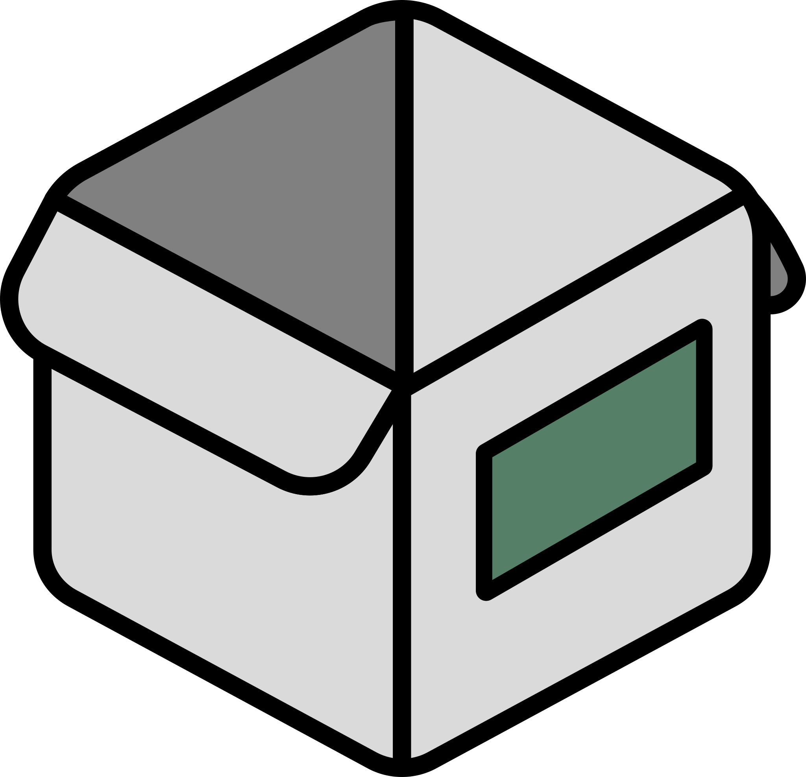
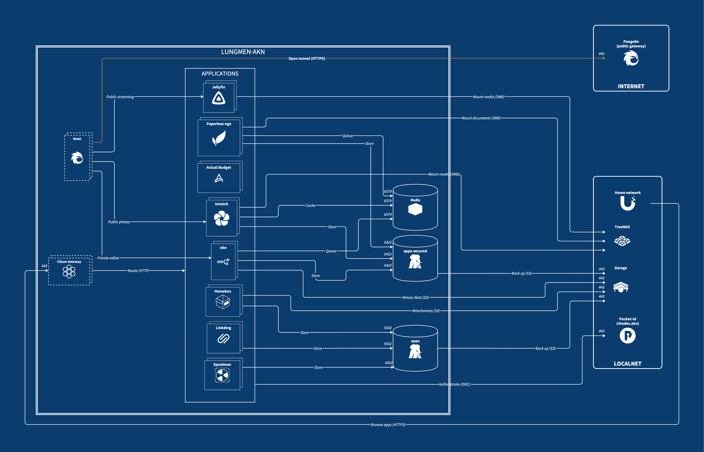

<p align="center">
  <picture>
    <source media="(prefers-color-scheme: dark)" srcset="./assets/logo.dark.png">
    
  </picture>
</p>

<h1 align="center">「lungmen.akn」</h1>

<p align="center"><strong>Cluster Talos — les applications du quotidien du homelab</strong></p>

<p align="center">
  
  
  
</p>

<p align="center">
  <a href="#services">Services</a> ·
  <a href="#architecture">Architecture</a> ·
  <a href="#accès">Accès</a> ·
  <a href="#configuration">Configuration</a> ·
  <a href="#déploiement">Déploiement</a> ·
  <a href="#contribuer">Contribuer</a> ·
  <a href="#pour-aller-plus-loin">Pour aller plus loin</a>
</p>

`lungmen.akn` héberge les applications que la maison utilise tous les jours : médias, photos, documents, budget,
signets, inventaires et automatisations. Il est en développement actif, les applications y sont ajoutées et mises à jour
souvent. Les briques dont dépendent les autres clusters vivent dans `rhodes.akn` : il en consomme l'authentification
(Pocket-Id) et les secrets (OpenBao), et n'a pas d'ArgoCD propre, il est piloté par celui de `rhodes.akn`.

## Services

L'inventaire de référence est [`kubernetes/src/apps/`](./kubernetes/src/apps/) : les services ci-dessous en sont la
liste complète à la date de cette page, rangés par importance.


### [Jellyfin](https://jellyfin.org/)

Diffuse les médias stockés sur le NAS (partage SMB) sous `streaming.chezmoi.sh`. Il est aussi publié sur Internet par
Pangolin, et ses données propres sont sauvegardées par Velero.

<br clear="all" />


### [Immich](https://immich.app/)

Gère les photos et vidéos de la famille sous `photos.chezmoi.sh`, avec l'application mobile ; les médias sont sur le
NAS. Il est publié sur Internet par Pangolin, sans SSO devant lui (l'application gère sa connexion).

<br clear="all" />


### [Paperless-ngx](https://docs.paperless-ngx.com/)

Numérise, indexe et range les documents (OCR, étiquettes, recherche plein texte) sous `archives.chezmoi.sh`. Les
documents sont sur le NAS, ses données propres sont sauvegardées par Velero.

<br clear="all" />


### [Actual Budget](https://actualbudget.com/)

Suit le budget du foyer sous `budget.chezmoi.sh`. Ses données sont sauvegardées par Velero.

<br clear="all" />


### [n8n](https://n8n.io/)

Exécute les automatisations sous `n8n.chezmoi.sh`, en mode file d'attente : un pod principal (éditeur, déclencheurs), un
processeur de webhooks, un worker et un Redis. L'éditeur n'est joignable depuis Internet que par un client Pangolin
(ressource privée), jamais publié.

<br clear="all" />



### [Homebox](https://homebox.software/)

Tient l'inventaire de la maison sous `catalogue.chezmoi.sh` ; les photos et pièces jointes vont dans un bucket Garage.

<br clear="all" />


### [Linkding](https://github.com/sissbruecker/linkding)

Garde les signets sous `bookmarks.chezmoi.sh`.

<br clear="all" />


### [Spoolman](https://github.com/Donkie/Spoolman)

Suit les bobines de filament des imprimantes 3D sous `spool.lab.chezmoi.sh`.

<br clear="all" />

## Architecture



Les utilisateurs du réseau local entrent par la Gateway Cilium, qui route chaque nom vers son application ; vers
l'extérieur, c'est Newt, dans le cluster, qui ouvre le tunnel vers Pangolin et ne laisse passer que Jellyfin, Immich et
l'éditeur privé de n8n. Les données restent hors du cluster pour l'essentiel : médias et documents sur le NAS,
sauvegardes et fichiers applicatifs dans Garage. Les bases PostgreSQL sont réparties en deux clusters mutualisés selon
la sensibilité (`apps-secured` pour Immich, Paperless-ngx et n8n), et l'authentification passe par Pocket-Id pour les
applications qui la gèrent (toutes sauf Spoolman).

## Accès

Les applications sont servies en HTTPS sous `*.chezmoi.sh` par deux Gateways Cilium (`internal` et `external`, dans
`kube-system`, mêmes noms, split-horizon : le DNS de `talosnet` répond l'IP de l'`internal` aux machines du réseau
Talos, tous les autres reçoivent celle de l'`external`). Seuls Jellyfin et Immich sont publiés sur Internet, via
Pangolin et le tunnel Newt (ressources dans `pulumi/stack/system/pangolin.ts` et `pulumi/stack/apps/*/pangolin.ts`).

Le cluster lui-même s'administre avec un kubeconfig fourni par Omni (`omnictl kubeconfig --cluster lungmen-akn`) et son
état GitOps se lit dans l'ArgoCD de `rhodes.akn`. Les connexions de cluster à cluster passent par Tailscale.

## Configuration

Le cluster est défini par trois sources. Le gabarit Omni (`omni/lungmen.clustertemplate.yaml`) décrit un control plane
et trois workers sur Proxmox, Cilium comme CNI (sans kube-proxy) et les destinations des logs Talos vers l'agent
d'observabilité. Les manifestes Kubernetes sont écrits à la main dans `kubernetes/src/` (`apps/` pour les applications,
`system/` pour les composants du cluster : Cilium, cert-manager, external-dns, External Secrets, CloudNative-PG, Velero,
Proxmox CSI et CCM, SMB CSI, Tailscale, Newt…) puis rendus dans `kubernetes/dist/` par `dist:render`, qui est ce
qu'ArgoCD synchronise ; `dist/` ne s'édite jamais à la main. Enfin le projet Pulumi `lungmen-akn` (`pulumi/`, pile
`lungmen_akn.live`) porte tout ce qui est hors du cluster : le montage et l'authentification OpenBao d'External Secrets,
les buckets Garage (sauvegardes CNPG et Velero, Homebox, n8n), les clients OIDC de Pocket-Id, le site Pangolin et ses
ressources, le jeton DNS-01 de cert-manager, le client OAuth de Tailscale, l'identité Proxmox du CCM et du CSI et le
jeton du Grafana de `rhodes.akn`.

Les secrets vivent dans OpenBao (montage `lungmen.akn/`), synchronisés par External Secrets ; ceux qui doivent rester
dans Git sont chiffrés avec SOPS (`.sops.yaml`). Les bases PostgreSQL (CloudNative-PG, `kubernetes/src/apps/databases/`)
sont sauvegardées automatiquement vers Garage, les volumes d'Actual Budget, Jellyfin et Paperless-ngx par Velero, et le
stockage bloc est fourni par le CSI Proxmox.

```text
.
├── architecture.d2         schéma d'architecture (assets/architecture.png)
├── omni/                   gabarit Omni du cluster
├── kubernetes/
│   ├── src/{apps,system}/  manifestes écrits à la main
│   └── dist/               manifestes rendus, synchronisés par ArgoCD
└── pulumi/                 ressources hors du cluster
    └── stack/{system,apps}/   comme kubernetes/src/ : composants du cluster, un dossier par application
```

## Déploiement

### Première installation

Le cluster est créé de bout en bout par Omni, sans `talosctl`. Le guide
[Initialiser Lungmen](../../../docs/guides/Initialiser-Lungmen.md) donne le détail, les étapes sont :

1. Créer les machine classes dans Omni (`mise run omni:machineclass:apply`, depuis la racine).
2. Valider puis appliquer le gabarit : `mise run omni:clustertemplate:validate`, puis
   `omnictl cluster template sync -f omni/lungmen.clustertemplate.yaml`.
3. Récupérer le kubeconfig : `omnictl kubeconfig --cluster lungmen-akn ~/.kube/config-lungmen-akn`.
4. Enregistrer le cluster dans l'ArgoCD de `rhodes.akn` : `argocd cluster add lungmen-akn --name lungmen.akn`.
5. Appliquer le projet Pulumi (`pulumi preview` puis `pulumi up` dans `pulumi/`, après `mise run bao:login`), une fois
   que Grafana de `rhodes.akn` est en ligne (le jeton de l'opérateur Grafana en dépend). Les identifiants des
   fournisseurs viennent de Bitwarden via fnox, déclarés dans `.fnox.toml`.

### Mises à jour

Les applications se déploient en modifiant `kubernetes/src/` puis en lançant `dist:render` ; ArgoCD applique `dist/`
après la fusion. `./scripts/argocd:app:sync fleet/clusters/akn.lungmen/kubernetes/src/apps/<app>` force la
synchronisation d'une application. Le gabarit Omni se rejoue avec `omnictl cluster template sync`, et Pulumi avec
`pulumi preview` puis `pulumi up`. Pour restaurer des données plutôt que repartir d'un cluster vide, voir
[`kubernetes/src/system/velero/`](./kubernetes/src/system/velero/) ; les sauvegardes antérieures à la recréation du
cluster portent la classe de stockage `longhorn`, que le `ConfigMap` `change-storage-class-config` remappe vers
`proxmox-lvmthin-ext4`.

### Vérifier un déploiement

- `kubectl get nodes -o wide` : les quatre nœuds sont `Ready`.
- `argocd app list` sur l'ArgoCD de `rhodes.akn` : les applications du cluster sont `Synced` et `Healthy`.
- `kubectl get externalsecrets -A` : tous les secrets sont `SecretSynced`.
- `kubectl get pods -A` : rien n'est en erreur.

## Contribuer

`mise run app:build` vérifie le rendu Kustomize, `mise run omni:clustertemplate:validate` valide le gabarit hors ligne,
sans connexion à Omni. Toute modification sous `kubernetes/src/` se termine par `dist:render` (jamais d'édition manuelle
de `dist/`). Le schéma se modifie dans `architecture.d2`, puis `mise run diagram:generate` régénère
`assets/architecture.png`, à commiter avec. Lancer `mise run lint` avant de pousser.

## Pour aller plus loin

- [Initialiser Lungmen](../../../docs/guides/Initialiser-Lungmen.md) : les paramètres du cluster et la procédure Omni
  complète.
- [ADR-011](../../../docs/decisions/ADR-011-Pre-rendre-les-Manifestes-Kubernetes-dans-Git.md) : pourquoi `dist/` est
  pré-rendu.
- [ADR-009](../../../docs/decisions/ADR-009-Consolider-les-Bases-PostgreSQL.md) : les bases PostgreSQL mutualisées.
- [ADR-014](../../../docs/decisions/ADR-014-Separer-le-Trafic-des-Noeuds-Talos-du-VLAN-Homelab.md) : le réseau des nœuds
  Talos.
- [Restaurer un PVC Velero](../../../docs/procedures/backups/BKP-20260805-00-Restaurer-un-PVC-Velero-sous-GitOps.md) :
  restaurer les données d'une application.
- [Nommage des machines](../../../docs/reference/Nommage-des-Machines-Reference.md) : d'où vient le nom `lungmen`.
