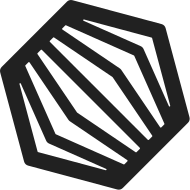
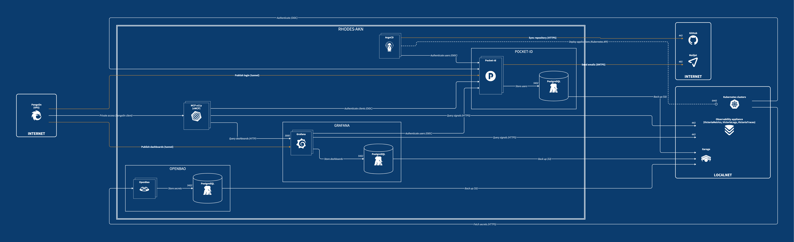

  

<h1 align="center">「rhodes.akn」</h1>

<strong>Cluster Talos du socle du homelab : secrets, identité et GitOps</strong>

  
  
  
  
  

  <a href="#services">Services</a> ·
  <a href="#architecture">Architecture</a> ·
  <a href="#accès">Accès</a> ·
  <a href="#configuration">Configuration</a> ·
  <a href="#déploiement">Déploiement</a> ·
  <a href="#contribuer">Contribuer</a> ·
  <a href="#pour-aller-plus-loin">Pour aller plus loin</a>

Rhodes est le cluster du socle du homelab : il héberge ce dont tous les autres dépendent (le coffre à secrets, le
fournisseur d'identité, le hub ArgoCD qui déploie les autres clusters et l'interface de dashboards) et il se comporte
donc comme de la production : un changement ici doit préserver la disponibilité des clusters qui s'appuient dessus. Il
tourne sur Talos Linux, dans des VM Proxmox VE provisionnées par Omni, et se passe de service tiers : seuls le SMTP et
GitHub sortent vers Internet, et le cluster ne dépend pas de Tailscale.

## Services

### [OpenBao](https://openbao.org/)

Source de vérité des secrets du homelab : les autres clusters viennent y lire leurs mots de passe, jetons et certificats
à l'exécution, via External Secrets Operator, au lieu de les copier d'un cluster à l'autre. Sa base PostgreSQL
(CloudNative-PG) est sauvegardée vers Garage : perdre le cluster ne fait pas perdre les secrets.

 

### [Pocket-Id](https://github.com/pocket-id/pocket-id)

Fournisseur d'identité unique du homelab, par passkey uniquement : ArgoCD, Grafana, le serveur MCP et OpenBao s'en
servent pour authentifier leurs utilisateurs en OIDC, et les autres clusters l'utilisent aussi. Il envoie ses e-mails
par SMTP (Mailjet). Même schéma de base de données et de sauvegarde qu'OpenBao.

 

### [ArgoCD](https://argoproj.github.io/cd/)

Hub GitOps : il synchronise ce dépôt sur ce cluster comme sur les autres, sans `kubectl apply` manuel
([ADR-011](../../../docs/decisions/ADR-011-Pre-rendre-les-Manifestes-Kubernetes-dans-Git.md)). C'est le dernier
composant amorcé lors d'une reprise : il adopte ce qui tourne déjà au lieu d'en être une dépendance.

 

### [Grafana](https://grafana.com/)

Interface des dashboards du homelab, gérée par le Grafana Operator. Elle interroge les métriques, logs et traces de
l'appliance d'observabilité (`ptilopsis.akn`) et garde ses utilisateurs et dashboards dans sa propre base PostgreSQL.
Les connexions passent par Pocket-Id.

 

### [MCP o11y](https://docs.stacklok.com/toolhive/)

Un serveur MCP virtuel (ToolHive, [ADR-019](../../../docs/decisions/ADR-019-ToolHive-pour-Gerer-les-Serveurs-MCP.md))
qui regroupe pour les assistants IA l'accès en lecture à Grafana, VictoriaMetrics, VictoriaLogs et VictoriaTraces. Il
authentifie ses clients lui-même, en déléguant à Pocket-Id.

 

## Architecture

Pocket-Id est le centre du schéma : tous les services s'y authentifient. Les trois bases PostgreSQL sont sauvegardées
vers Garage. Le diagramme ne montre pas l'infrastructure (Cilium, cert-manager, External Secrets, CloudNative-PG,
Proxmox CSI/CCM, ExternalDNS, Newt) mais elle est décrite dans [Configuration](#configuration).

## Accès

Les services sont exposés par les passerelles Cilium `external` (VLAN du homelab) et `internal` (réseau des nœuds
Talos), sous un certificat `*.chezmoi.sh`, avec des enregistrements DNS créés par ExternalDNS.

| Service   | URL                             | Joignable depuis                                  |
| --------- | ------------------------------- | ------------------------------------------------- |
| OpenBao   | `https://vault.chezmoi.sh`      | LAN uniquement                                    |
| ArgoCD    | `https://argocd.akn.chezmoi.sh` | LAN uniquement                                    |
| Pocket-Id | `https://auth.chezmoi.sh`       | LAN et Internet (via Pangolin, sans SSO Pangolin) |
| Grafana   | `https://o11y.chezmoi.sh`       | LAN et Internet (via Pangolin, sans SSO Pangolin) |
| MCP o11y  | `https://o11y.mcp.chezmoi.sh`   | LAN et appareils équipés du client Pangolin       |

Pocket-Id et Grafana sont publiés par Pangolin (VPS `horn.akn`) à travers le client tunnel Newt du cluster, sans second
contrôle d'accès : chaque application gère elle-même sa connexion. Le MCP n'est jamais publié, seulement atteignable en
privé depuis un appareil Pangolin. Le cluster lui-même se pilote par l'API Kubernetes via Omni (SideroLink) et
`talosctl`.

## Configuration

Les manifestes sont écrits dans `kubernetes/src/` et rendus dans `kubernetes/dist/`, ce qu'ArgoCD synchronise : on ne
modifie jamais `dist/` à la main, on lance `dist:render`. `kubernetes/src/apps/` contient les services ci-dessus
(`vault`, `pocket-id`, `o11y`, `mcp`) et `kubernetes/src/argocd/` ArgoCD et ses ApplicationSets
([README](./kubernetes/src/argocd/README.md)), qui découvrent chaque dossier de `dist/apps/` et `dist/system/`.
`kubernetes/src/system/` porte l'infrastructure ([README](./kubernetes/src/system/README.md)) : Cilium (CNI et
passerelles), cert-manager (DNS-01 via Cloudflare), External Secrets, ExternalDNS (UniFi et BIND), CloudNative-PG avec
le plugin Barman Cloud, les plugins Proxmox CSI et CCM, Newt, ToolHive et l'agent d'observabilité.

Le cluster est défini par `omni/rhodes.clustertemplate.yaml` (un nœud de contrôle, deux workers `w1.large`, dimensionnés
pour que chacun puisse porter toutes les applications pendant que l'autre redémarre lors d'une mise à jour de Talos),
avec `cloud-provider: external` obligatoire dès le départ : le CCM Proxmox ne fait rien sans, et le `providerID` ne peut
plus changer une fois le nœud enregistré.

Tout ce qui vit hors du cluster est dans `pulumi/` (projet `rhodes-akn`, pile `rhodes_akn.live`) : les jetons Cloudflare
de cert-manager, l'accès Kubernetes et les montages KV d'OpenBao, les clients OIDC de Pocket-Id, les ressources Pangolin
(Pocket-Id, Grafana, MCP), les comptes de service Grafana, les identifiants Proxmox et les jetons liés à CloudNative-PG.
La clé de configuration `recovery` (`true` pendant une reprise) désactive ce qui dépend d'OpenBao tant qu'il n'est pas
relevé. Le projet s'applique avec `pulumi preview` puis `pulumi up` dans `pulumi/`, après `mise run bao:login` ; la phrase
secrète et les identifiants des fournisseurs viennent de Bitwarden via fnox, déclarés dans `.fnox.toml`.

Les secrets viennent d'OpenBao par External Secrets (montage `rhodes.akn/`, rôle `rhodes.akn-eso-role`). Les seuls qui
doivent rester dans Git, parce qu'ils servent avant qu'OpenBao existe (clé age et identifiants GitHub d'ArgoCD, jetons
SoftHSM d'OpenBao), sont chiffrés avec SOPS et age (`.sops.yaml`, à lancer depuis ce dossier).

## Déploiement

### Première installation

La procédure détaillée est
[Créer un cluster Talos avec Omni](../../../docs/procedures/omni/OMNI-20260721-00-Creer-un-Cluster-Talos-avec-Omni.md).
En bref, une seule fois et à la main :

1. Valider le modèle hors ligne : `mise run omni:clustertemplate:validate`.
2. Le synchroniser dans Omni : `omnictl cluster template sync -f omni/rhodes.clustertemplate.yaml` (pas `omnictl apply`,
   qui ne comprend pas ce format). Si la convergence bloque, voir le skill `omni-talos-troubleshoot`.
3. Appliquer l'infrastructure de `kubernetes/dist/system/`, restaurer ou initialiser OpenBao puis Pocket-Id, et enfin
   amorcer ArgoCD avec `kubernetes/bootstrap.applications.yaml`, dans l'ordre décrit par
   [Restaurer Rhodes](../../../docs/plan-de-reprise/brouillon/Restaurer-Rhodes.md).

### Mises à jour

Un changement fusionné dans `main` est synchronisé par ArgoCD, après `dist:render`. Un changement du modèle Omni se
pousse à la main avec la commande `cluster template sync` ci-dessus.

### Reprise après sinistre

La reprise suit un ordre précis : Omni relève le cluster, puis chaque composant est restauré quand tout ce dont il a
besoin tourne déjà (OpenBao, External Secrets, cert-manager et ExternalDNS, puis Pocket-Id, tous appliqués à la main),
et ArgoCD est amorcé en dernier. Les procédures sont
[Restaurer Rhodes](../../../docs/plan-de-reprise/brouillon/Restaurer-Rhodes.md),
[Restaurer OpenBao](../../../docs/plan-de-reprise/brouillon/Restaurer-OpenBao.md) et
[Restaurer Pocket-Id](../../../docs/plan-de-reprise/brouillon/Restaurer-Pocket-Id.md). Ces tâches mise aident aux étapes
mécaniques, sans appliquer quoi que ce soit :

| Tâche                                      | Effet                                                             |
| ------------------------------------------ | ----------------------------------------------------------------- |
| `dr:openbao:backup:latest <contexte>`      | Affiche le `serverName` de la dernière sauvegarde S3 d'OpenBao    |
| `dr:openbao:patch-recovery <serverName>`   | Modifie `vault/cnpg.cluster.yaml` pour restaurer cette sauvegarde |
| `dr:pocket-id:backup:latest <contexte>`    | Idem pour Pocket-Id                                               |
| `dr:pocket-id:patch-recovery <serverName>` | Idem pour `pocket-id/cnpg.cluster.yaml`                           |

### Vérifier un déploiement

À lancer avec le contexte du cluster (commandes non rejouées sur la machine réelle) :

- `kubectl get nodes` : les trois nœuds sont `Ready`.
- `kubectl get applications -n argocd` : toutes les applications sont `Synced` et `Healthy`.
- `kubectl get externalsecrets -A` : tous les secrets sont `SecretSynced`.
- `kubectl get clusters.postgresql.cnpg.io -A` : les bases d'OpenBao, de Pocket-Id et de Grafana sont saines.
- `https://vault.chezmoi.sh`, `https://auth.chezmoi.sh` et `https://o11y.chezmoi.sh` répondent.

## Contribuer

`mise run omni:clustertemplate:validate` contrôle le modèle Omni sans connexion. Après toute modification sous
`kubernetes/src/`, lancer `dist:render` ; `scripts/argocd:app:sync <chemin>` force la synchronisation d'une application.
Le schéma se modifie dans `architecture.d2` puis `mise run diagram:generate` régénère `assets/architecture.png`, à
commiter avec. Les composants partagés avec les autres clusters sont dans `catalog/kubernetes/`. Les outils de reprise
(`s3cmd`) s'installent avec `mise install`. Lancer `mise run lint` avant de pousser.

## Pour aller plus loin

- [Restaurer Rhodes](../../../docs/plan-de-reprise/brouillon/Restaurer-Rhodes.md) : reconstruire le cluster de zéro.
- [ADR-011](../../../docs/decisions/ADR-011-Pre-rendre-les-Manifestes-Kubernetes-dans-Git.md) : pourquoi `dist/` est
  pré-rendu.
- [ADR-014](../../../docs/decisions/ADR-014-Separer-le-Trafic-des-Noeuds-Talos-du-VLAN-Homelab.md) : réseau des nœuds
  Talos.
- [ADR-019](../../../docs/decisions/ADR-019-ToolHive-pour-Gerer-les-Serveurs-MCP.md) : ToolHive et le serveur MCP.
- [ADR-022](../../../docs/decisions/ADR-022-Heberger-l-Appliance-d-Observabilite-sur-un-Mac-Studio-Dedie.md) :
  l'appliance d'observabilité que Grafana interroge.
- [Nommage des machines](../../../docs/reference/Nommage-des-Machines-Reference.md) : d'où vient le nom `rhodes`.
