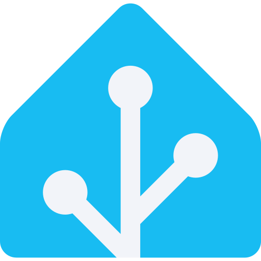
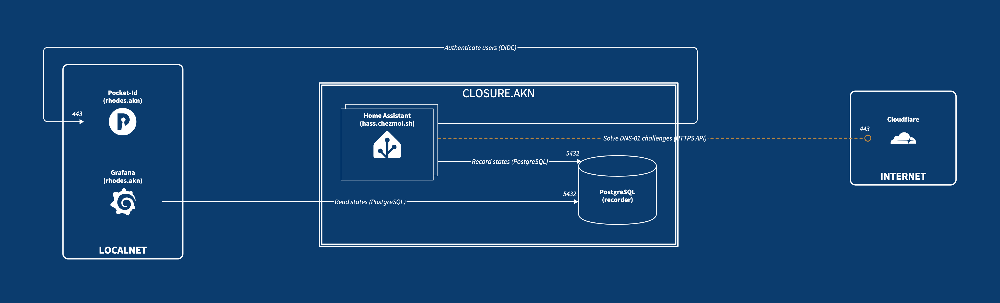

<p align="center">
  
</p>

<h1 align="center">「closure.akn」</h1>

<p align="center"><strong>Home Assistant OS — la domotique de la maison</strong></p>

<p align="center">
  
  
  
</p>

<p align="center">
  <a href="#services">Services</a> ·
  <a href="#architecture">Architecture</a> ·
  <a href="#accès">Accès</a> ·
  <a href="#configuration">Configuration</a> ·
  <a href="#déploiement">Déploiement</a> ·
  <a href="#contribuer">Contribuer</a> ·
  <a href="#pour-aller-plus-loin">Pour aller plus loin</a>
</p>

Closure héberge Home Assistant, qui sert surtout à suivre l'état de la maison (température, humidité, consommation
d'énergie) plutôt qu'à l'automatiser. La machine est un Home Assistant OS, installé et administré hors du dépôt : le
dépôt ne porte que ce qui l'entoure, c'est-à-dire le jeton Cloudflare de ses certificats et le client OIDC de sa
connexion, tous deux créés par Pulumi. Elle ne dépend d'aucun cluster pour tourner : c'est pourquoi ces deux secrets ne
passent pas par OpenBao, qui vit dans `rhodes.akn`.

## Services



### [Home Assistant](https://www.home-assistant.io/)

Centralise les appareils de la maison et expose leur état dans une interface unique, sous `https://hass.chezmoi.sh`. La
connexion passe par Pocket-Id grâce au composant [hass-oidc-auth](https://github.com/christiaangoossens/hass-oidc-auth),
et le certificat de l'instance est obtenu par le validateur DNS-01 de Cloudflare.

<br clear="all" />


### [PostgreSQL](https://www.postgresql.org/)

Garde l'historique des états enregistrés par Home Assistant. Grafana, sur `rhodes.akn`, le lit directement sur le port
5432 de `hass.chezmoi.sh` pour tracer les courbes de la maison.

<br clear="all" />

## Architecture



Home Assistant écrit son historique dans PostgreSQL, que Grafana vient lire depuis `rhodes.akn`. Les deux seuls flux qui
sortent de la machine sont l'authentification OIDC vers Pocket-Id et le défi DNS-01 vers l'API de Cloudflare.

## Accès

L'interface se trouve sur `https://hass.chezmoi.sh`. La connexion se fait par Pocket-Id, réservée aux membres du groupe
`maison`. La base PostgreSQL n'est atteignable que depuis le LAN, par Grafana (une `CiliumNetworkPolicy` de `rhodes.akn`
ne l'autorise qu'à lui,
[`network-policy.allow-grafana-to-home-assistant.yaml`](../../../fleet/clusters/akn.rhodes/kubernetes/src/apps/o11y/security/network-policy.allow-grafana-to-home-assistant.yaml)).
Côté réseau, la machine vit dans le VLAN IoT avec une exception pour Internet et un accès depuis le VLAN des
utilisateurs ([référence IPAM](../../../docs/reference/IPAM-Reference.md)).

## Configuration

Seul `pulumi/` est dans le dépôt (projet `closure-akn`, pile `closure_akn.live`). Il crée deux choses : un jeton
Cloudflare limité à la lecture de la zone et à l'édition DNS (composant partagé `cloudflare-dns01-token` du catalogue),
et le client OIDC `Home Assistant` de Pocket-Id, avec PKCE et réservé au groupe `maison`, dont l'identifiant est lu dans
la pile `chezmoi.sh` par `StackReference`. Ni l'un ni l'autre n'est poussé dans OpenBao : ce sont des sorties de la pile
(`homeAssistantDns01Token`, `homeAssistantOidcClientId`, `homeAssistantOidcClientSecret`), à recopier à la main dans
Home Assistant. Le `secrets.yaml` de l'hôte vit sur l'hôte, pas dans le dépôt. L'état Pulumi est stocké dans le backend
S3 de Garage ; la phrase secrète et les identifiants de ce backend sont résolus par fnox depuis Bitwarden Secrets
Manager (`fleet/.fnox.toml`), comme les identifiants Cloudflare et Pocket-Id (`.fnox.toml` de ce dossier), et `pulumi/.mise.toml` ne fixe que `PULUMI_STACK`.

```text
pulumi/
├── index.ts                    sorties exportées (celles que lit .mise.toml)
├── config.ts                   identifiants du compte et de la zone Cloudflare
└── stack/
    ├── home-assistant.ts       jeton DNS-01 Cloudflare
    └── pocket-id/              client OIDC (groupe lu dans la pile base)
```

## Déploiement

### Première installation

L'hôte Home Assistant OS n'est pas géré par le dépôt, son installation et sa configuration restent manuelles. Une fois
la pile appliquée (voir ci-dessous), brancher les secrets dans Home Assistant :

1. Récupérer le jeton avec `mise run pulumi:cloudflare-token` et le recopier dans le `secrets.yaml` de l'hôte.
2. Récupérer le client OIDC avec `mise run pulumi:oidc-client`.
3. Dans _Paramètres → Appareils et services → OpenID Connect/SSO Authentication_, coller le `client_id`, le
   `client_secret` et l'URL de découverte `https://auth.chezmoi.sh/.well-known/openid-configuration`.

### Mises à jour

Depuis `pulumi/`, `pulumi preview` prévisualise la pile et `pulumi up` l'applique (la commande `pulumi` passe par fnox
dans un shell interactif, voir `fleet/.mise.toml`). Si un secret change, il faut le recopier dans Home Assistant avec les deux commandes ci-dessus.

### Vérifier un déploiement

- `pulumi preview` (depuis `pulumi/`) ne doit rien proposer.
- `mise run pulumi:oidc-client` affiche un `client_id` et un `client_secret` non vides.
- Se connecter sur `https://hass.chezmoi.sh` avec le bouton Pocket-Id, depuis un compte du groupe `maison`.

## Contribuer

Les deux tâches de récupération des secrets se lancent depuis ce dossier. Le composant du jeton vient de `catalog/pulumi/components/cloudflare-dns01-token`. Le schéma se
modifie dans `architecture.d2`, puis `mise run diagram:generate` régénère `assets/architecture.png`, à commiter avec.
Lancer `mise run lint` avant de pousser.

## Pour aller plus loin

- [Nommage des machines](../../../docs/reference/Nommage-des-Machines-Reference.md) : d'où vient le nom `closure`.
- [Gérer l'état Pulumi](../../../docs/procedures/infrastructure/INF-20260705-00-Gerer-l-Etat-Pulumi-et-Importer-des-Ressources.md)
  : le backend S3 de la pile.
- [Infrastructure manuelle](../../../docs/reference/Infrastructure-Manuelle-Reference.md) : ce que le dépôt ne couvre
  pas sur l'hôte Home Assistant.
- [Référence IPAM](../../../docs/reference/IPAM-Reference.md) : le VLAN IoT et les exceptions de Home Assistant.
