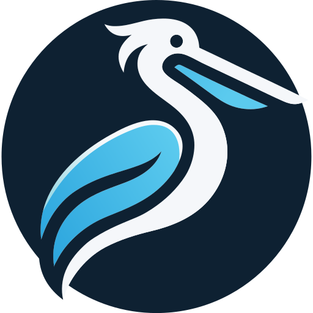
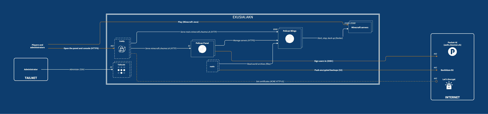

<p align="center">
  
</p>

<h1 align="center">「exusiai.akn」</h1>

<p align="center"><strong>Serveur Minecraft géré avec Pelican, sur une instance OCI Always Free</strong></p>

<p align="center">
  
  
  
  
  
</p>

<p align="center">
  <a href="#services">Services</a> ·
  <a href="#architecture">Architecture</a> ·
  <a href="#accès">Accès</a> ·
  <a href="#configuration">Configuration</a> ·
  <a href="#déploiement">Déploiement</a> ·
  <a href="#contribuer">Contribuer</a> ·
  <a href="#pour-aller-plus-loin">Pour aller plus loin</a>
</p>

Exusiai héberge les serveurs Minecraft Java du homelab sur une seule instance NixOS, hors Kubernetes : Pelican les crée
et les pilote, chaque personne autorisée par Pocket-Id se connecte au panel avec son propre compte et peut recevoir son
serveur, sans rien voir du reste de l'infrastructure. L'instance tient dans le quota Always Free d'OCI (1 OCPU et 6 Go,
l'autre moitié étant prise par `horn.akn`), et les sauvegardes partent chez Backblaze B2 pour qu'une VM perdue ne coûte
jamais un monde. Pulumi crée tout ce qui entoure la machine, NixOS ce qui tourne dedans.

## Services



### [Pelican](https://pelican.dev/)

Gestionnaire de serveurs de jeu, en deux conteneurs Docker : le Panel (interface web et API : utilisateurs, création des
serveurs, console, gestionnaire de fichiers, plannings et sauvegardes) et Wings, le démon qui lance chaque serveur de
jeu dans son propre conteneur. Le Panel authentifie les utilisateurs auprès de Pocket-Id, grâce au plugin communautaire
« Pocket ID Provider », et le plugin officiel `user-creatable-servers` laisse chacun créer ses serveurs dans les limites
fixées par un administrateur. Panel et Wings sont des versions bêta épinglées. _Choisi pour son multi-utilisateur natif,
son OAuth et son pool de ports que Wings attribue aux serveurs._ Chaque serveur de jeu (Paper, Fabric…) y est créé
depuis le Panel : l'instance convient à quelques joueurs, pas à de gros modpacks.

<br clear="all" />

## Architecture



Caddy est la porte d'entrée web : il sert le Panel et Wings, que les navigateurs appellent directement pour la console
et les fichiers. Les joueurs, eux, atteignent les serveurs de jeu sans passer par lui. Seule l'administration de la
machine passe par le tailnet.

## Accès

Le Panel est sur `https://minecraft.chezmoi.sh` et Wings sur `https://main.minecraft.chezmoi.sh` (les navigateurs
l'appellent pour la console et les fichiers). Les deux noms résolvent vers l'IP publique de l'instance (enregistrements
DNS Cloudflare non proxifiés, le proxy ne portant pas le TCP de Minecraft, le wildcard `*.minecraft` couvrant Wings et
les noms par serveur). Les joueurs se connectent à `minecraft.chezmoi.sh`, sur un port du pool TCP `25565-25580` (un par serveur). Seuls les
ports 80, 443 et ceux de ce pool sont ouverts, en IPv4 comme en IPv6, dans le pare-feu de l'hôte et dans le groupe de
sécurité réseau (NSG) d'OCI.

Pour se connecter au Panel, il faut être dans le groupe `admin` ou `minecraft` de Pocket-Id : le client OIDC y est
restreint, et le compte Pelican est créé à la première connexion (jamais rattaché automatiquement à un compte existant
par e-mail). Pour donner un serveur à quelqu'un, ajouter la personne au groupe `minecraft`, la laisser se connecter une
fois, puis lui donner un rôle qui permet de créer des serveurs.

La machine s'administre en SSH par Tailscale (`root@exusiai-akn`, tag `tag:svc-minecraft`). Le port 22 est ouvert dans
le pare-feu de l'hôte, mais fermé dans le NSG : il ne s'ouvre que le temps d'une installation, avec la configuration
Pulumi `unsecure`.

## Configuration

Pulumi (`pulumi/`, projet `exusiai-akn`, pile `exusiai_akn.live`) provisionne le compartiment OCI, un VCN et un
sous-réseau dédiés (distincts de ceux de `horn.akn`), l'instance A1.Flex (1 OCPU, 6 Go, démarrée sur une image Ubuntu
qui sert seulement d'amorce, que NixOS remplace), le NSG, les enregistrements DNS, le bucket B2 et sa clé limitée à ce
bucket, ainsi que la clé Tailscale du premier démarrage. Le groupe `minecraft` et le client OIDC de Pocket-Id sont
déclarés dans `stack/access/pocket-id.ts`, qui les importe (ils existaient avant la pile). Le secret du client est un secret de
pile : le régénérer remplace l'ancien côté Pocket-Id, et `pulumi up` réécrit `exusiai.sops.json`, qu'il faut redéployer.

NixOS (`nix/`) expose deux sorties de flake, `exusiai-akn-aarch64` (OCI A1, UEFI, production) et `exusiai-akn-x86_64`
(VM de test en BIOS legacy), car `nixos-anywhere` ne devine pas l'architecture de la cible. `configuration.nix` porte la
base (réseau, pare-feu, SSH, Tailscale, sops-nix, swap compressé) et chaque module un sujet : `pelican.nix` pour les
deux conteneurs, les plugins, les rôles et les allocations de ports (appliqués par des unités systemd qui attendent que
l'installeur web du Panel ait tourné), `caddy.nix` pour les certificats Let's Encrypt (HTTP-01) et les deux reverse
proxies, `backup.nix` pour restic. Il n'y a pas de mise à jour automatique : l'hôte n'est pas supervisé et un retour
arrière propre est difficile.

Les sauvegardes fonctionnent en deux couches : Wings écrit des archives cohérentes des mondes (à planifier dans le
Panel), puis restic les envoie chaque jour vers B2 avec les données du Panel. Les volumes des serveurs en cours
d'exécution ne sont pas sauvegardés : sans archive Wings planifiée, un monde n'existe pas hors site. Le détail est dans
`nix/modules/backup.nix`.

Les secrets sont chiffrés avec sops et déchiffrés par sops-nix grâce à la clé SSH d'hôte. `nix/secrets/exusiai.sops.json`
est écrit par Pulumi (clé Tailscale à usage unique valable 7 jours, identifiants B2, client Pocket-Id).
`nix/secrets/manual.sops.yaml` contient ce que rien ne génère : le mot de passe restic (à garder aussi dans OpenBao : le
perdre revient à perdre les sauvegardes) et les identifiants du nœud Wings. Le modèle est
`nix/secrets/manual.example.yaml`. Le `config.yml` de Wings est rendu par sops-nix à partir de ces secrets et n'est
jamais écrit en clair sur le disque.

```text
nix/
├── flake.nix              nixpkgs, disko, sops-nix, deux sorties (aarch64, x86_64)
├── configuration.nix      base du système, Tailscale, secrets
├── platforms/             boot et disque : oci.a1.nix (production), proxmox.kvm.nix (test)
├── modules/               pelican.nix, caddy.nix, backup.nix
├── secrets/               fichier sops et modèle
└── extra/                 clé d'hôte copiée à l'installation (ignorée par Git)
```

## Déploiement

### Première installation

L'installation est manuelle et se fait une fois. Le détail (configuration Pulumi, clé d'hôte, installation du nœud,
dépannage de `nixos-anywhere`, encadré macOS pour l'agent SSH) est dans le
[guide d'initialisation](../../../docs/guides/Initialiser-Exusiai.md) ; en résumé :

1. Provisionner l'infrastructure depuis `pulumi/` (`pulumi preview`, puis `pulumi up`), avec
   `unsecure` à `true` pour ouvrir SSH le temps de l'installation.
2. Générer la clé d'hôte dans `nix/extra/etc/ssh/`, créer `nix/secrets/manual.sops.yaml` depuis le modèle, et
   installer l'hôte dans les 7 jours de la clé Tailscale.
3. Installer NixOS par-dessus l'image Ubuntu, avec `mise run nixos:oci:install ubuntu@<ip-publique>`. La tâche
   **repartitionne le volume de démarrage**. Remettre ensuite `unsecure` à `false`.
4. Terminer l'installeur web du Panel sur `https://minecraft.chezmoi.sh/installer`, démarrer les unités qui en dépendent
   (`systemctl restart pelican-plugins pelican-roles`), créer le nœud (FQDN `main.minecraft.chezmoi.sh`, tag
   `user_creatable_servers`), copier son `uuid`, `token_id` et `token` dans le fichier sops, redéployer, puis appliquer
   les allocations (`systemctl restart pelican-allocations`).

### Mises à jour

`mise run nixos:oci:update` lance `nixos-rebuild switch` sur l'hôte à travers le tailnet (`root@exusiai-akn` par défaut,
une autre cible se passe en argument). `pulumi up`, depuis `pulumi/`, applique les changements de
l'infrastructure. Pour rejouer l'installation sur une VM de test Proxmox, `mise run nixos:e2e <utilisateur@hôte>` (cible
obligatoire, destructive pour elle).

### Vérifier un déploiement

- `tailscale status | grep exusiai-akn` : l'hôte est dans le tailnet.
- `ssh root@exusiai-akn systemctl status docker-pelican-panel docker-pelican-wings caddy` : les trois services tournent.
- `journalctl -u pelican-plugins -n 20` sur l'hôte : `Plugin installed and enabled.` la première fois, puis
  `Plugin is already installed!`.
- Le Panel répond sur `https://minecraft.chezmoi.sh`, la connexion Pocket-Id fonctionne et le nœud est au vert.
- `systemctl start restic-backups-minecraft`, puis `restic snapshots` sur le dépôt B2 : un snapshot apparaît.

## Contribuer

Les deux sorties du flake permettent de tester avant de toucher à la production : `.#exusiai-akn-x86_64` s'installe sur
une VM de test (`mise run nixos:e2e`). Nix est exécuté en natif. Un flake ne voit que les fichiers connus de Git : `git add -N` sur un fichier neuf avant de
construire. Les versions épinglées (images Pelican, plugins, paquets) sont suivies par Oripathy grâce aux commentaires
`# oripathy:` du code, et le Panel et Wings se mettent à jour ensemble. Le schéma se modifie dans `architecture.d2`,
puis `mise run diagram:generate` régénère `assets/architecture.png`, à commiter avec. Lancer `mise run lint` avant de
pousser.

## Pour aller plus loin

- [Initialiser Exusiai](../../../docs/guides/Initialiser-Exusiai.md) : la procédure d'amorçage complète et le
  dépannage de l'installation.
- [Restaurer Minecraft depuis restic](../../../docs/procedures/backups/BKP-20261005-00-Restaurer-Minecraft-depuis-Restic.md)
  : restaurer un monde ou reconstruire l'hôte depuis B2.
- [ADR-021](../../../docs/decisions/ADR-021-Passer-d-une-Vue-Projet-a-une-Vue-Flotte.md) : l'organisation de `fleet/`.
- [Migration vers la flotte](../../../docs/migrations/MIGR-20261114-00-Migrer-vers-la-Flotte.md) : le plan de migration
  de l'hôte vers `fleet/`.
- [ADR-016](../../../docs/decisions/ADR-016-NixOS-plutot-qu-Ansible-pour-Kazimierz.md) : pourquoi NixOS pour les VPS.
- [Nommage des machines](../../../docs/reference/Nommage-des-Machines-Reference.md) : d'où vient le nom `exusiai`.
