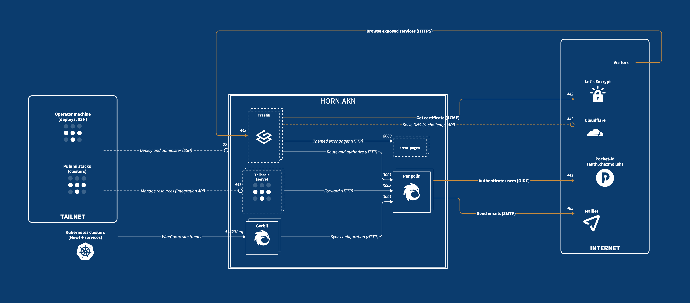

<p align="center">
  
</p>

<h1 align="center">「horn.akn」</h1>

<p align="center"><strong>VPS Oracle Cloud — la passerelle d'accès public du homelab</strong></p>

<p align="center">
  
  
  
  
  
</p>

<p align="center">
  <a href="#services">Services</a> ·
  <a href="#architecture">Architecture</a> ·
  <a href="#le-chemin-des-requêtes">Chemin des requêtes</a> ·
  <a href="#accès">Accès</a> ·
  <a href="#configuration">Configuration</a> ·
  <a href="#déploiement">Déploiement</a> ·
  <a href="#contribuer">Contribuer</a> ·
  <a href="#pour-aller-plus-loin">Pour aller plus loin</a>
</p>

Horn est la passerelle par laquelle une partie du homelab (photos, streaming, tableau de bord d'observabilité,
authentification) est joignable depuis Internet, pour la famille et les proches. C'est un VPS unique, volontairement
hors de Kubernetes, qui reste le seul point exposé : il peut être compromis, détruit et recréé sans que le reste de
l'infrastructure soit atteint, puisque les services restent chez eux et ne sont joints qu'à travers un tunnel WireGuard
([ADR-008](../../../docs/decisions/ADR-008-Ansible-plutot-que-Kubernetes-pour-Kazimierz.md),
[ADR-016](../../../docs/decisions/ADR-016-NixOS-plutot-qu-Ansible-pour-Kazimierz.md)).

## Services


### [Pangolin](https://pangolin.net/)

Contrôleur de la passerelle : il tient la liste des sites (les Newt des clusters) et des ressources publiées, décide qui
a le droit d'y accéder et sert le tableau de bord sur `pangolin.chezmoi.sh`. La connexion au tableau de bord passe par
Pocket-Id, et Pangolin envoie ses emails par Mailjet. Son Integration API, que les projets Pulumi des clusters
interrogent pour déclarer leurs ressources, n'est jamais publique : elle n'est joignable que sur le tailnet.

<br clear="all" />


### [Gerbil](https://github.com/fosrl/gerbil)

Gestionnaire WireGuard de la passerelle. Les Newt des clusters s'y connectent en UDP 51820 (tunnels de sites) et les
clients Pangolin en UDP 21820 (tunnels clients, pour les ressources privées). Il génère sa clé et reçoit sa
configuration de Pangolin.

<br clear="all" />

## Architecture



Tout le trafic public entre par Traefik, qui interroge Pangolin pour savoir où l'envoyer ; rien ne sort du VPS en clair,
les requêtes autorisées rejoignent les clusters par le tunnel WireGuard de Gerbil. L'administration (déploiements, SSH,
Integration API) ne passe que par le tailnet.

## Le chemin des requêtes

Un visiteur qui ouvre un service (`photos.chezmoi.sh`, `streaming.chezmoi.sh`, `o11y.chezmoi.sh` ou `auth.chezmoi.sh`)
atteint les ports 80 et 443 du VPS. Ces ports sont publiés par le conteneur Gerbil, dont Traefik partage l'espace
réseau. Traefik termine le TLS avec un certificat wildcard `chezmoi.sh` obtenu par un défi DNS-01 Cloudflare, redirige
le HTTP vers HTTPS, et recharge toutes les 5 secondes sa configuration depuis Pangolin.

Pangolin tranche ensuite : la ressource existe-t-elle, l'accès est-il autorisé. Les services qui gèrent eux-mêmes leur
authentification (Pocket-Id, Grafana) sont publiés sans second contrôle au niveau de Pangolin. Si la requête est
acceptée, Gerbil la transmet dans le tunnel WireGuard au Newt du bon cluster, qui la livre au service. Un nom qui ne
correspond à aucune ressource reçoit une page 404 au thème de la maison (error-pages), jamais le message brut de
Traefik. Certains services ne sont jamais publiés : n8n et le MCP d'observabilité ne répondent qu'à un appareil qui a le
client Pangolin (ressources privées).

## Accès

La passerelle écoute en public sur les ports TCP 80 et 443 et UDP 51820 et 21820, ouverts dans le pare-feu de l'hôte et
dans le groupe de sécurité réseau (NSG) OCI. Le tableau de bord est sur `https://pangolin.chezmoi.sh`, et
l'enregistrement DNS `*.chezmoi.sh` pointe sur le VPS : c'est lui la passerelle de tous les services exposés.

La machine s'administre en SSH par le tailnet (`ssh root@horn-akn`, clé uniquement, connexions limitées à trois
tentatives, `fail2ban` actif), Tailscale SSH étant aussi activé. Le port 22 est fermé dans le NSG tant que l'option
Pulumi `unsecure` est à `false` : on ne l'ouvre que le temps d'une installation. L'Integration API de Pangolin est
republiée sur le tailnet par `tailscale serve`, à l'adresse `https://horn-akn.<tailnet>.ts.net`, qui est la valeur de
`pangolin:url` des projets Pulumi.

## Configuration

Le VPS est une instance Always Free `VM.Standard.A1.Flex` (1 OCPU, 6 Go) d'`eu-paris-1`, provisionnée par Pulumi
(`pulumi/`, projet `horn-akn`, pile `horn_akn.live`) : compartiment, VCN dual-stack, NSG, instance, enregistrements DNS
Cloudflare, jeton DNS-01 de Traefik, clé d'enregistrement Tailscale, et côté Pangolin l'organisation `chezmoi-sh`, le
fournisseur d'identité Pocket-Id et le rôle `Privileged`. L'instance démarre sur une image Ubuntu qui ne sert que
d'amorce : NixOS s'installe par-dessus avec `nixos-anywhere`.

Tout le système est dans le flake `nix/`, qui expose deux sorties : `horn-akn-aarch64` (production) et `horn-akn-x86_64`
(VM de test Proxmox, pour répéter l'installation). `configuration.nix` porte la base (réseau, SSH, durcissement du
noyau, Tailscale, sops-nix) et `modules/pangolin.nix` les quatre conteneurs Docker (Pangolin, Gerbil, Traefik,
error-pages), dont les images sont épinglées par tag et digest. `modules/geoip.nix` rafraîchit chaque nuit les bases
GeoLite2 (Country et ASN) que Pangolin utilise pour ses règles de pays et d'ASN ; elles viennent d'un miroir
communautaire, sans compte MaxMind. Il n'y a pas de WAF ni d'IPS sur Traefik : le contrôle d'accès de Pangolin est la
protection du bord.

Tout l'état de Pangolin vit dans `/var/lib/pangolin/config` sur le volume de démarrage (base SQLite, clé WireGuard de
Gerbil, certificats, configuration de Traefik) : il n'y a pas de volume de données séparé, d'où la sauvegarde avant
toute réinstallation. Docker publie les ports 80 et 443 sur l'adresse privée (VCN) de l'instance, l'**IP de liaison**
(`pangolin.bindIp`), pour que `tailscale serve` garde le 443 de l'adresse du tailnet ; `mise run nixos:binding-ip`
l'écrit à partir de la sortie Pulumi dans `nix/extra/etc/pangolin/binding-ip` (ignoré par Git), et le build refuse de
continuer sans elle.

Les secrets sont chiffrés avec SOPS + age dans `nix/secrets/kazimierz.sops.yaml` et déchiffrés par sops-nix avec la clé
d'hôte SSH : `tailscale_authkey`, `pangolin_server_secret`, `pangolin_smtp_user`, `pangolin_smtp_pass` et
`cloudflare_dns_api_token`. Le `pangolin_server_secret` signe les sessions et chiffre des données de la base : il ne
change jamais, et se reprend à l'identique pour restaurer un état. Le jeton Cloudflare et la clé Tailscale sortent de la
pile Pulumi, pas d'OpenBao, parce que la passerelle ne doit pas dépendre d'un cluster qu'elle sert à joindre.
`nix/secrets/kazimierz.example.yaml` décrit chaque clé.

```text
nix/
├── flake.nix              nixpkgs, disko, sops-nix, deux sorties (aarch64 prod, x86_64 test)
├── configuration.nix      réseau, SSH, fail2ban, sysctl, Tailscale, sops
├── platforms/             démarrage et disque : oci.a1.nix (prod), proxmox.kvm.nix (VM de test)
├── modules/
│   ├── pangolin.nix       Pangolin, Gerbil, Traefik, error-pages, tailscale serve
│   └── geoip.nix          rafraîchissement des bases GeoLite2
└── secrets/               kazimierz.sops.yaml (+ exemple)
```

## Déploiement

### Première installation

La procédure complète, avec le dépannage, est dans le guide
[Initialiser Kazimierz](../../../docs/guides/Initialiser-Kazimierz.md). En résumé :

1. Provisionner l'instance : `pulumi preview` puis `pulumi up` dans `pulumi/`. Ouvrir temporairement
   le SSH avec `pulumi config set unsecure true`, et vérifier que `tag:svc-pangolin` existe dans l'ACL du tailnet et
   qu'aucun nœud `horn-akn` ne traîne dans la console Tailscale (sinon le nouveau devient `horn-akn-1`, et le
   `pangolin:url` des piles casse).
2. Générer la clé d'hôte (`ssh-keygen -t ed25519` dans `nix/extra/etc/ssh/`), l'ajouter comme destinataire de
   `nix/.sops.yaml`, puis créer `nix/secrets/kazimierz.sops.yaml` depuis l'exemple et le chiffrer avec `sops`.
3. Sur l'instance Ubuntu, installer `cpio` (nécessaire à `nixos-anywhere`), puis lancer
   `mise run nixos:oci:install ubuntu@<ip publique>`. Cette tâche **repartitionne le volume de démarrage** : elle évalue
   le système, montre la dernière sauvegarde et demande confirmation avant d'effacer.
4. Sur une installation neuve, ouvrir `https://pangolin.chezmoi.sh/auth/initial-setup` pour créer le compte
   administrateur (le jeton est affiché une fois dans `docker logs pangolin`), puis refermer le SSH avec
   `pulumi config set unsecure false && pulumi up`.

Pour réinstaller un hôte en service, restaurer d'abord l'état : `mise run nixos:backup` fait une sauvegarde à chaud
(sans interruption, base SQLite copiée par son API de sauvegarde) dans `$KAZIMIERZ_BACKUP_DIR`, par défaut
`~/.local/share/kazimierz.akn/backups`. L'archive contient des secrets en clair : la garder chiffrée au repos. Elle
s'extrait dans `nix/extra/var/lib/pangolin/config` avant l'installation, avec le même `pangolin_server_secret`.

### Mises à jour

`mise run nixos:oci:update` rafraîchit l'IP de liaison puis lance `nixos-rebuild switch` sur l'hôte, par le tailnet
(`root@horn-akn` par défaut). Rien ne s'applique automatiquement. `nixos-rebuild --rollback` sur l'hôte revient à la
génération précédente.

### Vérifier un déploiement

- `tailscale status | grep horn-akn` : le nœud est sur le tailnet.
- `ssh root@horn-akn 'systemctl status docker-pangolin docker-gerbil docker-traefik docker-error-pages pangolin-prepare pangolin-tailscale-serve'`
  : tous les services sont actifs.
- `ssh root@horn-akn 'tailscale serve status'` : l'Integration API est republiée sur le 443 du tailnet.
- `curl -sI https://pangolin.chezmoi.sh | head -n1` : le tableau de bord répond avec un certificat valide.
- Les sites (Newt) des deux clusters sont en ligne dans le tableau de bord.
- `pulumi preview` dans les projets des clusters n'affiche aucun diff sur les ressources `pangolin`.

## Contribuer

Pour valider une modification sans toucher à l'hôte : `mise run nixos:binding-ip`, puis, depuis `nix/`,
`nonix eval --raw ".#nixosConfigurations.horn-akn-aarch64.config.system.build.toplevel.drvPath"` (toute commande Nix
passe par `nonix`, qui l'exécute en conteneur). Il ne valide que l'évaluation : une dérivation qui ne compile pas ne se
voit qu'au build. `mise run nixos:e2e <user@host>` répète l'installation complète sur une VM de test Proxmox (x86_64),
et **efface la cible**. Côté Pulumi, `pulumi preview` dans `pulumi/`.

Les images des conteneurs sont à mettre à jour dans `nix/modules/pangolin.nix`, à un seul endroit. Le schéma
d'architecture se modifie dans `architecture.d2`, puis `mise run diagram:generate` régénère `assets/architecture.png`, à
commiter avec. Lancer `mise run lint` avant de pousser.

## Pour aller plus loin

- [Initialiser Kazimierz](../../../docs/guides/Initialiser-Kazimierz.md) : la procédure d'installation complète, la
  restauration de l'état et le dépannage.
- [ADR-008](../../../docs/decisions/ADR-008-Ansible-plutot-que-Kubernetes-pour-Kazimierz.md) : pourquoi la passerelle
  reste hors de Kubernetes.
- [ADR-016](../../../docs/decisions/ADR-016-NixOS-plutot-qu-Ansible-pour-Kazimierz.md) : pourquoi NixOS.
- [Migration vers la flotte](../../../docs/migrations/MIGR-20261114-00-Migrer-vers-la-Flotte.md) : le renommage en
  `horn.akn`.
- [Nommage des machines](../../../docs/reference/Nommage-des-Machines-Reference.md) : d'où vient le nom `horn`.
- [Référence IPAM](../../../docs/reference/IPAM-Reference.md) : le plan d'adressage du VCN OCI.
