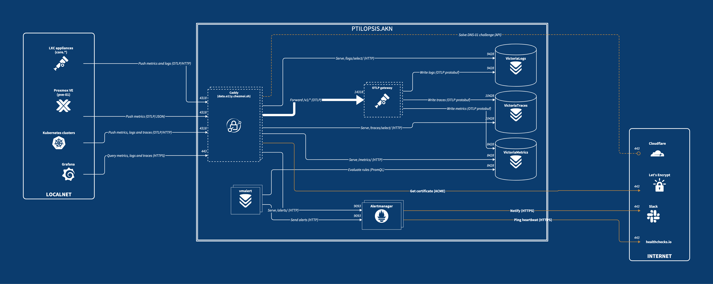

<p align="center">
  
</p>

<h1 align="center">「ptilopsis.akn」</h1>

<p align="center"><strong>Mac Studio — là où sont stockées les données d'observabilité</strong></p>

<p align="center">
  
  
  
  
  
</p>

<p align="center">
  <a href="#services">Services</a> ·
  <a href="#architecture">Architecture</a> ·
  <a href="#accès">Accès</a> ·
  <a href="#le-chemin-des-signaux">Chemin des signaux</a> ·
  <a href="#configuration">Configuration</a> ·
  <a href="#déploiement">Déploiement</a> ·
  <a href="#contribuer">Contribuer</a> ·
  <a href="#pour-aller-plus-loin">Pour aller plus loin</a>
</p>

Ptilopsis garde les données d'observabilité du homelab : métriques, logs et traces y sont stockés, et c'est de là que
partent les alertes critiques (la perte d'un hôte ou d'un cluster, par exemple). Elle vit volontairement en dehors des
clusters Kubernetes, pour que les signaux et le heartbeat continuent d'arriver quand l'un d'eux tombe
([ADR-022](../../../docs/decisions/ADR-022-Heberger-l-Appliance-d-Observabilite-sur-un-Mac-Studio-Dedie.md)).

## Services


### [VictoriaMetrics](https://victoriametrics.com/)

Stocke les métriques de toutes les machines, de Proxmox VE et des deux clusters. Grafana l'interroge en PromQL, comme
vmalert pour évaluer les règles d'alerte.

<br clear="all" />


### [VictoriaLogs](https://docs.victoriametrics.com/victorialogs/)

Stocke les logs des machines et des pods, avec une sévérité uniformisée à l'entrée. Grafana les lit en LogsQL.

<br clear="all" />


### [VictoriaTraces](https://docs.victoriametrics.com/victoriatraces/)

Stocke les traces envoyées par les clusters et les rend consultables depuis Grafana.

<br clear="all" />


### [Alertmanager](https://prometheus.io/docs/alerting/latest/alertmanager/)

Reçoit les alertes de vmalert (calculées sur VictoriaMetrics) et de Grafana, et les envoie sur Slack. Il entretient aussi le heartbeat :
une alerte toujours active pingue healthchecks.io, qui prévient si le Mac se tait.

<br clear="all" />

## Architecture



Tout entre par Caddy, sous le nom `data.o11y.chezmoi.sh` : l'écriture sur le port 4318 passe par la passerelle OTLP, la
lecture sur le port 443 va directement aux stores. Seuls Caddy (certificat) et Alertmanager (notifications, heartbeat)
sortent vers Internet.

## Accès

Tout passe par `https://data.o11y.chezmoi.sh`. Les clients écrivent en OTLP/HTTP sur le port 4318 (`/v1/metrics`,
`/v1/logs`, `/v1/traces`), qui est le seul chemin d'écriture. Le port 443 est en lecture seule : VictoriaMetrics sous
`/metrics/`, VictoriaLogs sous `/logs/select/`, VictoriaTraces sous `/traces/select/` et Alertmanager sous `/alerts/`.

Rien n'est authentifié, c'est le pare-feu de la machine qui filtre : seuls le LAN du homelab (plages dans la
[référence réseau](../../../docs/reference/Reseau-Reference.md)) et le loopback atteignent ces deux ports. Le VLAN Home
atteint le port 443 seulement, en lecture : Caddy n'accepte les silences d'Alertmanager que du LAN du homelab et du
loopback. La machine elle-même ne se pilote qu'en partage d'écran, il n'y a pas de SSH.

## Le chemin des signaux

Chaque machine, et chaque cluster, pousse ses signaux en OTLP vers `data.o11y.chezmoi.sh:4318`. Caddy les reçoit : il
termine le TLS, refuse tout ce qui n'est pas un chemin `/v1/*` (404) et limite les corps à 64 Mio. Il les passe ensuite
à la passerelle OTLP, un OpenTelemetry Collector qui n'écoute qu'en local.

La passerelle existe parce que les stores n'acceptent que de l'OTLP en protobuf, alors que certains clients envoient du
JSON (le serveur de métriques de Proxmox VE). Elle accepte les deux et renvoie toujours du protobuf. Au passage, elle ne
fait que deux retouches : elle uniformise la sévérité des logs (`warning`, `Information`, `err`… deviennent `WARN`,
`INFO`, `ERROR`…) et ajoute aux métriques les labels `job` et `instance`, pour que les tableaux de bord Prometheus
classiques fonctionnent. Les traces passent telles quelles. Chaque exporteur garde sa file sur disque, donc un store qui
redémarre ne fait pas perdre de données.

La lecture ne passe pas par la passerelle : Caddy sert directement les API des stores sur le port 443.

## Configuration

Toute la configuration est dans `nix/`. `configuration.nix` ne garde que ce qui est propre à la machine : son identité,
les valeurs qui dimensionnent la stack (rétention, limites mémoire, emplacement des données) et les réglages de l'agent.
Le reste est rangé par sujet dans `nix/modules/`, et le catalogue (`catalog/nix`) ne fournit que l'agent
d'observabilité, partagé avec les autres machines, et le plafonnement des logs.

Chaque service de la stack tourne comme daemon launchd (`org.nixos.o11y-*`), avec ses logs dans
`/var/log/o11y-datastore/`, plafonnés à 64 Mio par service. Les données vivent dans `/var/lib/o11y-datastore`, un volume
APFS dédié plafonné à 250 Go (une limite, pas une réservation) qu'il faut créer sur le bon disque, jamais sur le disque
système. Un daemon (`org.nixos.o11y-datastore-mount`) le garde monté : macOS 27.2.1 le démonte une minute après le
démarrage, même avec une entrée dans `/etc/fstab`, et tous les autres daemons tombent alors en `EX_CONFIG` (leur dossier
de travail est sur ce volume). Il le retrouve par son UUID (`volumeUuid` dans `configuration.nix`) et le remonte dans les
15 secondes. Au démarrage, launchd charge les daemons avant `/nix` et avant ce volume : chacun passe donc par un petit
shell qui attend son binaire et, pour ceux qui écrivent sur le volume, que celui-ci soit monté (sans ça, un daemon à
intervalle comme `pf` était abandonné au premier « Missing executable », et un store pouvait écrire sur le dossier vide
sous le volume). Un job root (`org.nixos.o11y-datastore-prepare`) recrée aussi à chaque démarrage les dossiers et les
fichiers de log avec les bons propriétaires : un dossier de log absent est recréé par launchd en `root`, et les daemons ne
peuvent plus y écrire (`Unable to open stdout path`, `EX_CONFIG`) jusqu'au switch suivant. La rétention de chaque store se règle dans `configuration.nix` en `<n>d`, `<n>w` ou `<n>M` (un mois fait 30
jours) et est convertie en jours pour les stores ; tout autre format est refusé à l'évaluation. Il n'y a pas de
sauvegarde prévue pour le moment. macOS n'ayant pas d'équivalent à `MemoryMax`, seules les options des stores
(`-memory.allowedBytes`, limites par requête) bornent la mémoire. Côté serveur, la machine ne se met jamais en veille,
redémarre toute seule après une coupure de courant ou un gel, et ne se met pas à jour toute seule.

Les secrets `slack-webhook-url` et `alertmanager-deadman-url` sont dans `nix/secrets/o11y.sops.yaml`, et
`cloudflare-api-token` dans `nix/secrets/cloudflare.sops.json`, chiffrés avec sops et déchiffrés par sops-nix au démarrage avec la clé d'hôte de la
machine (`/etc/ssh/ssh_host_ed25519_key`, générée à l'installation sans activer SSH). `alertmanager-deadman-url` sert au
heartbeat : Alertmanager pingue healthchecks.io en continu, et si le Mac s'arrête, le ping cesse et une alerte part.

Le jeton `cloudflare-api-token` (DNS-01 de Caddy) est créé par le projet Pulumi `ptilopsis-akn` (pile
`ptilopsis_akn.live`, dans `pulumi/`) et non par OpenBao, qui tourne dans `rhodes.akn` : la machine ne doit pas en
dépendre pour démarrer. Le `pulumi up` l'écrit dans `nix/secrets/cloudflare.sops.json` (ressource `SopsFile`, `sops` et la clé age doivent être présents
sur la machine qui le lance), il reste à commiter le fichier puis à reconstruire le Mac.

```text
nix/
├── flake.nix                 nixpkgs, nix-darwin, arcane (agent et log-trim du catalogue), sops-nix
├── flake.lock
├── configuration.nix         identité de la machine, valeurs de la stack, agent
├── .sops.yaml                règle de création de secrets/*
├── secrets/                  o11y.sops.yaml, cloudflare.sops.json (écrit par pulumi/)
└── modules/
    ├── server.nix            veille, énergie, mises à jour macOS, pare-feu, pas de SSH
    ├── secrets.nix           sops-nix et propriétaires des secrets
    └── o11y-datastore/
        ├── default.nix       options, comptes, dossiers, aide launchd
        ├── flags.nix         ports, options des daemons, build de Caddy
        ├── stores.nix        VictoriaMetrics, VictoriaLogs, VictoriaTraces, vmalert
        ├── alertmanager.nix  Alertmanager et heartbeat
        ├── gateway.nix       passerelle OTLP
        ├── caddy.nix         Caddy
        ├── firewall.nix      règles pf
        ├── agent.nix         ce que l'agent collecte sur la stack
        └── fs/               Caddyfile, page d'accueil, pipeline de la passerelle, règles vmalert
```

## Déploiement

### Première installation

La première installation se fait à la main, une seule fois :

1. Installer macOS en créant le compte administrateur avec le nom court `ptilopsis` (celui défini dans
   `nix/configuration.nix`), activer le partage d'écran, générer la clé de la machine (`sudo ssh-keygen -A` crée
   `/etc/ssh/ssh_host_ed25519_key`) et lui donner son adresse fixe (`10.0.0.32`).
2. Installer Nix avec l'installeur officiel (nix-darwin gère ensuite le daemon), puis cloner le dépôt.
3. Créer le volume APFS des données (quota 250 Go) sur le bon disque, jamais le disque système, et reporter son UUID
   (`diskutil info -plist <volume> | plutil -extract VolumeUUID raw -`) dans `volumeUuid` de `nix/configuration.nix`.
   Pas besoin d'entrée dans `/etc/fstab` : le daemon s'en charge.
4. Créer `secrets/o11y.sops.yaml` avec `sops` depuis `nix/` (la clé age de la machine est déjà parmi les destinataires de
   `nix/.sops.yaml` ; `nix run nixpkgs#ssh-to-age < /etc/ssh/ssh_host_ed25519_key.pub` la redonne) et les deux clés
   ci-dessus (`alertmanager-deadman-url` vient d'un nouveau check healthchecks.io), puis lancer le `pulumi up` de
   `pulumi/` pour produire `secrets/cloudflare.sops.json`, et commiter les deux fichiers.
5. Depuis `nix/` : `sudo nix run nix-darwin/master#darwin-rebuild -- switch --flake .#ptilopsis`. Caddy et
   VictoriaMetrics sont compilés sur place, ça prend du temps.
6. Donner l'accès complet au disque aux binaires des stores et de la passerelle (voir ci-dessous), puis les relancer
   (`sudo launchctl kickstart -k system/org.nixos.o11y-<service>`).

### Accès complet au disque

macOS refuse aux daemons l'accès à un volume externe (`operation not permitted`) tant que leur binaire n'a pas l'accès
complet au disque, et nix-darwin ne peut pas le déclarer sans MDM. Il se donne donc à la main, dans Réglages Système →
Confidentialité et sécurité → Accès complet au disque, à `victoria-metrics`, `victoria-logs`, `victoria-traces` et
`otelcol-contrib`. Leur chemin dans `/nix/store` est le `program` de leur job :

```sh
for s in victoriametrics victorialogs victoriatraces otlp-gateway; do
  launchctl print system/org.nixos.o11y-$s | awk '/^\tprogram =/ {print $3}'
done
```

Un rebuild qui change l'un de ces binaires change son chemin et lui fait perdre l'accès : le store qui redémarre en
boucle (`flock.lock: operation not permitted` dans son log) le signale. Caddy n'en a pas besoin, son état vit hors du
volume (`/var/lib/o11y-caddy`).

### Mises à jour

Une fois nix-darwin installé, `mise run nix:switch` demande confirmation puis lance `sudo darwin-rebuild switch`. Tant
que nix-darwin n'est pas installé, et hors macOS, la commande s'ignore sans erreur : c'est pour ça que la première
installation reste manuelle.

### Vérifier un déploiement

Sur le Mac :

- `sudo launchctl list | grep org.nixos.o11y` : tous les jobs tournent.
- `mount | grep o11y-datastore` : le volume est monté ; sinon `tail /var/log/o11y-datastore/mount.log`.
- `pmset -g` : `sleep 0` et `autorestart 1`.
- `sudo pfctl -a com.apple/o11y-datastore -s rules` : trois règles.
- `ls -l /run/secrets/` : les trois secrets sont là.
- `tail /var/log/o11y-datastore/*.log` : Caddy a obtenu son certificat.
- Lecture :
  `curl -sS --resolve data.o11y.chezmoi.sh:443:127.0.0.1 "https://data.o11y.chezmoi.sh/metrics/api/v1/query?query=up"`.
- `hw.power` apparaît dans VictoriaMetrics, et les logs du journal macOS portent `host.name="ptilopsis"`.

Depuis un hôte du LAN, l'écriture : aucun des trois chemins ne doit répondre 404, puis un push OTLP de test doit
ressortir à la lecture.

```sh
for s in metrics logs traces; do
  curl -sS -o /dev/null -w "$s %{http_code}\n" -H 'Content-Type: application/json' -d '{}' \
    --resolve data.o11y.chezmoi.sh:4318:10.0.0.32 "https://data.o11y.chezmoi.sh:4318/v1/$s"
done
```

Depuis le VLAN Home, le port 443 répond mais la création d'un silence renvoie 403, et le port 4318 doit expirer. Depuis
un autre réseau, les deux ports doivent expirer.

## Contribuer

`mise run nix:eval` évalue la configuration sans la construire ni l'activer, sur n'importe quelle machine avec Nix. Il
doit passer avant chaque commit, mais il ne valide que l'évaluation : une dérivation qui ne compile pas ne se voit qu'au
build. Sur un Mac Apple Silicon (aarch64-darwin), construire le système sans l'activer permet de tester avant de
déployer.

Tant que les fichiers ne sont pas commités, le flake Git ne les voit pas ; pour évaluer ou construire avec le catalogue
local, depuis `nix/` :

```sh
nix eval --no-write-lock-file --override-input arcane "path:$(git rev-parse --show-toplevel)/catalog/nix" \
  path:.#darwinConfigurations.ptilopsis.system.drvPath

nix build --no-link --no-write-lock-file --override-input arcane "path:$(git rev-parse --show-toplevel)/catalog/nix" \
  path:.#darwinConfigurations.ptilopsis.system
```

Tout ce qui concerne la stack est dans `nix/modules/o11y-datastore/` : un changement de port, de flag ou de règle se
fait là, et nulle part ailleurs. Seuls l'agent d'observabilité et le plafonnement des logs viennent du catalogue
(`catalog/nix`), parce que d'autres machines les utilisent. Le schéma d'architecture se modifie dans `architecture.d2`,
puis `mise run diagram:generate` régénère `assets/architecture.png`, à commiter avec. Lancer `mise run lint` avant de
pousser.

## Pour aller plus loin

- [ADR-022](../../../docs/decisions/ADR-022-Heberger-l-Appliance-d-Observabilite-sur-un-Mac-Studio-Dedie.md) : pourquoi
  l'observabilité vit sur un Mac Studio dédié.
- [Plan de migration](../../../docs/migrations/MIGR-20261115-00-Migrer-l-Observabilite-vers-le-Mac-Studio.md) : les
  étapes pour y arriver.
- [ADR-013](../../../docs/decisions/ADR-013-Observabilite-Centralisee-VictoriaMetrics-sur-LXC.md) : l'observabilité
  centralisée sur la stack VictoriaMetrics.
- [ADR-018](../../../docs/decisions/ADR-018-OTLP-comme-Protocole-d-Ingestion-Unique-pour-l-Appliance-d-Observabilite.md)
  : OTLP comme seul protocole d'ingestion.
- [Agent d'observabilité](../../../catalog/nix/modules/o11y-agent/README.md) : ce qui envoie les données.
- [Nommage des machines](../../../docs/reference/Nommage-des-Machines-Reference.md) : d'où vient le nom `ptilopsis`.
