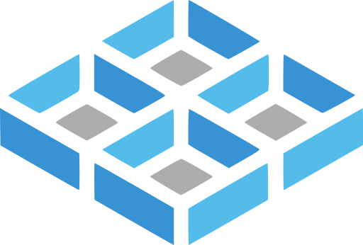
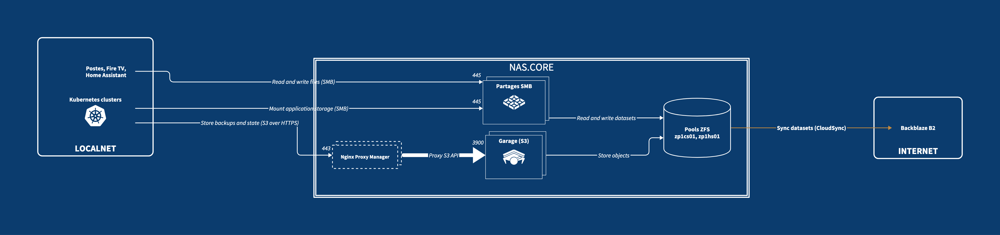

<p align="center">
  
</p>

<h1 align="center">「nas.core」</h1>

<p align="center"><strong>NAS TrueNAS SCALE du homelab, entièrement décrit en Pulumi</strong></p>

<p align="center">
  
  
  
  
</p>

<p align="center">
  <a href="#services">Services</a> · <a href="#architecture">Architecture</a> · <a href="#accès">Accès</a> · <a href="#configuration">Configuration</a> · <a href="#déploiement">Déploiement</a> · <a href="#contribuer">Contribuer</a> · <a href="#pour-aller-plus-loin">Pour aller plus loin</a>
</p>

`nas.chezmoi.sh` est le NAS du foyer. Il ne fait que stocker : la médiathèque (films, séries, animés, musique, livres),
les documents personnels, les volumes de données de quelques applications des clusters (Immich, Paperless-ngx), les
sauvegardes de Home Assistant et un magasin d'objets S3 qui héberge, entre autres, l'état Pulumi du dépôt. Il tourne
dans une VM Proxmox (`pve-01`) dont les pools ZFS reposent sur des disques physiques en passthrough, et une copie
hors-site des données utiles part vers Backblaze B2.

Tout ce qui se déclare l'est dans le projet Pulumi [`pulumi/`](pulumi/) (projet `nas-core`, stack `nas_core.live`) : ce
qui reste manuel (cycle de vie de la VM, création des pools, certificats ACME, ACL de systèmes de fichiers, listes
d'hôtes NFS/SMB) est détaillé plus bas. La référence générée de l'état réel du NAS (pools, datasets, partages,
permissions, sauvegardes, reconstruction) est [`TRUENAS.md`](TRUENAS.md).

## Services


### [Partages SMB](https://www.truenas.com/truenas-scale/)

Sert la médiathèque, les espaces utilisateurs (`Mes Documents`, `Documents partagés`), les sauvegardes de Home Assistant
et le stockage applicatif d'Immich et de Paperless-ngx, monté par les clusters Kubernetes. SMB est le seul protocole de
partage déclaré (`pulumi/shares.ts`) ; les comptes de service qui s'y connectent (`pulumi/users/`) voient leur mot de
passe publié dans OpenBao.

<br clear="all" />


### [Garage](https://garagehq.deuxfleurs.fr/)

Magasin d'objets compatible S3 (`s3.chezmoi.sh`) : TrueNAS SCALE n'en fournit pas. Il reçoit l'état Pulumi du dépôt et
les sauvegardes des clusters (CloudNative-PG, Velero). L'application est installée depuis le catalogue TrueNAS, et sa
configuration (identifiants, ports, stockage) est portée par la stack ; sa version, elle, est laissée au catalogue.

<br clear="all" />

## Architecture



Tout le trafic reste sur le réseau local sauf la synchronisation vers Backblaze B2. Les applications de Kubernetes
atteignent Garage à travers le reverse proxy interne du NAS (Nginx Proxy Manager, publié sur `10.0.0.31` et sur
l'adresse côté `talosnet`), alors que SMB s'adresse directement au NAS.

## Accès

- **Interface et API TrueNAS** : `https://nas.chezmoi.sh`. Pulumi s'y connecte avec la variable d'environnement
  `TRUENAS_API_KEY`.
- **Services activés au démarrage** : SMB (`cifs`), NFS et SSH. FTP, iSCSI, SNMP et UPS restent éteints
  (`pulumi/services.ts`).
- **Réseau** : trois interfaces physiques déclarées dans `pulumi/network.ts`. Une adresse est posée côté `talosnet` pour
  que Garage et Nginx Proxy Manager soient joignables depuis les pods Talos sans traverser le SNAT du SDN. Les adresses
  exactes sont dans [`TRUENAS.md`](TRUENAS.md) et dans la
  [référence réseau](../../../docs/reference/Reseau-Reference.md).
- **Alertes** : les alertes critiques partent par e-mail via le relais du NAS (`pulumi/alerts.ts`).

## Configuration

La stack est découpée par responsabilité. Un fichier par domaine dans `pulumi/` :

| Fichier           | Responsabilité                                                                                                                                |
| ----------------- | --------------------------------------------------------------------------------------------------------------------------------------------- |
| `zpools/`         | Pools ZFS et hiérarchie de datasets, un fichier par pool (`zp1cs01.ts`, `zp1hs01.ts`), plus scrubs et snapshots ; conventions dans son README |
| `shares.ts`       | Partages SMB                                                                                                                                  |
| `users/`          | Comptes de service, un fichier par compte, avec l'ACL du dataset qu'il possède ; mots de passe publiés dans OpenBao                           |
| `acls.ts`         | Modèles d'ACL NFS4 et affectation aux datasets sans propriétaire unique                                                                       |
| `identities.ts`   | Lectures (pas des ressources) des identités TrueNAS préexistantes (`apps`, `builtin_users`)                                                   |
| `apps.ts`         | Catalogue d'applications et applications `garage` et `nginx-proxy-manager`                                                                    |
| `cloudsync.ts`    | Buckets Backblaze B2 et tâches de synchronisation hors-site                                                                                   |
| `jobs.ts`         | Tâches cron : test S.M.A.R.T. quotidien, création du squelette de dossiers des espaces utilisateurs                                           |
| `certificates.ts` | Demandes de signature (CSR) et jeton Cloudflare DNS-01 pour l'ACME                                                                            |
| `network.ts`      | Nom d'hôte, passerelle, DNS, interfaces                                                                                                       |
| `services.ts`     | Services activés au démarrage                                                                                                                 |
| `alerts.ts`       | Destination et politique des alertes                                                                                                          |

Les trois couches de protection des données (scrub hebdomadaire de chaque pool, snapshots de `zp1hs01`, synchronisation
vers B2 sans `zp1cs01`, dont le contenu est considéré comme ré-acquérable) et leurs horaires réels sont dans
[`TRUENAS.md`](TRUENAS.md), section _Backups_ ; la justification des valeurs est dans
[`pulumi/zpools/README.md`](pulumi/zpools/README.md).

Ce que Pulumi ne gère volontairement pas :

- les certificats ACME (le provider ne sait ni configurer le défi DNS-01 ni référencer une CSR) : seules les CSR et le
  jeton Cloudflare sont déclarés ;
- les serveurs DNS (`truenas.DnsNameserver`), déjà portés par `network.ts` ;
- toutes les applications TrueNAS sauf `garage` et `nginx-proxy-manager` ;
- les ACL de systèmes de fichiers NFS4 : le provider ne peut pas les appliquer. La stack déclare les modèles et
  documente lequel poser sur quel dataset, à refaire à la main dans l'interface (`Storage` → `Datasets` →
  `Edit Permissions` → `Use ACL Preset`), sans détection de dérive ;
- les listes d'hôtes autorisés des partages, gérées dans l'interface du NAS (d'où `ignoreChanges: ["hosts"]` sur les
  partages) ;
- la VM elle-même et la création des pools, manuelles côté Proxmox.

Les secrets de la stack (`pulumi config set --secret`) sont `cloudflare_account_id`, `cloudflare_zone_id` et
`garage_admin_token`, `garage_rpc_secret`, `garage_web_ui_password`, `garage_web_ui_username`. Le point d'entrée du NAS
(`truenas:url`, `truenas:destroyProtection`) est dans `Pulumi.nas_core.live.yaml`. Les fournisseurs s'authentifient par
l'environnement : `TRUENAS_API_KEY`, `B2_APPLICATION_KEY_ID` / `B2_APPLICATION_KEY`, `VAULT_ADDR` et une session
`mise run bao:login`. La phrase secrète Pulumi du projet est chiffrée avec SOPS (`pulumi/.mise/env.yaml`, règles dans
[`.sops.yaml`](.sops.yaml), ADR-017) et l'état est stocké sur Garage, c'est-à-dire sur le NAS lui-même.

## Déploiement

### Première installation

Manuelle, une seule fois : installer TrueNAS SCALE dans une VM Proxmox avec les disques en passthrough, créer les pools,
puis renseigner les secrets de la stack. L'état étant hébergé sur Garage, la toute première application passe par la
procédure d'import et de bootstrap de l'état décrite dans
[Gérer l'état Pulumi](../../../docs/procedures/infrastructure/INF-20260705-00-Gerer-l-Etat-Pulumi-et-Importer-des-Ressources.md).

Reconstruire le NAS : si la VM est perdue mais pas les disques, restaurer la VM depuis PBS, recréer les mappings PCI si
l'hôte a changé, et les pools se réimportent avec leurs données (Garage et l'état Pulumi reviennent avec `zp1hs01`). Si
les disques sont perdus aussi, créer de nouveaux pools et récupérer les données depuis B2 (seuls les datasets
synchronisés reviennent). Dans les deux cas, finir par `mise run pulumi:apply` puis réappliquer les ACL à la main. Le
détail est dans [`TRUENAS.md`](TRUENAS.md), section _Rebuild the NAS_.

### Mises à jour

```sh
cd fleet/hosts/core.nas/pulumi
mise run pulumi:diff      # prévisualiser
mise run pulumi:apply     # appliquer (confirmation), puis régénère TRUENAS.md
```

Un rafraîchissement n'est fait que si le dernier a plus de 24 heures ; `-- --refresh` ou `-- --no-refresh` le force ou
l'évite.

### Vérifier un déploiement

```sh
mise run pulumi:diff                 # aucune différence attendue après un apply
mise run bao:smb:drift-check         # mots de passe SMB identiques côté Pulumi et OpenBao (hash uniquement)
```

Contrôler ensuite dans l'interface TrueNAS qu'aucune alerte critique n'est ouverte et que les ACL des datasets
correspondent à la table de [`TRUENAS.md`](TRUENAS.md).

## Contribuer

**Ajouter ou modifier un dataset.** Les datasets sont une table plate indexée par chemin (avec `/` initial) dans
`zpools/zp1cs01.ts` ou `zpools/zp1hs01.ts`, typée par `TrueNASPoolComponent`. L'imbrication se déduit du chemin : chaque
ancêtre doit donc avoir sa propre entrée, juste avant l'enfant. Pour les datasets d'application, préférer `atime: Off`
et `compression: Lz4`.

```typescript
"/applications/mynewds": {
  comments: "Description of the dataset",
  quota: 100 * ByteSize.Gi,
  compression: Compression.Lz4,
  atime: OnOffInherit.Off,
},
```

Les autres fichiers retrouvent un dataset par son chemin sans `/` initial, avec
`pool.get("applications/immich").resource`, qui échoue si le chemin n'est pas déclaré.

**Ajouter ou modifier un partage.** Déclarer un `truenas.ShareSmb` (ou `ShareNfs`) dans `shares.ts`, avec le dataset
comme `parent` et `ignoreChanges: ["hosts"]`. Le générateur de documentation ne lit pas ce fichier : il relit l'état via
`pulumi stack export`.

```typescript
new truenas.ShareSmb(
  "smb-share-myshare",
  {
    name: "MyShare",
    path: zp1cs01.get("media/mynewds").resource.mountPoint,
    purpose: "LEGACY_SHARE", // LEGACY_SHARE, PRIVATE_DATASETS_SHARE, DEFAULT_SHARE, TIMEMACHINE_SHARE
    comment: "Descriptive comment",
    enabled: true,
  },
  { parent: zp1cs01.get("media/mynewds").resource, ignoreChanges: ["hosts"] },
);
```

Si le dataset a besoin de permissions précises, ajouter sa ligne d'affectation (`acls.ts` ou `users/<compte>.ts`) et
appliquer le modèle à la main.

**Documentation générée.** [`TRUENAS.md`](TRUENAS.md) est produit à partir de l'état réel de la stack par
[`pulumi/toolbox/truenas-docs/`](pulumi/toolbox/truenas-docs/README.md), et ne se modifie pas à la main :
`mise run pulumi:apply` le régénère, ou `mise run truenas:docs:generate` seul.

**Diagramme.** Après toute modification de `architecture.d2`, régénérer le PNG avec `mise run diagram:generate` et le
versionner. `mise run lint` vérifie le reste. Les conventions de commit et de PR sont dans `AGENTS.md`.

## Pour aller plus loin

- [TRUENAS.md](TRUENAS.md) : la référence générée (pools, datasets, partages, permissions, sauvegardes, reconstruction).
- [Gérer l'état Pulumi](../../../docs/procedures/infrastructure/INF-20260705-00-Gerer-l-Etat-Pulumi-et-Importer-des-Ressources.md)
  : l'état de la stack est hébergé sur Garage, donc sur ce NAS.
- [ADR-017](../../../docs/decisions/ADR-017-Conserver-une-Phrase-Secrete-Pulumi-par-Projet-et-Interdire-le-Partage-par-StackReference.md)
  : la phrase secrète Pulumi par projet.
- [`pulumi/zpools/README.md`](pulumi/zpools/README.md) : conventions ZFS et justification des plannings de sauvegarde.
- [`pulumi/users/README.md`](pulumi/users/README.md) : conventions des comptes de service.
- [Nommage des machines](../../../docs/reference/Nommage-des-Machines-Reference.md) : pourquoi `core.nas`.
