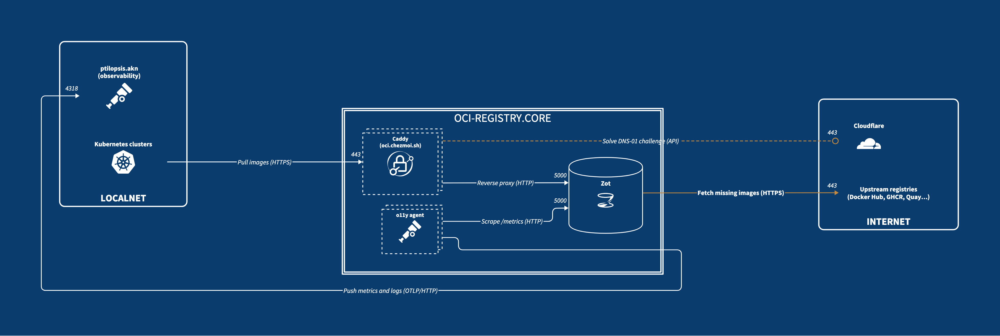

<p align="center">
  
</p>

<h1 align="center">「oci-registry.core」</h1>

<p align="center"><strong>LXC Proxmox — le registre OCI du homelab, un cache pull-through devant les registres publics</strong></p>

<p align="center">
  
  
  
  
</p>

<p align="center">
  <a href="#services">Services</a> ·
  <a href="#architecture">Architecture</a> ·
  <a href="#le-chemin-dune-image">Chemin d'une image</a> ·
  <a href="#accès">Accès</a> ·
  <a href="#configuration">Configuration</a> ·
  <a href="#déploiement">Déploiement</a> ·
  <a href="#contribuer">Contribuer</a> ·
  <a href="#pour-aller-plus-loin">Pour aller plus loin</a>
</p>

`oci-registry.core` sert `https://oci.chezmoi.sh`, le miroir par lequel les clusters tirent leurs images de conteneurs.
Il vit dans un LXC sur l'hyperviseur et non dans un cluster, pour que le démarrage d'un cluster ne dépende pas d'un
registre qu'il héberge lui-même : c'est la boucle qui a causé
l'[incident du 2026-05-26](../../../docs/incidents/Incident-2026-05-26-ImagePullBackOff-Circulaire-Kyverno-Zot-Amiya.md)
et que la politique OPA de l'[ADR-012](../../../docs/decisions/ADR-012-Remplacer-Kyverno-par-OPA.md) suppose rompue.

## Services


### [Zot](https://zotregistry.dev/)

Sert les images OCI sous `oci.chezmoi.sh/<registre>/<dépôt>:<tag>` et va chercher à la demande, chez le registre
d'origine, ce qu'il n'a pas encore en cache. Il garde aussi l'interface web, l'API de gestion et les métriques
Prometheus, lues par l'agent d'observabilité de la machine.

<br clear="all" />

## Architecture



Tout entre par Caddy, qui termine le TLS et passe à Zot, lequel n'écoute qu'en local. Seuls Zot (registres amont) et
Caddy (API Cloudflare pour le certificat) sortent vers Internet ; l'agent n'émet que vers `ptilopsis.akn`.

## Le chemin d'une image

Un client tire `oci.chezmoi.sh/ghcr.io/org/app:tag`. Le premier segment est le registre d'origine : Zot le reconnaît
parmi ceux déclarés dans `nix/upstreams.nix` (Docker Hub, GCR, GHCR, ECR Public, Quay, GitLab, `registry.k8s.io`, MCR,
`oci.external-secrets.io` et `code.forgejo.org`), récupère l'image au premier appel, conserve les blobs et les sert
ensuite depuis le cache. La synchronisation est à la demande (aucun miroir complet), garde le digest d'origine (les
signatures restent valides) et vérifie toujours la chaîne TLS du registre amont.

La liste est statique, et c'est voulu : aucune requête, aucun client authentifié, aucun processus compromis ne peut
faire passer du trafic par un registre non déclaré. Ajouter un registre demande une modification de `nix/upstreams.nix`,
un build et un déploiement (quelques minutes de build Nix), pas un réglage à chaud.

Un nettoyage tourne toutes les 24 h : les images de `ghcr.io/chezmoidotsh/**` gardent leurs 3 tags les plus récemment
poussés, tout le reste garde 3 tags tirés dans les 6 derniers mois, et les manifestes sans tag sont supprimés. Pour
forcer un passage après avoir changé la rétention, redémarrer `zot` : le nettoyage s'exécute au démarrage (compter
environ 30 secondes).

## Accès

Les clients tirent depuis `https://oci.chezmoi.sh` (le port 80 redirige vers le 443). Rien n'est authentifié : le
filtrage repose sur le pare-feu de Proxmox et celui du conteneur, qui n'ouvrent que les ports 80 et 443. Zot n'écoute
que sur `127.0.0.1:5000`. Les plages et adresses (dont la seconde interface sur `talosnet`, que `talosnet-dns` résout
pour `oci.chezmoi.sh`) sont dans la [référence IPAM](../../../docs/reference/IPAM-Reference.md).

La configuration en cours se lit par `https://oci.chezmoi.sh/v2/_zot/ext/mgmt?resource=config`, sans les secrets.

Il n'y a pas de SSH, pas d'utilisateur de connexion et pas d'autologin : la machine se pilote depuis le nœud Proxmox,
avec `pct enter <vmid>`, `pct console <vmid>` ou `pct exec <vmid> -- journalctl -u zot -f` (idem pour `caddy`).

## Configuration

Toute la configuration est dans `nix/`. `configuration.nix` ne porte que l'identité de la machine (nom, réseau statique,
fuseau, shell de la console avec `curl` et `jq` pour dépanner) et les dossiers de `/persistent`. Les services sont
rangés par sujet dans `nix/modules/`, les registres amont dans `nix/upstreams.nix`, et le catalogue (`catalog/nix`)
fournit l'agent d'observabilité et le réseau statique. Le conteneur est sans état : le recréer depuis le flake redonne
la même configuration. Seul le volume `mp0`, monté sur `/persistent`, garde des données.

**Zot** (`zot.nix`) stocke ses blobs dans `/persistent/zot` avec déduplication, `fsync` après écriture et GC (blobs non
référencés éligibles après 1 h, passage toutes les 24 h). Il active la recherche, l'interface web, le scan CVE (base
trivy rafraîchie toutes les 24 h, stockée dans le volume de données), les métriques et un contrôle d'intégrité
quotidien. Il n'a pas de `accessControl`, donc `/metrics` est lisible sans identifiants : il doit rester sur le
loopback. Son uid est fixé à 994.

**Caddy** (`caddy.nix`) est compilé avec le plugin DNS Cloudflare : le certificat est obtenu en DNS-01, donc le port 80
n'a jamais besoin d'être joignable par l'ACME. Il lève la limite de taille des requêtes (couches de plusieurs Gio),
désactive la mise en tampon des réponses, ajoute HSTS et cache l'en-tête `Server`. Ses certificats vivent dans
`/persistent/caddy` et son uid est fixé à 997. Changer la version du plugin oblige à recalculer le hash dans le fichier
(voir _Contribuer_).

Les uid fixes servent la correspondance avec Proxmox, où le conteneur non privilégié décale tout de 100000 (`zot` vaut
100994 sur l'hôte, `caddy` 100997) ; la mise à jour s'en sert pour garder le bon propriétaire sur le volume.

**Durcissement** (`hardening.nix`, toujours actif) : pas de `sshd`, pas d'autologin, `sysctl` réseau et noyau
restrictifs (pas de routage, pas de redirections ICMP, SYN cookies, `rp_filter`, ptrace limité, SysRq coupé), Avahi,
CUPS, Polkit et UDisks2 coupés, documentation retirée, pare-feu fermé hors TCP 80 et 443 et `systemd-timesyncd` actif
(une horloge qui dérive casse l'ACME). Le journal est volatil, plafonné à 64 Mio et relayé sur la console : rien n'est
écrit sur le disque racine, et il disparaît au redémarrage. Les services Zot et Caddy reçoivent les options systemd
compatibles avec un LXC non privilégié ; celles qui créent un espace de noms (`PrivateTmp`, `ProtectSystem`,
`ProtectHome`, `PrivateDevices`, `RestrictNamespaces`…) sont omises parce qu'elles échouent avec « Failed at step
NAMESPACE … Permission denied ». Les deux pare-feu et le loopback de Zot compensent.

**Observabilité** (`o11y-agent.nix`) : l'agent du catalogue envoie les logs du journal (analyseurs `caddy` et `zot`) et
les métriques de Zot (scrape de `127.0.0.1:5000`) en OTLP vers `data.o11y.chezmoi.sh:4318`, que le conteneur résout vers
`ptilopsis.akn`. Il n'y a pas d'alerte sur l'expiration du certificat ni sur le remplissage du volume de données.

**Réseau** : l'adresse de la première interface est écrite en dur dans `configuration.nix` (le VLAN n'a pas de DHCP).
Une seconde interface sur `talosnet` donne aux nœuds Talos un chemin direct, sans NAT ni changement de zone de suivi de
connexion, qui produisait des RST.

**Secrets** : le jeton Cloudflare de Caddy est la sortie `zotRegistryDns01Token` du projet Pulumi `oci-registry-core`
(pile `oci-registry_core.live`, dans `pulumi/`). Il ne passe pas par OpenBao, qui tourne dans un cluster dont ce
registre ne doit pas dépendre. `mise run lxc:secrets:sync` le copie, chiffré avec sops, dans
`nix/secrets/caddy.sops.env` (clé `CLOUDFLARE_API_TOKEN`) ; `mise run lxc:build` le déchiffre le temps du build et
l'écrit dans `/etc/caddy/secrets` (mode 0400, propriétaire `caddy`). Sans jeton, Caddy démarre mais n'obtient pas de
certificat.

**Limites connues** : une seule instance sur un seul nœud (pas de haute disponibilité) ; perdre `/persistent` ne coûte
que des téléchargements, le cache se reconstruit, et un instantané Proxmox hebdomadaire suffit ; il n'y a pas de test
NixOS (`pkgs.testers.runNixOSTest`) qui démarre le conteneur et vérifie `/v2/`.

```text
.
├── .mise.toml          tâches : lxc:secrets:sync, diagram:generate
├── .mise/tasks/lxc/    build, push, upgrade (bibliothèque partagée ../.mise/lib/lxc.sh)
├── .sops.yaml          règles de chiffrement de nix/secrets/
├── architecture.d2     source du schéma
├── nix/
│   ├── flake.nix       version de l'image et de Zot, binaire amont patché pour NixOS
│   ├── configuration.nix
│   ├── upstreams.nix   registres amont
│   ├── modules/        zot, caddy, hardening, o11y-agent
│   └── secrets/        caddy.sops.env
└── pulumi/             jeton DNS-01 Cloudflare
```

## Déploiement

### Première installation

Le conteneur se crée à la main, une seule fois. Prérequis : Docker (le build Nix passe par `nix:build:lxc`), `sops` avec
la clé age (`SOPS_AGE_KEY_FILE`), l'accès à la pile Pulumi `oci-registry_core.live` (`pulumi/.mise.toml`) et un accès
SSH root au nœud Proxmox.

1. Créer le jeton puis le synchroniser : `pulumi up` dans `pulumi/`, puis `mise run lxc:secrets:sync`.
2. Construire et envoyer l'image : `mise run lxc:build`, puis `mise run lxc:push -- <pve-host>` (dans
   `/var/lib/vz/template/cache/`).
3. Créer le conteneur, sans le démarrer (VMID libre, stockage à adapter) :

   ```sh
   pct create <vmid> local:vztmpl/oci-registry.<version>-amd64.tar.xz \
     --hostname oci-registry --ostype nixos --arch amd64 --unprivileged 1 \
     --features nesting=0,keyctl=0 --cores 1 --memory 1024 --swap 0 \
     --rootfs local-zfs:2 --mp0 local-zfs:100,mp=/persistent \
     --net0 name=eth0,bridge=<bridge>,ip=<ip>/<masque>,gw=<passerelle>,firewall=1,tag=<vlan> \
     --net1 name=eth1,bridge=talosnet,firewall=0 --onboot 1
   echo 'lxc.console.path: /dev/console' >> /etc/pve/lxc/<vmid>.conf
   ```

   L'adresse de `eth0` doit être celle de `nix/configuration.nix` (voir la
   [référence IPAM](../../../docs/reference/IPAM-Reference.md)), `eth1` celle de `talosnet`. Le conteneur reste non
   privilégié (jamais relâcher). La ligne `lxc.console.path` branche `pct console` sur la console NixOS ; sans elle, la
   console reste vide. Le dimensionnement testé (1 vCPU, 1024 Mio, 2 Gio de racine, 100 Gio de données, pas de swap)
   vient d'un échec : à 512 Mio, le scan CVE et le GC de démarrage de Zot, qui parcourent tous les dépôts, faisaient
   tuer le processus par manque de mémoire. La racine n'a pas besoin de plus (`pct resize <vmid> rootfs +2G` si le
   système dépasse 80 %) car la base CVE vit sur `mp0`.

4. Avant le premier démarrage, donner les bons propriétaires au volume : le sous-volume créé par Proxmox appartient à
   l'uid 0 de l'hôte, hors de la plage du conteneur (il y apparaît comme `nobody`). Sur le nœud : `pct mount <vmid>`,
   puis `chown 100994:100994` sur `/var/lib/lxc/<vmid>/rootfs/persistent/zot` et `chown 100997:100997` sur
   `.../persistent/caddy` (100000 + uid défini dans `zot.nix` et `caddy.nix`), puis `pct unmount <vmid>`.
5. Activer le pare-feu du cluster (`pvesh set /cluster/firewall/options --enable 1`), puis écrire
   `/etc/pve/firewall/<vmid>.fw` et recharger avec `pve-firewall restart` :

   ```ini
   [OPTIONS]
   enable: 1
   policy_in: DROP
   policy_out: ACCEPT
   ndp: 1
   dhcp: 1
   log_level_in: nolog
   log_level_out: nolog

   [RULES]
   IN ACCEPT -p tcp -dport 80 -log nolog
   IN ACCEPT -p tcp -dport 443 -log nolog
   IN ACCEPT -p icmp -log nolog
   ```

   Ce pare-feu s'ajoute à celui du conteneur : si un port s'ouvre par erreur dans NixOS, celui de Proxmox le bloque.

6. Démarrer avec `pct start <vmid>` et suivre _Vérifier un déploiement_.

### Mises à jour

`mise run lxc:build`, `mise run lxc:push -- <pve-host>` puis `mise run lxc:upgrade -- <pve-host>` remplacent le rootfs
du conteneur en gardant son VMID, donc son adresse, son identité PBS et le volume `mp0`. Le VMID se retrouve par les
tags PVE (`--vmid` pour le forcer, `--yes` pour supprimer les confirmations). Le script crée un conteneur jetable, prend
un instantané, remplace le rootfs, contrôle `caddy`, `zot` et `o11y-agent`, et revient en arrière si la validation est
refusée. Caddy demande un nouveau certificat au premier démarrage (30 à 60 secondes).

Avant chaque build, passer `imageVersion` de `nix/flake.nix` à la date du jour (`AAAA.MM.JJ`, suffixe `-N` pour un
second build) : elle nomme le template. La version de Zot (`version`) est suivie par Oripathy
([référence](../../../docs/reference/Oripathy-Reference.md)). Pour une rotation du jeton : remplacer la ressource
`caddy-dns01-zot` (`pulumi up --replace <urn>` dans `pulumi/`), `mise run lxc:secrets:sync`, rebuild et mise à jour. Si
Pulumi est injoignable, le jeton peut être roté dans Cloudflare et `nix/secrets/caddy.sops.env` modifié à la main.

Le détail pas à pas est dans la
[procédure de mise à jour d'un LXC](../../../docs/procedures/infrastructure/INF-20260605-00-Mettre-a-Jour-un-LXC-par-Echange-du-Rootfs.md)
et le skill `lxc-maintenance`.

### Vérifier un déploiement

- `curl -sSf https://oci.chezmoi.sh/v2/` répond `200` (le certificat peut mettre une minute).
- `curl -s https://oci.chezmoi.sh/v2/_zot/ext/mgmt?resource=config | jq .` affiche les registres amont et la rétention.
- `docker pull oci.chezmoi.sh/docker.io/library/alpine:3.20` réussit depuis un hôte du homelab.
- `pct exec <vmid> -- df -h /` : la racine doit rester sous 80 %.
- Un volume `mp0` mal possédé empêche Zot de démarrer : voir `journalctl -u zot --since '5 minutes ago'`.

Si Caddy n'obtient pas de certificat (`journalctl -u caddy | grep -Ei 'acme|cert|cloudflare'`) : `unauthorized` indique
un jeton expiré ou roté (resynchroniser, rebuild, mettre à jour) ; `connection refused` vers Cloudflare, un conteneur
sans sortie (`policy_out: ACCEPT` dans `<vmid>.fw`) ; `lookup … no such host`, un DNS cassé (`resolvectl status`). Des
`503` lors d'une coupure réseau passagère se résolvent en réessayant côté client : Zot ne temporise pas ses nouvelles
tentatives vers l'amont.

## Contribuer

Tout se construit par `mise run lxc:build` (produit `nix/oci-registry.<imageVersion>-amd64.tar.xz`, ignoré par Git). Les
services se modifient dans `nix/modules/`, les registres amont dans `nix/upstreams.nix`, le code partagé dans
`fleet/hosts/.mise/lib/lxc.sh` et `catalog/nix`. Pour changer la version du plugin DNS de Caddy, mettre la nouvelle
version et `lib.fakeHash` dans `caddy.nix`, lancer le build et recopier le hash donné par l'erreur :

```sh
nix build --impure --expr '
  (import <nixpkgs> {}).caddy.withPlugins {
    plugins = ["github.com/caddy-dns/cloudflare@<nouvelle-version>"];
    hash = (import <nixpkgs> {}).lib.fakeHash;
  }
'
```

Le schéma se modifie dans `architecture.d2`, puis `mise run diagram:generate` régénère `assets/architecture.png`, à
commiter avec. Lancer `mise run lint` avant de pousser.

## Pour aller plus loin

- [ADR-012](../../../docs/decisions/ADR-012-Remplacer-Kyverno-par-OPA.md) : la politique qui impose de tirer par
  `oci.chezmoi.sh`.
- [Incident du 2026-05-26](../../../docs/incidents/Incident-2026-05-26-ImagePullBackOff-Circulaire-Kyverno-Zot-Amiya.md)
  : la boucle de démarrage qui a motivé le registre hors cluster.
- [Incident du 2026-05-25](../../../docs/incidents/Incident-2026-05-25-Saturation-Disque-Zot-ImagePullBackOff.md) : la
  saturation du disque de Zot.
- [Mise à jour d'un LXC](../../../docs/procedures/infrastructure/INF-20260605-00-Mettre-a-Jour-un-LXC-par-Echange-du-Rootfs.md)
  : le détail du remplacement du rootfs.
- [Référence IPAM](../../../docs/reference/IPAM-Reference.md) : adresses du conteneur.
- [Nommage des machines](../../../docs/reference/Nommage-des-Machines-Reference.md) : d'où vient le nom `oci-registry`.
