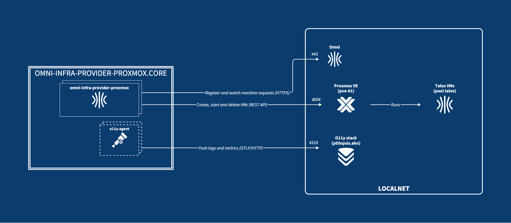

<p align="center">
  
</p>

<h1 align="center">「omni-infra-provider-proxmox.core」</h1>

<p align="center"><strong>LXC qui permet à Omni de créer des VM Talos sur Proxmox</strong></p>

<p align="center">
  
  
  
  
</p>

<p align="center">
  <a href="#services">Services</a> ·
  <a href="#architecture">Architecture</a> ·
  <a href="#accès">Accès</a> ·
  <a href="#configuration">Configuration</a> ·
  <a href="#déploiement">Déploiement</a> ·
  <a href="#dépannage">Dépannage</a> ·
  <a href="#contribuer">Contribuer</a> ·
  <a href="#pour-aller-plus-loin">Pour aller plus loin</a>
</p>

Ce conteneur est le pont entre Omni et Proxmox VE : quand une machine class est utilisée dans Omni pour agrandir un
cluster, c'est lui qui demande à Proxmox de créer la VM, de lui attacher l'image Talos et de la démarrer, puis de la
supprimer quand Omni n'en a plus besoin. Il ne garde aucun état (tout est dans Omni) et n'accepte aucune connexion
entrante : il n'appelle qu'Omni et l'API Proxmox. Il s'exécute dans un LXC NixOS, comme les autres appliances `core.*`.

## Services


### [omni-infra-provider-proxmox](https://github.com/siderolabs/omni-infra-provider-proxmox)

S'enregistre auprès d'Omni sous l'identifiant `pve.chezmoi.sh` et traduit chaque machine class de ce fournisseur en VM
Proxmox, dans le pool `talos`. Les classes (`c1.minimal`, `w1.medium`…) sont décrites dans
[`catalog/omni/machineclasses/`](../../../catalog/omni/machineclasses/README.md).

<br clear="all" />

## Architecture



Le fournisseur ne fait que sortir : vers Omni pour recevoir les demandes de machines, vers l'API Proxmox pour les
exécuter. Les VM Talos créées sont ensuite gérées par Omni, sans repasser par ce conteneur. Seul l'agent d'observabilité
envoie ses logs et métriques à `ptilopsis.akn`.

## Accès

Il n'y a rien à joindre : aucun port n'est ouvert (pare-feu NixOS actif, aucun port autorisé) et SSH est désactivé. On
administre le conteneur depuis `pve-01` : `pct enter <vmid>` pour la console, ou
`pct exec <vmid> -- journalctl -u omni-infra-provider-proxmox -f` pour les logs (le répertoire `/usr/sbin` pointe vers
le profil système pour que `pct exec` trouve les binaires). Le fournisseur apparaît comme « connecté » dans Omni, sous
_Settings → Infrastructure Providers_.

## Configuration

Tout est dans `nix/`. `configuration.nix` porte ce qui est propre à la machine : l'identité du conteneur, son adresse
fixe, et les options du fournisseur (`id`, point d'entrée d'Omni, URL de l'API Proxmox). Le reste est rangé par sujet
dans `nix/modules/` ([documentation du module](./nix/modules/README.md)), et le catalogue (`catalog/nix`) ne fournit que
l'agent d'observabilité, la configuration réseau statique et le paquet du fournisseur.

Le fournisseur s'authentifie auprès de Proxmox avec l'utilisateur `omni@pve`, dont les rôles et les ACL (limités au pool
`talos`, à `pve-01` et aux réseaux SDN) sont déclarés dans Pulumi, dans [`core.pve-01`](../core.pve-01/PROXMOX-VE.md).
Le nom d'utilisateur se donne sans le royaume (`omni`, avec `realm = "pve"` à part) : `omni@pve` dans `username` produit
un double royaume et Proxmox refuse la connexion. Le certificat de l'API Proxmox est auto-signé, d'où
`insecureSkipVerify = true`. Les machine classes doivent toutes renseigner `pool: talos`, sinon la création de VM échoue
en 403 ; et aucun LXC ne doit jamais rejoindre ce pool, car l'appartenance au pool est ce qui donne l'accès au
fournisseur.

Le conteneur utilise les résolveurs `10.10.10.10` puis `1.1.1.1` plutôt que le résolveur public par défaut : le nom
d'Omni (`omni.chezmoi.sh`) est en split-horizon et un résolveur public le renverrait vers une IP publique qu'on ne joint
pas depuis le LAN (hairpin NAT). Le durcissement (`hardening.nix`) coupe SSH, la connexion automatique et les services
inutiles, règle quelques sysctl et garde le journal en mémoire (64 Mio). Le service tourne sous l'utilisateur système
`infra-provider`, avec `NoNewPrivileges`, et redémarre en cas d'échec.

Deux secrets, chiffrés avec sops/age (règle dans `.sops.yaml`) et injectés dans l'image au build, pas au démarrage :
`nix/secrets/proxmox.sops.env` (`PROXMOX_PASSWORD`, mot de passe de `omni@pve`, écrit dans
`/etc/infra-provider/provider.yaml`) et `nix/secrets/omni.sops.env` (`OMNI_SERVICE_ACCOUNT_KEY`, clé du fournisseur
générée par Omni, écrite dans `/etc/infra-provider/secrets`). Sans la clé Omni, le build reste valable : le service
démarre mais ne peut pas se connecter (il journalise une clé vide).

```text
nix/
├── flake.nix                          nixpkgs, catalogue (arcane), version de l'image, secrets de build
├── flake.lock
├── configuration.nix                  identité, réseau, options du fournisseur
├── secrets/                           proxmox.sops.env, omni.sops.env
└── modules/
    ├── omni-infra-provider-proxmox.nix  service systemd et options
    ├── hardening.nix                    surface de connexion, sysctl, pare-feu, journald
    ├── o11y-agent.nix                   envoi des logs et métriques vers ptilopsis.akn
    └── secrets.nix                      /etc/infra-provider/secrets
```

## Déploiement

La construction, l'envoi et la mise à jour reposent sur la bibliothèque commune des LXC
([`fleet/hosts/.mise/lib/lxc.sh`](../.mise/lib/lxc.sh)) ; le détail des étapes est dans la
[procédure d'échange du rootfs](../../../docs/procedures/infrastructure/INF-20260605-00-Mettre-a-Jour-un-LXC-par-Echange-du-Rootfs.md)
et le skill `lxc-maintenance`.

### Première installation

Manuelle, une seule fois, en deux phases car la clé d'Omni n'existe qu'après l'enregistrement du fournisseur :

1. Sur `pve-01`, vérifier que `omni@pve` existe (Pulumi de `core.pve-01`) et lui donner un mot de passe :
   `pveum passwd omni@pve`.
2. `mise run lxc:secrets:proxmox` enregistre ce mot de passe dans `nix/secrets/proxmox.sops.env`.
3. Mettre à jour `version` dans `nix/flake.nix` (CalVer `YYYY.MM.DD`, `-N` pour un second build le même jour), puis
   `mise run lxc:build` et `mise run lxc:push -- <hôte-pve>`.
4. Créer le conteneur sur le nœud, puis le démarrer :

   ```sh
   VMID="<vmid>"
   TEMPLATE=omni-infra-provider-proxmox.<version>-amd64.tar.xz

   pct create ${VMID} local:vztmpl/${TEMPLATE} \
     --hostname omni-infra-provider-proxmox --ostype nixos --arch amd64 \
     --unprivileged 1 --features nesting=1 \
     --cores 1 --memory 512 --swap 0 --rootfs nvme-lvm:4 \
     --net0 name=eth0,bridge=vmbr1,ip=10.0.0.25/22,gw=10.0.0.1,firewall=1,tag=5 \
     --pool core --cmode console --onboot 1
   pct start ${VMID}
   ```

   Pas de volume persistant, de TUN ni de WireGuard. L'adresse doit rester celle de `catalog.staticNetwork` dans
   `configuration.nix` ([IPAM](../../../docs/reference/IPAM-Reference.md)), sinon `eth0` retombe en lien-local à chaque
   redémarrage (le VLAN 5 n'a pas de DHCP).

5. Dans Omni, _Settings → Infrastructure Providers → Create_ avec l'identifiant `pve.chezmoi.sh` (celui de
   `configuration.nix`) et copier la clé générée.
6. `mise run lxc:secrets:omni` (coller la clé), puis rebuild, push et
   `mise run lxc:upgrade -- <hôte-pve> --vmid <vmid>`.

### Mises à jour

`mise run lxc:build`, `mise run lxc:push -- <hôte-pve>` (ignoré si le template distant est identique), puis
`mise run lxc:upgrade -- <hôte-pve>` : le rootfs est échangé en place (même VMID, snapshot de retour arrière), sans
volume de données à migrer. Après avoir modifié `configuration.nix` ou monté la version du paquet (Renovate la propose
dans `catalog/nix/pkgs/by-name/om/omni-infra-provider-proxmox`), il faut toujours incrémenter `version` dans
`nix/flake.nix`. Pour changer un secret, relancer `lxc:secrets:proxmox` ou `lxc:secrets:omni` avant le build ; pour la
clé Omni, supprimer d'abord le fournisseur dans Omni et le réenregistrer.

### Vérifier un déploiement

- `pct exec <vmid> -- systemctl status omni-infra-provider-proxmox` : le service est actif.
- `pct exec <vmid> -- journalctl -u omni-infra-provider-proxmox -n 50` : pas d'erreur d'authentification ni de « empty
  key ».
- `pct exec <vmid> -- curl -sSf https://omni.chezmoi.sh/healthz` : Omni répond depuis le conteneur.
- Dans Omni, le fournisseur est « connecté ».
- Créer une machine depuis une machine class : la VM apparaît dans le pool `talos` de Proxmox.

## Dépannage

| Symptôme                                | Cause et correction                                                                                                                                                                                              |
| --------------------------------------- | ---------------------------------------------------------------------------------------------------------------------------------------------------------------------------------------------------------------- |
| Le fournisseur n'apparaît pas dans Omni | `omniApiEndpoint` doit correspondre exactement à l'URL d'Omni (slash final compris) et la clé `OMNI_SERVICE_ACCOUNT_KEY` doit être présente ; tester `curl` vers `/healthz` depuis le conteneur.                 |
| Journal « empty key »                   | Normal en phase 1 : la clé Omni n'est pas encore injectée. Terminer la phase 2.                                                                                                                                  |
| Échec d'authentification Proxmox        | Vérifier le mot de passe (`proxmox.sops.env`), le nom d'utilisateur sans royaume et `insecureSkipVerify = true`.                                                                                                 |
| 403 à la création d'une VM              | La machine class n'a pas `pool: talos`. Si le 403 survient à l'envoi de l'ISO, vérifier les ACL d'`omni@pve` sur `pve-01` (`Sys.AccessNetwork`) et que le stockage des ISO (`local`) est membre du pool `talos`. |
| « proxmox pool does not exist »         | Proxmox filtre `GET /pools` selon les droits : sans `Pool.Audit` (rôle `OmniProvider`), le pool est invisible. Corriger le rôle dans Pulumi (`core.pve-01`), pas à la main.                                      |

## Contribuer

`nix build` (depuis `nix/`) construit l'image sans secrets : le service démarre mais ne peut pas s'authentifier, ce qui
suffit à valider l'évaluation. Le module du fournisseur est propre à cet hôte (`nix/modules/`) ; l'agent d'observabilité
et la configuration réseau viennent du catalogue (`catalog/nix`), partagés avec les autres LXC. Le schéma se modifie
dans `architecture.d2`, puis `mise run diagram:generate` régénère `assets/architecture.png`, à commiter avec. Lancer
`mise run lint` avant de pousser.

## Pour aller plus loin

- [Paquet du fournisseur](../../../catalog/nix/pkgs/by-name/om/omni-infra-provider-proxmox/README.md) : comment le
  binaire est construit depuis les sources.
- [Machine classes](../../../catalog/omni/machineclasses/README.md) : le catalogue de tailles de VM et leurs données de
  fournisseur.
- [Proxmox VE (`core.pve-01`)](../core.pve-01/PROXMOX-VE.md) : l'utilisateur `omni@pve`, ses rôles et ses ACL.
- [ADR-014](../../../docs/decisions/ADR-014-Separer-le-Trafic-des-Noeuds-Talos-du-VLAN-Homelab.md) : réseau des nœuds
  Talos créés par le fournisseur.
- [Procédure d'échange du rootfs](../../../docs/procedures/infrastructure/INF-20260605-00-Mettre-a-Jour-un-LXC-par-Echange-du-Rootfs.md)
  : comment un LXC est mis à jour.
- [Nommage des machines](../../../docs/reference/Nommage-des-Machines-Reference.md) : d'où vient le nom de l'hôte.
