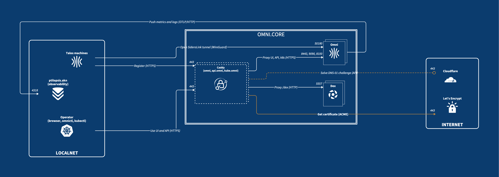

<p align="center">
  
</p>

<h1 align="center">「omni.core」</h1>

<p align="center"><strong>LXC Proxmox — le gestionnaire des clusters Talos du homelab</strong></p>

<p align="center">
  
  
  
  
</p>

<p align="center">
  <a href="#services">Services</a> ·
  <a href="#architecture">Architecture</a> ·
  <a href="#accès">Accès</a> ·
  <a href="#configuration">Configuration</a> ·
  <a href="#déploiement">Déploiement</a> ·
  <a href="#exploitation">Exploitation</a> ·
  <a href="#contribuer">Contribuer</a> ·
  <a href="#pour-aller-plus-loin">Pour aller plus loin</a>
</p>

`omni.core` fait tourner Omni, qui crée, met à jour et supervise les clusters Talos du homelab : les machines s'y
enregistrent (SideroLink), les clusters s'y déclarent et l'accès `kubectl` passe par son proxy. Un Dex co-hébergé
fournit la connexion OIDC, sur le même nom de domaine. C'est un LXC NixOS non privilégié, volontairement indépendant des
clusters qu'il gère : il doit exister avant eux et rester joignable quand l'un d'eux tombe. Son nom est fonctionnel,
comme celui des autres machines de la famille `core`
([nommage](../../../docs/reference/Nommage-des-Machines-Reference.md)).

## Services


### [Omni](https://omni.siderolabs.com/)

Gère le cycle de vie des clusters Talos : enregistrement des machines par un tunnel WireGuard (SideroLink), création et
mise à jour des clusters, interface web, API et proxy de l'API Kubernetes pour `omnictl` et `kubectl`. Les machines
Talos, les opérateurs et l'infra provider Proxmox s'y connectent.

<br clear="all" />


### [Dex](https://dexidp.io/)

Fournit la connexion OIDC d'Omni, avec un seul administrateur déclaré en dur. La page de connexion reprend le thème
d'Omni (`nix/modules/dex-theme/`). Dex garde ses sessions en mémoire : un redémarrage les invalide.

<br clear="all" />

## Architecture



Caddy est la seule porte TCP : trois noms sur le port 443, un certificat Let's Encrypt obtenu en DNS-01 via Cloudflare.
Seul le tunnel SideroLink (UDP 50180) arrive directement sur Omni. Omni et Dex n'écoutent que sur le loopback.

## Accès

| Nom                    | Port      | Sert                                       | Cible interne                     |
| ---------------------- | --------- | ------------------------------------------ | --------------------------------- |
| `omni.chezmoi.sh`      | 443       | Interface et API d'Omni, Dex sous `/dex/*` | `:8443` (TLS de la PKI) + `:5557` |
| `api.omni.chezmoi.sh`  | 443       | API Machine SideroLink (gRPC)              | `:9090` (TLS de la PKI)           |
| `kube.omni.chezmoi.sh` | 443       | Proxy de l'API Kubernetes                  | `:8100` (TLS de la PKI)           |
| —                      | 50180/UDP | Tunnel WireGuard SideroLink                | direct                            |

Caddy termine le TLS avec le certificat public, ce qui évite aux machines Talos d'importer la CA auto-signée d'Omni : il
rejoint ensuite Omni avec `tls_insecure_skip_verify`, puisque la PKI d'Omni est auto-signée. Le port 80 ne fait que
rediriger `omni.chezmoi.sh` vers HTTPS. Le puits d'événements (`:8091`) et les autres services destinés aux nœuds ne
sont joignables que par l'interface WireGuard `siderolink`, que le pare-feu de la machine considère comme de confiance :
chaque paquet vient d'un pair WireGuard authentifié. Les VM Talos joignent Omni par une seconde interface (`eth1`) sur
`talosnet`, sans NAT ; le DNS de `talosnet` y résout `omni.chezmoi.sh` et `api.omni.chezmoi.sh`
([adresses](../../../docs/reference/IPAM-Reference.md)).

Les enregistrements `api.omni` et `kube.omni` doivent exister en DNS, vers la même adresse que `omni.chezmoi.sh` ; Caddy
obtient un certificat par nom. Il n'y a pas de SSH : la console de l'administration se prend depuis l'hyperviseur avec
`pct enter <vmid>` (un shell) ; `pct console <vmid>` n'est qu'une vue en lecture seule des logs.

La session de connexion dure 24 h pour le jeton d'identité et 7 jours pour le jeton de rafraîchissement (inactivité
comme durée absolue), réglés dans `services.omni.dex.expiry` de `nix/configuration.nix` : un compromis assumé pour un
homelab à un seul administrateur, à resserrer si cela change.

## Configuration

Tout est dans `nix/`. `configuration.nix` porte ce qui est propre à la machine : identité, adresse fixe de `eth0` (elle
doit refléter celle du conteneur Proxmox, sinon l'interface retombe en lien-local à chaque redémarrage), adresse de
`eth1` sur `talosnet`, uid fixes des services (`omni` 980, `caddy` 997) et réglages d'Omni et de Dex. Le paquet Omni est
compilé depuis les sources par le catalogue ([paquet](../../../catalog/nix/pkgs/by-name/om/omni/README.md)), les modules
`omni.nix` et `dex.nix` sont propres à cette machine ([README des modules](nix/modules/README.md)), et le catalogue
fournit l'agent d'observabilité et la configuration réseau statique.

Un seul volume Proxmox (`mp0`, monté sur `/persistent`) porte les données : `/persistent/omni` (PKI, base SQLite, clé
GPG `omni.asc`) et `/persistent/caddy` (certificats). Les uid sont fixes pour que les droits côté hôte (uid du
conteneur + 100000) survivent aux reconstructions de l'image ; le script de mise à jour réapplique ces droits.

La machine est durcie par `nix/modules/hardening.nix`, toujours actif : pas de `sshd` ni de getty automatique, sysctls
réseau restrictifs (pas de routage IP, pas de redirections ICMP, SYN cookies, `rp_filter`, YAMA), Avahi, CUPS, Polkit et
UDisks2 coupés, pare-feu NixOS en refus par défaut (80, 443, UDP 50180, plus l'interface `siderolink`), journald en
mémoire (64 Mio, relayé sur la console). Les options de bac à sable qui montent des namespaces (`PrivateTmp`,
`ProtectSystem`…) échouent dans un LXC non privilégié et sont volontairement omises : le pare-feu en couches et les
écoutes sur loopback compensent. Le pare-feu Proxmox s'ajoute par-dessus (voir
[Première installation](#première-installation)).

Les logs de Caddy, d'Omni et de Dex et les métriques d'Omni (`127.0.0.1:2122`) partent en OTLP vers
`data.o11y.chezmoi.sh:4318` (`ptilopsis.akn`), que le conteneur résout directement vers le Mac Studio pour éviter un
détour par la passerelle.

Deux secrets, chiffrés avec sops/age et injectés dans l'image à la construction (jamais en clair sur disque) :

| Fichier                       | Variable                  | Origine                                                |
| ----------------------------- | ------------------------- | ------------------------------------------------------ |
| `nix/secrets/omni.sops.env`   | `DEX_ADMIN_PASSWORD_HASH` | Opérateur : hash bcrypt, `mise run lxc:secrets:rotate` |
| `nix/secrets/caddy.sops.json` | `CLOUDFLARE_API_TOKEN`    | Écrit par le `pulumi up` de `pulumi/` (`SopsFile`)     |

Le hash est lu à l'évaluation Nix et écrit dans la configuration de Dex : créer `/etc/omni/secrets` à la main après coup
ne change rien, il faut reconstruire l'image avec les secrets présents. Le jeton Cloudflare (DNS-01 de Caddy) vient du
projet Pulumi `omni-core` (pile `omni_core.live`, dans `pulumi/`) et non d'OpenBao, qui tourne dans `rhodes.akn` : Omni
doit exister avant les clusters.

```text
.
├── .mise.toml              tâches : secrets, diagramme
├── .mise/tasks/lxc/        build, push, upgrade (bibliothèque partagée fleet/hosts/.mise/lib/lxc.sh)
├── architecture.d2         source du schéma
├── nix/
│   ├── flake.nix           image LXC, version de l'image (CalVer)
│   ├── .sops.yaml          règles de création des secrets
│   ├── configuration.nix   identité, réseau, uid, réglages Omni et Dex
│   ├── modules/            omni, dex (+ thème), caddy, hardening, secrets, o11y-agent
│   └── secrets/            omni.sops.env, caddy.sops.json
└── pulumi/                 jeton DNS-01 Cloudflare
```

## Déploiement

### Première installation

Prérequis : `mise` (`mise trust`), Docker (enveloppe de la construction Nix), `sops` avec la clé age, `htpasswd`
(`apache2-utils` ou `httpd-tools`), l'accès SSH root par clé au nœud Proxmox et un accès à la pile `omni_core.live`. La
procédure se fait à la main, une seule fois.

1. Charger le module WireGuard sur l'**hyperviseur** (le conteneur partage son noyau et ne peut pas faire `modprobe`) :

   ```sh
   echo wireguard > /etc/modules-load.d/omni-lxc.conf
   modprobe wireguard
   lsmod | grep -E '^wireguard'
   ```

   Le `boot.kernelModules = [ "wireguard" "tun" ]` du module Omni est sans effet dans le conteneur (échec silencieux au
   démarrage) ; s'il devient bruyant, le forcer à `[ ]` dans `nix/configuration.nix`.

2. Préparer les secrets. Hash de l'administrateur Dex : `mise run lxc:secrets:rotate`. Jeton Cloudflare : appliquer la
   pile (`pulumi up` dans `pulumi/`), qui écrit `nix/secrets/caddy.sops.json`. Sans pile, créer le jeton à la main dans
   Cloudflare (_Edit zone DNS_, ou _Zone → DNS → Edit_ et _Zone → Zone → Read_, limité à la zone `chezmoi.sh`) et le
   chiffrer directement :

   ```sh
   cd nix && printf '{"CLOUDFLARE_API_TOKEN": "%s"}' '<jeton>' \
     | sops -e --input-type json --output-type json --filename-override secrets/caddy.sops.json /dev/stdin \
     > secrets/caddy.sops.json
   ```

   Appliquer la pile dès que possible pour que `pulumi/` reprenne le fichier de façon déclarative.

3. Construire et envoyer le template : `mise run lxc:build`, puis `mise run lxc:push -- <hôte-pve>`. Le nom du template
   (`omni.<version>-amd64.tar.xz`) vient de `version` dans `nix/flake.nix` (CalVer `YYYY.MM.DD`, suffixe `-N` pour
   plusieurs constructions le même jour) : l'incrémenter avant chaque construction.

4. Créer le conteneur sans le démarrer (adresses : [IPAM](../../../docs/reference/IPAM-Reference.md)) :

   ```sh
   VMID="<vmid>"   # libre, voir `pct list`
   ssh root@${NODE} pct create ${VMID} local:vztmpl/omni.<version>-amd64.tar.xz \
     --hostname omni --ostype nixos --arch amd64 --unprivileged 1 \
     --features nesting=1,keyctl=0 --cores 2 --memory 2048 --swap 0 \
     --rootfs nvme-lvm:4 --mp0 nvme-lvm:20,mp=/persistent,backup=1 \
     --net0 name=eth0,bridge=vmbr1,ip=10.0.0.21/22,gw=10.0.0.1,firewall=1,tag=5 \
     --cmode console --onboot 1
   ```

   `unprivileged 1` est obligatoire (root du conteneur mappé sur un uid élevé de l'hôte), `nesting=1` sert à
   l'activation NixOS, `keyctl=0` parce qu'aucun service n'utilise le trousseau noyau, `cmode=console` parce que l'image
   n'a pas de getty (le mode `tty` échoue avec `Denied access to tty`). Ne pas ajouter `lxc.console.path`. Ajouter aussi
   la seconde interface `eth1` (pont `talosnet`, `firewall=0`, adresse de `configuration.nix`).

5. Donner au conteneur le périphérique TUN (SideroLink) :

   ```sh
   echo 'lxc.cgroup2.devices.allow: c 10:200 rwm' >> /etc/pve/lxc/${VMID}.conf
   echo 'lxc.mount.entry: /dev/net/tun dev/net/tun none bind,create=file' >> /etc/pve/lxc/${VMID}.conf
   ```

6. Créer les dossiers de `mp0` et leur donner les bons droits. Proxmox crée le volume avec l'uid 0 de l'hôte, qui
   apparaît comme `nobody` dans le conteneur : sans cette étape, `omni-pki-init`, `omni-gpg-init` et `caddy` échouent en
   `Permission denied` au premier démarrage.

   ```sh
   pct mount ${VMID}
   mkdir -p /var/lib/lxc/${VMID}/rootfs/persistent/{omni,caddy}
   chown 100980:100980 /var/lib/lxc/${VMID}/rootfs/persistent/omni    # omni  : 100000 + 980
   chown 100997:100997 /var/lib/lxc/${VMID}/rootfs/persistent/caddy   # caddy : 100000 + 997
   pct unmount ${VMID}
   ```

7. Poser le pare-feu Proxmox du conteneur (`/etc/pve/firewall/${VMID}.fw`, puis `pve-firewall restart`) : entrée refusée
   par défaut, TCP 80 et 443, UDP 50180, ICMP.

   ```text
   [OPTIONS]
   enable: 1
   policy_in: DROP
   policy_out: ACCEPT
   ndp: 1
   dhcp: 1

   [RULES]
   IN ACCEPT -p tcp -dport 80
   IN ACCEPT -p tcp -dport 443
   IN ACCEPT -p udp -dport 50180
   IN ACCEPT -p icmp
   ```

8. Démarrer (`pct start ${VMID}`), puis sauvegarder tout de suite `/persistent/omni/omni.asc` (voir
   [Exploitation](#exploitation)).

`services.omni.advertiseHost` (`omni.chezmoi.sh`) est le point d'accès WireGuard annoncé : il doit résoudre vers une
adresse que les machines Talos joignent en UDP 50180. La PKI d'Omni s'en sert comme SAN, DNS ou IP selon sa forme.

### Mises à jour

Incrémenter `version` dans `nix/flake.nix`, puis :

```sh
mise run lxc:build
mise run lxc:push -- <hôte-pve>
mise run lxc:upgrade -- <hôte-pve>     # --vmid <id> si le conteneur n'est pas détecté par ses tags
```

`lxc:upgrade` remplace le rootfs du conteneur en place : un nouveau CT est créé et testé, le volume `mp0` lui est
rattaché, avec un instantané Proxmox pour revenir en arrière, et une question finale permet de valider ou d'annuler. La
version d'Omni elle-même suit le paquet du catalogue, que Renovate met à jour. Le déroulé complet, le retour arrière et
les problèmes connus sont dans la
[procédure](../../../docs/procedures/infrastructure/INF-20260605-00-Mettre-a-Jour-un-LXC-par-Echange-du-Rootfs.md).

### Vérifier un déploiement

- `pct exec <vmid> -- systemctl status omni dex caddy` : les trois services sont actifs.
- `curl -sSf https://omni.chezmoi.sh/dex/.well-known/openid-configuration` : la configuration OIDC répond.
- `https://omni.chezmoi.sh` : la page de connexion Dex s'affiche et l'administrateur peut se connecter.
- Dans l'interface d'Omni, les machines Talos passent à l'état `connected`.

## Exploitation

Les logs se lisent avec `pct exec <vmid> -- journalctl -u omni -f` (idem `dex`, `caddy`). `pct exec` ne passe pas par un
shell : si une commande est introuvable, utiliser son chemin absolu (`/run/current-system/sw/bin/<cmd>`).

**Sauvegardes : les perdre, c'est perdre les clusters.** Un instantané hebdomadaire du volume `mp0` couvre les trois
fichiers ci-dessous ; copier en plus `omni.asc` dans un endroit sûr à part.

| Fichier                       | Si perdu                                           |
| ----------------------------- | -------------------------------------------------- |
| `/persistent/omni/omni.asc`   | Tout l'état d'Omni est irrécupérable (clé GPG).    |
| `/persistent/omni/pki/ca.pem` | Les machines Talos ne peuvent plus vérifier l'API. |
| `/persistent/omni/db/omni.db` | Inventaire des clusters et des machines perdu.     |

Rotation : le mot de passe Dex avec `mise run lxc:secrets:rotate`, le jeton Cloudflare avec `pulumi up --replace` dans
`pulumi/` (qui réécrit `caddy.sops.json`) ; dans les deux cas, reconstruire et redéployer.

Quand ça ne démarre pas :

- **Caddy n'obtient pas de certificat** : lire `journalctl -u caddy`. Causes habituelles : jeton expiré (rotation, puis
  `pulumi up`), pas de sortie réseau, DNS, dérive d'horloge.
- **Omni échoue à lire la configuration OIDC** (`failed to fetch openid configuration`) : tester l'URL de découverte
  ci-dessus. Un 404 veut dire que le routeur `/dex*` de `nix/modules/caddy.nix` n'est pas placé avant le `handle` par
  défaut ; un 502 que Dex est arrêté ou écoute ailleurs que `services.omni.dex.bindAddr`. Un Dex qui refuse tous les
  logins signifie que l'image a été construite sans le fichier de secrets.
- **Des machines ne passent jamais à `connected`** : vérifier le module `wireguard` sur l'hyperviseur, l'UDP 50180
  ouvert dans le pare-feu Proxmox et en amont, et que `advertiseHost` résout vers une adresse joignable.
- **`omni-pki-init` ou `omni-gpg-init` échoue** : presque toujours l'étape 6 oubliée. Arrêter le conteneur, refaire les
  `mkdir` et `chown`, redémarrer. `omni-gpg-init` peut aussi bloquer sur l'entropie.
- **`pct console` répond `Denied access to tty`** : une ligne `lxc.console.path` traîne dans `/etc/pve/lxc/<vmid>.conf`.
  La retirer, puis `pct set <vmid> --cmode console` et `pct reboot <vmid>`.

Limites connues : un seul conteneur sur un seul nœud (la haute disponibilité demanderait un etcd externe et deux
instances derrière un répartiteur) ; pas de test NixOS automatisé (un `runNixOSTest` vérifiant la découverte Dex et
`/healthz` rattraperait des régressions) ; aucune alerte sur l'expiration du certificat si l'ACME casse en silence.

## Contribuer

`nix eval` ou `nix build` dans `nix/` valident la configuration avant déploiement ; le catalogue local s'utilise avec
`--override-input arcane "path:$(git rev-parse --show-toplevel)/catalog/nix"`. Le code de construction, d'envoi et de
mise à jour est partagé avec les autres LXC dans `fleet/hosts/.mise/lib/lxc.sh` (voir la skill
[lxc-maintenance](../../../.agents/skills/lxc-maintenance/SKILL.md)) : ne pas le dupliquer ici. Le schéma se modifie
dans `architecture.d2`, puis `mise run diagram:generate` régénère `assets/architecture.png`, à commiter avec. Lancer
`mise run lint` avant de pousser.

## Pour aller plus loin

- [Mettre à jour un LXC par échange du rootfs](../../../docs/procedures/infrastructure/INF-20260605-00-Mettre-a-Jour-un-LXC-par-Echange-du-Rootfs.md)
  : le déroulé de `lxc:upgrade`, le retour arrière.
- [Créer un cluster Talos avec Omni](../../../docs/procedures/omni/OMNI-20260721-00-Creer-un-Cluster-Talos-avec-Omni.md)
  : ce qu'on fait avec Omni une fois déployé.
- [Mettre à jour Talos avec Omni](../../../docs/procedures/infrastructure/INF-20260525-00-Mettre-a-Jour-Talos-avec-Omni.md)
  : la mise à jour des nœuds.
- [ADR-014](../../../docs/decisions/ADR-014-Separer-le-Trafic-des-Noeuds-Talos-du-VLAN-Homelab.md) : pourquoi les nœuds
  Talos ont leur réseau `talosnet`, et donc la seconde interface d'Omni.
- [Référence IPAM](../../../docs/reference/IPAM-Reference.md) : adresses et noms de l'appliance.
- [Infra provider Proxmox](../core.omni-infra-provider-proxmox/README.md) : le LXC compagnon, et la création de
  l'utilisateur et du rôle Proxmox dont il a besoin.
- [Modules NixOS](nix/modules/README.md) : les options `services.omni` et `services.omni.dex`.
- [Nommage des machines](../../../docs/reference/Nommage-des-Machines-Reference.md) : d'où vient le nom `omni`.
