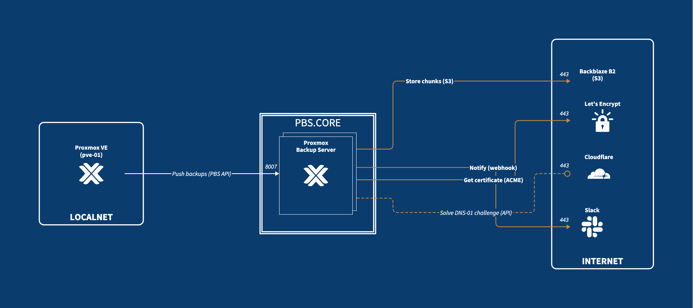

<p align="center">
  
</p>

<h1 align="center">「pbs.core」</h1>

<p align="center"><strong>Proxmox Backup Server — les sauvegardes des VM et des LXC, stockées chez Backblaze B2</strong></p>

<p align="center">
  
  
  
  
</p>

<p align="center">
  <a href="#services">Services</a> ·
  <a href="#architecture">Architecture</a> ·
  <a href="#accès">Accès</a> ·
  <a href="#configuration">Configuration</a> ·
  <a href="#déploiement">Déploiement</a> ·
  <a href="#contribuer">Contribuer</a> ·
  <a href="#pour-aller-plus-loin">Pour aller plus loin</a>
</p>

`pbs.pve.chezmoi.sh` reçoit les sauvegardes des VM et des LXC de Proxmox VE : dédupliquées, incrémentales et vérifiées
par somme de contrôle. C'est une VM Proxmox VE installée à la main depuis l'ISO officielle (PBS n'est pas supporté dans
un LXC, et n'a pas de raison d'entrer dans le moule des appliances Nix des autres hôtes `core.*`) ; tout ce qui se
trouve au-dessus du système est géré par le projet Pulumi `pbs-core` (pile `pbs_core.live`, dans `pulumi/`), via le
fournisseur [`proxmox-backup-server`](../../../catalog/pulumi/sdks/proxmox-backup-server/), un pont vers le fournisseur
Terraform [`yavasura/pbs`](https://registry.terraform.io/providers/yavasura/pbs). Le même découpage que pour le NAS
([`core.nas`](../core.nas/README.md)) : l'OS à la main, le reste en code.

## Services


### [Proxmox Backup Server](https://www.proxmox.com/en/products/proxmox-backup-server/overview)

Reçoit les sauvegardes que Proxmox VE pousse dans le datastore `Backblaze-B2`, un datastore S3 dont le bucket est chez
Backblaze. La rétention est appliquée côté serveur (4 jours, 2 semaines, 3 mois, chaque nuit à 03:00), la vérification
des sommes de contrôle tourne le dimanche à 03:30 et le ramasse-miettes à 04:00. Les événements de ces tâches partent
sur le canal Slack `#notifications`. _Le datastore est directement sur S3, pas une copie d'un datastore local : la VM ne
porte aucune donnée à protéger._

<br clear="all" />

## Architecture



Seul Proxmox VE pousse des sauvegardes, sur le port 8007. Le serveur parle ensuite à Backblaze pour stocker les blocs, à
Slack pour notifier, et à Let's Encrypt et Cloudflare pour son certificat (défi DNS-01, l'interface n'étant pas
joignable depuis Internet).

## Accès

L'interface et l'API sont sur `https://pbs.pve.chezmoi.sh:8007`, avec un certificat ACME valide (le client ACME intégré
à PBS utilise directement le jeton Cloudflare, sans Caddy). Aucune identité n'utilise `root@pam` en régime normal :
Proxmox VE se connecte avec le compte `pve-backup@pbs` et son jeton `pve-storage`, qui n'ont que deux rôles sur le
datastore, `DatastoreBackup` (pousser et restaurer ses sauvegardes) et `DatastoreReader` (lister, ce que demande
`pvesm add pbs` pour ses contrôles). Chaque rôle est accordé deux fois, à l'utilisateur et au jeton : accordé à un seul
des deux, `proxmox-backup-client` échouait avec `missing permissions`.

Le jeton n'a volontairement pas `Datastore.Prune`. La rétention est faite par le serveur, et ce droit sur l'identifiant
que `vzdump` utilise à chaque sauvegarde permettrait à un hôte Proxmox VE compromis de supprimer les sauvegardes
distantes. Il ne faut donc pas non plus régler de rétention (« Prune Backups ») sur l'entrée de stockage ni sur la tâche
de sauvegarde côté Proxmox VE.

## Configuration

Les sauvegardes sont chiffrées côté client par Proxmox VE avant d'arriver : sans la clé, rien dans le datastore n'est
restaurable. La clé et son paperkey sont dans OpenBao.

Chaque fichier de `pulumi/` a une responsabilité :

| Fichier            | Contenu                                                                                                                                      |
| ------------------ | -------------------------------------------------------------------------------------------------------------------------------------------- |
| `acme.ts`          | Jeton Cloudflare DNS-01 du certificat de `pbs.pve.chezmoi.sh`                                                                                |
| `datastore.ts`     | Bucket Backblaze B2, clé d'application, point d'accès S3 et datastore                                                                        |
| `jobs.ts`          | Tâche de rétention (`prune`) et tâche de vérification hebdomadaire                                                                           |
| `notifications.ts` | Cible webhook Slack et règle qui lui envoie tous les événements du datastore                                                                 |
| `access.ts`        | Compte `pve-backup@pbs`, son jeton d'API et les droits sur le datastore                                                                      |
| `toolbox/`         | Générateur de [`PROXMOX_BACKUP_SERVER.md`](PROXMOX_BACKUP_SERVER.md), voir son [README](pulumi/toolbox/proxmox-backup-server-docs/README.md) |

Le bucket n'a pas de verrou de fichier, contrairement à ceux du NAS : le ramasse-miettes de PBS supprime des blocs par
de simples `DeleteObject`, et une rétention en mode gouvernance les bloquerait en silence, ce qui ferait grossir le
stockage sans fin. La clé d'application est limitée à ce bucket. Le point d'accès S3 est en `pathStyle: true` (le
certificat du point d'accès ne couvre pas les sous-domaines de bucket) avec
`providerQuirks: ["skip-if-none-match-header"]`, sans quoi chaque écriture de bloc échoue sur Backblaze, qui ne gère pas
l'en-tête `If-None-Match` envoyé par PBS.

Le `path` du datastore (`/mnt/datastore/cache`) reste obligatoire pour un datastore S3 : PBS s'en sert comme cache local
de blocs avant l'envoi, il ne contient pas toutes les sauvegardes. Il doit être sur son propre disque (écrit en continu
pendant les sauvegardes), monté avant le premier `pulumi up`, car le fournisseur ne le crée pas et la création du
datastore échoue s'il manque. Restaurer depuis B2 est plus lent que depuis un disque local : acceptable pour un homelab,
à revoir si un test de restauration est trop long. La rétention suppose des sauvegardes quotidiennes qui profitent de la
déduplication ; un fichier d'archive opaque (une sauvegarde de NAS, par exemple) déduplique moins bien, ce qu'il faut
regarder dans les statistiques du ramasse-miettes après quelques semaines. Les horaires (03:00, 03:30, 04:00) sont des
heures creuses choisies pour ne pas se chevaucher, pas une mesure : à confirmer face à la tâche hebdomadaire de Proxmox
VE.

Ne sont pas gérés par Pulumi :

- la VM et son système (installation, compte `root@pam`, réseau), le disque de cache (une opération Proxmox VE) et la
  clé de chiffrement du datastore et son paperkey (le fournisseur n'a pas de ressource pour cela, c'est la CLI de PBS) ;
- les tâches de sauvegarde elles-mêmes (quelles VM, quand) : ce sont des ressources Proxmox VE, pas PBS. Seule l'entrée
  de stockage `pve-storage-pbs` est déclarée, dans la pile `pve-01-core` (`fleet/hosts/core.pve-01/pulumi/storage.ts`) ;
- l'URL du webhook Slack, copiée à la main : elle vit dans un fichier SOPS (`slack-webhook-url` de
  `fleet/hosts/akn.ptilopsis/nix/secrets/o11y.sops.yaml`) que cette pile, qui s'exécute en amont de tout cluster, ne
  peut pas lire.

Le jeton du compte `pbs:apiToken` que Pulumi utilise est un identifiant distinct, créé une fois à la main : Pulumi ne
peut pas créer lui-même l'identifiant dont il a besoin pour tourner. Le fournisseur accepte aussi `username` et
`password`, dont rien ne se sert aujourd'hui, mais qu'il vaut mieux connaître si une ressource réservée à `root`
apparaît.

> [!IMPORTANT]\
> Un mot de passe ne se donne que par variable d'environnement limitée à la commande qui en a besoin, jamais par
> `pulumi config set`, même avec `--secret` : cela écrit un blob chiffré dans `pulumi/Pulumi.pbs_core.live.yaml`, suivi
> par Git. Le schéma est celui de `fleet/hosts/core.pve-01/README.md` (« Première installation », étape 1). Les noms des
> variables du fournisseur PBS (`PBS_USERNAME`, `PBS_PASSWORD`) n'ont pas été vérifiés pour cette pile.

## Déploiement

### Première installation

À faire à la main, une seule fois, sur la VM PBS installée depuis l'ISO et joignable. C'est aussi la procédure de
reconstruction : perdre la VM ne fait perdre aucune sauvegarde (elles sont sur S3), il suffit de réinstaller puis de
repasser ces étapes.

1. Ajouter un second disque virtuel à la VM dans Proxmox VE, puis le monter sur `/mnt/datastore/cache` (à faire avant
   l'étape 4) :

   ```sh
   mkfs.ext4 /dev/sdb                       # ou le périphérique du nouveau disque
   mkdir -p /mnt/datastore/cache
   echo '/dev/sdb  /mnt/datastore/cache  ext4  defaults  0  2' >> /etc/fstab
   mount -a
   ```

2. Créer sur la VM un identifiant restreint pour Pulumi (pas `root@pam` : par exemple `admin@pbs` avec un jeton limité
   aux datastores, tâches, notifications, utilisateurs et ACL) puis le déclarer :

   ```sh
   pulumi config set pbs:endpoint https://pbs.pve.chezmoi.sh:8007
   pulumi config set --secret pbs:apiToken 'admin@pbs!pulumi=<token-value>'
   ```

3. Copier l'URL du webhook Slack depuis `fleet/hosts/akn.ptilopsis/nix/secrets/o11y.sops.yaml` :

   ```sh
   pulumi config set --secret notificationsSlackWebhookUrl <url>
   ```

4. Lancer `mise run pulumi:apply` depuis `pulumi/` : il crée le datastore, les tâches, la cible de notification et le
   jeton `pve-backup@pbs`.
5. Récupérer le secret du jeton, que PBS ne renvoie plus jamais, et le ranger dans OpenBao (la pile ne peut pas écrire
   dans Vault, elle tourne en amont des clusters) :

   ```sh
   pulumi stack output pveBackupTokenSecret --show-secrets
   ```

6. Générer sur la VM la clé de chiffrement du datastore et imprimer son paperkey :

   ```sh
   proxmox-backup-client key create /root/.config/proxmox-backup/backups.key
   proxmox-backup-client key paperkey /root/.config/proxmox-backup/backups.key
   ```

   Choisir une phrase secrète solide (ou `--kdf none` avec des droits stricts si le fichier est déjà protégé au repos).
   Ranger le fichier et le paperkey dans OpenBao : les perdre rend toutes les sauvegardes irrécupérables. La clé est
   envoyée une fois à Proxmox VE à l'étape suivante, et chaque sauvegarde poussée par cette entrée est ensuite chiffrée.

7. Configurer le stockage `pbs` de Proxmox VE avec `pveBackupTokenId` et `pveBackupTokenSecret`, et la clé de l'étape 6.
   L'entrée `pve-storage-pbs` est une ressource de la pile `pve-01-core` : copier le secret dedans avec
   `pulumi config set --secret pveBackupTokenSecret` (pas de `StackReference`, ADR-017). Les champs de l'interface et la
   commande `pvesm add pbs` sont dans [`PROXMOX_BACKUP_SERVER.md`](PROXMOX_BACKUP_SERVER.md) (« Configuring Proxmox VE
   to use this datastore ») ; le port `8007` doit y être renseigné explicitement, sinon certaines versions de Proxmox VE
   répondent `401 Unauthorized` malgré de bons identifiants.

### Mises à jour

Depuis `pulumi/` : `mise run pulumi:diff` prévisualise, `mise run pulumi:apply` applique après confirmation puis
régénère [`PROXMOX_BACKUP_SERVER.md`](PROXMOX_BACKUP_SERVER.md) (`mise run proxmox-backup-server:docs:generate` le
régénère seul).

Pour tourner le jeton de Proxmox VE, le marquer `taint`, appliquer, puis relire le nouveau secret :

```sh
cd fleet/hosts/core.pbs/pulumi
urn=$(pulumi stack export | jq -re '.deployment.resources[] | select(.urn | endswith("::pbs-token-pve-backup")) | .urn')
pulumi state taint "$urn" --yes
pulumi up --refresh
pulumi stack output pveBackupTokenSecret --show-secrets
```

Il faut ensuite poser la nouvelle valeur dans la configuration de la pile `pve-01-core` et l'appliquer ; tant que ce
n'est pas fait, chaque sauvegarde planifiée échoue à l'authentification.

### Vérifier un déploiement

- `pulumi stack` : la pile `pbs_core.live` est sélectionnée et `mise run pulumi:diff` ne montre aucun changement.
- Dans PBS, le datastore `Backblaze-B2` est présent, avec les tâches `backups-retention` et `backups-weekly-verify`.
- Depuis Proxmox VE, l'entrée de stockage liste le datastore sans erreur `401`.

## Contribuer

Les tâches de rétention et de vérification sont dans `pulumi/jobs.ts` (`pbs.PruneJob` et `pbs.VerifyJob`, chacune avec
son identifiant explicite et un `store`). Les espaces de noms PBS ne sont pas utilisés ; s'il en faut pour une rétention
ou des droits par charge, voir `catalog/pulumi/sdks/proxmox-backup-server/` (`pruneJob.ts`, `verifyJob.ts`,
`namespace.ts`).

Les notifications (`pulumi/notifications.ts`) combinent une cible (où : URL, méthode, gabarit) et une règle (quoi :
sévérités, mode). Le fichier `notifications.cfg` de PBS est orienté ligne : un `body` multiligne doit être encodé en
base64, sinon l'API répond « detected unexpected control character » (voir le commentaire de `slackWebhookBody`). Pour
une seconde cible (Gotify, SMTP), déclarer la ressource `pbs.*Notification` correspondante puis étendre `targets` ou
ajouter une règle avec d'autres `matchSeverities` ou `matchFields`.

Le schéma d'architecture se modifie dans `architecture.d2`, puis `mise run diagram:generate` régénère
`assets/architecture.png`, à commiter avec. Lancer `mise run lint` avant de pousser.

## Pour aller plus loin

- [PROXMOX_BACKUP_SERVER.md](PROXMOX_BACKUP_SERVER.md) : l'état courant du serveur (datastore, tâches, accès), généré,
  avec la procédure de restauration.
- [Proxmox VE](../core.pve-01/PROXMOX-VE.md) : l'hyperviseur qui pousse les sauvegardes, et où se pilotent les
  restaurations.
- [ADR-015](../../../docs/decisions/ADR-015-Migrer-Crossplane-vers-Pulumi.md) : pourquoi Proxmox reste hors de Pulumi.
- [ADR-017](../../../docs/decisions/ADR-017-Conserver-une-Phrase-Secrete-Pulumi-par-Projet-et-Interdire-le-Partage-par-StackReference.md)
  : une phrase secrète Pulumi par projet, sans `StackReference`.
- [Plan de reprise](../../../docs/plan-de-reprise/brouillon/Plan-de-Reprise-apres-Sinistre.md) : la remise en service de
  PBS dans la reprise après sinistre.
- [Nommage des machines](../../../docs/reference/Nommage-des-Machines-Reference.md) : d'où vient le nom `pbs.core`.
