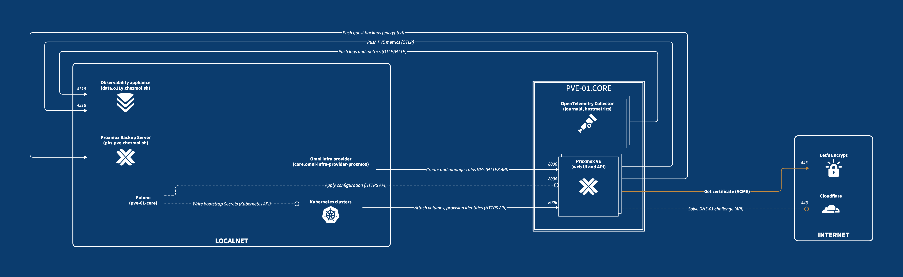

<p align="center">
  
</p>

<h1 align="center">「pve-01.core」</h1>

<p align="center"><strong>L'hyperviseur Proxmox VE sur lequel tourne tout le homelab</strong></p>

<p align="center">
  
  
  
</p>

<p align="center">
  <a href="#services">Services</a> ·
  <a href="#architecture">Architecture</a> ·
  <a href="#accès">Accès</a> ·
  <a href="#configuration">Configuration</a> ·
  <a href="#déploiement">Déploiement</a> ·
  <a href="#contribuer">Contribuer</a> ·
  <a href="#pour-aller-plus-loin">Pour aller plus loin</a>
</p>

`pve-01` est l'unique hyperviseur du homelab : tous les nœuds Kubernetes, les LXC de la plateforme et le NAS sont des
invités de cette machine. Elle est donc tout en bas de la chaîne de dépendances, et rien d'autre ne survit à sa perte.

Le système et le cycle de vie des invités (VM, LXC, sauvegardes, stockage local, ponts réseau) restent manuels : laisser
les clusters piloter l'hyperviseur qui les héberge fermerait une boucle de confiance
([ADR-015](../../../docs/decisions/ADR-015-Migrer-Crossplane-vers-Pulumi.md), « Non-Goals »). Le projet Pulumi
`pve-01-core` (pile `pve-01_core.live`, dans [`pulumi/`](pulumi/)) ne gère que la couche d'administration : les
identités et leurs droits, le réseau SDN, les pools, l'entrée de stockage vers PBS, le certificat ACME et le pare-feu de
base des VM Talos. Les fichiers installés à la main sur le nœud sont dans [`fs/`](fs/).

## Services


### [Proxmox VE](https://www.proxmox.com/en/proxmox-virtual-environment/overview)

Héberge les VM Talos, les LXC de la plateforme et la VM du NAS. Omni y crée les VM des clusters, les plugins CSI et CCM
des clusters y attachent les volumes, et l'interface web sert à l'administration au quotidien. Il pousse aussi ses
sauvegardes chiffrées vers Proxmox Backup Server et ses métriques vers l'appliance d'observabilité.

<br clear="all" />


### [OpenTelemetry Collector](https://opentelemetry.io/docs/collector/)

Envoie le journal systemd et les métriques de la machine (CPU, mémoire, disques physiques, cartes réseau et ponts) à
l'appliance d'observabilité, comme les agents des LXC. _Il remplace `prometheus-node-exporter` et le transfert rsyslog
vers l'ancien LXC `pve-exporter`._

<br clear="all" />

## Architecture



Tout passe par l'API de Proxmox VE sur le port 8006 : Pulumi, Omni et les clusters s'en servent chacun avec leur propre
identité. L'hôte ne parle à Internet que pour son certificat (Let's Encrypt et l'API de Cloudflare pour le DNS-01).

## Accès

L'interface web et l'API sont sur `https://pve-01.pve.chezmoi.sh:8006`, avec un certificat Let's Encrypt renouvelé par
le client ACME de Proxmox VE. L'interface de gestion n'est pas exposée sur Internet, d'où le DNS-01 (le HTTP-01 n'a
aucun moyen de la valider). Les adresses (gestion, IPMI, VLAN) sont dans la
[référence IPAM](../../../docs/reference/IPAM-Reference.md). L'hôte lui-même est administré en SSH
(`root@pve-01.pve.chezmoi.sh`), comme le font les tâches `host:*` ci-dessous.

Les droits sont répartis sur trois identités, chacune limitée au chemin le plus étroit qui fonctionne :

- **`omni@pve`** est la plus large (allocation, clonage, configuration et alimentation des VM), limitée au pool `talos`,
  avec `Sys.AccessNetwork` et `Sys.Audit` sur `/nodes/pve-01` et `SDN.Use` sur les deux ponts où elle branche les cartes
  des VM Talos. Elle s'authentifie par mot de passe (`PROXMOX_PASSWORD`) que cette pile ne lit ni n'écrit jamais.
- **`rhodes-akn-bootstrap@pve`** et **`lungmen-akn-bootstrap@pve`** sont des identifiants de délégation, pas des
  identités de workload : `Administrator` limité à `/access` (utilisateurs, rôles, ACL, jetons, sans toucher aux VM, au
  stockage ni au SDN) et `Permissions.Modify` sur `/nodes/pve-01` et `/pool/talos`. Le programme Pulumi de chaque
  cluster s'en sert pour créer lui-même son identité CCM et CSI (composant
  `catalog/pulumi/components/proxmox-cluster-identity`, `fleet/clusters/akn.rhodes/pulumi/stack/proxmox.ts`). Le jeton
  est déposé directement dans un `Secret` Kubernetes du cluster (`kube-system/<cluster>-akn-bootstrap-pve`), jamais en
  sortie de pile.

Aucun identifiant ne peut agir hors du pool `talos` sur les VM et les LXC. Aucun n'a de droit sur le pool `core`
(`oci-registry`, `omni`, `o11y`, …). Ajouter un invité au pool `talos` donne donc à toutes les identités liées à ce pool
un accès complet sur lui : l'appartenance au pool _est_ la permission.

## Configuration

Le projet Pulumi couvre, par dossier de `pulumi/stack/` (`config.ts` lit toutes les entrées du programme une seule fois)
: `access/` (rôles personnalisés `OmniProvider*`, comptes de service, jetons et chaque ACL), `network/sdn.ts` (zone
`pvenet` et VNet `talosnet`, réseau partagé de trafic des nœuds de tous les clusters Talos, avec SNAT parce que les
nœuds n'ont pas d'adresse sur le VLAN du homelab et doivent joindre l'API de Proxmox VE pour le CSI), `storage/pools.ts`
(pools `core` et `talos`, et l'appartenance de `talos` aux stockages `local` et `nvme-lvm`), `storage/storage.ts`
(entrée de stockage de type `pbs` vers le datastore géré par [`core.pbs`](../core.pbs/README.md)), `system/acme.ts`
(compte `default`, greffon DNS-01 Cloudflare et le jeton Cloudflare limité au DNS-01 qu'il utilise) et
`network/firewall.ts` (groupe de sécurité `talos`, la base ouverte à toutes les VM Talos : ICMP, apid `50000` et trustd
`50001` depuis `+rfc1918`). Les modifications SDN sont appliquées automatiquement en fin de `pulumi up`. L'état est dans
le backend S3 Garage du NAS (voir `Pulumi.yaml`) et les secrets (phrase secrète partagée, identifiants du backend,
Cloudflare, `root@pam`) sont résolus par fnox depuis Bitwarden Secrets Manager (`fleet/.fnox.toml` et `.fnox.toml`),
sans fichier chiffré dans le dépôt.

Ne sont **pas** gérés par Pulumi : le cycle de vie des VM et LXC (aucun type `VirtualEnvironmentVm` ou `Container` n'est
importé), les jobs de sauvegarde, le stockage local et les ponts, les mappings PCI/USB (adresses IOMMU à redécouvrir à
chaque reconstruction), les realms `pam` et `pve` (intégrés), les notifications (le fournisseur n'a pas de ressource
pour Proxmox VE : le nœud garde son règle `sendmail` vers `root@pam`), le compte ACME `testing` (staging, sans
consommateur) et la zone `localnetwork` / pont `vmbr1` visée par l'ACL `omniSdnVmbr1Acl`, antérieure à la pile. Le
détail, les tableaux d'identités et de pools et les procédures sont dans [`PROXMOX-VE.md`](PROXMOX-VE.md), généré depuis
l'état déployé (voir [`pulumi/toolbox/proxmox-docs/`](pulumi/toolbox/proxmox-docs/README.md)).

Les fichiers de l'hôte, installés à la main (voir la
[référence de l'infrastructure manuelle](../../../docs/reference/Infrastructure-Manuelle-Reference.md)), vivent sous
`fs/` avec un dossier cible encodé par des points : `fs/etc.otelcol-contrib/config.yaml` devient
`/etc/otelcol-contrib/config.yaml`.

- **Collecteur OpenTelemetry** : paquet Debian `otelcol-contrib` (version et somme de contrôle épinglées dans
  [`.mise.toml`](.mise.toml)). Les logs viennent du journal systemd (récepteur `journald`, curseur dans
  `/var/lib/otelcol-contrib`) et suivent le même mapping que les agents des LXC (`catalog/nix/modules/o11y-agent`) :
  `MESSAGE` en corps, `SYSLOG_IDENTIFIER` en `service.name`, `PRIORITY` en sévérité. Les métriques sont celles de
  `hostmetrics`, avec `service.name=hostmetrics`. `host.name` vaut le nom d'hôte du nœud (`pve-01`). Les métriques de
  l'API Proxmox VE (nœuds, invités, stockage) ne viennent pas d'ici : c'est le serveur de métriques OpenTelemetry de
  Proxmox VE qui les pousse (`/etc/pve/status.cfg`).
- **`qga-ping`** : l'agent invité `qemu-ga` (extension `siderolabs/qemu-guest-agent` des VM Talos, 11.1.1 en 2026-11)
  tourne en boucle à 100 % d'un CPU quand une réponse reste coincée dans son port virtio-serial : le client de l'hôte
  est parti sans la lire, chaque `write()` renvoie `EAGAIN` et l'agent réessaie sans attendre, jusqu'à ce que Proxmox
  relise le port (arrêt, sauvegarde, affichage de l'IP). Le 2026-11-14, 6 des 7 VM Talos tournaient ainsi depuis des
  semaines, soit environ 6 cœurs perdus (signature : des millions de `syscw` pour quelques Ko de `wchar` dans
  `/proc/<pid>/io`, fd sur `/dev/vportNpN`). Un `qm agent <vmid> ping` lit les données en attente et arrête la boucle ;
  `qga-ping` le fait chaque minute (timer systemd) pour chaque VM démarrée dont l'agent est activé, en envoyant un
  `guest-sync` directement à `/var/run/qemu-server/<vmid>.qga` (`qm` lance un interpréteur Perl par appel : environ 50 s
  de CPU par passage pour dix VM, contre environ 0,1 s ici). Seuls les échecs sont journalisés. À retirer quand le
  correctif sera dans l'extension (patch qemu-devel non fusionné « qga: don't busy-loop writing to virtio-serial when
  host disconnected », 2026-07, qui attend `POLLOUT` au lieu de réessayer).

```text
fs/
├── etc.otelcol-contrib/config.yaml                                   -> /etc/otelcol-contrib/config.yaml
├── etc.systemd.system.otelcol-contrib.service.d/override.conf        -> /etc/systemd/system/otelcol-contrib.service.d/override.conf
├── etc.systemd.system/qga-ping.{service,timer}                       -> /etc/systemd/system/
└── usr.local.sbin/qga-ping                                           -> /usr/local/sbin/qga-ping
```

## Déploiement

### Première installation

À faire une seule fois avant le premier `pulumi up` de la pile.

> [!IMPORTANT]\
> **Aucun identifiant n'entre dans la configuration Pulumi, pas même avec `--secret`** : `pulumi config set --secret`
> écrit un blob chiffré dans `pulumi/Pulumi.pve-01_core.live.yaml`, qui est commité, et chiffré au repos ne veut pas
> dire sûr à commiter. Chaque identifiant passe par une variable d'environnement posée pour une seule commande, jamais
> exportée dans la session. Seuls les paramètres de connexion non sensibles (`proxmox:endpoint`, `proxmox:insecure`)
> vont dans la configuration.

1. **S'authentifier en `root@pam` avec un mot de passe, pas un jeton d'API** (obligatoire). Les autres piles
   (`core.nas`, `core.pbs`) utilisent un jeton, mais le point d'accès `/cluster/acme/account` de Proxmox VE, géré par
   `acme.ts`, refuse toute authentification par jeton : `pulumi import` et `preview` échouent avec
   `Permission check failed (user != root@pam)`, même avec un jeton sans séparation de privilèges (il s'authentifie
   comme `root@pam!<nom>`, pas comme une vraie session `root@pam`). Aucun rôle ni ACL n'y change rien. Les paramètres
   non sensibles :

   ```sh
   pulumi config set proxmox:endpoint https://pve-01.pve.chezmoi.sh:8006/api2/json
   pulumi config set proxmox:insecure "true"   # certificat auto-signé, comme pbs:insecure
   ```

   puis le mot de passe, que fnox résout depuis Bitwarden Secrets Manager (`.fnox.toml`, secret
   `pulumi-proxmox-ve-root-password`, créé à la main) et ne place que dans l'environnement du processus `pulumi` : rien
   à inliner, `pulumi up` suffit. `PROXMOX_VE_ENDPOINT` et `PROXMOX_VE_API_TOKEN` peuvent surcharger ponctuellement la
   configuration, mais seuls `PROXMOX_VE_USERNAME` et `PROXMOX_VE_PASSWORD` rendent `AcmeAccount` accessible.

   > [!CAUTION]\
   > Le jeton `root@pam!pulumi-import` de cet hôte n'est **pas** en lecture seule malgré son nom : il porte `PVEAuditor`
   > et `Administrator` sur `/`, soit le contrôle complet du cluster (`Permissions.Modify`, `User.Modify`). Le rôle
   > `Administrator` a été ajouté en essayant d'importer l'ACME, avant de constater qu'aucun jeton n'atteint ces points
   > d'accès, et jamais retiré. Plus rien n'en a besoin : le révoquer, ou au minimum retirer l'ACL.
   >
   > ```sh
   > pveum user token remove root@pam pulumi-import                       # préféré
   > pveum acl delete / --tokens 'root@pam!pulumi-import' --roles Administrator  # minimum
   > ```

2. **Renseigner les secrets de la pile** : `cloudflare_account_id` et `cloudflare_zone_id` (lus par `stack/config.ts`,
   utilisés par `acme.ts`, chaque projet qui crée un jeton Cloudflare garde sa propre copie, sans `StackReference`,
   ADR-017) et `pveBackupTokenSecret` (sortie de la pile `pbs-core`, lue par `stack/config.ts`, utilisée par
   `storage.ts`), copiée par un tube pour qu'elle n'atteigne pas l'historique :

   ```sh
   (cd ../../core.pbs/pulumi && pulumi stack output pveBackupTokenSecret --show-secrets) \
     | pulumi config set --secret pveBackupTokenSecret
   ```

   Les contextes kubectl par lesquels les `Secret` de bootstrap des clusters sont écrits (`rhodesAknKubernetesContext`,
   `lungmenAknKubernetesContext`) sont des valeurs simples, déjà dans `pulumi/Pulumi.pve-01_core.live.yaml`.

3. **Fournir la clé de chiffrement côté client du datastore PBS** à la ressource `StoragePbs` de `storage.ts` (la même
   que dans [`core.pbs`](../core.pbs/README.md), « Première installation », étape 6), en pointant
   `PVE_PBS_STORE_ENCRYPTION_KEY` vers une copie locale du fichier de clé pour l'unique apply qui en a besoin :

   ```sh
   PVE_PBS_STORE_ENCRYPTION_KEY=/chemin/vers/la/cle pulumi up
   ```

   La valeur est appliquée à la création puis ignorée (`ignoreChanges`) : un `pulumi up` normal sans la variable
   n'affiche aucun écart, inutile de garder la clé entre deux bootstraps. Il n'y a volontairement aucun repli par la
   configuration Pulumi.

4. **Importer les ressources existantes** sans les recréer (procédure générale :
   [`INF-20260705-00`](../../../docs/procedures/infrastructure/INF-20260705-00-Gerer-l-Etat-Pulumi-et-Importer-des-Ressources.md)).
   Ce qui est déclaré dans `stack/access/`, `sdn.ts`, `pools.ts` et `storage.ts`, plus `AcmeAccount`, `AcmeDnsPlugin` et
   `AcmeCertificate`, existait déjà sur `pve-01` (créé par les recettes manuelles que la pile remplace). Les trois
   imports ACME exigent l'identifiant de l'étape 1. Ne sont pas des imports : le jeton Cloudflare DNS-01 de `acme.ts`
   (une rotation volontaire de celui configuré à la main), le groupe de sécurité `talos` de `firewall.ts` et
   `rhodes-akn-bootstrap@pve` (utilisateur, jeton et ACL sur `/access`).

5. **Lancer `pulumi up`** (voir _Mises à jour_). Le jeton Cloudflare de `acme.ts` est remplacé au premier apply : le
   jeton longue durée configuré à la main cesse alors d'être utilisé par le greffon `cloudflare`, à révoquer dans le
   tableau de bord Cloudflare une fois l'apply réussi.

Sur le nœud, le collecteur s'installe ensuite avec la procédure
[`INF-20261111-00`](../../../docs/procedures/infrastructure/INF-20261111-00-Installer-le-Collecteur-OpenTelemetry-sur-Proxmox.md)
:

```sh
mise run host:otelcol:install -- pve-01.pve.chezmoi.sh   # paquet (première fois, ou après un changement de version)
mise run host:otelcol:deploy  -- pve-01.pve.chezmoi.sh   # configuration et drop-in, validés sur le nœud, puis redémarrage
mise run host:qga-ping:deploy -- pve-01.pve.chezmoi.sh   # script et unités, un passage, timer activé
```

### Mises à jour

Pour la pile, depuis `pulumi/` (fnox fournit les identifiants `root@pam` de l'étape 1) :

```sh
cd fleet/hosts/core.pve-01/pulumi
mise run pulumi:diff     # prévisualise les changements
mise run pulumi:apply    # applique (confirmation requise), puis régénère PROXMOX-VE.md
```

Les deux passent par `pulumi:stack`, qui ne rafraîchit l'état que s'il a plus de `PULUMI_REFRESH_MAX_AGE` heures (24 par
défaut) : `-- --refresh` ou `-- --no-refresh` forcent ou évitent le rafraîchissement. Les fichiers de l'hôte se
redéploient avec les tâches `host:*` ci-dessus. `mise run proxmox:acme:rotate` fait tourner le jeton Cloudflare (il le
marque comme à remplacer puis applique) ; le révoquer ensuite dans Cloudflare, pas avant, sinon les renouvellements
échouent jusqu'au prochain apply.

### Vérifier un déploiement

- `pulumi:diff` ne montre aucun écart après un `pulumi:apply`.
- `systemctl is-active otelcol-contrib` répond `active` sur le nœud et `host.name="pve-01"` apparaît dans VictoriaLogs.
- `systemctl list-timers qga-ping.timer` montre le prochain passage.
- Le certificat de `https://pve-01.pve.chezmoi.sh:8006` est celui de Let's Encrypt. Pour le réémettre avant l'échéance
  (renouvelé automatiquement à 30 jours), `pvenode acme cert order --force` puis `journalctl -u pvedaemon -f`.

## Contribuer

Une nouvelle identité ou ACL suit le bloc par identité de `pulumi/stack/access/` : un `VirtualEnvironmentRole`
(seulement si aucun rôle intégré ne convient), un `VirtualEnvironmentUser`, un `UserToken` optionnel et un `Acl` par
couple (chemin, rôle). Donner un `comment` à l'utilisateur, qui remplit la colonne « Purpose » de `PROXMOX-VE.md`. Les
ressources restent plates (pas d'option `parent`) : tout l'import a été fait sans `--parent`, un parent donnerait une
URN différente de celle de l'état et un faux delete+create. Chaque droit est limité au chemin le plus étroit possible
(un pool, un nœud), jamais `/`. Un nouveau jeton affiche son secret une seule fois dans la sortie de l'apply.

Un nouveau cluster Talos n'a rien à faire côté SDN : il partage le VNet existant et l'identité Omni y a déjà `SDN.Use`.
Un _nouveau_ VNet exige une ACL `PVESDNUser` pour l'identité Omni
([`INF-20260627-00`](../../../docs/procedures/infrastructure/INF-20260627-00-Provisionner-le-SDN-Proxmox.md)).

Le schéma d'architecture se modifie dans `architecture.d2`, puis `mise run diagram:generate` régénère
`assets/architecture.png`, à commiter avec. `PROXMOX-VE.md` ne se modifie pas à la main :
`mise run proxmox:docs:generate` (déjà chaîné à `pulumi:apply`) le régénère. Lancer `mise run lint` avant de pousser.

## Pour aller plus loin

- [`PROXMOX-VE.md`](PROXMOX-VE.md) : référence générée (identités, pools, SDN, stockage de sauvegarde, certificats,
  procédures de restauration d'un invité et de reconstruction de l'hôte).
- [ADR-015](../../../docs/decisions/ADR-015-Migrer-Crossplane-vers-Pulumi.md) : pourquoi la portée de la pile est
  étroite.
- [ADR-014](../../../docs/decisions/ADR-014-Separer-le-Trafic-des-Noeuds-Talos-du-VLAN-Homelab.md) : les VM Talos à deux
  cartes réseau et le SDN.
- [Infrastructure manuelle](../../../docs/reference/Infrastructure-Manuelle-Reference.md) : ce qui reste configuré à la
  main sur l'hôte.
- [Référence IPAM](../../../docs/reference/IPAM-Reference.md) : adresses et VLAN de l'hôte.
- [Nommage des machines](../../../docs/reference/Nommage-des-Machines-Reference.md) : d'où vient le nom `pve-01.core`.
- [`core.pbs`](../core.pbs/README.md) : le serveur de sauvegarde que cet hôte alimente.
