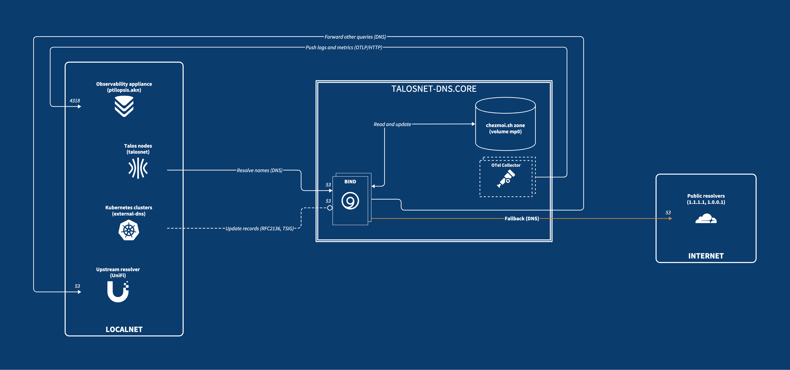

<p align="center">
  
</p>

<h1 align="center">「talosnet-dns.core」</h1>

<p align="center"><strong>LXC Proxmox — le DNS split-horizon du sous-réseau talosnet</strong></p>

<p align="center">
  
  
  
  
</p>

<p align="center">
  <a href="#services">Services</a> ·
  <a href="#architecture">Architecture</a> ·
  <a href="#accès">Accès</a> ·
  <a href="#configuration">Configuration</a> ·
  <a href="#déploiement">Déploiement</a> ·
  <a href="#contribuer">Contribuer</a> ·
  <a href="#pour-aller-plus-loin">Pour aller plus loin</a>
</p>

`talosnet-dns` est le serveur DNS du sous-réseau SDN `talosnet` de Proxmox : le DHCP de talosnet l'annonce comme
résolveur à tous les nœuds Talos (`dns.talosnet.chezmoi.sh`). Il sert deux besoins à partir d'un seul démon. Pour les
hôtes de la plateforme que talosnet doit joindre sans passer par le SNAT de Proxmox, il répond avec leur adresse côté
talosnet. Pour les services des clusters, il répond avec l'adresse de la Gateway `internal`, en réutilisant le nom
public (`*.chezmoi.sh`) que le service a déjà à l'extérieur. Tout le reste est transmis à des résolveurs amont. La place
de ce serveur dans la séparation des Gateways internal et external est décrite dans la
[référence Passerelles et DNS](../../../docs/reference/Passerelles-et-DNS-Reference.md).

## Services


### [BIND](https://www.isc.org/bind/)

Fait autorité sur la zone `chezmoi.sh` pour talosnet et résout le reste par transmission. Les nœuds Talos l'interrogent
en DNS ; `external-dns`, sur chaque cluster, y publie et y met à jour ses enregistrements `A` et `TXT` en RFC2136,
signés par une clé TSIG. La zone vit sur un volume persistant, de sorte que ces enregistrements survivent aux mises à
jour de l'image.

<br clear="all" />

## Architecture



BIND est le seul service : il lit et écrit sa zone sur le volume persistant, reçoit les requêtes des nœuds Talos et les
mises à jour d'`external-dns`, et transmet le reste à un résolveur amont (UniFi) puis, à défaut, à des résolveurs
publics. Le collecteur OpenTelemetry est la seule autre connexion sortante : il envoie logs et métriques à l'appliance
d'observabilité.

## Accès

BIND écoute sur le port 53 (TCP et UDP), sur l'interface talosnet (`10.128.0.3`, `eth1`) et sur le loopback. Il ne
répond qu'aux clients de `10.128.0.0/24` et au loopback ; l'interface `eth0` (VLAN 5, `10.0.0.26`) ne répond jamais aux
requêtes DNS. C'est le seul port ouvert du conteneur. Il n'y a pas de SSH : on administre la machine depuis l'hôte
Proxmox avec `pct enter <vmid>`. Les adresses sont répertoriées dans la
[référence IPAM](../../../docs/reference/IPAM-Reference.md).

## Configuration

La configuration est entièrement dans `nix/`. `configuration.nix` ne porte que l'identité du conteneur : son nom, son
adresse statique sur `eth0` (le VLAN 5 n'a pas de DHCP, sans adresse fixe l'interface retomberait en lien-local au
redémarrage) et celle de `eth1`, la seconde carte réseau ajoutée côté Proxmox sur le bridge `talosnet` (`firewall=0`).
Le reste est rangé par sujet dans `nix/modules/` : `bind.nix` pour BIND, `o11y-agent.nix` pour l'agent d'observabilité
du catalogue (`catalog.o11yAgent`) et `hardening.nix` pour les réglages sysctl, le pare-feu (seul le port 53 est
ouvert), la désactivation de SSH et un journal en mémoire.

La zone `chezmoi.sh` est le fichier `/var/lib/bind/chezmoi.sh.zone`, sur le volume persistant `mp0`. Elle a deux
sources. Les enregistrements statiques (`seedZone` dans `nix/modules/bind.nix` : `ns`, `dns.talosnet`, `pve-01.pve`,
`omni`, `api.omni`, `oci`, `data.o11y`, `s3`, `nas`) sont copiés depuis l'image au premier démarrage du volume
seulement, pour que les clients talosnet atteignent ces hôtes par leur adresse talosnet plutôt qu'en traversant les
zones SNAT/conntrack. `data.o11y` fait exception : il vise `10.0.0.32` (le Mac Studio `akn.ptilopsis`, sur le VLAN 5,
hors talosnet), joint à travers le SNAT de pve-01. Un redéploiement n'écrase jamais le fichier : modifier `seedZone` ne
touche qu'un volume neuf. Les enregistrements dynamiques viennent d'`external-dns`, qui publie le même nom
`*.chezmoi.sh` que celui de l'extérieur, pointé sur l'adresse talosnet de la Gateway `internal`. La clé TSIG
`external-dns.` peut mettre à jour les `A` et `TXT` de toute la zone et la transférer en AXFR, rien d'autre : une clé
compromise peut rediriger des noms mais pas prendre la zone. Tout ce que la zone ne couvre pas part vers `10.10.10.10`,
puis `1.1.1.1` et `1.0.0.1`.

L'agent d'observabilité envoie les logs du journal et les métriques de la machine en OTLP à `data.o11y.chezmoi.sh:4318`.
Ce nom est figé dans `/etc/hosts` sur `10.0.0.32`, la même adresse que dans la zone : l'envoi ne dépend donc pas de ce
résolveur, qui est celui qu'il surveille.

Le seul secret est `BIND_TSIG_SECRET`, dans `nix/secrets/bind.sops.env` (SOPS et age, règle de création dans
`.sops.yaml`). Il est intégré à l'image au moment du build, et la même valeur est utilisée par `external-dns-bind` sur
`rhodes.akn` et `lungmen.akn` (`kubernetes/src/system/external-dns/sops/bind.secret.yaml` de chaque cluster) : la
changer demande de mettre à jour les trois, sinon les mises à jour RFC2136 échouent en `NOTAUTH`. Sans le secret
(`nix build` seul), l'image se construit mais refuse les mises à jour dynamiques.

```text
.
├── README.md
├── architecture.d2           source du schéma
├── .mise.toml                tâche du schéma et documentation des tâches
├── .mise/tasks/lxc/          build, push, upgrade (bibliothèque partagée)
├── .sops.yaml                règle de création de nix/secrets/
├── assets/                   schéma généré, lien vers docs/assets/icons
└── nix/
    ├── flake.nix             build de l'image LXC, version CalVer
    ├── flake.lock
    ├── configuration.nix     nom, adresses statiques (eth0 et eth1)
    ├── modules/
    │   ├── default.nix
    │   ├── bind.nix          BIND, zone d'amorçage, clé TSIG et politique de mise à jour
    │   ├── o11y-agent.nix    logs et métriques vers l'observabilité
    │   └── hardening.nix     sysctl, pare-feu, accès
    └── secrets/
        └── bind.sops.env     BIND_TSIG_SECRET
```

## Déploiement

### Première installation

Aucun code Pulumi du dépôt ne crée ce LXC : la création est manuelle, une seule fois.

1. Construire l'image et la téléverser sur le nœud Proxmox (`mise run lxc:push -- <pve-host>` construit d'abord, voir
   [Mises à jour](#mises-à-jour)). Prérequis : `mise` approuvé, Docker (enveloppe du build Nix), `sops` avec la clé age
   du dépôt, accès SSH par clé au nœud Proxmox.
2. Créer le conteneur à partir de ce modèle avec deux cartes réseau : `eth0` sur le VLAN 5 (`10.0.0.26/22`) et `eth1`
   sur le bridge `talosnet` (`10.128.0.3/24`, `firewall=0`).
3. Ajouter le volume `mp0`, monté sur `/var/lib/bind`, appartenant à l'uid `100993` (l'utilisateur `named`, uid 993,
   avec le mappage par défaut des conteneurs non privilégiés de Proxmox).
4. Poser le tag PVE `talosnet-dns` : c'est lui, ou à défaut le nom d'hôte, qui permet à `lxc:upgrade` de retrouver le
   conteneur.
5. Démarrer le conteneur : BIND copie la zone d'amorçage sur le volume.

### Mises à jour

Incrémenter `version` dans `nix/flake.nix` (CalVer `AAAA.MM.JJ`, suffixe `-N` pour plusieurs builds le même jour), puis
:

```sh
mise run lxc:build                                    # construit l'image avec BIND_TSIG_SECRET intégré
mise run lxc:push -- <pve-host>                       # téléverse l'image sur Proxmox
mise run lxc:upgrade -- <pve-host> [--vmid <vmid>]    # mise à jour sur place du LXC en cours d'exécution
```

L'upgrade conserve le volume `mp0` monté sur `/var/lib/bind` (propriétaire `100993`), donc les enregistrements ajoutés
dynamiquement survivent. Le script redémarre `bind` et `o11y-agent`, et propose `dig @10.128.0.3 oci.chezmoi.sh` comme
test de bout en bout. La mécanique commune à tous les LXC est dans [`fleet/hosts/.mise/lib/lxc.sh`](../.mise/lib/lxc.sh)
et la
[procédure de mise à jour par échange du rootfs](../../../docs/procedures/infrastructure/INF-20260605-00-Mettre-a-Jour-un-LXC-par-Echange-du-Rootfs.md).

### Vérifier un déploiement

Depuis un hôte de talosnet :

- `dig @10.128.0.3 oci.chezmoi.sh` : renvoie l'adresse statique de la zone.
- `dig @10.128.0.3 example.com` : la transmission amont répond.
- Le nom d'un service publié par `external-dns` (par exemple `vault.chezmoi.sh`) : renvoie l'adresse talosnet de la
  Gateway `internal`, pas celle du VLAN 5.

Depuis un hôte du VLAN 5, `dig @10.0.0.26 oci.chezmoi.sh` ne doit pas répondre.

Dans le conteneur (`pct enter <vmid>`) : `systemctl status bind o11y-agent` montre les deux services actifs.

## Contribuer

`nix build`, lancé dans `nix/`, construit l'image sans secret (elle refuse alors les mises à jour dynamiques) ;
`mise run lxc:build` la construit avec `BIND_TSIG_SECRET`. Le code de build, de téléversement et de mise à jour est
partagé entre tous les LXC, dans `fleet/hosts/.mise/lib/lxc.sh` : on n'y touche pas depuis ce dossier (voir la skill
`lxc-maintenance`, `.agents/skills/lxc-maintenance/SKILL.md`). Le schéma se modifie dans `architecture.d2`, puis
`mise run diagram:generate` régénère `assets/architecture.png`, à commiter avec. Lancer `mise run lint` avant de
pousser.

## Pour aller plus loin

- [Passerelles et DNS](../../../docs/reference/Passerelles-et-DNS-Reference.md) : comment BIND s'intègre à la séparation
  des Gateways internal et external, et comment vérifier la résolution.
- [IPAM](../../../docs/reference/IPAM-Reference.md) : les adresses de `talosnet-dns` et de talosnet.
- [ADR-014](../../../docs/decisions/ADR-014-Separer-le-Trafic-des-Noeuds-Talos-du-VLAN-Homelab.md) : pourquoi talosnet
  existe, avec ses deux cartes réseau et son SNAT.
- [Mise à jour d'un LXC par échange du rootfs](../../../docs/procedures/infrastructure/INF-20260605-00-Mettre-a-Jour-un-LXC-par-Echange-du-Rootfs.md)
  : ce que fait `lxc:upgrade`.
- [Nommage des machines](../../../docs/reference/Nommage-des-Machines-Reference.md) : d'où vient le nom
  `talosnet-dns.core`.
