# `data.o11y.chezmoi.sh` — observability appliance

Proxmox LXC (CT 103 on `pve-01`, name `observability`) running NixOS and the VictoriaMetrics stack: metrics, logs,
traces and the existential alerts (watchdog / dead-man's switch). It lives outside every Kubernetes cluster's failure
domain, so signals and the heartbeat survive a cluster outage.

**One write path, OTLP/HTTP on `:4318`. Everything on `:443` is read-only.** Decisions:
[ADR-013](../../../../../../../docs/decisions/ADR-013-Observabilite-Centralisee-VictoriaMetrics-sur-LXC.md) (appliance)
and
[ADR-018](../../../../../../../docs/decisions/ADR-018-OTLP-comme-Protocole-d-Ingestion-Unique-pour-l-Appliance-d-Observabilite.md)
(OTLP ingest).



Source: [`o11y-datastore.d2`](./o11y-datastore.d2). Regenerate with `mise run diagram:generate`.

## Endpoints

Both ports are served on two listeners: the LAN name `data.o11y.chezmoi.sh` (TLS from Cloudflare DNS-01) and the tailnet
node `o11y-ep.<tailnet>.ts.net` (caddy-tailscale, TLS from Tailscale). No authentication: access control is the Proxmox
firewall (source CIDR) plus the tailnet.

| Port   | Purpose                | Path                                                | Goes to                                           |
| ------ | ---------------------- | --------------------------------------------------- | ------------------------------------------------- |
| `4318` | **Write** (OTLP/HTTP)  | `/v1/metrics`, `/v1/logs`, `/v1/traces`             | OTLP gateway, then the Victoria store of the type |
| `4318` | —                      | anything else                                       | `404` (bodies capped at 64 MiB)                   |
| `443`  | Landing page + 4 UIs   | `/`                                                 | `/etc/caddy/www/index.html`                       |
| `443`  | **Read** metrics       | `/metrics/*` (also `/metrics/prometheus/*`, vmui)   | VictoriaMetrics query API, vmui, flags, debug     |
| `443`  | **Read** logs          | `/logs/select/*`                                    | VictoriaLogs                                      |
| `443`  | **Read** traces        | `/traces/select/*`                                  | VictoriaTraces (Tempo + Jaeger APIs, vmui)        |
| `443`  | Alerts                 | `/alerts/*`                                         | Alertmanager (prefix kept)                        |
| `443`  | Write / import / admin | `/metrics/api/v1/write`, `import*`, `admin/*`, etc. | `403`                                             |
| `80`   | Redirect               | any                                                 | HTTPS                                             |

## Data flow

```text
sender ──OTLP (JSON or protobuf)──▶ Caddy :4318 ──/v1/*──▶ otlp-gateway 127.0.0.1:14318 ──protobuf──▶ VictoriaMetrics
                                                                                                    ├─▶ VictoriaLogs
                                                                                                    └─▶ VictoriaTraces
```

The OTLP gateway is an OpenTelemetry Collector. It exists because the Victoria stores only accept OTLP protobuf, while
some senders emit OTLP/JSON (the Proxmox VE metric server). It does nothing else: no enrichment, no parsing. Its
exporter queues are persisted in `/persistent/o11y/otlp-gateway`, so a store restart does not drop data.

Senders: the [`o11y-agent`](../../../../../../../catalog/nix/modules/o11y-agent/README.md) of every LXC (this one
included, see `modules/o11y-agent.nix`), the Proxmox VE host (its OpenTelemetry metric server pushes OTLP/JSON), and,
later, the cluster agents.

## Components

| Service         | Bind                   | Role                                                                                                                 |
| --------------- | ---------------------- | -------------------------------------------------------------------------------------------------------------------- |
| Caddy           | `:80`, `:443`, `:4318` | TLS, routing, read-only allowlist, tailnet listener. Metrics on `:2019`                                              |
| otlp-gateway    | `127.0.0.1:14318`      | OTLP JSON/protobuf in, protobuf out (OpenTelemetry Collector)                                                        |
| VictoriaMetrics | `127.0.0.1:8428`       | Metrics, 18 months retention                                                                                         |
| VictoriaLogs    | `127.0.0.1:9428`       | Logs, 30 days retention                                                                                              |
| VictoriaTraces  | `127.0.0.1:10428`      | Traces, 2 days retention                                                                                             |
| vmalert         | `127.0.0.1:8880`       | Evaluates the Watchdog rule ([`modules/fs/etc.vmalert.rules/`](./modules/fs/etc.vmalert.rules/), baked in the image) |
| Alertmanager    | `127.0.0.1:9093`       | Routes Watchdog to the external heartbeat, existential alerts to Slack                                               |
| o11y-agent      | none                   | Ships this LXC's journal and metrics (and scrapes the components above)                                              |

Per-cluster alerting and recording rules live in each cluster's own vmalert, not here. Grafana runs on `rhodes.akn`.

## Labels and fields

| Concept | Metrics (VictoriaMetrics) | Logs (VictoriaLogs) | Set by                                                          |
| ------- | ------------------------- | ------------------- | --------------------------------------------------------------- |
| Host    | `host.name`               | `host.name`         | Agent `resourcedetection`; `extraLabels.host_name` overrides it |
| Service | `service.name`            | `service.name`      | Logs: journald identifier. Metrics: scrape job name             |
| Cluster | `k8s.cluster.name`        | `k8s.cluster.name`  | Sender (resource attribute)                                     |

- Metric **names** are Prometheus-style (`system_cpu_load_average_1m`), but **labels keep their OTel dots**
  (`service.name`, `host.name`). VictoriaMetrics runs with `-opentelemetry.convertMetricNamesToPrometheus` and
  `-opentelemetry.promoteScopeMetadata=false` (no scope labels). MetricsQL accepts dotted labels unquoted:
  `{service.name="zot"}`.
- VictoriaLogs stream fields are `service.name,host.name`; `scope.name` and `scope.version` are dropped.
- Logs are raw (the message only). Parse at query time, for example `| unpack_json`.
- A service name differs between logs (journald identifier, `victoria-metrics`) and metrics (scrape job,
  `victoriametrics`): join logs and metrics on `host.name`, not on `service.name`.

## Send data

Point any OTLP/HTTP exporter at `https://data.o11y.chezmoi.sh:4318`; both `application/json` and
`application/x-protobuf` are accepted. LXC appliances use the shared agent (`catalog.o11yAgent`) instead of a custom
exporter.

```sh
# Smoke test: each path must not answer 404
for s in metrics logs traces; do
  curl -sS -o /dev/null -w "$s %{http_code}\n" -H 'Content-Type: application/json' \
    -d '{}' "https://data.o11y.chezmoi.sh:4318/v1/$s"
done
```

Apps that cannot push OTLP (Victoria components, Alertmanager, Caddy, zot, omni, pve-exporter) are scraped by the agent
of their LXC (`metrics.scrapeTargets`).

## Query data

| Signal  | Base URL                               | Examples                                    |
| ------- | -------------------------------------- | ------------------------------------------- |
| Metrics | `https://data.o11y.chezmoi.sh/metrics` | `/api/v1/query?query=up`, `/vmui/`          |
| Logs    | `https://data.o11y.chezmoi.sh/logs`    | `/select/logsql/query`, `/select/vmui/`     |
| Traces  | `https://data.o11y.chezmoi.sh/traces`  | `/select/tempo/api/search`, `/select/vmui/` |
| Alerts  | `https://data.o11y.chezmoi.sh/alerts`  | `/api/v2/alerts`, `/#/alerts`               |

```sh
curl -sSG 'https://data.o11y.chezmoi.sh/metrics/api/v1/query' \
  --data-urlencode 'query=count({host.name!=""}) by (host.name)' | jq .
curl -sSG 'https://data.o11y.chezmoi.sh/logs/select/logsql/query' \
  --data-urlencode 'query={host.name="o11y"}' --data-urlencode 'limit=5'
```

Grafana (`rhodes.akn`, `https://o11y.chezmoi.sh`) reads three datasources: Prometheus-type on `/metrics`, VictoriaLogs
on `/logs`, Tempo-type on `/traces/select/tempo`.

## Operations

All tasks are `mise` tasks run from this directory. Prerequisites: Docker (Nix build container), `sops` with the age key
(`SOPS_AGE_KEY_FILE`), SSH access as root to the Proxmox node.

| Task                                          | What it does                                                               |
| --------------------------------------------- | -------------------------------------------------------------------------- |
| `mise run lxc:secrets:sync`                   | Pull the Cloudflare and Tailscale tokens from Pulumi into `caddy.sops.env` |
| `mise run lxc:build`                          | Build `observability.<version>-amd64.tar.xz` with the secrets baked in     |
| `mise run lxc:push -- <pve-host>`             | Upload the template to Proxmox (runs `lxc:build` first)                    |
| `mise run lxc:upgrade -- <pve-host> --vmid N` | In-place upgrade: new rootfs, same `mp0` volume, Proxmox snapshot rollback |
| `mise run ui:dev`                             | Serve the landing page on `:8080` (UIs proxied to the live backend)        |
| `mise run diagram:generate`                   | Render `o11y-datastore.d2` to `o11y-datastore.svg`                         |

Release: bump `version` in `flake.nix` (CalVer `YYYY.MM.DD`, append `-N` for several builds a day), then `lxc:build`,
`lxc:push`, `lxc:upgrade`. The version only names the template; component versions follow the nixpkgs pin.

`ui:dev` needs `caddy` on `PATH`; `UI_PORT` and `UI_BACKEND` override the port and the backend.

Details of the shared build, push and upgrade flow: `.agents/skills/lxc-maintenance/SKILL.md`.

### Secrets

Two SOPS/age files baked into the image at build time. There is no ingest or query credential.

| File                             | Keys                                            | Source   |
| -------------------------------- | ----------------------------------------------- | -------- |
| `secrets/caddy.sops.env`         | `CLOUDFLARE_API_TOKEN`, `TAILSCALE_OAUTH_KEY`   | Pulumi   |
| `secrets/observability.sops.env` | `SLACK_WEBHOOK_URL`, `ALERTMANAGER_DEADMAN_URL` | operator |

Edit the operator file with `sops secrets/observability.sops.env`. Run `pulumi up` in
`projects/chezmoi.sh/src/infrastructure/pulumi` before `lxc:secrets:sync`, so the stack outputs exist.

### Create the container (first deployment)

The appliance is stateful: `mp0` (`/persistent`) holds metrics, logs, traces, Alertmanager state and the gateway queues.
Back it up (Proxmox snapshot of the dataset at least); the rootfs is rebuilt from the flake.

```sh
pct create <vmid> local:vztmpl/observability.<version>-amd64.tar.xz \
  --hostname observability --ostype nixos --arch amd64 --unprivileged 1 \
  --cores 2 --memory 4096 --swap 0 --rootfs local-zfs:4 --mp0 local-zfs:64,mp=/persistent \
  --net0 name=eth0,bridge=vmbr1,ip=10.0.0.22/22,gw=10.0.0.1,firewall=1,tag=5 --onboot 1
echo 'lxc.console.path: /dev/console' >> /etc/pve/lxc/<vmid>.conf
```

Before the first start, give `mp0` to the service users (unprivileged LXC, host uid = 100000 + container uid):
`pct mount <vmid>`, then `chown 100980:100980 /var/lib/lxc/<vmid>/rootfs/persistent` (`o11y` user) and create
`/persistent/caddy` owned by `100997` (`caddy` user); `pct unmount <vmid>`. `eth1` (`10.128.0.5/24`, bridge `talosnet`)
is a second NIC for the Talos nodes.

### Proxmox firewall

Source CIDR is the access control on the LAN path. In `/etc/pve/firewall/<vmid>.fw`: `policy_in: DROP`,
`policy_out: ACCEPT` (needed for Slack, the heartbeat, ACME and Tailscale), then accept TCP `443` and `4318` from the
homelab subnet, TCP `80` and UDP `41641` (direct Tailscale connections) from anywhere. The NixOS firewall opens the same
ports (`modules/hardening.nix`). The PVE syslog listener (`:5140`) belongs to the
[`pve-exporter`](../pve-exporter/README.md) LXC, not to this one.

## Troubleshooting

From the Proxmox host (the LXC has no SSH; `curl` and `jq` are installed):

```sh
pct exec <vmid> -- systemctl status caddy otlp-gateway victoriametrics victorialogs victoriatraces vmalert alertmanager o11y-agent
pct exec <vmid> -- journalctl -u otlp-gateway -n 50
pct exec <vmid> -- curl -s 127.0.0.1:9093/alerts/api/v2/alerts | jq .   # Alertmanager
pct exec <vmid> -- curl -s 127.0.0.1:8880/api/v1/alerts | jq .          # vmalert
```

| Symptom                                | Likely cause                                     | Fix                                                                    |
| -------------------------------------- | ------------------------------------------------ | ---------------------------------------------------------------------- |
| Push or query times out                | Source IP not allowed by the PVE firewall        | Add the source CIDR (`443`, `4318`) to `/etc/pve/firewall/<vmid>.fw`   |
| Push answers `404`                     | Wrong path or port                               | Use `:4318` with `/v1/{metrics,logs,traces}`                           |
| Query path answers `403`               | Write, import or admin path, or not in allowlist | Use a read endpoint listed in [Endpoints](#endpoints)                  |
| Push answers `4xx` with a body         | Malformed OTLP payload                           | Check `journalctl -u otlp-gateway` and the sender's exporter           |
| Data missing after a store restart     | Gateway queue still draining                     | Wait; queues persist in `/persistent/o11y/otlp-gateway`                |
| Caddy cannot issue the certificate     | Cloudflare token expired                         | `lxc:secrets:sync`, rebuild, upgrade                                   |
| Tailnet clients cannot connect         | tsnet auth failed                                | `journalctl -u caddy`; check `TS_AUTHKEY` and the `tag:o11y` OAuth key |
| Service fails with `Permission denied` | `mp0` not owned by `100980` / `100997`           | Re-run the ownership step above                                        |
| Heartbeat service keeps paging         | Watchdog not reaching `ALERTMANAGER_DEADMAN_URL` | Check egress and the URL                                               |

## Layout

```text
.
├── flake.nix                 image build + version
├── configuration.nix         identity, static network, `o11y` user, console toolbox
├── o11y-datastore.d2 / .svg  architecture diagram
├── modules/
│   ├── caddy.nix             Caddy service, secrets, tsnet state (config is fs/etc.caddy/Caddyfile)
│   ├── otlp-gateway.nix      service + build-time validation
│   ├── victoriametrics.nix   victorialogs.nix   victoriatraces.nix
│   ├── vmalert.nix           alertmanager.nix
│   ├── o11y-agent.nix        self-observability (catalog.o11yAgent)
│   ├── hardening.nix         sysctl, firewall, journald
│   └── fs/                   files installed in the image (see below)
│       ├── etc.caddy/Caddyfile                      TLS, :4318 routing, :443 read-only allowlist, tsnet
│       ├── etc.caddy/www/index.html                 landing page
│       ├── etc.otlp-gateway/config.yaml             OpenTelemetry Collector pipeline
│       └── etc.vmalert.rules/watchdog.rules.yaml    the only rule (dead-man's switch)
├── secrets/                  SOPS files
└── .mise.toml, .mise/tasks/lxc/  tasks
```

`modules/fs/` holds the files installed as-is into the image. The directory path is encoded with dots and file names are
kept: `modules/fs/etc.foo/bar.yaml` is installed at `/etc/foo/bar.yaml`. Here: `/etc/caddy/caddy_config` (the whole
Caddy config, used as `services.caddy.configFile`; the tokens come from the environment, `/etc/caddy/secrets`),
`/etc/caddy/www` (landing page), `/etc/otlp-gateway/config.yaml` (the gateway runs from it), `/etc/vmalert/rules`.
