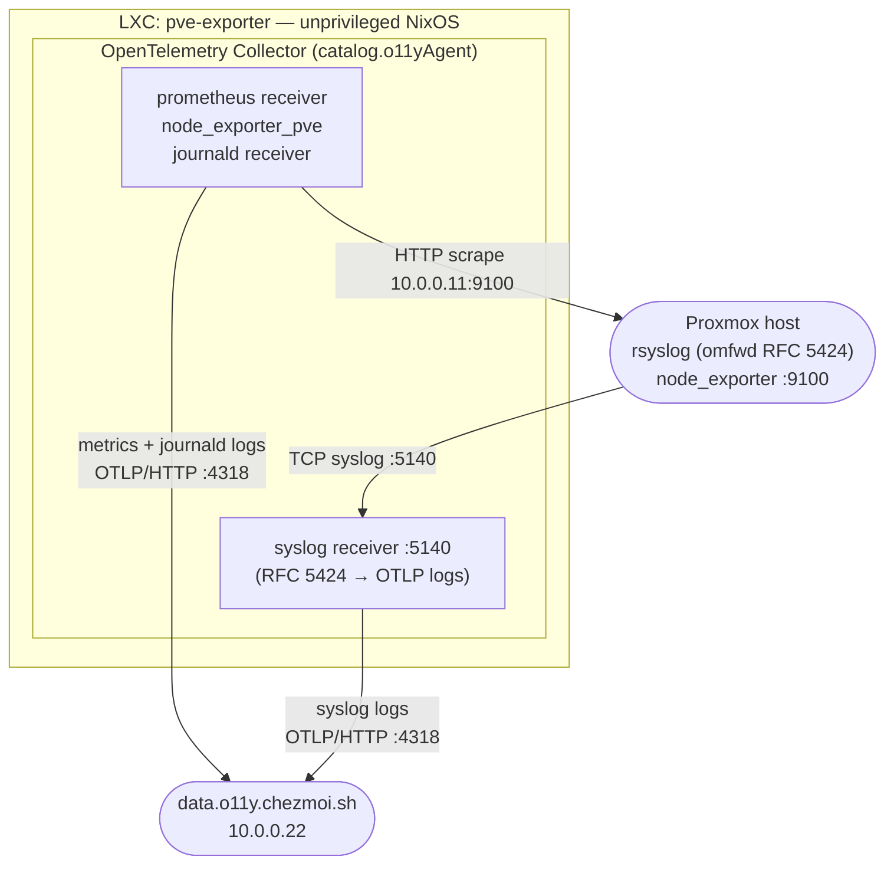

# `pve-exporter` — Proxmox VE Host Agent LXC (Proxmox)

Standalone Proxmox LXC running NixOS + OpenTelemetry Collector (`catalog.o11yAgent`). It is the observability agent of
the Proxmox VE host: it relays the host's syslog and scrapes the host's `node_exporter`, shipping everything as OTLP to
the central observability appliance (`data.o11y.chezmoi.sh`).

> **Historical name.** This LXC used to run `prometheus-pve-exporter`, which has been removed: it no longer produced any
> `pve_*` metric (failing API calls, gunicorn tracebacks, ~11.5k log lines/hour). Proxmox VE's own OpenTelemetry metric
> server now pushes node/VM/CT/storage metrics straight to o11y over OTLP (`job="proxmox-ve"`, `host.name=pve-01`; see
> [`Infrastructure-Manuelle-Reference.md`](../../../../../../../docs/reference/Infrastructure-Manuelle-Reference.md)).
> The hostname, CT and directory keep the `pve-exporter` name for now (see [Known gaps](#known-gaps--follow-ups)).

It owns **PVE syslog ingest**: the Proxmox host forwards its syslog here (not to o11y directly), and the agent's syslog
receiver turns RFC 5424 into OTLP logs. The o11y appliance only accepts OTLP/HTTP on `:4318` (ADR-018): it has no syslog
listener and no parser.

This container holds **no persistent data and no secrets** — it pushes outbound (everything as OTLP/HTTP to `:4318`) and
can be rebuilt and replaced at any time without data loss; the agent's on-disk queue only buffers during an appliance
outage. Its only inbound port is the syslog listener (`:5140`).

## Table of contents

1. [Architecture](#architecture)
2. [What's in this directory](#whats-in-this-directory)
3. [Prerequisites](#prerequisites)
4. [Build & deploy](#build--deploy)
5. [Proxmox LXC creation](#proxmox-lxc-creation)
6. [Proxmox host firewall](#proxmox-host-firewall)
7. [Proxmox host — syslog forwarding](#proxmox-host--syslog-forwarding)
8. [Hardening reference](#hardening-reference)
9. [Operations](#operations)
10. [Known gaps / follow-ups](#known-gaps--follow-ups)

## Architecture



- **OpenTelemetry Collector** (via `catalog.o11yAgent`) does three things: scrapes the PVE host's `node_exporter`
  (`10.0.0.11:9100`, job `node_exporter_pve`, attributed to `pve-01` through `extraLabels.host_name`), reads the systemd
  journal of the LXC, and runs a syslog TCP listener on `:5140` (`logs.syslog.enable`). Everything leaves as OTLP/HTTP
  to `https://data.o11y.chezmoi.sh:4318`.
- **PVE API metrics are not collected here.** The Proxmox VE OpenTelemetry metric server pushes them directly to o11y
  (`job="proxmox-ve"`); this LXC is not involved.
- **Syslog ingest** lives here, not on o11y. The agent's syslog receiver maps `appname` to `service.name` and `hostname`
  to `host.name`; messages are forwarded raw, with no per-service parser (see the
  [`catalog.o11yAgent` README](../../../../../../../catalog/nix/modules/o11y-agent/README.md)).
- **Only inbound port is `:5140`** (syslog). Metrics and logs are push-only. There is no Caddy, no TLS termination, no
  public surface.
- **`hostsOverride`** in `modules/o11y-agent.nix` resolves `data.o11y.chezmoi.sh` to the Proxmox bridge IP (`10.0.0.22`)
  inside the LXC, bypassing public DNS for the push paths.
- **No SSH.** Console access goes through `pct enter <vmid>` on the Proxmox host.

## What's in this directory

```text
.
├── README.md              ← you are here
├── flake.nix              ← LXC image build (nixos-rebuild build-image)
├── flake.lock             ← pinned inputs
├── configuration.nix      ← site identity, locale, console toolbox
├── .mise.toml             ← mise tasks header (tasks are file-based)
├── .mise/tasks/lxc/       ← build / push / upgrade scripts
├── modules/
│   ├── default.nix        ← module aggregator
│   ├── o11y-agent.nix     ← catalog.o11yAgent (node_exporter scrape + journald + syslog → o11y over OTLP)
│   └── hardening.nix      ← sysctl, firewall (only :5140), login surface, journald
```

## Prerequisites

- `mise` with the repo's `.mise.toml` trusted (`mise trust`).
- Docker (used by `nix:build:lxc` to wrap the Nix build).
- SSH key-based root access to the Proxmox node you push to.

## Build & deploy

### Versioning

The appliance uses **CalVer** (`YYYY.MM.DD`). The version is a static string in `flake.nix` — bump it to today's date
before every `lxc:build`. Append `-N` for multiple builds on the same calendar day.

```nix
# flake.nix — bump before each build
version = "2026.06.07";
```

```sh
mise run lxc:build           # build the LXC tarball (no secrets)
mise run lxc:push -- pve.lan # upload to /var/lib/vz/template/cache/
```

### Task reference

| Task                                                       | What it does                                     |
| ---------------------------------------------------------- | ------------------------------------------------ |
| `mise run lxc:build`                                       | Build the LXC tarball                            |
| `mise run lxc:push -- <pve-host>`                          | `scp` the tarball to Proxmox (`local` storage)   |
| `mise run lxc:upgrade -- <pve-host> [--vmid <id>] [--yes]` | Rootfs-swap upgrade of a running LXC (same VMID) |

### Retiring the Proxmox API identity

The former exporter identity (`prometheus@pve` user, `Exporter` role, `exporter` token and the root ACL) was managed by
Pulumi (`access/pve-exporter.ts`, now deleted). After this change is merged, run `pulumi up` on the `chezmoi.sh` stack:
it deletes the user, token, role and ACL from the Proxmox host. The SOPS secret and its tasks are already gone from the
repository.

## Proxmox LXC creation

The build emits `pve-exporter.<version>-amd64.tar.xz`. This LXC is **stateless** — no persistent data volume and no
pre-chown step needed.

```sh
VMID="<vmid>"   # pick an unused id — `pct list` shows used ones.
TEMPLATE=pve-exporter.<version>-amd64.tar.xz
NODE=pve.lan

ssh root@${NODE} pct create ${VMID} local:vztmpl/${TEMPLATE} \
    --hostname     pve-exporter \
    --description  "$(cat <<'EOF'
# Proxmox VE host agent
Ingests Proxmox host syslog (RFC 5424), scrapes the host node_exporter and ships everything to data.o11y.chezmoi.sh over OTLP. No inbound ports except :5140 (syslog TCP).
EOF
)" \
    --ostype       nixos \
    --arch         amd64 \
    --unprivileged 1 \
    --features     nesting=0,keyctl=0 \
    --cores        1 \
    --memory       256 \
    --swap         0 \
    --rootfs       nvme-lvm:2 \
    --net0         name=eth0,bridge=vmbr1,ip=10.0.0.24/22,gw=10.0.0.1,firewall=1,tag=5 \
    --onboot       1

# Wire the console device so `pct console <vmid>` works.
ssh root@${NODE} "echo 'lxc.console.path: /dev/console' >> /etc/pve/lxc/${VMID}.conf"

ssh root@${NODE} pct start ${VMID}
```

There is no data volume (`mp0`) and no service-owned directory outside the rootfs, so no pre-start chown step is needed.

### Resource sizing — starting values

\| Workload | Recommended | \| CPU | 1 vCPU | \| Memory | 256 MiB | \| Root disk (OS only) | 2 GiB (stateless, rebuilt
from flake) | \| Data volume | None | \| Swap | 0 (let OOM kill on overrun) |

The root disk holds the NixOS closure of the agent. Keep 2 GiB; if a future rebuild exceeds it bump with
`pct resize <vmid> rootfs +2G` before rebuilding.

## Proxmox host firewall

The only inbound port is `:5140` (syslog TCP), restricted to the homelab subnet.

```sh
VMID="<vmid>"
cat <<'EOF' >/etc/pve/firewall/${VMID}.fw
[OPTIONS]
enable: 1
policy_in: DROP
policy_out: ACCEPT
ndp: 1
dhcp: 1
log_level_in: nolog
log_level_out: nolog

[RULES]
# Syslog TCP ingest from the PVE host / LXCs on the bridge network.
IN ACCEPT -p tcp -dport 5140 -source 10.0.0.0/8 -log nolog # rsyslog omfwd (RFC 5424)
IN ACCEPT -p icmp -log nolog
EOF
pve-firewall restart
```

> Tighten `10.0.0.0/8` to the actual PVE host / bridge subnet if you can. The in-LXC NixOS firewall also opens `:5140`
> (`hardening.nix`) — both layers must allow it for syslog to reach the agent.

`policy_out: ACCEPT` is required for:

- The `node_exporter` scrape (HTTP to `10.0.0.11:9100`)
- The OTLP/HTTP push to `data.o11y.chezmoi.sh:4318`
- DNS, NTP

## Proxmox host — syslog forwarding

Point the Proxmox host's rsyslog at this LXC (not at o11y). Create `/etc/rsyslog.d/50-pve-exporter.conf` on the PVE
host:

```text
# Forward Proxmox host logs to the pve-exporter LXC (syslog TCP RFC 5424)
*.* action(
  type="omfwd"
  target="<pve-exporter-lxc-ip>"
  port="5140"
  protocol="tcp"
  template="RSYSLOG_SyslogProtocol23Format"
  queue.type="LinkedList"
  queue.size="5000"
  queue.saveOnShutdown="on"
  action.resumeRetryCount="-1"
)
```

Then validate and restart:

```sh
rsyslogd -N1 && systemctl restart rsyslog
```

The agent turns each RFC 5424 record into an OTLP log (`service.name` from `appname`, `host.name` from `hostname`) and
forwards it to o11y. Query it in VictoriaLogs at `https://data.o11y.chezmoi.sh/logs` (LogsQL, e.g.
`{host.name="pve-01"}`).

## Hardening reference

`modules/hardening.nix` is always active — same model as the OCI registry LXC:

| Layer                | What we change                                                                                                            |
| -------------------- | ------------------------------------------------------------------------------------------------------------------------- |
| **Login surface**    | No `sshd`, no autologin getty.                                                                                            |
| **Kernel sysctls**   | IP forwarding off, source-routing off, ICMP redirects off, SYN cookies on, rp_filter on, ptrace YAMA, SUID coredumps off. |
| **Services**         | Avahi, CUPS, Polkit, UDisks2 disabled with `mkForce`.                                                                     |
| **Docs**             | man-db / info / nixos-docs disabled.                                                                                      |
| **Journald**         | `Storage=volatile`, `RuntimeMaxUse=64M`, `ForwardToConsole=yes`.                                                          |
| **Firewall (NixOS)** | Default-deny; only TCP `:5140` (syslog) open.                                                                             |
| **Firewall (PVE)**   | Layered on top — `policy_in: DROP`, only TCP `:5140` from the bridge subnet.                                              |

### What we explicitly do **not** harden

Same caveats as `oci-registry`: mount-namespace options (`PrivateTmp`, `ProtectSystem`, …) fail in unprivileged LXC with
"step NAMESPACE … Permission denied" and are intentionally omitted. The layered NixOS + PVE firewalls (only `:5140`
inbound) compensate.

## Operations

### Inspecting live logs

```sh
ssh root@pve.lan pct exec <vmid> -- ssh root@pve.lan pct exec <vmid> -- journalctl -u o11y-agent -f   # OpenTelemetry Collector (catalog.o11yAgent)
```

> The collector unit is named `o11y-agent` (it is owned by `catalog.o11yAgent`).

### Verifying syslog ingest

```sh
# Confirm the agent is listening on :5140 inside the LXC:
ssh root@pve.lan pct exec <vmid> -- ss -tlnp | grep 5140

# After the PVE host rsyslog is configured, query forwarded logs in VictoriaLogs:
curl -sSf 'https://data.o11y.chezmoi.sh/logs/select/logsql/query' \
  --data-urlencode 'query={host.name="pve-01"}' | head
```

### Checking the node_exporter target

```sh
# From inside the LXC (via pct exec): the PVE host's node_exporter must answer.
ssh root@pve.lan pct exec <vmid> -- curl -s http://10.0.0.11:9100/metrics | head -5
```

### Verifying metrics reach the o11y appliance

```sh
# From an allow-listed homelab client:
curl -sSf 'https://data.o11y.chezmoi.sh/metrics/api/v1/query?query=node_load1{job="node_exporter_pve"}' | jq .
# → should return a non-empty result set (host.name=pve-01)
```

### Upgrading

The LXC is stateless — no data volume to preserve. Rebuild and swap the rootfs.

```sh
mise run lxc:build
mise run lxc:push -- pve.lan
mise run lxc:upgrade -- pve.lan <source_id> <target_id>
```

The upgrade script does a rootfs-swap and copies the PVE firewall config from the source CT. No `mp0` transfer needed.

### Backups

- **Image** — stateless: delete and recreate from the same flake for an identical result.
- **Secrets** — none.

## Known gaps / follow-ups

1. **`flake.lock` is seeded from the observability sibling.** This LXC shares the exact input set
   (`nixpkgs/nixos-26.05`, `arcane`) with `../o11y-datastore`, so its lock was copied from there to give a valid pin.
   Run `nix flake lock` here to refresh it independently when bumping inputs.

2. **Misleading name.** The LXC is no longer an exporter: it is the PVE host's agent. Rename it (hostname, CT,
   directory, flake `pname`, rsyslog `target`) or replace it with a dedicated agent LXC or a collector on the host.
   Deferred to a follow-up.

3. **No alert if the agent goes silent.** If the LXC dies, the o11y appliance stops receiving the PVE-host syslog and
   `node_exporter_pve` metrics without notification. The appliance's vmalert only evaluates the watchdog today; an
   `up{job="node_exporter_pve"} == 0` rule (label names to verify, see the o11y README) would close this gap.

4. **Syslog mapping is not unit-tested.** The `transform/syslog` statements of `catalog.o11yAgent` are only checked by
   `otelcol-contrib validate` at build time (syntax, not behavior). Verify with the LogsQL query above after a change.

5. **No NixOS smoke test.** A `pkgs.testers.runNixOSTest` that boots the LXC, asserts `o11y-agent.service` is active and
   listening on `:5140` would catch module regressions before they reach Proxmox.
